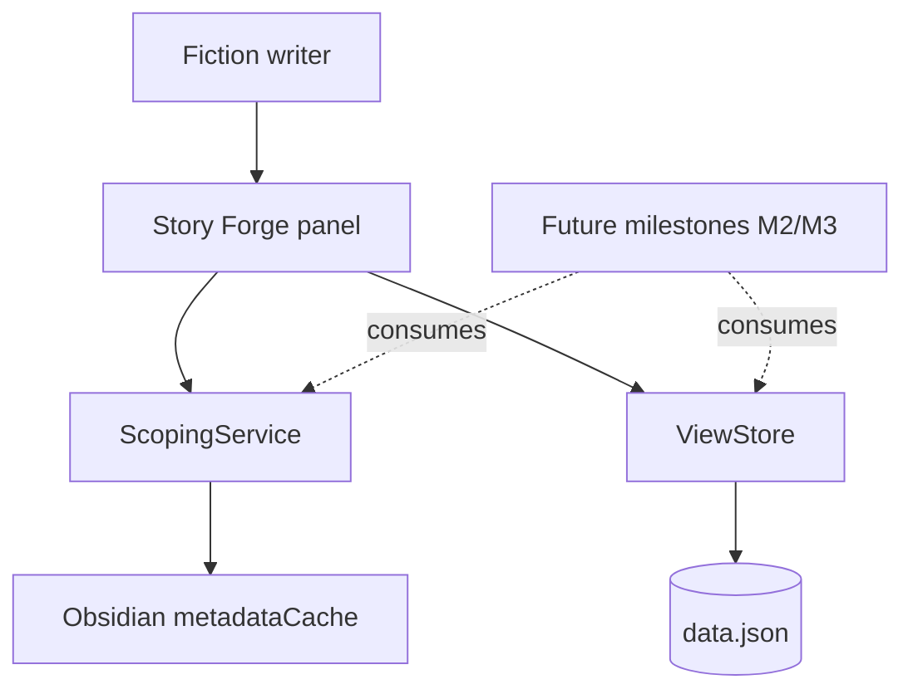
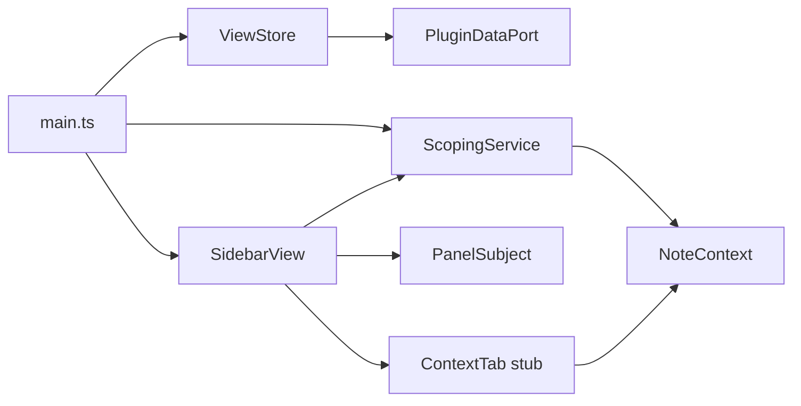
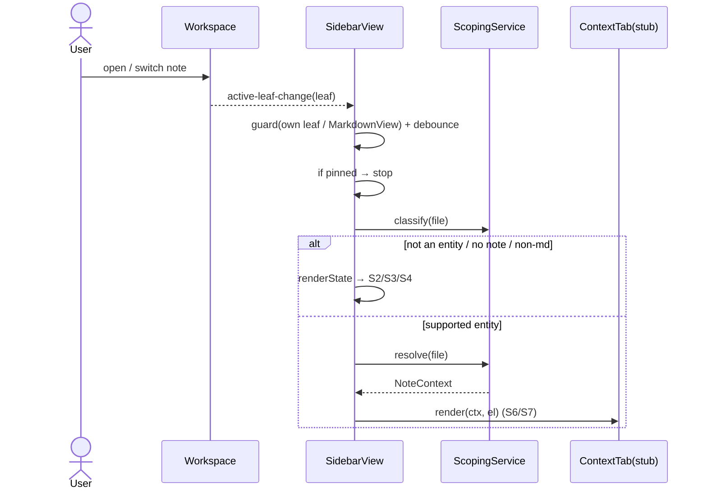
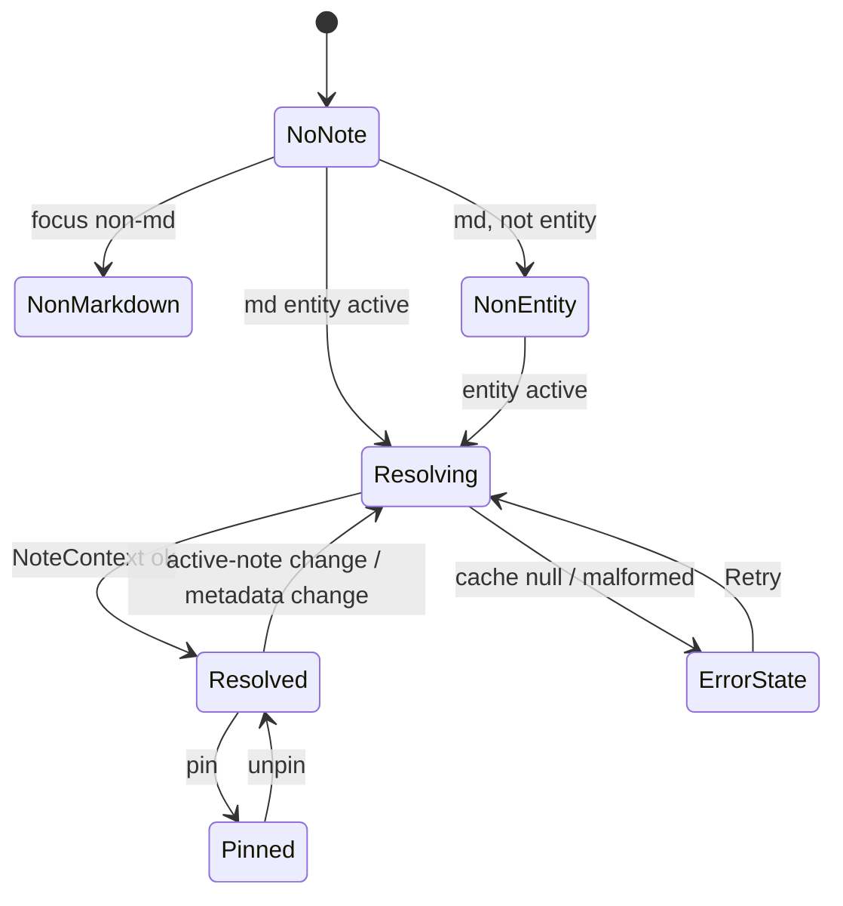

# Solution Design Document

## Validation Checklist

### CRITICAL GATES (Must Pass)
- [x] All required sections are complete
- [x] No [NEEDS CLARIFICATION] markers remain
- [x] Architecture pattern is clearly stated with rationale
- [x] **All architecture decisions confirmed by user** (ADR-1…6 confirmed 2026-07-13)
- [x] Every interface has specification

### QUALITY CHECKS (Should Pass)
- [x] Context sources listed with relevance
- [x] Project commands discovered from package.json
- [x] Constraints → Strategy → Design path is logical
- [x] Every component has a directory mapping
- [x] Error handling covers all error types
- [x] Quality requirements are specific and measurable
- [x] Component names consistent across diagrams
- [x] A developer could implement from this design

---

## Constraints

- **CON-1** — Obsidian plugin, `minAppVersion` 1.5.7, `isDesktopOnly: false` (must run on mobile: no Node/Electron APIs, no main-thread-blocking work). TypeScript + esbuild; vitest; `eslint-plugin-obsidianmd` 0.3.0 already wired.
- **CON-2** — Community-submission rules from the start: all listeners/timers via `register*` hooks; `console.debug` only; XSS-safe DOM (no `innerHTML` with untrusted data); no sample-plugin residue.
- **CON-3** — **Frontmatter-truth principle**: M1 is read-only; the plugin never owns canonical state. Only view *config* persists (in `data.json`), never canon.
- **CON-4** — No network, no telemetry in M1.
- **CON-5** — Scope is M1 only (view store + scoping + panel shell). No query engines, consent, write-back, backlinks index, or real view content (those are M2–M6).

## Implementation Context

### Required Context Sources

#### Documentation Context
```yaml
- doc: docs/build-plan.md
  relevance: HIGH
  why: "M1 milestone scope + exit criteria"
- doc: docs/views-and-integration.md
  relevance: HIGH
  why: "Two surfaces; contextual panel behaviour"
- doc: docs/DESIGN.md
  relevance: HIGH
  why: "§3 view-store shape, §4 query-engine seam"
- doc: docs/XDD/specs/001-core-infrastructure/requirements.md
  relevance: CRITICAL
  why: "The PRD this design must satisfy"
- doc: docs/XDD/specs/001-core-infrastructure/mockups.html
  relevance: CRITICAL
  why: "Interface source of truth — panel states S1–S10"
```

#### Code Context
```yaml
- file: src/main.ts
  relevance: HIGH
  why: "Plugin entry — lifecycle wiring only (keep thin); loadSettings/saveData live here"
- file: src/settings/SettingsTab.ts
  relevance: MEDIUM
  why: "Existing settings surface the store extends"
- file: src/types/index.ts
  relevance: MEDIUM
  why: "Placeholder PluginSettings the store replaces/extends"
- file: package.json
  relevance: MEDIUM
  why: "Build/test/lint commands + deps"
```

#### Reference Implementations (read-only, not vendored)
```yaml
- ref: markdown-mason src/scripts/store.ts (+ store.test.ts)
  relevance: CRITICAL
  why: "The exact store pattern M1 clones (rename script→view)"
- ref: Storyline SceneInspectorView.ts / DetailsView.ts / main.ts (activateView, active-leaf-change)
  relevance: HIGH
  why: "Proven single-tabbed-ItemView follow pattern"
```

### External APIs
None. M1 integrates only with the **Obsidian API** (in-process) and, as a *deferred* seam, the Dataview plugin (feature-detected in M2 — not called in M1).

### Implementation Boundaries
- **Must Preserve:** the thin-`main.ts` convention (`src/CLAUDE.md`); green `build`/`lint`/`typecheck`/`schema:check`.
- **Can Modify:** `src/types/index.ts` (fold settings into the store data shape), `src/main.ts` (wire the new modules).
- **Must Not Touch:** the `test/StoryForge/` vault content (read-only fixture); canon notes are never written.

### External Interfaces

#### System Context Diagram


#### Interface Specifications
```yaml
inbound:
  - name: "Obsidian workspace events"
    type: in-process event
    events: [active-leaf-change, metadataCache 'changed', metadataCache 'resolved', onLayoutReady]
    data_flow: "Signals that drive the panel's follow behaviour"
outbound:
  - name: "Obsidian metadataCache (read)"
    type: in-process API
    data_flow: "Read frontmatter + frontmatterLinks; resolve link targets"
    criticality: HIGH
data:
  - name: "data.json (Plugin.loadData/saveData)"
    type: JSON blob (shared with settings)
    data_flow: "View configuration persistence (read-modify-write)"
```

### Project Commands
```bash
Install: npm install
Dev:     npm run dev            # esbuild watch → deploys into test/StoryForge/.obsidian/plugins/story-forge/
Test:    npm test              # vitest run
Lint:    npm run lint          # eslint src/ + stylelint
Typecheck: npm run typecheck   # tsc --noEmit
Build:   npm run build         # tsc check + esbuild production
Schema:  npm run schema:check  # frontmatter schema drift gate
```

## Solution Strategy

- **Architecture Pattern:** modular, layered inside a single plugin — a thin entry (`main.ts`) wiring three decoupled modules: a **persistence layer** (`ViewStore`), a **domain/resolution layer** (`ScopingService`, framework-free and unit-testable), and a **presentation layer** (`SidebarView` + tab renderers). The domain layer has no Obsidian-view coupling so it is testable and reusable by M2/M3.
- **Integration Approach:** register one right-sidebar `ItemView`; subscribe to workspace/metadata events (all via `registerEvent`); resolve the active note through `ScopingService`; hand a plain `NoteContext` to the current tab renderer (M1: a stub).
- **Justification:** matches the frontmatter-truth principle (read-only domain), the mason-proven store, and the Storyline-proven single-tabbed-view; keeps the Dataview/Bases engines as a later seam without polluting M1.
- **Key Decisions:** see ADR-1…6.

## Building Block View

### Components


### Directory Map
```
.
├── src/
│   ├── main.ts                 # MODIFY: wire store+scoping+view; register view; onLayoutReady
│   ├── constants.ts            # NEW: SIDEBAR_VIEW_TYPE, ICON, DEBOUNCE_MS
│   ├── store/
│   │   ├── ViewStore.ts        # NEW: getViews/setRecord/deleteRecord + applyDefaults (mason clone)
│   │   └── types.ts            # NEW: ViewRecord, StoryForgeData, PluginDataPort
│   ├── scoping/
│   │   ├── ScopingService.ts   # NEW: resolve(file)→NoteContext, classify(file)→EntityKind
│   │   └── NoteContext.ts      # NEW: EntityKind, ResolvedEntity, NoteContext types
│   ├── views/
│   │   ├── SidebarView.ts      # NEW: ItemView shell — subject, header, tabs, states, pin
│   │   └── StubContextTab.ts   # NEW: M1 stub renderer (dumps NoteContext)
│   └── settings/               # existing (SettingsTab, HeaderSection) — store data folds in
└── test/
    ├── store/ViewStore.test.ts     # NEW: round-trip, defaults, sibling-preservation, delete
    └── scoping/ScopingService.test.ts # NEW: classify + resolve over fixture metadata
```

### Interface Specifications (inline)

#### Application Data Models
```typescript
// src/store/types.ts  — cloned from markdown-mason store.ts (script→view), + engine discriminant
export interface ViewRecord {
  provenance: "curated" | "imported";
  enabled: boolean;
  okayed: { version: number; checksum: string } | null; // consent slot (M2); null until okayed
  source: string;                                        // vault path or catalog ref
  engine: "bases" | "dataview-dql" | "dataviewjs";       // DESIGN §4
  command: boolean;                                      // view can bind a command
  description?: string;                                  // catalog blurb
  commandName?: string;                                  // user-chosen palette label
}

// Top-level data.json — shared blob with settings (mason PluginData shape)
export interface StoryForgeData {
  settings?: StoryForgeSettings;              // existing settings fold in here
  views?: Record<string, ViewRecord>;         // keyed by view id — NOT an array, NO schemaVersion
}

export interface PluginDataPort {             // injected Obsidian IO — makes ViewStore testable
  load(): Promise<unknown>;
  save(data: unknown): Promise<void>;
}
```

```typescript
// src/scoping/NoteContext.ts — the engine-free contract M2/M3 bind to
export type EntityKind =
  | "character" | "location" | "object" | "lore" | "scene" | "plotline" | "unknown";

export interface ResolvedEntity {
  file: TFile;
  kind: EntityKind;
  relation: "outgoing" | "backlink" | "self";
  field?: string;          // source frontmatter key: 'pov' | 'characters' | 'location' | ...
  unresolved?: boolean;    // link text that resolves to no file
}

export interface NoteContext {
  activeFile: TFile;
  activeKind: EntityKind;
  entities: ResolvedEntity[];   // outgoing relations, classified (M1)
  backlinks: ResolvedEntity[];  // seam — EMPTY in M1, filled in M3
  resolvedAt: number;           // millis, for debounce/staleness
}
```

#### Internal API (module methods)
```typescript
// src/store/ViewStore.ts
export class ViewStore {
  constructor(port: PluginDataPort);
  getViews(): Promise<Record<string, ViewRecord>>;   // reads data.views ?? {}, applies defaults
  setRecord(id: string, rec: ViewRecord): Promise<void>; // read-modify-write; preserves settings
  deleteRecord(id: string): Promise<void>;            // absent id = safe no-op
  // private applyDefaults(rec): ViewRecord — fail-closed (bad okayed→null, missing→disabled)
}

// src/scoping/ScopingService.ts  (framework-light: takes MetadataCache-like deps)
export class ScopingService {
  constructor(app: App);
  classify(file: TFile): EntityKind;          // tag-first, frontmatter `type` fallback
  resolve(file: TFile): NoteContext;          // outgoing relations only (M1)
}

// src/views/SidebarView.ts
export type SubjectSource = "follow" | "pinned"; // M3 adds "focused"
export interface PanelSubject { file: TFile | null; source: SubjectSource; }

export class SidebarView extends ItemView {
  getViewType(): string;  getDisplayText(): string;  getIcon(): string;
  onOpen(): Promise<void>;  onClose(): Promise<void>;
  private setSubject(file: TFile | null, source: SubjectSource): void;
  private renderState(): void;   // maps subject/context → one of mockup states S1–S9
  private togglePin(): void;
}

export interface ContextTab {                  // M1: one StubContextTab; M2+ swap engines in
  id: string;
  render(ctx: NoteContext, el: HTMLElement): void;
}
```

#### Data Storage Changes
`data.json` gains a top-level `views: Record<string, ViewRecord>` alongside the existing `settings`. No migration (mason precedent); partial/legacy records are repaired by fail-closed `applyDefaults` on read.

#### Integration Points
```yaml
- from: SidebarView
  to: ScopingService
  protocol: in-process method call
  data_flow: "resolve(activeFile) → NoteContext"
- from: SidebarView / future engines
  to: ViewStore
  protocol: in-process async
  data_flow: "enabled/consent/provenance config (M1 reads; M2+ writes)"
- seam (deferred to M2):
  to: Dataview plugin
  detection: app.plugins.getPlugin('dataview') behind one adapter; NOT called in M1
```

### Implementation Examples

#### Example: fail-closed defaults on store read (why: prevents a malformed record from enabling an unconsented view)
```typescript
// Strategic example — mirrors mason parseOkayed/applyDefaults. Not prescriptive.
function applyDefaults(raw: Partial<ViewRecord> | undefined): ViewRecord {
  return {
    provenance: raw?.provenance === "imported" ? "imported" : "curated",
    enabled: raw?.enabled === true,
    okayed: parseOkayed(raw?.okayed),          // any malformed shape → null (not consented)
    source: typeof raw?.source === "string" ? raw.source : "",
    engine: isEngine(raw?.engine) ? raw!.engine! : "bases",  // unknown → safe default
    command: raw?.command === true,
    description: raw?.description, commandName: raw?.commandName,
  };
}
```

#### Example: classify a note (why: the "what kind of entity" rule the whole panel keys off)
```typescript
// tag-first (canon/*, manuscript/scene, planning/*), frontmatter `type` as fallback.
classify(file: TFile): EntityKind {
  const cache = this.app.metadataCache.getFileCache(file);
  const tags = getAllTags(cache ?? {}) ?? [];                     // e.g. "#canon/character"
  if (tags.includes("#canon/character")) return "character";
  // …location/object/lore, "#manuscript/scene" → scene, "#planning/plotline" → plotline
  const t = cache?.frontmatter?.type;                            // fallback
  return isEntityKind(t) ? t : "unknown";
}
```

#### Test Examples as Interface Documentation
```typescript
// ViewStore round-trip + fail-closed (documents the persistence contract)
it("round-trips a record and preserves settings", async () => {
  const port = fakePort({ settings: { theme: "x" } });
  const store = new ViewStore(port);
  await store.setRecord("v1", rec({ enabled: true }));
  expect((await port.load() as StoryForgeData).settings).toEqual({ theme: "x" }); // sibling kept
  expect((await store.getViews())["v1"].enabled).toBe(true);
});
it("coerces a malformed okayed to null (not consented)", async () => {
  const store = new ViewStore(fakePort({ views: { v1: { okayed: 42 } } }));
  expect((await store.getViews())["v1"].okayed).toBeNull();
});
```

## Runtime View

### Primary Flow: the panel follows the active note
1. User switches to a note → `active-leaf-change` fires.
2. Guard: ignore if the leaf is the panel's own or not a `MarkdownView`.
3. Debounce (~200 ms) to coalesce rapid switches.
4. If subject source is `pinned`, ignore the change.
5. `classify(file)` → if `unknown`/non-markdown/none → render the matching empty state (S2–S4).
6. `resolve(file)` → `NoteContext` → hand to the current tab's `render()` (S6/S7 stub); errors → S9.



### Error Handling
- **No active note / non-markdown leaf** → empty states S2/S3 (no error).
- **Not an entity** → S4 chrome (not an error).
- **`getFileCache` null (pre-index) / malformed frontmatter** → S9 error state with **Retry**; logged at `console.debug`; never thrown to the UI.
- **Unresolved relation link** → the entity is marked `unresolved: true` and listed; resolution continues.
- **Corrupt/partial `data.json`** → `applyDefaults` repairs on read; next `setRecord` rewrites cleanly.
- **Metadata not ready at startup** → first resolve deferred to `workspace.onLayoutReady`.

### Complex Logic — follow pipeline
```
ON active-leaf-change(leaf) OR metadataCache.changed(file==subject):
  IF leaf is own panel OR not MarkdownView: RETURN
  DEBOUNCE 200ms:
    IF subject.source == "pinned": RETURN
    file := activeMarkdownFile
    kind := classify(file)
    IF kind in {none, non-markdown, unknown}: renderEmpty(kind); RETURN
    TRY ctx := resolve(file) CATCH: renderError(); RETURN
    subject := {file, source:"follow"}; currentTab.render(ctx)
```

## Deployment View

### Single Application Deployment
- **Environment:** runs inside Obsidian (desktop + mobile) as a community plugin; no server, no build-time backend.
- **Configuration:** none required by the user for M1; `data.json` is created on first store write.
- **Dependencies:** Obsidian ≥ 1.5.7. Dataview is *not* a dependency in M1.
- **Performance:** active-note follow is pure metadata reads + one debounced render; target imperceptible (<1 animation frame after debounce).

### Multi-Component Coordination
No change — single plugin, no multi-service coordination.

## Cross-Cutting Concepts

### User Interface & UX
**The interface is defined visually in `mockups.html` (states S1–S10) — the source of truth.** This SDD does not re-describe layout.
- **Information Architecture:** one right-sidebar panel; header (note title + entity-type badge + pin) → tab strip → state-dependent body. Drill-in breadcrumb/▾/‹pill› navigation is designed (S10) but **built in M3**.
- **Design System:** native Obsidian classes/tokens (`.pane-empty` idiom, workspace-leaf styling, CSS variables); no custom framework.
- **Interaction/State:** the panel is a small state machine (below); pin overrides follow; selected tab persists across note changes.
- **Accessibility:** `role=region`/`tablist`/`tab`/`tabpanel`; arrow-key tab nav; `aria-live=polite` for state changes; pin is a real `<button aria-pressed>`; respect `prefers-reduced-motion`.

#### Component States


### System-Wide Patterns
- **Error Handling:** local, non-throwing; every failure maps to a visible state or a silent `console.debug`.
- **Performance:** debounce follow; no eager vault scan in M1 (backlinks deferred); metadata-only reads.
- **Lifecycle/Leaks (submission-critical):** all `workspace.on`/`metadataCache.on` via `this.registerEvent`; intervals via `registerInterval`; DOM listeners via `registerDomEvent`; state cleared in `onClose`.
- **i18n/L10n:** out of scope (English UI, sentence-case per obsidian-plugin rules).
- **Logging:** `console.debug` only.

### New Pattern Created
- `docs/patterns/subject-source.md` *(implicit, documented here)*: the panel renders a **subject** whose source is `follow | pinned` (M1) and later `focused` (M3). Pin is the M1 proof of "subject ≠ active note"; drill-in reuses the same seam.

## Architecture Decisions

- [x] **ADR-1 — View store clones markdown-mason `store.ts`.** Flat `Record<id, ViewRecord>` in `data.json` (shared with settings), **no `schemaVersion`/migration**, immediate save on mutation, injected `PluginDataPort`, fail-closed `applyDefaults`; add an `engine` discriminant.
  - Rationale: battle-tested sibling pattern with tests; resolves the Technical-vs-mason record-shape conflict toward proven code; avoids inventing migration we don't need.
  - Trade-offs: no forward-migration scaffolding (accepted — defensive defaults cover partial records); record shape is "flat" not envelope.
  - User confirmed: Yes (2026-07-13)

- [x] **ADR-2 — Single tabbed `ItemView` with a subject abstraction** (not multiple workspace leaves). Tabs are internal DOM; subject source `follow | pinned` now, `focused` in M3.
  - Rationale: Storyline-proven; one active-file listener, simpler cleanup; pin/drill-in fall out of one seam.
  - Trade-offs: pop-out-to-own-pane deferred; all views share one leaf.
  - User confirmed: Yes (2026-07-13)

- [x] **ADR-3 — Scoping via `metadataCache` only; `NoteContext` is engine-free plain data.** Outgoing relations from `frontmatter` + `frontmatterLinks` → `getFirstLinkpathDest`; `resolvedLinks` NOT used for scoping (mixes prose links); **backlinks deferred to M3** (seam present, empty).
  - Rationale: correct for the `_forge` typed-relation model; unit-testable without a vault; avoids the unstable `getBacklinksForFile`; keeps M2/M3 bound to one plain contract.
  - Trade-offs: "appears in" not demonstrable until M3; a later `NoteContext` field addition is a cross-milestone touch (mitigated by finalizing it here).
  - User confirmed: Yes (2026-07-13)

- [x] **ADR-4 — Classification is tag-first, `type`-fallback.** `#canon/*`, `#manuscript/scene`, `#planning/*` primary; frontmatter `type` as fallback.
  - Rationale: seed notes carry both; tags are the query key Bases/Dataview use later; robust to either being absent.
  - Trade-offs: a note with neither is `unknown` (correct — S4).
  - User confirmed: Yes (2026-07-13)

- [x] **ADR-5 — Follow lifecycle: `active-leaf-change` (guarded) + `metadataCache.on('changed')`, debounced, gated on `onLayoutReady`.** Primary trigger `active-leaf-change` (ignore own leaf / non-`MarkdownView`); refresh shown note on its metadata change; ~200 ms debounce; first resolve after layout-ready; everything via `registerEvent`.
  - Rationale: matches Obsidian norms and Storyline; correct first render; no leaks; no flicker on rapid switches.
  - Trade-offs: ~200 ms perceptible settle on switch (accepted; tunable).
  - User confirmed: Yes (2026-07-13)

- [x] **ADR-6 — Store persists only on user-initiated mutations; never persists `NoteContext`.** Read-modify-write preserving `settings`; the follow pipeline writes nothing to `data.json`.
  - Rationale: avoids racing Obsidian Sync on `data.json`; `NoteContext` is derived and cheap to recompute.
  - Trade-offs: none material for M1.
  - User confirmed: Yes (2026-07-13)

## Quality Requirements
- **Performance:** follow render imperceptible (<1 frame after the ~200 ms debounce); no eager vault scan; metadata-only reads.
- **Usability:** every situation shows an explicit state (S1–S9), never a blank pane; pin holds across navigation; accessible per the UX section.
- **Reliability:** zero listener/timer leaks on unload/detach (asserted); corrupt `data.json` never loses sibling settings; malformed frontmatter never throws to the UI.
- **Portability:** works on mobile (no desktop-only APIs); green `build`/`lint`/`typecheck`/`schema:check`.

## Acceptance Criteria (EARS)

**Panel shell — PRD Feature 1**
- [ ] WHEN the user invokes the ribbon icon or the open command, THE SYSTEM SHALL dock one panel in the right sidebar with a stable title and icon.
- [ ] WHEN the active markdown note changes, THE SYSTEM SHALL update the header (title + entity type) and body state within one debounce interval.
- [ ] WHILE no markdown note is active, THE SYSTEM SHALL show the "no note" state (S2).
- [ ] WHEN a non-markdown file is focused, THE SYSTEM SHALL show the "follows markdown notes" state (S3).
- [ ] IF the active note is not a tracked entity, THEN THE SYSTEM SHALL show the "not a story entity" state (S4).
- [ ] WHEN several note switches occur within the debounce window, THE SYSTEM SHALL render only the last note.
- [ ] WHEN the plugin unloads or the leaf detaches, THE SYSTEM SHALL remove all registered listeners and timers.

**Pin — PRD Feature 2**
- [ ] WHILE the panel is pinned, THE SYSTEM SHALL ignore active-note changes and keep the pinned subject.
- [ ] WHEN the user unpins, THE SYSTEM SHALL resume following the active note.

**Entity-context resolution — PRD Feature 3**
- [ ] WHEN a scene note is resolved, THE SYSTEM SHALL produce a NoteContext listing each outgoing relation's target, source field, and classified kind.
- [ ] IF a relation link resolves to no file, THEN THE SYSTEM SHALL mark it unresolved and continue.
- [ ] WHEN the shown note's metadata changes, THE SYSTEM SHALL re-resolve and re-render without a note switch.
- [ ] THE SYSTEM SHALL resolve a NoteContext from fixture metadata in a unit test without Obsidian.

**View store — PRD Feature 4**
- [ ] WHEN a record is saved and the plugin reloads, THE SYSTEM SHALL return the record intact.
- [ ] IF a stored record is malformed, THEN THE SYSTEM SHALL apply fail-closed defaults (disabled, not consented).
- [ ] WHEN a record is written, THE SYSTEM SHALL preserve sibling settings in data.json.
- [ ] WHEN a record is deleted, THE SYSTEM SHALL no longer return it; deleting an absent id SHALL be a no-op.

## Risks and Technical Debt

### Known Technical Issues
- `getFileCache` can be `null` before the metadata index is ready → first resolve gated on `onLayoutReady`; otherwise render error/empty, never throw.

### Technical Debt
- `NoteContext.backlinks` ships empty in M1 (seam) — intentional; filled in M3. Documented so M3 doesn't treat it as a bug.
- `engine` default (`"bases"`) in `applyDefaults` is a placeholder until real views exist (M2+).

### Implementation Gotchas
- Guard `active-leaf-change` against the panel's own leaf, or focusing the panel resets it.
- Prefer `metadataCache.on('changed')` over `vault.on('modify')`+`setTimeout` — the cache is already reparsed.
- The only sanctioned `app as any` cast (Dataview detect) is **M2**, not M1 — keep M1 cast-free.
- Do not persist on the follow path — only on store mutations (Sync race).

## Glossary

### Domain Terms
| Term | Definition | Context |
|------|------------|---------|
| Entity | A canonical `_forge` note (character/location/object/lore) | What the panel classifies + resolves |
| Subject | The entity the panel currently displays | May differ from the active note (pin/drill-in) |
| Drill-in | Focusing a linked entity within the panel | Designed S10, built in M3 |

### Technical Terms
| Term | Definition | Context |
|------|------------|---------|
| NoteContext | Engine-free struct of a note's resolved relations | The M2/M3 contract |
| ViewRecord | Persisted per-view config | data.json `views` map |
| PluginDataPort | Injected load/save abstraction | Makes ViewStore unit-testable |
| Fail-closed | Malformed config coerces to the safe (disabled/unconsented) value | Store defaults |

### API/Interface Terms
| Term | Definition | Context |
|------|------------|---------|
| `frontmatterLinks` | metadataCache FileCache entries for `[[links]]` inside frontmatter values | How typed relations are read |
| `active-leaf-change` | Workspace event on focus/leaf switch | Primary follow trigger |
| ItemView | Obsidian dockable view base class | The panel shell |
