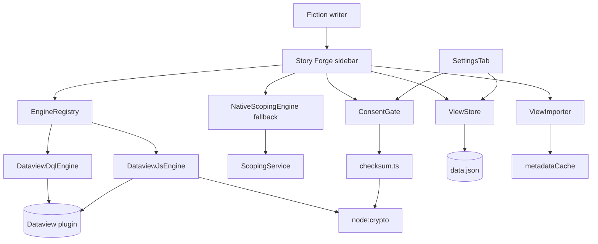
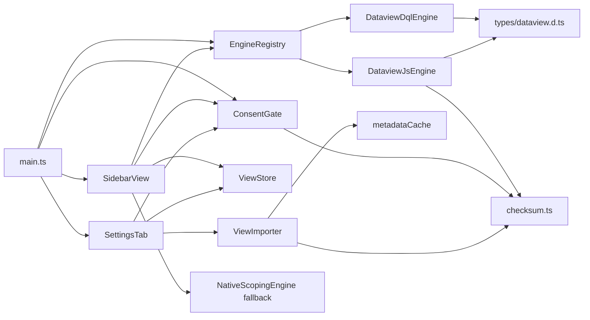
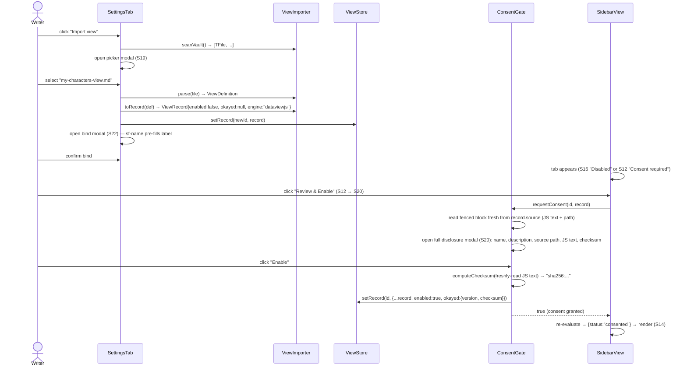
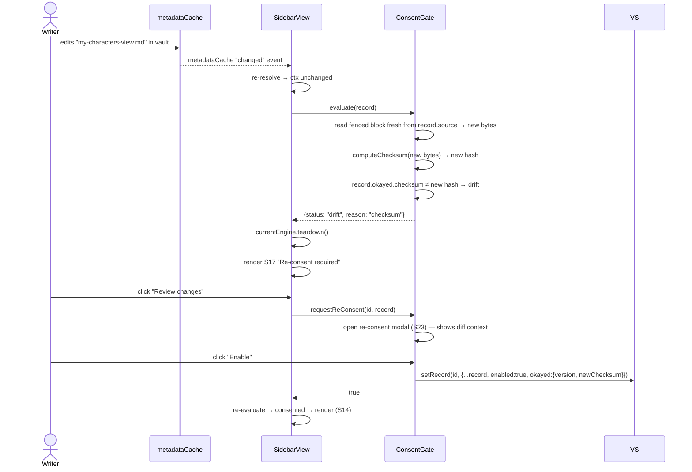
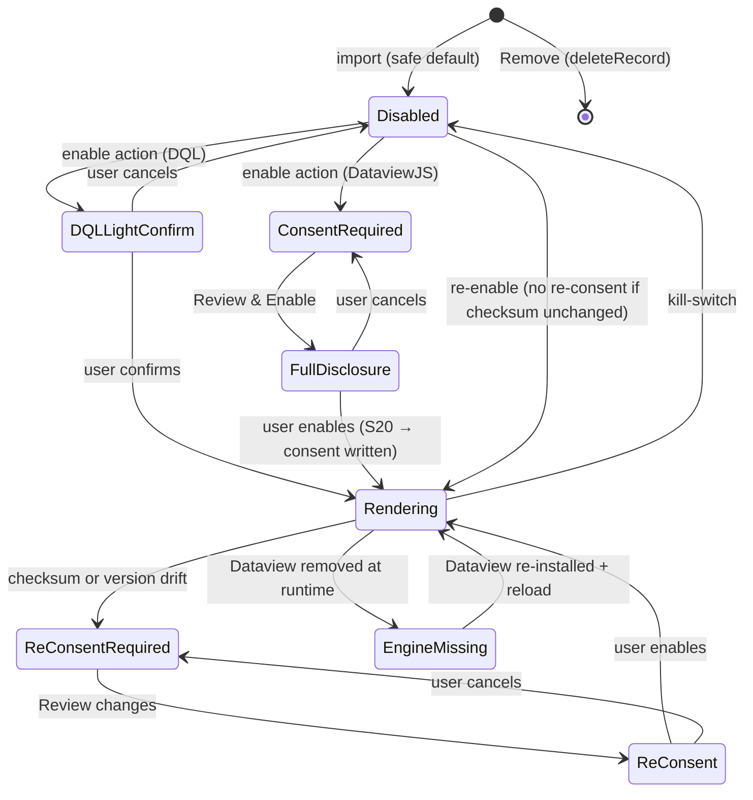

# Solution Design Document

## Validation Checklist

### CRITICAL GATES (Must Pass)

- [x] All required sections are complete
- [x] No [NEEDS CLARIFICATION] markers remain
- [x] Architecture pattern is clearly stated with rationale
- [x] **All architecture decisions confirmed by user** (ADR-1…9 confirmed 2026-07-15)
- [x] Every interface has specification

### QUALITY CHECKS (Should Pass)

- [x] All context sources are listed with relevance ratings
- [x] Project commands are discovered from actual project files
- [x] Constraints → Strategy → Design → Implementation path is logical
- [x] Every component in diagram has directory mapping
- [x] Error handling covers all error types
- [x] Quality requirements are specific and measurable
- [x] Component names consistent across diagrams
- [x] A developer could implement from this design

---

## Constraints

- **CON-1** — Obsidian plugin, `minAppVersion` 1.5.7, `isDesktopOnly: false` (must run on mobile: no Node/Electron APIs on the core path). TypeScript + esbuild; vitest; `eslint-plugin-obsidianmd` 0.3.0 already wired.
- **CON-2** — Community-submission rules: all listeners/timers via `register*` hooks; `console.debug` only; XSS-safe DOM (no `innerHTML` with untrusted data); no sample-plugin residue.
- **CON-3** — **Frontmatter-truth principle**: Story Forge is read-only with respect to vault notes. Only view config persists (in `data.json`), never canon story data.
- **CON-4** — No network, no telemetry in M2.
- **CON-5** — M2 scope: Dataview adapter + consent gate + user-import flow + Settings view list. No Bases engine (M4), no curated catalog (M4), no write-back (M6), no note panel (post-M3).
- **CON-6** — **Dataview is a soft dependency**: feature-detected at runtime; Story Forge must load and function correctly with Dataview absent. The `engines.ts` module is the only place that references the Dataview API.
- **CON-7** — **DataviewJS is desktop-only**: SHA-256 checksum uses `node:crypto`, which is unavailable on mobile. On any mobile platform, DataviewJS-engine tabs show a platform-restriction state without attempting execution. DQL and native fallback run on all platforms.
- **CON-8** — **Single sanctioned `app as any` cast**: the Dataview feature-detection read (`(app as any).plugins.plugins["dataview"]`) is the only permitted `any` cast in the entire codebase (M1 SDD Gotchas §). All other code uses `unknown` + narrowing.

## Implementation Context

### Required Context Sources

#### Documentation Context
```yaml
- doc: docs/XDD/specs/002-query-engine-dataview/requirements.md
  relevance: CRITICAL
  why: "The PRD this design satisfies — 29 Gherkin ACs across F1–F4"

- doc: docs/XDD/specs/002-query-engine-dataview/README.md
  relevance: CRITICAL
  why: "Decisions log — all ADRs are recorded here as confirmed"

- doc: docs/XDD/specs/002-query-engine-dataview/mockups.html
  relevance: CRITICAL
  why: "UI source of truth — states S11–S26; layouts NOT re-described in prose here"

- doc: docs/XDD/specs/001-core-infrastructure/solution.md
  relevance: HIGH
  why: "M1 SDD — seams (ContextTab, ViewStore, NoteContext) that M2 fills in"

- doc: docs/DESIGN.md
  relevance: HIGH
  why: "§4 query-engine seam; two render surfaces; open decisions"

- doc: docs/views-and-integration.md
  relevance: MEDIUM
  why: "View-definition format, import flow, surface contracts"
```

#### Code Context
```yaml
- file: src/store/types.ts
  relevance: CRITICAL
  why: "ViewRecord (provenance, enabled, okayed, source, engine, command, description, commandName); applyDefaults/parseOkayed/isEngine helpers"

- file: src/store/ViewStore.ts
  relevance: CRITICAL
  why: "getViews/setRecord/deleteRecord — M2 writes consent + enabled to these"

- file: src/views/SidebarView.ts
  relevance: CRITICAL
  why: "_renderResolved (~line 504) is the ContextTab seam M2 replaces with engine dispatch; onClose teardown must call engine teardown"

- file: src/scoping/ScopingService.ts
  relevance: HIGH
  why: "Native fallback engine; resolve() → NoteContext used when Dataview absent"

- file: src/scoping/NoteContext.ts
  relevance: HIGH
  why: "NoteContext/ResolvedEntity — the data contract passed to every engine render()"

- file: src/main.ts
  relevance: HIGH
  why: "Plugin entry — M2 adds EngineRegistry + ConsentGate construction + late-join listener wiring"

- file: src/settings/SettingsTab.ts
  relevance: MEDIUM
  why: "M2 extends display() with the view-list section (S24–S26 rows)"

- file: package.json
  relevance: MEDIUM
  why: "Build/test commands; no new runtime deps (node:crypto is built-in)"
```

#### External APIs
```yaml
- service: Dataview plugin (community plugin, soft dep)
  doc: installed main.js v0.5.68 in test vault
  relevance: CRITICAL
  why: "dvApi.execute() + dvApi.executeJs() + dvApi.version — the adapter surface; API verified from the installed binary"
```

### Implementation Boundaries

- **Must Preserve:** M1 `ViewStore` contract, `NoteContext` shape, `SidebarView` public interface, green `build`/`lint`/`typecheck`/`schema:check`.
- **Can Modify:** `src/views/SidebarView.ts` (`_renderResolved` + `onClose`), `src/main.ts` (add EngineRegistry + ConsentGate wiring + late-join listener), `src/settings/SettingsTab.ts` (extend `display()`). `src/store/types.ts` and `ViewStore.ts` are NOT modified in M2 (M1 already provides the full contract).
- **Must Not Touch:** `test/StoryForge/` vault content (read-only fixture); canon notes are never written; `schema/*.json` (schema change runbook required).

### External Interfaces

#### System Context Diagram



#### Interface Specifications
```yaml
inbound:
  - name: "Obsidian workspace events (existing)"
    type: in-process event
    events: [active-leaf-change, metadataCache 'changed', workspace.onLayoutReady]
    data_flow: "Drive panel follow and subject update — unchanged from M1"

  - name: "Dataview late-join event"
    type: in-process event
    event: metadataCache.on('dataview:api-ready')
    data_flow: "Signal that Dataview loaded after Story Forge; triggers engine re-registration"

outbound:
  - name: "Dataview plugin API"
    type: in-process method call
    methods: [dvApi.execute(source, el, component, filePath), dvApi.executeJs(source, el, component, filePath), dvApi.version.satisfies(range)]
    data_flow: "DQL/JS execution scoped to the panel subject's vault path"
    criticality: HIGH

data:
  - name: "data.json (Plugin.loadData/saveData)"
    type: JSON blob (shared with settings)
    data_flow: "ViewRecord consent state (okayed, enabled) written on user actions only"
```

### Project Commands
```bash
Install:   npm install
Dev:       npm run dev            # esbuild watch → deploys into test/StoryForge/.obsidian/plugins/story-forge/
Test:      npm test               # vitest run
Lint:      npm run lint           # eslint src/ + stylelint
Typecheck: npm run typecheck      # tsc --noEmit
Build:     npm run build          # tsc check + esbuild production
Schema:    npm run schema:check   # frontmatter schema drift gate
```

## Solution Strategy

- **Architecture Pattern:** layered plugin extension. M2 adds three new modules (`src/engines/`, `src/consent/`, `src/import/`) that slot into the M1 seams without reshaping them. `SidebarView._renderResolved` delegates to `EngineRegistry`; `main.ts` constructs and injects the registry and `ConsentGate`. The domain layer (`engines/`, `consent/`) remains framework-light and unit-testable.
- **Integration Approach:** `EngineRegistry` is a discriminant→engine map injected into `SidebarView` at construction. `ConsentGate` is injected into both `SidebarView` (for in-panel consent flows) and `SettingsTab` (for the view-list surface). `ViewImporter` is stateless — called on user action from `SettingsTab`. No new Obsidian lifecycle hooks are needed beyond the late-join `dataview:api-ready` listener registered in `main.ts`.
- **Justification:** matches M1's thin-`main.ts` / injected-dependency convention; keeps engines individually testable; the registry discriminant is the existing `ViewRecord.engine` field — no new data model shape is needed.
- **Key Decisions:** see ADR-1…9.

## Building Block View

### Components



### Directory Map

```
.
├── src/
│   ├── main.ts                         # MODIFY: construct NativeScopingEngine (fallback) + EngineRegistry (wired engines only) + ConsentGate; inject into SidebarView + SettingsTab; register late-join dataview:api-ready listener
│   ├── engines/
│   │   ├── QueryEngine.ts              # NEW: QueryEngine interface + EngineRegistry class
│   │   ├── DataviewDqlEngine.ts        # NEW: DQL adapter (dvApi.execute + Component lifecycle)
│   │   ├── DataviewJsEngine.ts         # NEW: DataviewJS adapter (dvApi.executeJs + Component lifecycle; desktop-only guard)
│   │   └── NativeScopingEngine.ts      # NEW: native fallback renderer using NoteContext.entities
│   ├── consent/
│   │   ├── checksum.ts                 # NEW: SHA-256 over raw fenced-block bytes; desktop-only (node:crypto)
│   │   └── ConsentGate.ts             # NEW: ConsentDecision logic; DataviewJS full-disclosure modal; DQL light-confirm; drift detection
│   ├── import/
│   │   ├── ViewImporter.ts             # NEW: auto-scan picker; vault-note parser → ViewDefinition → ViewRecord; duplicate guard
│   │   └── fencedBlock.ts              # NEW: readFencedBlock(app, sourcePath) — shared extractor used by engines + ConsentGate + ViewImporter; returns null if the note is missing
│   ├── types/
│   │   └── dataview.d.ts               # NEW: minimal Dataview API shim (NOT an npm dep; local type declarations only)
│   ├── views/
│   │   └── SidebarView.ts             # MODIFY: _renderResolved → engine dispatch; onClose → engine teardown; inject EngineRegistry + ConsentGate
│   └── settings/
│       └── SettingsTab.ts             # MODIFY: extend display() with view-list section (S24–S26 rows: import, enable/disable/re-consent/remove)
├── test/
│   ├── engines/
│   │   ├── DataviewDqlEngine.test.ts   # NEW: render + teardown; filePath scoping; engine-missing fallback
│   │   ├── DataviewJsEngine.test.ts    # NEW: consent-gate integration; desktop-only guard; dvJs-off prompt
│   │   └── NativeScopingEngine.test.ts # NEW: NoteContext → DOM render
│   ├── consent/
│   │   ├── checksum.test.ts            # NEW: byte-exact SHA-256; CRLF≠LF; prefix format
│   │   └── ConsentGate.test.ts         # NEW: drift detection; modal paths; kill-switch; okayed round-trip
│   └── import/
│       └── ViewImporter.test.ts        # NEW: parser; zero/multi-block rejection; duplicate guard; engine inference
└── test/StoryForge/                    # MODIFY: add at least one sf-view:true note per engine type for live-vault checks
```

### Interface Specifications (inline)

#### QueryEngine + EngineRegistry

```typescript
// src/engines/QueryEngine.ts

/**
 * QueryEngine — the M2 render contract.
 *
 * Each engine owns the lifecycle of the content it renders into `el`.
 * SidebarView calls teardown() before every re-render and in onClose().
 * Engines register their own event listeners on the injected Component
 * so Obsidian auto-cleans them on component.unload() (ADR-7).
 */
export interface QueryEngine {
  /** Discriminant matching ViewRecord.engine. */
  readonly kind: ViewRecord["engine"];

  /**
   * Render view content into `el`, scoped to `ctx.activeFile`.
   * Must be idempotent: called after teardown() leaves `el` empty.
   *
   * The query text is NOT carried on the ViewRecord. The engine reads the
   * single fenced block from the note at `view.source` (via vault read /
   * metadataCache) at render time; that freshly-read text is the query it
   * executes. The same freshly-read bytes are what ConsentGate hashes, which
   * is what makes re-consent-on-drift work (edit the note → bytes change →
   * checksum drifts → re-consent). (ADR-3/ADR-4)
   *
   * @param view  The resolved, consented ViewRecord (carries `source` path only).
   * @param ctx   The panel subject's NoteContext (from ScopingService).
   * @param el    Empty container element owned by SidebarView.
   */
  render(view: ViewRecord, ctx: NoteContext, el: HTMLElement): Promise<void>;

  /**
   * Unload the engine's Component and remove any DOM nodes it added to `el`.
   * Called before every re-render and in SidebarView.onClose().
   * Must be safe to call when render() has never been called.
   */
  teardown(): void;
}

/**
 * EngineRegistry — maps a ViewRecord.engine discriminant to the WIRED engine
 * instance responsible for rendering views of that kind.
 *
 * The registry holds ONLY real, wired engines:
 *   - "dataview-dql"  → DataviewDqlEngine   (registered only when Dataview is present + version-ok)
 *   - "dataviewjs"    → DataviewJsEngine    (registered only when Dataview is present + version-ok)
 * The "bases" slot is intentionally UNWIRED in M2 (Won't-have; M4 fills it) —
 * get("bases") returns undefined.
 *
 * The registry is ALLOWED TO BE EMPTY (e.g. Dataview absent). It does NOT hold
 * the native fallback: NativeScopingEngine is held separately by SidebarView
 * and always exists independently of the registry (see the render pipeline).
 *
 * Constructed in main.ts; injected into SidebarView and ConsentGate.
 */
export class EngineRegistry {
  private readonly map: Map<ViewRecord["engine"], QueryEngine>;

  constructor(engines: QueryEngine[]) {
    this.map = new Map(engines.map((e) => [e.kind, e]));
  }

  /**
   * Returns the wired engine for the given kind, or undefined if none is wired
   * (Dataview absent for a dataview-* kind, or the unwired "bases" kind).
   * Callers fall back to the separately-held NativeScopingEngine.
   */
  get(kind: ViewRecord["engine"]): QueryEngine | undefined {
    return this.map.get(kind);
  }
}
```

#### Dataview API shim

```typescript
// src/types/dataview.d.ts
// Minimal type declarations for the Dataview plugin API surface used by M2.
// NOT an npm dependency — these types are verified against the installed
// Dataview main.js v0.5.68.

export interface DataviewApi {
  /** Execute a DQL query block, rendering into `el` scoped to `filePath`. */
  execute(
    source: string,
    el: HTMLElement,
    component: Component,
    filePath: string,
  ): Promise<void>;

  /** Execute a DataviewJS block, rendering into `el` scoped to `filePath`. */
  executeJs(
    source: string,
    el: HTMLElement,
    component: Component,
    filePath: string,
  ): Promise<void>;

  /** Semver version helper. */
  version: {
    satisfies(range: string): boolean;
  };
}

// Augmented App type for the single sanctioned any-cast (ADR-2, CON-8).
// Usage: const dvApi = (app as DataviewApp).plugins.plugins["dataview"]?.api
export interface DataviewApp {
  plugins: {
    plugins: Record<string, { api?: DataviewApi } | undefined>;
  };
}
```

#### Consent types + ConsentGate

```typescript
// src/consent/ConsentGate.ts

/** Result of a consent-gate evaluation for a single ViewRecord. */
export type ConsentDecision =
  | { status: "consented" }            // okayed and current — render is permitted
  | { status: "not-consented" }        // okayed is null — user has never consented
  | { status: "drift"; reason: "version" | "checksum" | "both" } // okayed is stale
  | { status: "disabled" }             // enabled:false regardless of okayed
  | { status: "platform-restricted" }  // DataviewJS on mobile
  | { status: "engine-missing" }       // Dataview plugin absent or version < 0.5.31
  | { status: "dvjs-off" };            // enableDataviewJs:false in Dataview settings

/**
 * ConsentGate — evaluates consent state and drives the consent/re-consent modals.
 *
 * Injected into SidebarView (in-panel flows) and SettingsTab (view-list rows).
 * Constructed in main.ts with EngineRegistry and ViewStore references.
 */
export interface ConsentGate {
  /**
   * Evaluate the current consent state for a view.
   * Called on every render; does NOT open any modal.
   *
   * Reads the single fenced block fresh from the note at `record.source` and
   * checksums those bytes, comparing against `record.okayed.checksum`. This is
   * the same fresh read the engine executes, so drift is detected against the
   * exact bytes that would run. Returns "not-consented" (source-missing variant)
   * if the note at `record.source` no longer resolves. (ADR-3/ADR-4)
   */
  evaluate(record: ViewRecord): Promise<ConsentDecision>;

  /**
   * Open the full DataviewJS disclosure modal (S20) or DQL light confirm (S21).
   * On "Enable": writes okayed:{version,checksum}+enabled:true via ViewStore.setRecord().
   * On dismiss/cancel: no write.
   *
   * @returns true if the user granted consent; false if dismissed.
   */
  requestConsent(id: string, record: ViewRecord): Promise<boolean>;

  /**
   * Open the re-consent modal (S23 for DataviewJS; same light-confirm for DQL).
   * Triggered when evaluate() returns { status: "drift" }.
   *
   * @returns true if the user re-granted consent; false if dismissed.
   */
  requestReConsent(id: string, record: ViewRecord): Promise<boolean>;
}
```

#### Checksum

```typescript
// src/consent/checksum.ts
// Desktop-only (node:crypto). Never imported on the mobile code path.

/**
 * Compute a SHA-256 checksum over the raw bytes of a fenced block's source.
 *
 * - Input: the raw content string of the fenced block body (between the
 *   opening and closing ``` delimiters, exclusive).
 * - Encoding: UTF-8 bytes.
 * - CRLF vs LF: NOT normalised — CRLF ≠ LF by design (byte-exact). This is
 *   a feature, not a bug: a CRLF edit triggers re-consent as intended.
 * - Output format: "sha256:<hex-digest>" (64 hex chars after the prefix).
 *
 * @throws Error if node:crypto is unavailable (mobile guard should prevent this).
 */
export function computeChecksum(source: string): string;

/**
 * Type alias for the "sha256:<hex>" checksum string.
 * Used in ViewRecord.okayed.checksum and in ViewDefinition.checksum.
 */
export type Checksum = `sha256:${string}`;
```

#### ViewDefinition + ViewImporter

```typescript
// src/import/ViewImporter.ts

/**
 * Parsed view definition extracted from a vault note.
 * Intermediate form between the raw vault note and a ViewRecord.
 */
export interface ViewDefinition {
  /** Vault-relative path of the source note (becomes ViewRecord.source). */
  sourcePath: string;
  /** Engine inferred from the fenced block language tag. */
  engine: "dataview-dql" | "dataviewjs";
  /** sf-version frontmatter field (integer). */
  version: number;
  /** sf-name frontmatter field (becomes ViewRecord.commandName default). */
  name: string;
  /** sf-description frontmatter field (becomes ViewRecord.description). */
  description?: string;
  /** sf-command frontmatter field (becomes ViewRecord.command). */
  command: boolean;
  /**
   * Raw source string of the fenced query block body, as read at import time.
   * TRANSIENT — used only to preview the query and derive `checksum` during
   * import. It is NOT persisted onto the ViewRecord; at render/consent time the
   * block is re-read fresh from the note at `sourcePath` (ADR-3/ADR-4).
   */
  querySource: string;
  /** Checksum over querySource bytes at import time (sha256: prefixed); shown in the import preview, not persisted until consent. */
  checksum: Checksum;
}

/**
 * ViewImporter — stateless service for scanning the vault and parsing
 * view-definition notes into ViewRecords.
 *
 * Auto-scan uses metadataCache (no vault reads for the listing step).
 * Parsing reads the note file once via vault.read() to extract the fenced block.
 */
export interface ViewImporter {
  /**
   * Return all vault notes whose CachedMetadata carries sf-view: true.
   * Result is a list of TFile objects; does NOT parse the notes.
   */
  scanVault(): TFile[];

  /**
   * Parse a view-definition note into a ViewDefinition.
   *
   * Validates:
   * - Exactly one fenced block with language "dataview" or "dataviewjs" (rejects 0 or >1).
   * - Presence of sf-version (integer), sf-name (non-empty string).
   * - sf-engine in frontmatter is cross-checked against the fenced block language.
   *
   * Computes the checksum over the fenced block body bytes.
   *
   * @throws ImportError with a human-readable message on validation failure.
   */
  parse(file: TFile): Promise<ViewDefinition>;

  /**
   * Convert a ViewDefinition into a new (not yet consented) ViewRecord.
   * id is generated by the store (UUID or nanoid); not the vault path.
   */
  toRecord(def: ViewDefinition): ViewRecord;
}

/** Error thrown by ViewImporter.parse() on invalid view-definition notes. */
export class ImportError extends Error {
  constructor(
    public readonly code:
      | "NO_QUERY_BLOCK"
      | "MULTIPLE_QUERY_BLOCKS"
      | "INVALID_FRONTMATTER"
      | "ENGINE_MISMATCH",
    message: string,
  ) {
    super(message);
  }
}
```

#### ViewRecord mapping from ViewDefinition

The `toRecord()` conversion is specified here for implementers:

| `ViewDefinition` field | `ViewRecord` field | Notes |
|---|---|---|
| `sourcePath` | `source` | Vault-relative path |
| `engine` | `engine` | `"dataview-dql"` or `"dataviewjs"` |
| `version` + `checksum` | `okayed` | **null** (not yet consented) |
| `name` | `commandName` | Default tab/command label |
| `description` | `description` | Optional catalog blurb |
| `command` | `command` | true if sf-command:true |
| — | `provenance` | Always `"imported"` |
| — | `enabled` | Always `false` (safe default, ADR-5) |

The **store-generated id** is never derived from `sourcePath`. `ViewStore.setRecord(id, rec)` is called with a new UUID/nanoid; `rec.source` carries the path for display and duplicate detection (ADR-9).

#### Data Storage Changes

No schema change to `data.json`. M1 `ViewRecord` already includes every field M2 writes:
- `okayed: { version: number; checksum: string } | null` — written on consent grant.
- `enabled: boolean` — written on grant, kill-switch, remove.

`applyDefaults` and `parseOkayed` (M1) already handle all M2 consent state correctly; no changes to `store/types.ts`.

#### Integration Points

```yaml
- from: SidebarView._renderResolved
  to: EngineRegistry → QueryEngine.render()
  protocol: in-process async
  data_flow: "ViewRecord + NoteContext → rendered DOM in tab body el"

- from: SidebarView.onClose
  to: QueryEngine.teardown()
  protocol: in-process sync
  data_flow: "Unload Component + empty el before close (ADR-7)"

- from: ConsentGate.requestConsent / requestReConsent
  to: ViewStore.setRecord()
  protocol: in-process async
  data_flow: "Write okayed:{version,checksum} + enabled:true in one mutation"

- from: SettingsTab
  to: ViewImporter.scanVault() + ViewImporter.parse()
  protocol: in-process async
  data_flow: "Populate import picker; create ViewRecord on confirm"

- from: DataviewDqlEngine / DataviewJsEngine
  to: Dataview plugin dvApi.execute / dvApi.executeJs
  protocol: in-process async
  data_flow: "Query source + filePath=ctx.activeFile.path → rendered DOM via Dataview's Component"

- from: SidebarView (native fallback)
  to: NativeScopingEngine.render()
  protocol: in-process async
  data_flow: "NoteContext.entities → entity-context DOM; used when no wired engine matches view.engine (Dataview absent or unwired 'bases')"

- seam (deferred to M4):
  to: Bases engine
  detection: engine discriminant "bases" — EngineRegistry.get("bases") returns undefined in M2 (unwired slot); SidebarView renders the native fallback + an 'engine coming in M4' hint
```

### Implementation Examples

#### Example: Engine dispatch in SidebarView._renderResolved (why: replaces the M1 stub; shows the teardown→empty→render order)

```typescript
// src/views/SidebarView.ts — _renderResolved replacement (illustrative)
// Actual implementation will access the injected registry, the separately-held
// nativeEngine fallback, and currentRecord.
private async _renderResolved(body: AugEl, ctx: NoteContext): Promise<void> {
  const view = this.currentRecord; // the enabled, consented ViewRecord for the active tab
  if (!view) {
    // No view selected — render native context via the NativeScopingEngine
    // fallback, which is held on SidebarView, NOT in the EngineRegistry.
    this.currentEngine?.teardown();
    body.empty();
    await this.nativeEngine.render(null, ctx, body);
    this.currentEngine = this.nativeEngine;
    return;
  }

  const engine = this.registry.get(view.engine);
  if (!engine) {
    // No wired engine for this kind:
    //   - dataview-* kind → Dataview absent/version-low → S11 "engine missing"
    //   - "bases" kind    → unwired in M2 → S11 "engine coming in M4" hint
    // In both cases the native fallback still renders entity context below the hint.
    this._renderEngineMissing(body, view.engine); // S11 (kind-specific copy)
    this.currentEngine?.teardown();
    await this.nativeEngine.render(view, ctx, body);
    this.currentEngine = this.nativeEngine;
    return;
  }

  const decision = await this.consentGate.evaluate(view);
  switch (decision.status) {
    case "consented":
      this.currentEngine?.teardown();              // (1) teardown previous
      body.empty();                                // (2) empty container
      await engine.render(view, ctx, body);        // (3) render
      this.currentEngine = engine;
      break;
    case "not-consented":
      this._renderConsentRequired(body, view);     // S12
      break;
    case "drift":
      this._renderReConsentRequired(body, view);   // S17
      break;
    case "disabled":
      this._renderDisabled(body);                  // S16
      break;
    case "platform-restricted":
      this._renderPlatformRestriction(body);       // variant of S11
      break;
    case "engine-missing":
      this._renderEngineMissing(body, view.engine); // S11
      break;
    case "dvjs-off":
      this._renderDvJsOff(body);                   // S15 variant
      break;
  }
}
```

#### Example: filePath scoping in DataviewDqlEngine (why: this is the resolved spike — filePath is the subject path, not the view-note path)

```typescript
// src/engines/DataviewDqlEngine.ts (illustrative)
export class DataviewDqlEngine implements QueryEngine {
  readonly kind = "dataview-dql" as const;
  private component: Component | null = null;

  constructor(private readonly app: App) {}

  async render(view: ViewRecord, ctx: NoteContext, el: HTMLElement): Promise<void> {
    const dvApi = getDataviewApi(this.app); // the single sanctioned any-cast
    if (!dvApi) { el.createDiv({ text: "Dataview not available" }); return; }

    // The query text is NOT on the ViewRecord. Read the single fenced block
    // from the view-definition note at `view.source` at render time. The same
    // bytes are what ConsentGate hashed for the consent check that gated this
    // render. (ADR-3/ADR-4)
    const querySource = await readFencedBlock(this.app, view.source); // → raw DQL text

    this.component = new Component();
    this.component.load();

    // KEY: filePath is the PANEL SUBJECT's path (ctx.activeFile.path),
    // NOT the view-definition note's path (view.source).
    // This makes `this` / `FROM` in DQL resolve to the subject. (ADR-3)
    await dvApi.execute(
      querySource,          // DQL text freshly read from the note at view.source
      el,
      this.component,
      ctx.activeFile.path,  // subject path — sets DQL origin
    );
  }

  teardown(): void {
    this.component?.unload();
    this.component = null;
  }
}
```

**Note for implementers:** `ViewRecord.source` is the view-definition note's vault path (the M1 "vault path" meaning) — it never holds query text. The query is read fresh from that note's single fenced block at render time via a shared `readFencedBlock(app, source)` helper (the same extractor `ViewImporter.parse()` uses). Reading fresh is deliberate: it is what makes drift detection sound — the bytes the engine executes and the bytes `ConsentGate` hashes are one and the same, so any edit to the note surfaces as a checksum drift. No query text is stored in `data.json`; no new ViewRecord field; no M1 contract change.

#### Example: Consent drift detection (why: shows the OR-drift rule — either version or checksum change independently triggers re-consent)

```typescript
// src/consent/ConsentGate.ts — evaluate() (illustrative)
async evaluate(record: ViewRecord): Promise<ConsentDecision> {
  if (!record.enabled) return { status: "disabled" };
  if (record.engine === "dataviewjs" && Platform.isMobile) return { status: "platform-restricted" };

  const engine = this.registry.get(record.engine);
  if (!engine) return { status: "engine-missing" };

  if (record.engine === "dataviewjs" && !isDvJsEnabled(this.app)) return { status: "dvjs-off" };

  if (!record.okayed) return { status: "not-consented" };

  // Read the fenced block fresh from the note at record.source; if the note no
  // longer resolves, treat as not-consented (source-missing → S15 variant).
  const querySource = await readFencedBlock(this.app, record.source);
  if (querySource === null) return { status: "not-consented" };

  // Drift: version OR checksum independently triggers re-consent (ADR-5 Rule 4)
  const currentChecksum = await computeChecksum(querySource);
  const versionDrifted = record.okayed.version !== currentVersion(record);
  const checksumDrifted = record.okayed.checksum !== currentChecksum;

  if (versionDrifted || checksumDrifted) {
    return {
      status: "drift",
      reason: versionDrifted && checksumDrifted ? "both"
            : versionDrifted ? "version"
            : "checksum",
    };
  }

  return { status: "consented" };
}
```

#### Example: ViewImporter.parse() validation (why: shows the exactly-one-block rule and engine inference)

```typescript
// src/import/ViewImporter.ts — parse() (illustrative)
async parse(file: TFile): Promise<ViewDefinition> {
  const content = await this.vault.read(file);
  const cache = this.metadataCache.getFileCache(file);
  const fm = cache?.frontmatter;
  if (!fm?.["sf-version"] || typeof fm["sf-version"] !== "number") {
    throw new ImportError("INVALID_FRONTMATTER", "sf-version must be an integer");
  }
  const blocks = extractFencedBlocks(content, ["dataview", "dataviewjs"]);
  if (blocks.length === 0) throw new ImportError("NO_QUERY_BLOCK", "No query block found");
  if (blocks.length > 1) throw new ImportError("MULTIPLE_QUERY_BLOCKS", "View definitions must contain exactly one query block");
  const block = blocks[0];
  const engine: "dataview-dql" | "dataviewjs" =
    block.lang === "dataviewjs" ? "dataviewjs" : "dataview-dql";
  const checksum = computeChecksum(block.source); // desktop-only; mobile cannot import DataviewJS
  return {
    sourcePath: file.path,
    engine,
    version: fm["sf-version"] as number,
    name: String(fm["sf-name"] ?? file.basename),
    description: fm["sf-description"] ? String(fm["sf-description"]) : undefined,
    command: fm["sf-command"] === true,
    querySource: block.source,
    checksum,
  };
}
```

## Runtime View

### Flow A — Startup: engine detection and late-join registration

```mermaid
sequenceDiagram
    participant Main as main.ts (onload)
    participant WS as workspace
    participant MC as metadataCache
    participant ER as EngineRegistry
    participant SV as SidebarView

    Main->>Main: construct NativeScopingEngine (fallback, held on SidebarView)
    Main->>Main: construct EngineRegistry(engines=[]) — wired engines only
    Main->>Main: construct ConsentGate(registry, store)
    Main->>WS: onLayoutReady(callback)
    WS-->>Main: layout ready
    Main->>Main: detect Dataview via (app as any).plugins.plugins["dataview"]?.api
    alt Dataview present AND version ≥ 0.5.31
        Main->>ER: register DataviewDqlEngine + DataviewJsEngine
    else absent or version too low
        Main->>Main: log console.debug("Dataview absent or version < 0.5.31")
        Note over ER: registry stays EMPTY; native fallback still on SidebarView
    end
    Main->>MC: registerEvent("dataview:api-ready", lateJoinHandler)
    Note over MC: late-join: fires if Dataview loads AFTER Story Forge
    MC-->>Main: (later) dataview:api-ready
    Main->>ER: re-register Dataview engines on late-join
```

**Traced flow:** On plugin load, `main.ts` calls `workspace.onLayoutReady()` to defer the Dataview check (Dataview may not have fully initialised yet). After layout-ready, the `app.plugins.plugins["dataview"]?.api` is read (the single sanctioned `any` cast). If the API is present and `dvApi.version.satisfies(">=0.5.31")` is true, both Dataview engines are registered in the `EngineRegistry`. The `metadataCache.on("dataview:api-ready")` listener handles the case where Dataview finishes loading after Story Forge's `onLayoutReady` callback fires. Per ADR-2, the engine checks `.api` on **each render** (not just startup) because Dataview can be disabled at runtime.

---

### Flow B — Render pipeline: subject changes → engine dispatch

```mermaid
sequenceDiagram
    actor Writer
    participant WS as Workspace
    participant SV as SidebarView
    participant CG as ConsentGate
    participant ER as EngineRegistry
    participant E as QueryEngine (DQL/DVJ/Native)

    Writer->>WS: open note "chapter-01.md"
    WS-->>SV: active-leaf-change (debounced)
    SV->>SV: classify(file) → "scene"
    SV->>SV: resolve(file) → NoteContext{activeFile: chapter-01.md}
    SV->>VS: getViews() → {tabId: ViewRecord}
    SV->>CG: evaluate(record)
    Note over CG: reads fenced block fresh from record.source; checksums it
    CG-->>SV: {status: "consented"}
    SV->>E: registry.get(record.engine) → engine (or none → native fallback)
    SV->>E: currentEngine.teardown()
    SV->>SV: body.empty()
    SV->>E: engine.render(record, ctx, el)
    Note over E: read fenced block from record.source → dvApi.execute(queryText, el, component, "chapter-01.md")
    E-->>SV: resolved DOM
    SV->>SV: currentEngine = engine
```

**Key design point (ADR-3 spike resolution):** the `filePath` argument to `dvApi.execute()` and `dvApi.executeJs()` is `ctx.activeFile.path` — the panel **subject's** vault-relative path, not the view-definition note's path. This means:
- In DataviewJS views: `dv.current()` returns the subject note's frontmatter (Dataview sets `DataviewInlineApi.currentFilePath = filePath`).
- In DQL views: `this` and origin for `FROM` resolve to the subject.
- Authors must use `dv.current()` (DataviewJS) or `this` (DQL) — never `dv.page(dv.current().file.path)` and never a `window.*` global.
- Edge case: `dv.current()` returns `{}` (not a throw) when the subject note is not yet indexed by Dataview. The engine must handle this gracefully.

---

### Flow C — DataviewJS consent path (import → S12 → S20 → okayed → render)



---

### Flow D — Re-consent on checksum drift



---

### Flow E — Native fallback when Dataview is absent

When `EngineRegistry.get("dataview-dql")` or `EngineRegistry.get("dataviewjs")` returns `undefined` (Dataview not installed), `SidebarView._renderResolved` renders the S11 engine-missing state for that tab. Simultaneously, the `NativeScopingEngine` — held directly on `SidebarView`, NOT in the registry — continues to render entity-context from `NoteContext.entities`, so the M1 scoping layer is unaffected. The same fallback path handles the unwired `"bases"` kind (Won't-have in M2): `get("bases")` returns undefined, and the tab shows the native context plus an "engine coming in M4" hint. Writers without Dataview see entity relations resolved from frontmatter links; they cannot run DQL or DataviewJS views.

### Error Handling

| Condition | System response | State |
|---|---|---|
| Dataview absent | `EngineRegistry.get(engine)` → undefined; no crash | S11 engine-missing |
| `enableDataviewJs: false` in Dataview settings | `ConsentGate.evaluate()` → `{status:"dvjs-off"}`; actionable prompt with link to Dataview settings | S15 variant |
| DQL query runtime error | Dataview renders its own error into `el`; engine propagates the visible output; Story Forge logs `console.debug` | Visible error inside tab |
| DataviewJS runtime error | Same as DQL — Dataview's renderer surfaces it inside `el` | Visible error inside tab |
| DataviewJS sync infinite loop | Freezes Obsidian; **accepted limitation**, cannot be interrupted; disclosed at consent time (S20) | Accepted |
| `view.source` note deleted from vault | `metadataCache.getFileCache` returns null for the source path; `ConsentGate.evaluate()` detects missing source via vault.getAbstractFileByPath; returns `{status:"not-consented"}` and renders S15 variant "Source missing" | S15 variant |
| `computeChecksum()` on mobile | Guard: DataviewJS engine tab shows S11 platform-restriction; `checksum.ts` is never imported on the mobile code path | S11 variant |
| Import parse failure (0 or >1 blocks) | `ImportError` surfaced in the picker modal as a human-readable message; no ViewRecord created | Picker error state |
| Duplicate import (source already in store) | Picker marks note with "already imported" indicator; import action is disabled | Picker duplicate state |
| Dataview version < 0.5.31 | Engine not registered; S11 engine-missing with version hint | S11 |

## Deployment View

### Single Application Deployment

- **Environment:** runs inside Obsidian (desktop + mobile) as a community plugin; no server, no build-time backend.
- **Configuration:** no additional user configuration required for M2 beyond Dataview being installed. DataviewJS requires `enableDataviewJs: true` in Dataview's settings (default: false).
- **Dependencies:** Obsidian ≥ 1.5.7; Dataview ≥ 0.5.31 (soft — absent is handled gracefully); `node:crypto` (built-in; available on desktop only).
- **Performance:** consent evaluation is synchronous (one checksum compute per render); DQL/DataviewJS render time is determined by Dataview, not Story Forge.

### Multi-Component Coordination

No change — single plugin, no multi-service coordination.

## Cross-Cutting Concepts

### User Interface & UX

**The interface is defined visually in `docs/XDD/specs/002-query-engine-dataview/mockups.html` (states S11–S26) — the source of truth for all panel and modal layouts.** This SDD does not re-describe layout in prose.

State inventory for reference:
- **S11** Panel — engine missing (and platform-restriction variant)
- **S12** Panel — consent required (DataviewJS)
- **S13** Panel — loading (query in flight)
- **S14** Panel — result (query rendered)
- **S15** Panel — error (source missing, query error, dvjs-off variant)
- **S16** Panel — disabled
- **S17** Panel — re-consent required
- **S18** Panel — DQL light-confirm pending
- **S19** Modal — import picker (auto-scan list)
- **S20** Modal — full disclosure (DataviewJS)
- **S21** Modal — light confirm (DQL)
- **S22** Modal — bind (tab label + command assignment)
- **S23** Modal — re-consent (DataviewJS)
- **S24** Settings row — Enabled
- **S25** Settings row — Disabled / Consent required
- **S26** Settings row — Engine missing

#### Component State Machine (view tab states)



#### Tab label overflow

Long `sf-name` values truncate with CSS `overflow: ellipsis` in the tab strip; the full name is accessible on hover via the `title` attribute on the tab element (ADR-9 minor decision).

### System-Wide Patterns

- **Error Handling:** fail-closed throughout: absent consent → disabled; malformed `okayed` → null (M1 `parseOkayed`); missing engine → S11; no unhandled exceptions propagate to the Obsidian UI.
- **Lifecycle / Leaks (submission-critical):** all `metadataCache.on` / `workspace.on` via `this.registerEvent`; each engine owns one Obsidian `Component`; `component.unload()` is called in `teardown()` before every re-render and in `SidebarView.onClose()` (ADR-7 order: teardown → `body.empty()` → render). The `dataview:api-ready` listener is registered via `registerEvent` so it is automatically cleaned up on plugin unload.
- **No network / no telemetry:** Story Forge never makes HTTP requests. The Dataview API is in-process only.
- **Logging:** `console.debug` only, prefixed `[StoryForge]`. No `console.log`, `console.warn`, or `console.error`.
- **Accessibility:** consent modals are standard Obsidian `Modal` subclasses (inherit focus trap + keyboard dismiss). View-list rows in `SettingsTab` use `Setting` API (Obsidian-native accessible). Platform-restriction and engine-missing states in the tab body follow the M1 empty-state pattern (`role=region`, `aria-live=polite`).
- **Frontmatter-truth:** `ViewImporter.parse()` reads vault notes; no write-back to vault notes in any M2 code path. `ViewStore.setRecord()` (data.json) is the only write in M2.

### Patterns Used

```yaml
- pattern: mason disclosure + checksum (consent/checksum.ts)
  relevance: CRITICAL
  why: "Proven reference for byte-exact SHA-256 consent in the sibling plugin (markdown-mason); M2 clones this pattern"

- pattern: M1 fail-closed ViewStore defaults
  relevance: CRITICAL
  why: "applyDefaults/parseOkayed already coerce malformed okayed → null; M2 relies on this without changes"

- pattern: M1 PluginDataPort injection
  relevance: HIGH
  why: "ConsentGate receives the store, not the port; same testability pattern"
```

## Architecture Decisions

- [x] **ADR-1 — QueryEngine interface + EngineRegistry (wired engines only) + separately-held native fallback.** A `QueryEngine` interface (`kind`, `render(view, ctx, el): Promise<void>`, `teardown(): void`) behind the M1 `ContextTab` seam. The `EngineRegistry` maps a `ViewRecord.engine` discriminant to a WIRED engine only: `"dataview-dql" → DataviewDqlEngine` and `"dataviewjs" → DataviewJsEngine`, registered **only when Dataview is present and version-ok**. The `"bases"` slot stays UNWIRED in M2 (Won't-have; M4 fills it) → `get("bases")` returns undefined. The registry MAY BE EMPTY (Dataview absent). `NativeScopingEngine` is NOT a registry entry; it is a fallback renderer held directly on `SidebarView` and always available. Dispatch in `SidebarView._renderResolved`: look up `registry.get(view.engine)`; if a wired engine is returned, render with it (after the consent check); if none (Dataview absent for a `dataview-*` kind, or the unwired `"bases"` kind), render with `NativeScopingEngine` and surface the matching state — S11 "engine missing / Dataview not installed" for `dataview-*`, an "engine coming in M4" hint for `"bases"`.
  - Rationale: the `engine` discriminant already exists in `ViewRecord` (M1); a registry map over the wired engines is the most direct, framework-free design. Keeping the native fallback out of the registry avoids conflating "a real wired engine" with "the always-there fallback" and lets the registry be legitimately empty. Each engine is independently testable. Adding Bases in M4 requires only implementing `QueryEngine` and registering it under `"bases"` — no change to `SidebarView`.
  - Trade-offs: the two Dataview engines are constructed eagerly when Dataview is present; the fallback and dispatch add one branch. Both negligible.
  - User confirmed: Yes (2026-07-15)

- [x] **ADR-2 — Feature detection via `app.plugins.plugins["dataview"].api` + `workspace.onLayoutReady` + late-join listener.** The Dataview API is read from `(app as any).plugins.plugins["dataview"]?.api` — the single sanctioned `any` cast (CON-8). Detection is gated on `workspace.onLayoutReady`. A legacy `metadataCache.on("dataview:api-ready")` listener (via `registerEvent`) handles late-loading. The API is re-checked on each render (Dataview can be disabled at runtime). Min Dataview version: **0.5.31** (guarded via `dvApi.version.satisfies(">=0.5.31")`). Note: 0.5.68 is the currently-installed version; 0.5.31 is the minimum supported.
  - Rationale: the only safe cross-plugin API access pattern in the Obsidian community; no import of Dataview types at bundle time; the `any` cast is isolated to a single helper function `getDataviewApi()`.
  - Trade-offs: the `any` cast is unavoidable for cross-plugin access; isolating it to one function contains the unsafe surface.
  - User confirmed: Yes (2026-07-15)

- [x] **ADR-3 — Subject scoping via `filePath` argument (resolved spike); query read fresh from `source`.** The query text is never stored on the ViewRecord: at render time the engine reads the single fenced block from the note at `view.source` and passes those bytes as the first argument to `dvApi.execute(queryText, el, component, filePath)` / `dvApi.executeJs(queryText, el, component, filePath)`. The `filePath` argument is `ctx.activeFile.path` (bare vault-relative path, no query string) — the panel SUBJECT's path, not the view-note's path. This sets `DataviewInlineApi.currentFilePath` inside the Dataview renderer: `dv.current()` (DataviewJS) and `this`/origin (DQL) resolve to the subject note. View authors use `dv.current()` in DataviewJS and `this` in DQL — never `getActiveFile()`, never a `window.*` global. Edge case: `dv.current()` returns `{}` (not a throw) if the subject is not yet indexed.
  - Rationale: verified from Dataview source (installed v0.5.68): `DataviewInlineApi.currentFilePath = filePath`; `dv.current() = index.pages.get(currentFilePath)`. No variable injection into query source; no vault-note contamination.
  - Trade-offs: if the subject note is not indexed by Dataview, `dv.current()` returns `{}`; authors must guard for this. The alternative (variable injection into query source) would break arbitrary DataviewJS code; `filePath` is the correct API.
  - User confirmed: Yes (2026-07-15)

- [x] **ADR-4 — Consent/checksum module cloned from markdown-mason `disclosure.ts`.** SHA-256 over the **raw bytes** of the fenced block's source (byte-exact — CRLF ≠ LF), computed via `node:crypto`. Output format: `"sha256:<64-char hex>"`. The hashed bytes are ALWAYS read fresh from the note at `record.source` at consent/evaluate/render time — the exact same bytes the engine will execute — so drift detection is sound and no query text is persisted in `data.json`. If the note at `record.source` no longer resolves, `evaluate()` returns not-consented (source-missing → S15 variant). DataviewJS engine is **desktop-only** (mobile has no `node:crypto` AND Dataview blocks DataviewJS on mobile). DQL and native fallback run on all platforms. Fail-closed: `parseOkayed` already rejects malformed `okayed` → null → not consented (M1). Consent grant writes `okayed:{version, checksum}` + `enabled:true` in one `setRecord` call.
  - Rationale: proven pattern from the sibling plugin; byte-exact hash ensures any editing of the view definition note triggers re-consent; importing `node:crypto` as a dynamic import guards the mobile code path.
  - Trade-offs: byte-exact means CRLF files re-consent on LF normalisation (Windows editors); acceptable — writers should use LF. The desktop-only restriction on DataviewJS is independently enforced by Dataview itself; this is belt-and-suspenders.
  - User confirmed: Yes (2026-07-15)

- [x] **ADR-5 — Consent policy: DataviewJS full-disclosure always; DQL light confirm only; re-consent on version-OR-checksum drift; no "enable-once"; safe-default disabled; kill-switch preserves `okayed`; Remove = `deleteRecord`.** DataviewJS: full disclosure modal (S20) on first consent AND every re-consent — no abbreviated path. DQL: light confirm (S21) only, never full gate. Re-consent fires on version-OR-checksum drift (either independently). Disable (kill-switch) sets `enabled:false` preserving `okayed`; re-enable without drift requires no re-consent. Remove = `deleteRecord` (never touches the vault note).
  - Rationale: DQL is declarative and read-only — no security gate beyond informed acknowledgement is warranted. DataviewJS is arbitrary JavaScript — the full disclosure is required every time to prevent silent habituation. OR-drift is the safer trigger (catches version bumps without code change, and code changes without version bump).
  - Trade-offs: no "enable-once" / one-shot mode (won't-have per PRD). Writers who frequently edit view definitions may find re-consent friction; this is intentional.
  - User confirmed: Yes (2026-07-15)

- [x] **ADR-6 — View-definition format: vault note with `sf-view: true` frontmatter + exactly one fenced query block.** Frontmatter fields: `sf-view: true` (required), `sf-engine` (cross-checked against block language), `sf-version: <integer>` (required; forced integer because M1 `okayed.version: number`), `sf-name` (string, default tab label), `sf-description` (optional), `sf-command` (boolean). Auto-scan picker reads `metadataCache` for `sf-view: true`. Parser: reject 0 or >1 fenced blocks; classify engine from fence language tag; map to `ViewRecord`. Checksum computed over the fenced block body bytes.
  - Rationale: vault-note format is human-readable, portable, and consistent with the mason-pattern and the frontmatter-truth principle. `metadataCache` scanning avoids vault reads during the picker scan. The exactly-one-block rule eliminates ambiguity.
  - Trade-offs: writers must know the `sf-*` frontmatter convention; a validation hint on save is a could-have for a future milestone.
  - User confirmed: Yes (2026-07-15)

- [x] **ADR-7 — Leak-free render lifecycle: each engine owns one Obsidian `Component`; teardown order is teardown → `body.empty()` → render.** `component.unload()` is called in `teardown()` before every re-render and in `SidebarView.onClose()`. Dataview's own renderers register their event listeners on the child Component and are auto-cleaned on `component.unload()`. The `SidebarView` never holds a reference to Dataview's internal listeners.
  - Rationale: Obsidian's Component lifecycle is the correct resource-management primitive; matches Dataview's own design. Teardown-before-render prevents double-listener accumulation.
  - Trade-offs: if `render()` is called multiple times before `teardown()` (programming error), listeners accumulate; mitigated by the single-entry-point dispatch in `_renderResolved`.
  - User confirmed: Yes (2026-07-15)

- [x] **ADR-8 — Management surface: extend existing `SettingsTab` with a view-list section.** `SettingsTab.display()` gains a "Views" section below the existing settings. Each view row (S24–S26) shows: name, engine type, state badge, and actions (Enable/Disable, re-consent if drifted, Remove). The "Import view" action opens the picker (S19). No dedicated manage-views modal in M2 (deferred to M4 catalog).
  - Rationale: minimum viable management surface; re-uses the existing settings tab without adding a new registered view type. M4 will replace this with a richer catalog modal when the curated view set arrives.
  - Trade-offs: the settings tab is re-rendered on `display()` call (standard Obsidian pattern) — live-refresh of view state requires the writer to close and reopen settings; acceptable for M2.
  - User confirmed: Yes (2026-07-15)

- [x] **ADR-9 — View id scheme: store-generated id (UUID/nanoid); `source` carries the vault path.** The ViewRecord's map key in `data.json` is generated by the store at import time and never written to the vault note. `ViewRecord.source` holds the vault-relative path of the view-definition note. On note rename/move, `source` no longer resolves (vault.getAbstractFileByPath returns null); the tab renders a "source missing" state (S15 variant) until the writer removes and re-imports the view. This preserves the frontmatter-truth/read-only principle — no UUID is ever written to vault notes. Minor decisions: `sf-version` is an integer (enforced at parse; `okayed.version: number` in M1); tab-label overflow uses CSS ellipsis + `title` attribute.
  - Rationale: store-generated id decouples the ViewRecord identity from the vault note's path. Writing a UUID to the vault note would violate the frontmatter-truth read-only principle. "Source missing" on rename is an accepted limitation; Re-import is the recovery path.
  - Trade-offs: rename/move breaks the `source` link; no automatic re-link. This is a known limitation documented in Risks/Debt.
  - User confirmed: Yes (2026-07-15)

## Quality Requirements

- **Performance:** consent evaluation (checksum compute) completes in < 5 ms for typical view sizes (< 10 KB source); DQL/DataviewJS render time is bounded by Dataview, not Story Forge; teardown + re-render on note switch completes within one debounce interval (~200 ms) exclusive of Dataview query time.
- **Correctness:** DataviewJS never executes before `okayed` is recorded in `ViewStore` (verified by unit test); checksum re-consent fires on any single-byte change to the fenced block body (verified by unit test with CRLF and LF variants).
- **Portability:** DQL and native fallback run on mobile (no `node:crypto`); DataviewJS engine path is guarded by `Platform.isMobile` before any `node:crypto` import; green `build`/`lint`/`typecheck`/`schema:check` on both desktop and mobile targets.
- **Reliability:** zero listener/timer leaks on plugin unload/panel close (asserted); corrupt/missing `okayed` never enables unconsented execution (fail-closed defaults from M1); no unhandled promise rejections from the Dataview adapter.
- **Usability:** every view state (S11–S26) is explicitly rendered, never a blank pane; consent modals are keyboard-navigable (Obsidian Modal base); tab-label overflow truncates gracefully with full name on hover.
- **Security:** no arbitrary code runs without an explicit `okayed` record; DataviewJS source is displayed verbatim in the disclosure modal; the checksum is shown to the writer (byte-exact verification); no external network calls from any M2 code path.

## Acceptance Criteria (EARS)

### F1 — Dataview adapter

- [ ] WHEN Dataview is installed and a DQL view is enabled and consented, THE SYSTEM SHALL read the fenced block fresh from the note at `view.source` and execute it via `dvApi.execute(queryText, el, component, ctx.activeFile.path)`, displaying the result in the tab body.
- [ ] WHEN Dataview is installed and a DataviewJS view is enabled and consented, THE SYSTEM SHALL read the fenced block fresh from the note at `view.source` and execute it via `dvApi.executeJs(queryText, el, component, ctx.activeFile.path)`, displaying the result in the tab body.
- [ ] WHEN Dataview is not installed, THE SYSTEM SHALL detect this at `workspace.onLayoutReady` and render the S11 engine-missing state for any Dataview-engine view tab — not a crash, not a blank pane.
- [ ] WHEN Dataview is not installed, THE SYSTEM SHALL continue to resolve and display entity context via `ScopingService` (the M1 native fallback) unaffected.
- [ ] WHEN Dataview is installed but `enableDataviewJs` is false, THE SYSTEM SHALL render the "DataviewJS disabled in Dataview settings" prompt (S15 variant) for DataviewJS-engine tabs instead of silently failing.
- [ ] WHEN a DataviewJS-engine view is active on a mobile platform, THE SYSTEM SHALL render the platform-restriction state (S11 variant) and SHALL NOT attempt to import `node:crypto` or call `dvApi.executeJs`.
- [ ] WHEN a DQL view is active and the active note changes, THE SYSTEM SHALL re-render the DQL query scoped to the new note's path without requiring user action.
- [ ] WHEN Dataview loads after Story Forge (late-join), THE SYSTEM SHALL register the Dataview engines via the `dataview:api-ready` listener and make DQL/DataviewJS views available without a plugin reload.
- [ ] WHEN Dataview's installed version is below 0.5.31, THE SYSTEM SHALL treat Dataview as absent (engine-missing state) and log a `console.debug` message with the version detail.

### F2 — Consent gate

- [ ] WHEN a DataviewJS view has been imported but `okayed` is null, THE SYSTEM SHALL render the "Consent required" state (S12) and SHALL NOT execute the DataviewJS source.
- [ ] WHEN the writer opens the consent flow for a DataviewJS view, THE SYSTEM SHALL display a full disclosure modal (S20) containing the view name, description, source note path, complete DataviewJS source, and the `sha256:` checksum.
- [ ] WHEN the writer clicks "Enable" in the disclosure modal, THE SYSTEM SHALL compute the checksum over the fenced block source bytes, write `okayed:{version, checksum}` and `enabled:true` in a single `ViewStore.setRecord()` call, close the modal, and begin rendering the view (S14).
- [ ] WHEN a consented DataviewJS view's fenced block source changes by any byte, THE SYSTEM SHALL detect the checksum drift on the next render and show the "Re-consent required" state (S17); the previously-consented code SHALL NOT execute until re-consent.
- [ ] WHEN a consented DataviewJS view's `sf-version` field changes (without a code change), THE SYSTEM SHALL detect the version drift and show the "Re-consent required" state (S17).
- [ ] WHEN the writer activates the kill-switch ("Disable") for any view, THE SYSTEM SHALL set `enabled:false` on the ViewRecord and SHALL preserve `okayed` unchanged.
- [ ] WHEN the writer re-enables a view whose `okayed.checksum` matches the current fenced block source, THE SYSTEM SHALL begin rendering without showing any consent modal.
- [ ] WHEN the writer enables a DQL view, THE SYSTEM SHALL show only the light informational confirm (S21) — not the full disclosure modal — and SHALL write `okayed:{version, checksum}` + `enabled:true` on confirm.
- [ ] WHEN a DQL view's fenced block source drifts, THE SYSTEM SHALL show the light re-confirm (S21) and SHALL NOT show the full disclosure modal.
- [ ] WHEN any view has not been explicitly enabled, THE SYSTEM SHALL default to `enabled:false` and SHALL NOT execute any query.
- [ ] WHEN the writer chooses "Remove" for a view in Settings, THE SYSTEM SHALL call `ViewStore.deleteRecord()` and SHALL NOT modify or delete the vault note that defined the view.
- [ ] THE SYSTEM SHALL compute checksums over raw fenced block source bytes using SHA-256 via `node:crypto`, prefixed `sha256:`, with no CRLF normalisation (byte-exact).

### F3 — User-import flow

- [ ] WHEN the writer opens the "Import view" action in Settings, THE SYSTEM SHALL open a picker listing all vault notes whose `CachedMetadata` contains `sf-view: true`, sourced from `metadataCache` with no manual path entry.
- [ ] WHEN the writer selects a valid view-definition note and confirms, THE SYSTEM SHALL create a ViewRecord with the correct `engine` discriminant, `provenance:"imported"`, `enabled:false`, and `okayed:null`, and persist it via `ViewStore.setRecord()`.
- [ ] WHEN a selected note has no fenced `dataview` or `dataviewjs` block, THE SYSTEM SHALL reject the import with the message "No query block found" and SHALL NOT create a ViewRecord.
- [ ] WHEN a selected note has more than one fenced query block, THE SYSTEM SHALL reject the import with the message "View definitions must contain exactly one query block" and SHALL NOT create a ViewRecord.
- [ ] WHEN a note is already present in the ViewStore (its path matches an existing `ViewRecord.source`), THE SYSTEM SHALL show a "already imported" indicator in the picker and SHALL prevent a duplicate import.
- [ ] WHEN an import is confirmed, THE SYSTEM SHALL open the bind modal (S22) pre-filled with the `sf-name` value as the default tab label, and SHALL offer the option to register a command palette command.
- [ ] WHEN the bind step completes, THE SYSTEM SHALL add a new tab to the sidebar panel in the "Disabled" or "Consent required" state depending on engine type.

### F4 — View management surface in Settings

- [ ] WHEN the writer opens Story Forge Settings, THE SYSTEM SHALL display a "Views" section listing each imported view with its name, engine type, and current state (Enabled / Disabled / Consent required / Engine missing).
- [ ] WHEN a listed view's Dataview engine is absent at display time, THE SYSTEM SHALL show the S26 "Engine missing" row state alongside the view name.
- [ ] WHEN the writer clicks Enable on a DataviewJS view row in Settings, THE SYSTEM SHALL open the full disclosure modal (S20) — the same modal as the in-panel consent flow.
- [ ] WHEN the writer clicks "Disable" on any view row, THE SYSTEM SHALL set `enabled:false` and the panel tab SHALL show the S16 disabled state; `okayed` SHALL be preserved.
- [ ] WHEN the writer clicks "Remove" on any view row, THE SYSTEM SHALL delete the ViewRecord and remove the tab from the sidebar panel; the vault note SHALL be unchanged.
- [ ] WHEN the plugin reloads (Obsidian restart), THE SYSTEM SHALL restore all ViewRecords and their consent states from `data.json` via `ViewStore.getViews()` with no re-import required.

## Risks and Technical Debt

### Known Technical Issues

- **`dv.current()` returns `{}` when subject not indexed:** if the active note has not yet been indexed by Dataview (e.g., immediately after vault open), DataviewJS views using `dv.current()` receive an empty object. Views must guard for this. Story Forge cannot detect the not-yet-indexed case from outside Dataview; authors are responsible for defensive `dv.current()` usage.
- **Sync infinite loop is unrecoverable:** a DataviewJS view with an infinite synchronous loop freezes the Obsidian renderer until Obsidian is force-quit. Cannot be interrupted from within the plugin. Disclosed at the consent step (S20) and documented as an accepted limitation.

### Technical Debt

- **`source` path fragility on rename/move (ADR-9):** renaming or moving a view-definition note breaks `ViewRecord.source`. The tab shows S15 "source missing" until the writer removes and re-imports. A future milestone (M4 catalog) may address this with a reverse-lookup index.
- **Settings view-list is a static render:** `SettingsTab.display()` re-renders the whole tab on open; live-refresh of view state (e.g., Dataview installed while settings is open) requires closing and reopening the tab. A reactive settings surface is deferred to M4.
- **Engine re-check on every render has no debounce:** `getDataviewApi(app)` is called on every `_renderResolved()` call. This is cheap (one property access) but adds a small per-render cost. Acceptable for M2; a cached `isDataviewAvailable` flag could be added if profiling shows impact.

### Implementation Gotchas

- **`filePath` must be a bare vault-relative path** — no `?no-dataview` query string suffix. Dataview will fail to resolve the note if a query string is appended.
- **DataviewJS checksum is over the block body, not the whole note** — only the content between the opening ` ```dataviewjs ` and closing ` ``` ` delimiters is hashed; frontmatter and prose changes do NOT trigger re-consent (by design — only query changes matter).
- **`dvApi` can become `undefined` between startup and render** — Dataview can be disabled at runtime. Re-read `(app as any).plugins.plugins["dataview"]?.api` on each render; do not cache the API reference across renders.
- **`sf-version` must be an integer in the vault note** — `okayed.version` is typed `number` in M1 and the checksum comparison requires numeric equality. Semver strings or floats in `sf-version` frontmatter must be rejected by `ViewImporter.parse()` with `ImportError("INVALID_FRONTMATTER", ...)`.
- **Component must be `.load()`ed before passing to Dataview** — `new Component()` alone is not enough; `component.load()` must be called before `dvApi.execute()` / `dvApi.executeJs()`, otherwise Dataview's listener registration on the component silently fails.
- **`node:crypto` must be a dynamic import** — static import of `node:crypto` breaks the mobile bundle. Use `const { createHash } = await import("node:crypto")` inside `computeChecksum()`, guarded by a `Platform.isDesktop` check at the call site.

## Glossary

### Domain Terms

| Term | Definition | Context |
|------|------------|---------|
| View definition | A vault note marked `sf-view: true` containing exactly one fenced query block; the human-authored query the writer imports into Story Forge | F3 import flow; `ViewImporter.parse()` |
| Subject | The note the panel is currently showing context for (may differ from the active note when pinned) | Inherited from M1; `ctx.activeFile.path` is the subject path passed to Dataview |
| Consent | The writer's explicit, informed approval for a view to execute — recorded as `okayed:{version, checksum}` in the ViewRecord | F2; ADR-5 |
| Drift | A change to either `sf-version` or the fenced block source (checksum) since the last consent was recorded | F2; triggers re-consent modal |
| Kill-switch | The Disable action in Settings that stops execution but preserves `okayed`; re-enable without drift skips the modal | F2 Rule 5 |
| Engine-missing | The state when the Dataview plugin is absent or below the minimum version; native fallback remains active | S11; ADR-2 |

### Technical Terms

| Term | Definition | Context |
|------|------------|---------|
| QueryEngine | The interface every render engine implements (`kind`, `render`, `teardown`) | ADR-1; `src/engines/QueryEngine.ts` |
| EngineRegistry | Map from `ViewRecord.engine` discriminant to `QueryEngine` instance; constructed in `main.ts` | ADR-1; injected into SidebarView |
| ConsentGate | Module that evaluates consent state and drives modal flows | ADR-4/5; `src/consent/ConsentGate.ts` |
| ViewDefinition | Parsed intermediate form of a view-definition vault note, before `toRecord()` converts it to a `ViewRecord` | ADR-6; `src/import/ViewImporter.ts` |
| Byte-exact checksum | SHA-256 over the raw UTF-8 bytes of the fenced block body; CRLF ≠ LF | ADR-4; `src/consent/checksum.ts` |
| filePath scoping | Passing `ctx.activeFile.path` as the `filePath` argument to Dataview's API so queries resolve to the panel subject | ADR-3 spike resolution |
| Late-join listener | The `metadataCache.on("dataview:api-ready")` handler that re-registers Dataview engines if Dataview loads after Story Forge | ADR-2 |
| Store-generated id | The UUID/nanoid key in `data.json`'s `views` map; never written to vault notes | ADR-9 |
| Platform-restriction | The state shown for DataviewJS-engine tabs on mobile, where `node:crypto` and DataviewJS execution are both unavailable | ADR-4; S11 variant |

### API/Interface Terms

| Term | Definition | Context |
|------|------------|---------|
| `dvApi.execute()` | Dataview API method for DQL rendering; takes `(source, el, component, filePath)` | DataviewDqlEngine |
| `dvApi.executeJs()` | Dataview API method for DataviewJS rendering; takes `(source, el, component, filePath)` | DataviewJsEngine |
| `dvApi.version.satisfies()` | Semver range check against the installed Dataview version; M2 gate: `">=0.5.31"` | ADR-2 |
| `dv.current()` | DataviewJS runtime function returning the page object for `currentFilePath`; returns `{}` when not indexed | ADR-3; view author convention |
| `dataview:api-ready` | `metadataCache` event emitted by Dataview when its API is fully available; used for late-join engine registration | ADR-2 |
| `sf-view: true` | Frontmatter field marking a vault note as a Story Forge view definition | ADR-6; `ViewImporter.scanVault()` |
| `sf-version` | Integer frontmatter field on view-definition notes; maps to `okayed.version`; version drift triggers re-consent | ADR-6; ADR-9 |
| `node:crypto` | Node.js built-in used for SHA-256 checksum; desktop-only; dynamically imported | ADR-4; CON-7 |
| `Component` | Obsidian base class for managing event listener lifecycles; each engine owns one instance | ADR-7 |
