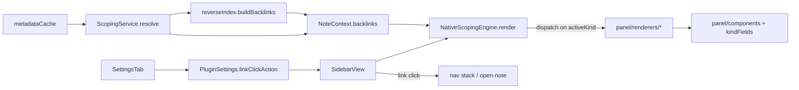
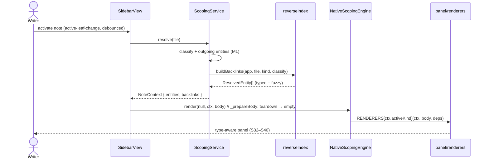
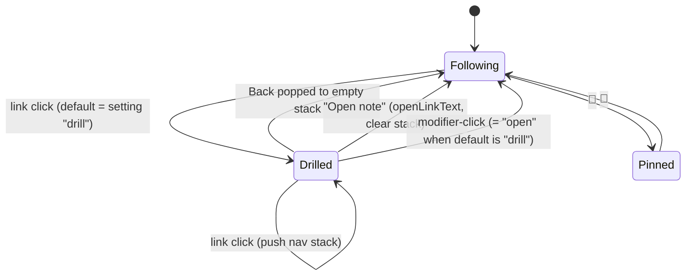

# Solution Design Document

## Validation Checklist

### CRITICAL GATES (Must Pass)

- [x] All required sections are complete
- [x] No [NEEDS CLARIFICATION] markers remain
- [x] Architecture pattern is clearly stated with rationale
- [x] All architecture decisions confirmed by user (ADR-1…9)
- [x] Every interface has specification

### QUALITY CHECKS (Should Pass)

- [x] All context sources listed with relevance ratings
- [x] Project commands discovered from actual project files
- [x] Constraints → Strategy → Design → Implementation path is logical
- [x] Every component in the diagram has a directory mapping
- [x] Error handling covers all error types (empty/unresolved/cache-null/cycle)
- [x] Quality requirements are specific and measurable
- [x] Component names consistent across diagrams
- [x] A developer could implement from this design
- [x] Implementation examples use actual schema field names (verified against `schema/*.json`)
- [x] Complex logic (reverse index, hierarchy walk) includes traced walkthroughs

---

## Constraints

- **CON-1 — Platform baseline.** TypeScript strict; Obsidian `minAppVersion` stays
  1.5.7; `isDesktopOnly: false`. The Context tab and reverse resolution must run on
  **mobile** (only DataviewJS view tabs are desktop-only).
- **CON-2 — Public API only.** Reverse resolution must NOT call
  `metadataCache.getBacklinksForFile()` (absent from `obsidian.d.ts`); using it forces
  an `app as any` cast → violates the M2 any-cast confinement and the "mock must match
  real API" rule. Only `metadataCache.resolvedLinks`, `.getFileCache().frontmatterLinks`,
  and `.getFirstLinkpathDest()` may be used.
- **CON-3 — Additive contracts.** `NoteContext` and `ResolvedEntity` are M1/M2 public
  contracts. M3 may only fill `backlinks` and add an *optional* field; no shape break.
  `QueryEngine.render(view, ctx, el)` / `teardown()` signatures are frozen.
- **CON-4 — Frontmatter is truth.** M3 is read-only w.r.t. vault notes; no plugin-owned
  relation store; the panel renders from `metadataCache` only.
- **CON-5 — Teardown discipline (ADR-2/ADR-7 of M2).** Every re-render path runs
  `teardown → el.empty() → render`; listeners are delegated on the panel body (die on
  `body.empty()`) or registered on a Component.
- **CON-6 — Schema pipeline.** The new `plotline`/`book` types and the `image` field
  follow `docs/schema-change-runbook.md`; `npm run schema:gen` regenerates artifacts and
  `npm run schema:check` is the gate.
- **CON-7 — Branch discipline.** Work on `contextual-panel`; hooks block `main`.
  English-only content. Conventional Commits.

## Implementation Context

### Required Context Sources

#### Documentation Context
```yaml
- doc: docs/XDD/specs/004-contextual-panel/requirements.md
  relevance: CRITICAL
  why: "F1–F7 + ACs this design must satisfy; decisions D1–D6"
- doc: docs/XDD/specs/004-contextual-panel/mockups.html
  relevance: CRITICAL
  why: "Styled panel states S32–S43 — the render target per kind"
- doc: docs/XDD/specs/002-query-engine-dataview/solution.md
  relevance: HIGH
  why: "ADR-1…9 and the QueryEngine/registry/consent contracts M3 must not break"
- doc: docs/DESIGN.md
  relevance: HIGH
  why: "§4 scoping layer + zero-dependency native fallback; §5 frontmatter-truth"
- doc: docs/schema-change-runbook.md
  relevance: HIGH
  why: "ADD-a-type procedure for plotline/book + image field (ADR-6/7)"
```

#### Code Context
```yaml
- file: src/scoping/ScopingService.ts
  relevance: CRITICAL
  why: "resolve() fills backlinks (ADR-1); classify() already maps all 6 kind tags"
- file: src/scoping/NoteContext.ts
  relevance: CRITICAL
  why: "ResolvedEntity/NoteContext contract; backlinks seam; relation:'backlink'"
- file: src/engines/NativeScopingEngine.ts
  relevance: CRITICAL
  why: "Context-tab renderer to grow into a type dispatcher (ADR-2)"
- file: src/engines/QueryEngine.ts
  relevance: HIGH
  why: "Frozen render/teardown contract; registry wired-only"
- file: src/views/SidebarView.ts
  relevance: HIGH
  why: "_renderResolved path; subject/pin; nav-stack + link handlers land here (ADR-4/5)"
- file: src/store/types.ts
  relevance: MEDIUM
  why: "ViewRecord + StoryForgeData settings blob for the link-click setting"
- file: src/types/index.ts
  relevance: MEDIUM
  why: "PluginSettings stub — linkClickAction added here (ADR-5)"
- file: schema/scene.json
  relevance: HIGH
  why: "Canonical relation fields (pov/characters/location/plotlines/book); model for new types"
- file: scripts/schema-gen.mjs
  relevance: HIGH
  why: "Must generate artifacts for the two new types (ADR-6)"
```

### Implementation Boundaries
- **Must Preserve:** `NoteContext`/`ResolvedEntity`/`QueryEngine` contracts; M2 engine
  registry + consent gate; existing shell states S2–S18; pin behaviour.
- **Can Modify:** `ScopingService.resolve()` (fill backlinks); `NativeScopingEngine`
  (type dispatch); `SidebarView` (nav stack, link handlers); `SettingsTab`;
  `PluginSettings`; `schema/object.json`, `schema/location.json`.
- **Must Not Touch:** M2 consent/checksum modules; DataviewDql/JsEngine internals;
  ViewStore consent slot semantics; the `bases` engine slot (M4).

### Project Commands
```bash
Install:  npm install
Dev:      npm run dev            # esbuild watch → deploys into test/StoryForge/
Test:     npm test              # vitest
Lint:     npm run lint          # eslint (obsidianmd) + stylelint
Build:    npm run build         # tsc + esbuild
Schema:   npm run schema:gen && npm run schema:check
```

## Solution Strategy

- **Architecture pattern:** layered, read-only pipeline —
  `metadataCache → ScopingService (resolve + reverse index) → NoteContext →
  NativeScopingEngine (type dispatch) → per-kind renderer (pure DOM)`. The Context tab
  is native and dependency-free; Dataview stays the engine for optional view tabs.
- **Integration approach:** additive. `ScopingService.resolve()` gains a reverse-index
  step that fills the already-declared `NoteContext.backlinks`. `NativeScopingEngine`
  keeps its `QueryEngine` identity but dispatches on `ctx.activeKind` to a new
  `src/panel/` module of pure renderers. `SidebarView` grows a drill-in nav stack and a
  link-click handler honouring a new setting.
- **Justification:** keeps every M1/M2 contract intact (CON-3); the reverse index is
  cache-only and **synchronous**, so it needs no `_renderGen` staleness guard and no
  `vault.read`; it works with zero plugins installed (DESIGN §4) and on mobile (CON-1).
- **Key decisions:** reverse index keyed on the frontmatter **field name** not the schema
  `"relation"` marker (ADR-1); per-kind renderers as a new module, not inline in the
  engine (ADR-2); `plotline`/`book` become first-class schema types (ADR-6); drill-in is
  the default click with an open-note escape and a settings swap (ADR-4/5).

## Building Block View

### Components



### Directory Map

```
src/
  scoping/
    ScopingService.ts      # MODIFY: call reverse index, fill NoteContext.backlinks (ADR-1)
    NoteContext.ts         # MODIFY: ResolvedEntity gains optional `fuzzy?` flag (ADR-3)
    reverseIndex.ts        # NEW: buildBacklinks(app, subject, kind) → ResolvedEntity[] (ADR-1/8)
  engines/
    NativeScopingEngine.ts # MODIFY: dispatch on ctx.activeKind; delegate to panel/ (ADR-2)
  panel/                   # NEW module — per-kind renderers + shared DOM builders
    renderPanel.ts         # NEW: kind → renderer dispatch table (character…plotline, book)
    components.ts          # NEW: section(), factRow(), relationRow(), linkRow(),
                           #      emptyLine(), unresolvedRow(), portraitTile(), imageTile()
    kindFields.ts          # NEW: per-kind facts/relations field lists (from schema)
    renderers/
      character.ts         # NEW: F1 + fantasy sub-block (ADR-9)
      location.ts          # NEW: F3 hierarchy/inhabitants/scenes-here + image (ADR-7)
      object.ts            # NEW: F3 owner + fuzzy appears-in + image (ADR-7/8)
      lore.ts              # NEW: F3 related + referenced-by (fuzzy) (ADR-8)
      scene.ts             # NEW: F3 entities-in-scene + reading order
      plotline.ts          # NEW: F3 facts + reverse scenes (also renders `book`)
  views/
    SidebarView.ts         # MODIFY: nav stack + drill/open link handler (ADR-4), reads setting
    SubjectSource          # MODIFY: union gains "drilled" (ADR-4)
  settings/
    SettingsTab.ts         # MODIFY: link-click action dropdown row (ADR-5)
  types/
    index.ts               # MODIFY: PluginSettings.linkClickAction: "drill"|"open" (ADR-5)
styles.css                 # MODIFY: panel section/portrait/imageTile/trail/pinhint classes
schema/
  plotline.json            # NEW (ADR-6)
  book.json                # NEW (ADR-6)
  object.json              # MODIFY: + optional `image` field (ADR-7)
  location.json            # MODIFY: + optional `image` field (ADR-7)
scripts/
  schema-gen.mjs           # VERIFY/EXTEND: emit artifacts for plotline + book (ADR-6)
  schema-check.mjs         # VERIFY: gate covers the two new types
test/StoryForge/           # PLAN: seed a fantasy character, an object-in-scene, a
                           #       lore-in-scene reference, and >=1 non-empty image
```

### Interface Specifications

#### Data model changes

```typescript
// src/scoping/NoteContext.ts — ResolvedEntity (ADR-3, additive optional field)
export interface ResolvedEntity {
  file: TFile;
  kind: EntityKind;
  relation: "outgoing" | "backlink" | "self";
  field?: string;         // frontmatter field the edge came through (e.g. "pov", "owner")
  unresolved?: boolean;
  fuzzy?: boolean;        // NEW: true for prose/body backlinks (object/lore appears-in, ADR-8)
}
// resolve() now fills `backlinks: ResolvedEntity[]`.
// DEVIATION DV-1 (Phase 3): NoteContext ALSO gains `frontmatter: Record<string, unknown>`
// (raw cache.frontmatter, `{}` on cache-null) so per-kind renderers can show scalar facts
// (role/status/tagline/logline/portrait/image/…) without app access — additive, keeps
// renderers pure/data-testable. See plan/phase-3.md DV-1.
```

```typescript
// src/scoping/reverseIndex.ts — NEW (ADR-1/8), synchronous, cache-only
/**
 * Build reverse relations pointing AT `subject`.
 * Typed backlinks: source notes whose frontmatter field resolves to subject.
 * Fuzzy backlinks:  source notes that link subject anywhere (body), for kinds
 *                   with no typed inbound field (object/lore "appears in").
 */
export function buildBacklinks(
  app: App,
  subject: TFile,
  subjectKind: EntityKind,
  classify: (f: TFile) => EntityKind,
): ResolvedEntity[];
```

```typescript
// src/panel/renderPanel.ts — NEW (ADR-2)
export type PanelRenderer = (ctx: NoteContext, el: HTMLElement, deps: PanelDeps) => void;
export interface PanelDeps {
  // As shipped (Phase 3/4): renderers stay pure and stamp link targets via
  // `data-sf-link`; SidebarView owns a single delegated body handler that routes
  // drill/open (ADR-4). Per-link `onOpenLink` is therefore a plain path opener,
  // NOT a (target, mode) router — the delegated handler supersedes it (T4.2).
  onOpenLink: (path: string) => void;                           // open a linked note by path
  collapsed: Record<string, boolean>;                           // section collapse state, keyed by section id
  toggleCollapse: (sectionId: string) => void;
}
export const RENDERERS: Record<EntityKind, PanelRenderer>;      // "unknown" → flat fallback
```

```typescript
// src/types/index.ts — PluginSettings (ADR-5)
export interface PluginSettings {
  exampleSetting: string;
  linkClickAction: "drill" | "open";   // NEW; default "drill"; modifier-click inverts
}
```

```typescript
// src/views/SidebarView.ts — SubjectSource (ADR-4)
export type SubjectSource = "follow" | "pinned" | "drilled";   // "drilled" is NEW
// navStack: TFile[] — drill pushes current subject; Back pops; open-note clears & follows
```

#### Data Storage Changes (schema — ADR-6/7)

```yaml
# NEW entity type — schema/plotline.json  (folder "20 Planning", tag "planning/plotline")
Fields: type(fixed=plotline), name(text), title(text), logline(text),
        status(select: seed|active|resolved|abandoned), series(text, default Forge),
        tags(tags: planning/plotline)

# NEW entity type — schema/book.json  (folder "20 Planning", tag "planning/book")
Fields: type(fixed=book), name(text), title(text), subtitle(text), author(text),
        order(number), status(select: planning|drafting|revising|done),
        series(text, default Forge), tags(tags: planning/book)

# MODIFY schema/object.json  — add optional image
  ADD FIELD: image (text)   # optional image link, like character.portrait

# MODIFY schema/location.json — add optional image
  ADD FIELD: image (text)   # optional image link

schema_doc: schema/README.md
generator:  scripts/schema-gen.mjs   # globs schema/*.json → FileClass/Template/Schema/*.md/json/infra
gate:       scripts/schema-check.mjs
```

Field lists above are the *minimal* proposal (finalise against `_forge` in PLAN P1).
`classify()` already maps `#planning/plotline` → `plotline`; `#planning/book` has no
kind — **`book` needs an `EntityKind` addition** (`"book"`) and a `TAG_MAP` row
(`["#planning/book", "book"]`), see ADR-6.

### Implementation Examples

#### Reverse index — typed vs fuzzy backlinks (ADR-1/8)

**Why:** this is the core new algorithm; "appears in" must be *field-filtered*, not a raw
backlink walk. Uses only public APIs (CON-2).

```typescript
// Schema reference (verified): scene.json fields pov(relation), characters(list relation),
// location(relation), plotlines(list), book(relation); object.json owner(relation);
// location.json world(relation), inhabitants(list relation).
export function buildBacklinks(app, subject, subjectKind, classify): ResolvedEntity[] {
  const out: ResolvedEntity[] = [];
  const { resolvedLinks } = app.metadataCache;      // { srcPath: { destPath: count } }  (CON-2)
  const subjectPath = subject.path;

  for (const srcPath in resolvedLinks) {
    if (!resolvedLinks[srcPath][subjectPath]) continue;     // prefilter: src links subject at all
    const srcFile = app.vault.getAbstractFileByPath(srcPath);
    if (!(srcFile instanceof TFile)) continue;
    const cache = app.metadataCache.getFileCache(srcFile);
    if (!cache) continue;
    const srcKind = classify(srcFile);

    // Typed backlink: a frontmatter field on src resolves to subject.
    let typed = false;
    for (const fm of cache.frontmatterLinks ?? []) {
      const dest = app.metadataCache.getFirstLinkpathDest(fm.link, srcPath);
      if (dest?.path !== subjectPath) continue;
      out.push({ file: srcFile, kind: srcKind, relation: "backlink",
                 field: fm.key.replace(/\.\d+$/, "") });   // "characters.0" → "characters"
      typed = true;
    }

    // Fuzzy backlink (ADR-8): only for kinds with no typed inbound field (object/lore),
    // and only when NO typed edge was found, so we don't double-count.
    if (!typed && (subjectKind === "object" || subjectKind === "lore") && srcKind === "scene") {
      out.push({ file: srcFile, kind: srcKind, relation: "backlink", fuzzy: true });
    }
  }
  return out;
}
```

**Traced walkthrough — subject = `Mara Stoneway` (character):**
- `resolvedLinks["10 Manuscript/.../Scene 1.md"]` includes `…/Mara Stoneway.md` → candidate.
- Scene 1 `frontmatterLinks`: `pov → Mara`, `characters.0 → Mara`, `location → Lighthouse`…
  Two resolve to Mara → emit `{field:"pov"}` and `{field:"characters"}` backlinks. The
  character renderer groups these under **Appears in**, flags `pov` (mockup S32).
- A note that only mentions `[[Mara]]` in prose: `resolvedLinks` hits, but no
  `frontmatterLinks` entry resolves to Mara and Mara is not object/lore → nothing emitted
  (prose mention correctly excluded).

**Traced walkthrough — subject = `The Beacon Lens` (object):**
- Scene 1 links the lens in its body only (no `objects` field exists). `frontmatterLinks`
  has no edge to the lens, `subjectKind==="object"`, `srcKind==="scene"` → emit
  `{fuzzy:true}` backlink → object renderer lists it under **Appears in** (mockup S37, D2).

#### Location hierarchy walk — cycle-safe (F3)

```typescript
// Walk `world` chain upward; guard against cycles/unresolved (PRD F3 AC).
function worldChain(app, start): TFile[] {
  const chain: TFile[] = []; const seen = new Set<string>(); let cur = start;
  while (cur) {
    if (seen.has(cur.path)) break;         // cycle → stop, mark break in renderer
    seen.add(cur.path); chain.push(cur);
    const world = app.metadataCache.getFileCache(cur)?.frontmatter?.world;  // scalar [[link]]
    if (!world) break;                      // top-level (world:"") → stop
    cur = app.metadataCache.getFirstLinkpathDest(stripLink(world), cur.path);
  }
  return chain.reverse();                    // parent-first breadcrumb (mockup S36 "Within")
}
```

## Runtime View

### Primary Flow — follow → resolve → type-aware render



### Drill-in / open flow (ADR-4/5)



### Error Handling
- **Unresolved link (F5):** `ResolvedEntity.unresolved` → `unresolvedRow()` (muted,
  `aria-disabled`, `⊘ … (unresolved)`); no click handler; resolution continues.
- **Empty relation/reverse (F5):** renderer emits `emptyLine()` copy ("No scenes yet." …)
  instead of a blank region; fully-empty relationship block collapses to one line.
- **Metadata cache null (pre-index):** `resolve()` returns empty context; SidebarView keeps
  the existing S9 error+Retry (unchanged) — NOT treated as empty relations.
- **`world` cycle/unresolved parent:** the `world` breadcrumb is single-level (DV-2), so a
  cycle cannot loop; an unresolved parent renders as an unresolved row. (Full multi-level,
  break-point-marked ancestry is deferred per DV-2.)
- **Renderer throw:** caught by SidebarView's existing engine-render try/catch → engine-error
  box; `currentEngine` nulled; teardown safe.

## Cross-Cutting Concepts

### UI & UX
- **Design system:** reuse the panel shell (`.vhead/.chead/.badge/.tabs/.body`). New CSS in
  `styles.css` (bundled, no runtime `<style>`): `.sf-section/.sf-sec-head/.sf-portrait/
  .sf-imgtile/.sf-frow/.sf-rel/.sf-lrow/.sf-unres/.sf-trail/.sf-pinhint` mirroring
  `mockups.html`. Kind badge tokens add `object/lore/plotline` (+`book`).
- **Accessibility:** section headers `role="button"` + `aria-expanded`; link rows are
  focusable (keyboard drill/open); portrait/image tile carries `alt`/`aria-label` = entity
  name; unresolved rows `aria-disabled="true"`; body keeps `aria-live="polite"`.
- **State:** section collapse is per-label in-memory on SidebarView (persistence = Could-have,
  deferred). Drill nav stack is in-memory, cleared on note-open and on close.

### System-Wide Patterns
- **Security:** none new — read-only, no code execution; the native panel bypasses the
  consent gate by design (only DataviewJS view tabs are gated).
- **Performance:** reverse index is O(sources-linking-subject) via the `resolvedLinks`
  prefilter, run once per debounced note switch, fully synchronous (no `vault.read`).
- **Mobile:** all APIs public + cross-platform (CON-1/2).

## Architecture Decisions

- [x] **ADR-1 — Reverse relations in `ScopingService.resolve()`, sync, field-filtered.**
  Build `NoteContext.backlinks` via a `resolvedLinks` prefilter + per-candidate
  `frontmatterLinks` scan, keyed on the **frontmatter field name** (index-stripped), not
  the schema `"relation"` marker.
  - Rationale: exact field-level "appears in"/"owns"/"inhabits" filtering for free;
    public-API-only (CON-2); sync + cache-only avoids the `_renderGen` async guard; catches
    `plotlines`/`first_appearance`/`related` which carry no `"relation"` key.
  - Trade-offs: a per-switch scan of subject-linking sources; bounded by the prefilter,
    acceptable for real vaults; no hard ms budget (degrade-gracefully signal).
  - User confirmed: **Yes**

- [x] **ADR-2 — Per-kind renderers as a new `src/panel/` module; `NativeScopingEngine`
  becomes a thin type dispatcher.** `render(null, ctx, el)` dispatches on `ctx.activeKind`
  to `RENDERERS[kind]`; `unknown` keeps the current flat list.
  - Rationale: keeps the frozen `QueryEngine` contract (CON-3); pure render functions are
    unit-testable without a live vault; separates layout from engine plumbing; matches
    DESIGN §5 ("the plugin renders; frontmatter is truth").
  - Trade-offs: layout is hand-coded TS (intended — the native layer is code; declarative
    surface is the curated Dataview views); six renderers to maintain.
  - User confirmed: **Yes**

- [x] **ADR-3 — Reuse `ResolvedEntity` for backlinks; add optional `fuzzy?` flag.**
  Backlinks are `relation:"backlink"` with `field`; `fuzzy:true` marks body-only edges.
  - Rationale: additive, no `NoteContext`/`isNoteContext` change (CON-3); one model for
    both directions.
  - Trade-offs: consumers must branch on `relation`/`fuzzy`; acceptable.
  - User confirmed: **Yes**

- [x] **ADR-4 — Drill-in nav stack on `SidebarView`; `SubjectSource` gains `"drilled"`.**
  Default click drills (push subject, re-resolve, follow suspended); Back pops; Open-note
  uses `workspace.openLinkText` and resumes follow; pinned is unchanged.
  - Rationale: satisfies F6 + mockup S41; additive union member; reuses the resolve pipeline.
  - Trade-offs: a second navigation model beside Obsidian's; bounded by an in-memory stack
    cleared on open/close.
  - User confirmed: **Yes**

- [x] **ADR-5 — Link-click action setting `linkClickAction: "drill" | "open"` (default
  `"drill"`), modifier-click inverts; rendered as a dropdown row in `SettingsTab`.**
  Persisted in the `data.json` settings blob (mason `StoryForgeData.settings`).
  - Rationale: implements D3 (drill default, open on modifier, swappable); `PluginSettings`
    is a stub so the field is a clean add; extends the spec-003 settings surface.
  - Trade-offs: one more setting; default chosen per D3.
  - User confirmed: **Yes**

- [x] **ADR-6 — `plotline` + `book` become first-class schema types.** Add
  `schema/plotline.json` + `schema/book.json` (minimal fields); `schema:gen` emits their
  artifacts; add `EntityKind "book"` + `TAG_MAP` row `["#planning/book","book"]`
  (`plotline` already mapped).
  - Rationale: implements D1; gives both kinds a facts block (mockup S40) and treats them
    like every other type through the generator/gate; unblocks the plotline/book panels.
  - Trade-offs: a schema change coupled into M3 (runbook-gated); seed notes (`The Dying
    Light.md`, `Wardens of Moonharbor.md`) must be aligned; `schema-gen.mjs` may need a
    tweak if it hard-codes the six current types.
  - User confirmed: **Yes**

- [x] **ADR-7 — Optional `image` field on `object` + `location` (D5).** Text/image link
  like `character.portrait`; renderers show the image when present, else a **kind-glyph
  placeholder tile** (🏛 location / 🔮 object) via `kindTileEl()` inside a `profileRow`.
  - Rationale: implements D5; symmetrical with the character portrait, which always shows
    a tile (image or monogram). *(Revised in the S32–S43 mockup-fidelity pass: the
    original D5 rendered NO placeholder when `image` was absent; the mockup S36/S37
    `.imgtile.loc`/`.imgtile.obj` always show a tile, so the placeholder is now shown to
    match — consistent with the character portrait monogram behaviour.)*
  - Trade-offs: two more schema fields regenerated via `schema:gen`.
  - User confirmed: **Yes**

- [x] **ADR-8 — Fuzzy backlinks for object/lore "appears in".** When a kind has no typed
  inbound scene field, "appears in"/"referenced by" is computed from `resolvedLinks`
  (any scene→subject link) and flagged `fuzzy`.
  - Rationale: implements D2; scenes carry no `objects`/`lore` field; keeps the panel useful
    without a schema change to `scene.json`.
  - Trade-offs: over-reports incidental prose mentions; documented imprecision; revisit a
    typed `scene.objects` later.
  - User confirmed: **Yes**

- [x] **ADR-9 — `character-fantasy` reuses the character renderer with a conditional
  fantasy facts sub-block.** Presence of `species`/`magical_abilities`/`combat_skills`/
  weapons/armor drives an extra facts block; no separate kind (classifies as `character`
  via the base tag).
  - Rationale: one renderer; fantasy is an extension FileClass, not a new tag.
  - Trade-offs: renderer must probe optional fields; trivial.
  - User confirmed: **Yes**

## Quality Requirements

- **Performance:** reverse resolution completes within the existing follow debounce on the
  test vault; synchronous, no `vault.read`; degrades gracefully on large vaults (no hard
  ms target — a verification signal, not analytics).
- **Usability:** every mockup state S32–S43 is reproducible in the running plugin on the
  seed vault (after PLAN seed-note additions); empty/unresolved states never blank or crash.
- **Reliability:** resolution stays non-throwing; renderer throws are caught; teardown is
  leak-free (no per-render listeners survive `body.empty()`).
- **Compatibility:** `npm run test`, `lint`, `typecheck`, `typecheck:test`, `schema:check`
  (covering the two new types), and `build` all green.

## Acceptance Criteria (EARS)

**Reverse resolution [PRD/F2]**
- [ ] WHEN a note resolves, THE SYSTEM SHALL populate `NoteContext.backlinks` with typed
  backlinks keyed on the source frontmatter field.
- [ ] WHERE the subject is an object or lore note, THE SYSTEM SHALL compute "appears in"
  from `resolvedLinks` and mark those entries `fuzzy`.
- [ ] THE SYSTEM SHALL compute reverse relations using only `resolvedLinks`,
  `frontmatterLinks`, and `getFirstLinkpathDest` (never `getBacklinksForFile`).

**Per-kind render [PRD/F1,F3]**
- [ ] WHEN `ctx.activeKind` is character, THE SYSTEM SHALL render facts+portrait,
  relationship groups, "appears in" (POV-flagged), owns, and related (mockup S32).
- [ ] WHILE a location's `world` field points at a cycle or unresolved parent, THE SYSTEM
  SHALL render a bounded single-level breadcrumb without looping (DV-2; multi-level
  break-point marking deferred to a future milestone).
- [ ] WHERE an object/location note has a non-empty `image`, THE SYSTEM SHALL render a
  thumbnail tile; otherwise no tile (ADR-7).

**Schema [PRD/F4]**
- [ ] WHEN `npm run schema:gen` runs, THE SYSTEM SHALL emit FileClass/Template/Schema
  artifacts for `plotline` and `book`, and `schema:check` SHALL pass.
- [ ] WHEN a plotline note is active, THE SYSTEM SHALL classify it `plotline` and render its
  facts + ordered reverse scenes (mockup S40).

**Navigation [PRD/F6]**
- [ ] WHEN a link row is clicked with the default action, THE SYSTEM SHALL drill in (push
  nav stack, re-resolve, suspend follow) (S41).
- [ ] WHEN clicked with the modifier, THE SYSTEM SHALL open the note and resume follow.
- [ ] WHERE `linkClickAction` is `"open"`, THE SYSTEM SHALL swap the default and modifier
  behaviours.

**Empty/partial [PRD/F5]**
- [ ] IF a relation list is empty, THEN THE SYSTEM SHALL show the section's empty-state copy,
  not a blank region.
- [ ] IF a relation link is unresolved, THEN THE SYSTEM SHALL render a muted, non-clickable
  `(unresolved)` row and continue.

## Risks and Technical Debt

### Known Technical Issues
- `scripts/schema-gen.mjs` may enumerate the six current types explicitly; adding two types
  could require a generator tweak (verify in PLAN P1 before authoring renderers).
- All sample `portrait`/`image` fields are empty → the non-empty image/portrait path must be
  tested with at least one seed note carrying an image (PLAN).

### Technical Debt
- Fuzzy object/lore "appears in" (ADR-8) is imprecise pending a typed `scene.objects`
  field (deferred).
- Section-collapse persistence and POV-vs-present refinement are Could-haves, left in-memory.

### Implementation Gotchas
- `frontmatterLinks[].key` carries array indices (`characters.0`) — strip with
  `/\.\d+$/` exactly as `resolve()` already does.
- Alias/piped links (`[[file|display]]`) must resolve via `getFirstLinkpathDest`, never raw
  display text (aliases like Elke's resolve through metadataCache).
- `plotlines`/`related`/`first_appearance` carry no `"relation"` key — the resolver keys on
  the field name, so they are still captured (ADR-1).
- `book` needs both an `EntityKind` member and a `TAG_MAP` row, or it classifies `unknown`.

## Glossary

### Domain Terms
| Term | Definition | Context |
|------|------------|---------|
| Reverse relation / backlink | A note pointing AT the subject through a typed frontmatter field | "appears in", "owns", "inhabitants", "scenes here" |
| Fuzzy backlink | A body/prose link (no typed field) counted as "appears in" | object/lore only (ADR-8) |
| Drill-in | Re-subjecting the panel to a clicked entity without opening the note | F6 / S41 |
| `world` chain | The recursive `location.world` parent hierarchy | S36 "Within" breadcrumb |

### Technical Terms
| Term | Definition | Context |
|------|------------|---------|
| `NoteContext` | Engine-free snapshot of a note's story context | filled by ScopingService |
| `resolvedLinks` | metadataCache map srcPath→{destPath→count} | reverse-index prefilter (CON-2) |
| `frontmatterLinks` | per-note cache of frontmatter wikilinks with `key` | field-filtered reverse edges |
| PanelRenderer | Pure `(ctx, el, deps) ⇒ void` per-kind layout fn | `src/panel/renderers/*` (ADR-2) |
