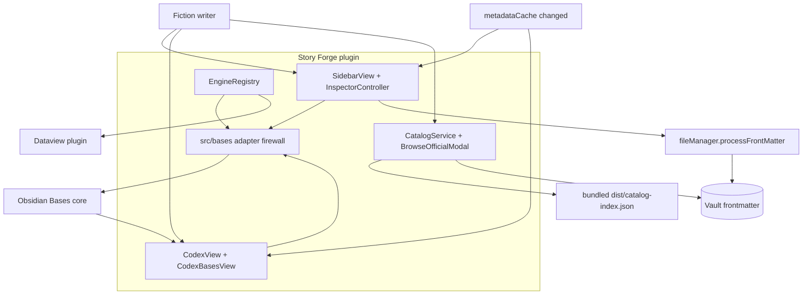
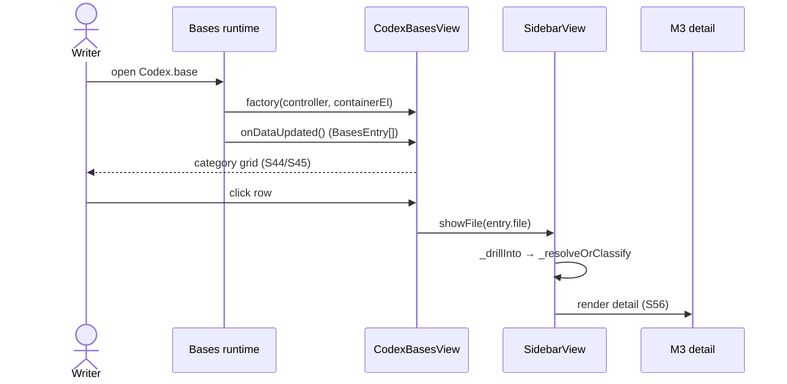
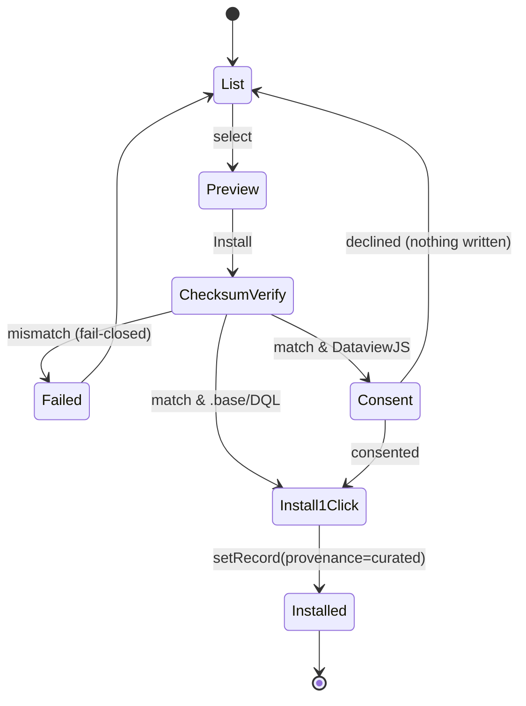
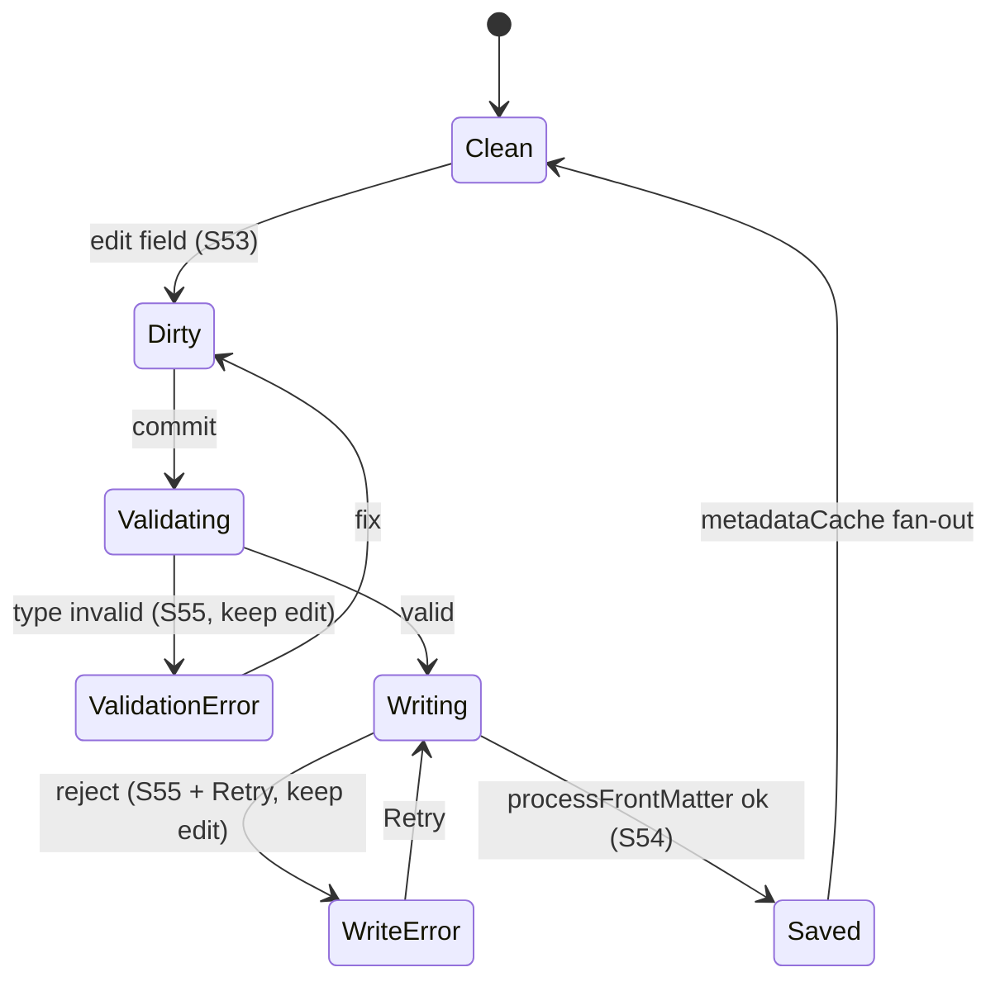

# Solution Design Document

## Validation Checklist

### CRITICAL GATES (Must Pass)

- [x] All required sections are complete
- [x] No [NEEDS CLARIFICATION] markers remain
- [x] Architecture pattern is clearly stated with rationale
- [x] **All architecture decisions confirmed by user** (ADR-1…ADR-10; 6 open questions + 2 workflow calls resolved 2026-07-21)
- [x] Every interface has specification

### QUALITY CHECKS (Should Pass)

- [x] All context sources are listed with relevance ratings
- [x] Project commands are discovered from actual project files
- [x] Constraints → Strategy → Design → Implementation path is logical
- [x] Every component in diagram has directory mapping
- [x] Error handling covers all error types
- [x] Quality requirements are specific and measurable
- [x] Component names consistent across diagrams
- [x] A developer could implement from this design
- [x] Implementation examples use actual symbol/schema names (not pseudocode), verified against source files
- [x] Complex flows include traced walkthroughs with example data

---

## Output Schema

### SDD Status Report

| Field | Value |
|-------|-------|
| specId | 005-bases-codex-catalog |
| architecture | Layered/modular Obsidian-plugin extension: additive engine-registry slot + one Bases-typings adapter firewall + reused M2 consent/checksum/import + reused M3 panel drill-in |
| validationPassed | 13/13 checklist items |
| validationPending | 0 (prototype gate is a pre-**build** gate, not a pre-SDD gate — see ADR-10) |

---

## Constraints

The solution space is bounded by the PRD Constraints, ADR-0001, and the invariants carried from M1–M3.

- **CON-1 — Frontmatter is truth.** Vault notes are read-only **except** the F6 Inspector, which writes **plain frontmatter via `app.fileManager.processFrontMatter`** — no plugin-owned relation/entity store, no plugin-owned state. Bases cell values are **never** written programmatically (no public API; ADR-0001). *(memory: design-principle-frontmatter-truth)*
- **CON-2 — Additive to M1/M2/M3 public contracts.** M4 fills the M2 `bases` engine-registry slot and reuses M2's consent gate + checksum-drift + import machinery and M3's contextual-panel drill-in. It does **not** change `NoteContext`, `ResolvedEntity`, `ViewRecord`, or the `QueryEngine`/`EngineRegistry` shapes — only **extends** them (new `provenance:"curated"` uses, a new public `SidebarView.showFile`, a new `bases` fenced-lang).
- **CON-3 — Single Bases-typings firewall.** All Bases typings (`BasesView`, `QueryController`, `BasesEntry`, `BasesConfigFile`, `BasesViewConfig`, `registerBasesView`) and every Bases-runtime interaction live in **one module** (`src/bases/`), exactly as `src/engines/EngineRegistry.ts` is the sole home for the `app as any` Dataview casts. This is the API-churn firewall (ADR-0001 Consequences). *(memory: obsidian-mock-must-match-real-api — build to `obsidian.d.ts`, `as unknown as` on app/vault is a red flag)*
- **CON-4 — Teardown discipline.** Every Bases surface, Codex grid, and Inspector obeys the M3 `teardown → empty → render` discipline (`SidebarView._prepareBody`, `src/views/SidebarView.ts:1050`), owns a `Component` (unloaded on teardown), and registers listeners via `registerDomEvent`/`registerEvent` (auto-clean). No per-render leaks, no stale content bleed.
- **CON-5 — `minAppVersion` → 1.12.7.** Bumped from 1.5.7. Honest floor: `registerBasesView` is `@since 1.10.0`, the fence ≥1.9; 1.12.7 is current stable, 1.13 is Catalyst/beta and not required. The core panel + Dataview engine gain **no new floor** — they degrade rather than hard-fail when Bases is unavailable.
- **CON-6 — Core Bases may be disabled.** Bases is a **core** plugin the user may turn off. M4 feature-detects it via the boolean returned by `registerBasesView` (`obsidian.d.ts:5005`, "@returns false if bases are not enabled") — **not** via `plugins.plugins["bases"]` (wrong namespace) and **not** via `internalPlugins` (untyped in `obsidian.d.ts`). Detection is re-read per render, never cached (mirrors `getDataviewApi`, `EngineRegistry.ts:38`).
- **CON-7 — Public API only.** `MarkdownRenderer.render` for the fence; `registerBasesView` for the Codex; `processFrontMatter` for writes. No private `controller.view` casts (ADR-0001).
- **CON-8 — No 3rd-party plugin dependency.** No `advanced-bases`, no community Kanban. Dataview stays a soft, feature-detected dependency as in M2/M3.
- **CON-9 — Offline / no telemetry.** The catalog is **bundled**; **zero** runtime network access on any path (`fetch`/`requestUrl` are forbidden in the catalog install flow); no analytics.
- **CON-10 — Process discipline.** Work on the **`bases-codex-catalog`** branch; hooks block direct commits to `main`; Conventional Commits; **English-only** committed content (plugin and test vault). *(memory: english-only-vault-and-plugin)*

## Implementation Context

**IMPORTANT**: All context sources below were read and analyzed during SDD research (Agent Team: Integration / Architecture / Robustness, 2026-07-21).

### Required Context Sources

#### Documentation Context
```yaml
- doc: docs/XDD/adr/0001-bases-integration-strategy.md
  relevance: CRITICAL
  why: "Locks the three Bases integration mechanisms (fence / registerBasesView / processFrontMatter); this SDD implements it."
- doc: docs/XDD/specs/005-bases-codex-catalog/requirements.md
  relevance: CRITICAL
  why: "F1–F8, 42 Gherkin ACs, the 6 SDD-level open questions this SDD resolves."
- doc: docs/XDD/specs/005-bases-codex-catalog/mockups.html
  relevance: HIGH
  why: "Styled states S44–S57 the surfaces must match (Codex grid/empty/Bases-off; catalog list/preview/update/JS-consent; sidepanel fence; Inspector detail/dirty/saved/error; Codex↔panel)."
- doc: docs/DESIGN.md
  relevance: HIGH
  why: "Two render surfaces, query-engine model, curated+authored view library; the catalog pattern cloned from markdown-mason."
- doc: docs/view-roadmap.md
  relevance: HIGH
  why: "V4–V8 field/sort/group spec for the five F3 overview views."
- doc: docs/build-plan.md
  relevance: MEDIUM
  why: "M4 exit criteria (Codex browsable; overviews installable; ADR spike recorded; Inspector ③ chosen; v0.2 tag)."
```

#### Code Context
```yaml
- file: src/engines/QueryEngine.ts
  relevance: CRITICAL
  why: "The engine contract (kind + render(view,ctx,el) + teardown()); the `bases` slot is intentionally UNWIRED (:59-61). F1 fills it."
- file: src/engines/EngineRegistry.ts
  relevance: CRITICAL
  why: "buildEngineRegistry (:77) + getDataviewApi (:38, the per-render soft-detect + `app as any` firewall). F1/F5 mirror this for Bases."
- file: src/engines/DataviewDqlEngine.ts
  relevance: CRITICAL
  why: "The exact QueryEngine teardown pattern (owned Component load()/unload(), self-unload on throw) BasesFenceEngine mirrors one-to-one."
- file: src/views/SidebarView.ts
  relevance: CRITICAL
  why: "_drillInto (:639), _resolveOrClassify (:680), _prepareBody/_renderGen (:1050/:1066), _renderEngineMissing (:1186, the S11 `bases` branch to repurpose), metadataCache changed subscription (:252), leaf lookup pattern precedent, _renderRelevantEqual (:838), onClose (:279)."
- file: src/consent/ConsentGate.ts
  relevance: CRITICAL
  why: "requestConsentForDef (:173) + evaluate (:114, reads source via readFencedBlock) + fail-closed posture (:82). Catalog DataviewJS install routes here; the readFencedBlock dataview-only limit is the biggest greenfield seam."
- file: src/consent/checksum.ts
  relevance: CRITICAL
  why: "computeChecksum (:31, sha256 hex over UTF-8). Reused byte-for-byte at build time and at install-time fail-closed verify."
- file: src/import/ViewImporter.ts
  relevance: HIGH
  why: "importToStore (:177) + toRecord (:141, hardcodes provenance:'imported' — needs a curated override) + DUPLICATE detection (:185)."
- file: src/import/ImportFlow.ts
  relevance: HIGH
  why: "runImportFlow (:48) ALWAYS gates — F4 .base/DQL 1-click needs a gate-less sibling flow."
- file: src/import/fencedBlock.ts
  relevance: HIGH
  why: "QUERY_LANGS (:20) recognises only dataview/dataviewjs — a bases source is .base YAML, not a fenced dataview block. Source-model seam (ADR-5)."
- file: src/import/ImportPickerModal.ts
  relevance: MEDIUM
  why: "Structure the Browse-official modal (S47/S48) clones: list rows + inline preview + confirm."
- file: src/store/ViewStore.ts
  relevance: HIGH
  why: "setRecord (:57) persist + _notify subscribers; SidebarView re-renders tabs via store.subscribe."
- file: src/store/types.ts
  relevance: HIGH
  why: "ViewRecord.engine already includes 'bases' (:26); provenance union already includes 'curated' (:15); applyDefaults (:102)."
- file: src/panel/renderPanel.ts, src/panel/renderers/*.ts, src/panel/kindFields.ts
  relevance: HIGH
  why: "Per-kind read-only detail renderers the Inspector reuses for display + column layout for the Codex grid."
- file: src/main.ts
  relevance: HIGH
  why: "onload/onLayoutReady wiring (:59 registerView, :89 populateRegistry, :162 leaf-lookup command pattern, dataview:api-ready late-join)."
- file: schema/character.json (+ location/object/lore/scene/character-fantasy)
  relevance: HIGH
  why: "select `values` vocabularies (e.g. role/status) driving the F6 constrained dropdown (ADR-7)."
- file: test/StoryForge/00 Meta/Bases/Canon.base, Manuscript.base
  relevance: HIGH
  why: "M3-seeded .base source for 4/5 overview views + the Codex categories; the default Q5 install folder (00 Meta/Bases)."
- file: manifest.json
  relevance: MEDIUM
  why: "minAppVersion 1.5.7 → 1.12.7 (CON-5)."
- file: node_modules/obsidian/obsidian.d.ts (pinned 1.13.1)
  relevance: CRITICAL
  why: "registerBasesView (5009), BasesView (1105), BasesEntry (685), BasesQueryResult (971), BasesConfigFile (531), BasesViewConfig (1176), MarkdownRenderer.render (4147), processFrontMatter (2954), metadataCache.on('changed') (4453)."
```

#### External APIs (Obsidian core surfaces)
```yaml
- service: Obsidian Bases (core plugin, GA ~1.9.10)
  doc: obsidian.d.ts 1.13.1 + "Build a Bases view" dev docs
  relevance: CRITICAL
  why: "registerBasesView (custom view type, read BasesEntry[] in onDataUpdated); MarkdownRenderer ```base``` fence (read-only embed). No public embed/results/cell-write API (ADR-0001)."
- service: Obsidian FileManager
  doc: obsidian.d.ts processFrontMatter (2954, @since 1.4.4)
  relevance: CRITICAL
  why: "Atomic plain-frontmatter read-modify-write for the F6 Inspector."
- service: Obsidian Dataview (community, soft dependency)
  doc: existing M2/M3 integration
  relevance: MEDIUM
  why: "Coexists as a peer engine; DataviewJS catalog entries route through the existing consent gate."
```

### Implementation Boundaries

- **Must Preserve:** `QueryEngine`/`EngineRegistry` shape; `ViewRecord` shape; `NoteContext`/`ResolvedEntity`; the M3 panel drill-in behaviour (`_drillInto`/`navStack`/drilled-follow-suspension); the M2 consent gate + checksum semantics; the S11 engine-missing UX; per-render soft-detection discipline.
- **Can Modify:** `SidebarView` (add public `showFile`, host an `InspectorController`, repurpose the `_renderEngineMissing` `bases` copy); `ViewImporter`/`ImportFlow` (add a `provenance` override + a gate-less 1-click flow); `fencedBlock.ts`/`ConsentGate.evaluate` (make source-reading `bases`-aware); `EngineRegistry`/`main.ts` populate (register the Bases engine + Codex view + feature-detect); `manifest.json` (`minAppVersion`); `package.json` (add `catalog:build`).
- **Must Not Touch:** the `schema/*.json` canonical model and its generated vault artifacts (out of M4 scope — no schema change; `npm run schema:check` must stay green); the M5/M6 interactive-view surfaces; the note-panel (in-note) surface (DESIGN §2 surface B).

### External Interfaces

#### System Context Diagram



#### Interface Specifications

```yaml
inbound:
  - name: "Sidebar view-tabs (F1 Bases fence)"
    type: Obsidian ItemView (right leaf)
    format: DOM render via QueryEngine.render(view, ctx, el)
    trigger: active-note change (debounced follow) / tab select
    data_flow: "curated .base YAML → ```base``` fence → read-only Bases render, scoped to ctx.activeFile.path"
  - name: "Codex main-area view (F2)"
    type: registerBasesView custom view type instantiated by the Bases runtime inside a .base
    format: BasesView.onDataUpdated() reads BasesQueryResult (BasesEntry[])
    trigger: user opens Codex.base; vault/Bases-config change
    data_flow: "BasesEntry[] → category grid DOM; row click → SidebarView.showFile(entry.file)"
  - name: "Browse-official modal (F4)"
    type: Obsidian Modal
    format: reads bundled dist/catalog-index.json; list/preview/install
    data_flow: "catalog entry → (checksum verify) → (DataviewJS: consent gate) → ViewImporter.importToStore(provenance:'curated')"
  - name: "Inspector edit (F6)"
    type: edit-mode overlay inside SidebarView detail
    format: scalar/enum field controls; commit → processFrontMatter
    data_flow: "dirty field value → validate → fileManager.processFrontMatter → metadataCache fan-out"

outbound:
  - name: "Obsidian Bases runtime"
    type: registerBasesView / MarkdownRenderer.render
    authentication: n/a (in-process)
    data_flow: "read-only query results + rendered base; NO cell writes (no public API)"
    criticality: HIGH
  - name: "Obsidian FileManager"
    type: fileManager.processFrontMatter(file, fn)
    data_flow: "plain-frontmatter read-modify-write (the ONLY M4 write path)"
    criticality: HIGH

data:
  - name: "Bundled catalog index"
    type: JSON asset compiled into main.js (or dist/) at build time
    connection: static import / read-at-load
    data_flow: "checksummed, versioned curated-view manifest — offline, no fetch"
  - name: "Plugin data.json"
    type: Obsidian saveData/loadData (existing ViewStore persistence)
    connection: Plugin.saveData
    data_flow: "installed ViewRecord[] incl. provenance:'curated' + checksum + settings (curated .base folder path)"
  - name: "Vault frontmatter + curated .base files"
    type: vault files
    connection: fileManager / vault adapter
    data_flow: "F6 frontmatter writes; F4 installs curated .base into the configurable folder (default 00 Meta/Bases)"
```

### Cross-Component Boundaries

- **API Contracts (must not break):** `QueryEngine`, `EngineRegistry`, `ViewRecord`, `NoteContext`/`ResolvedEntity`, the `ConsentGate` result union. M4 extends, never breaks them.
- **Team Ownership:** single-maintainer plugin; no cross-team coordination.
- **Shared Resources:** `ViewStore` (plugin `data.json`) is shared by import, catalog, and sidebar; `metadataCache` events are shared by panel, Codex, and any open base.
- **Breaking Change Policy:** additive only within M4; the `_forge` schema is frozen for this milestone.

### Project Commands

```bash
# Discovered from package.json / CLAUDE.md
Install:       npm install
Dev (watch):   npm run dev            # esbuild watch → redeploys into test/StoryForge/
Test:          npm test               # vitest
Lint:          npm run lint           # eslint (obsidianmd rules) + stylelint
Typecheck:     npm run typecheck      # tsc --noEmit (+ typecheck:test / typecheck:mock)
Build:         npm run build          # tsc check + esbuild production build
Schema gate:   npm run schema:gen / npm run schema:check

# NEW for M4
Catalog build: npm run catalog:build  # catalog/ sources → checksummed dist/catalog-index.json
                                       #   + build-time .base YAML validation against BasesConfigFile
```

## Solution Strategy

- **Architecture Pattern:** **Layered, additive plugin extension** with a **single-module anti-corruption firewall** for the volatile Bases API. Four new feature modules (`bases/`, `codex/`, `inspector/`, `catalog/`) plug into existing seams (`engines/`, `import/`, `consent/`, `store/`, `views/`, `panel/`) without changing their contracts.
- **Integration Approach:**
  1. **F1** implements the empty M2 `bases` engine slot as a `QueryEngine` (`BasesFenceEngine`) that renders a ```base``` fence via `MarkdownRenderer.render` — a drop-in peer of the Dataview engines, so it inherits the panel's teardown/generation-guard machinery with **zero `SidebarView` changes**.
  2. **F2** registers **one polymorphic** Bases view type (`registerBasesView`) whose category comes from view config; the Codex is a curated `Codex.base` opened in the main area; row clicks call the new public **`SidebarView.showFile`** which delegates to the existing private `_drillInto`.
  3. **F4** clones the markdown-mason pipeline (`catalog/` → `catalog:build` → checksummed bundled index) and maps the runtime install onto **existing M2 machinery** with two minimal extensions (a `provenance` override on the importer; a gate-less 1-click sibling flow). DataviewJS entries route through the existing `ConsentGate`; `.base`/DQL install 1-click; checksum verify fails closed **before** any write.
  4. **F5** feature-detects Bases via the `registerBasesView` boolean, re-read per render, and degrades every Bases surface through the **existing** `_renderEngineMissing` S11 path (repurposing its stale "Engine coming in M4" `bases` copy).
  5. **F6** adds an `InspectorController` hosted inside `SidebarView`'s detail, writing plain frontmatter via `processFrontMatter`; the existing `metadataCache.changed` subscription fans the change out to panel + Codex + any open base for free.
- **Justification:** Every surface reuses a proven M2/M3 seam, minimising new plumbing and honouring CON-2 (additive) and CON-1 (frontmatter is truth). The one genuinely new architectural element — the `src/bases/` firewall — directly discharges ADR-0001's accepted API-churn risk by confining all volatile typings to one file.
- **Key Decisions:** ADR-1…ADR-10 below (all confirmed).

## Building Block View

### Components

```mermaid
graph LR
    subgraph new[NEW M4 modules]
        BA[bases/BasesAdapter<br/>feature-detect + typings firewall]
        BF[bases/basesFence<br/>MarkdownRenderer helper]
        BC[bases/basesConfig<br/>.base YAML validator/builders]
        BE[engines/BasesFenceEngine<br/>QueryEngine kind=bases]
        CV[codex/CodexView + CodexBasesView + codexGrid]
        IC[inspector/InspectorController + frontmatterWriter + editableFields]
        CS[catalog/CatalogService + BrowseOfficialModal + catalogTypes]
        BUILD[scripts/build-catalog.mjs + catalog/ sources]
    end
    subgraph reused[EXISTING seams (extended)]
        ER[engines/EngineRegistry]
        SV[views/SidebarView]
        CG[consent/ConsentGate + checksum]
        VI[import/ViewImporter + ImportFlow + fencedBlock]
        VS[store/ViewStore]
        PR[panel/renderers + kindFields]
    end
    BE --> BF --> BA
    BC --> BA
    BUILD --> BC
    ER --> BE
    CV --> BA
    CV -->|showFile| SV
    IC --> PR
    IC -->|processFrontMatter| SV
    SV --> IC
    CS --> CG
    CS --> VI
    CS --> VS
    CS --> BUILD
    BE -. degrade .-> SV
```

### Directory Map

**Component**: story-forge plugin (single component)
```
.
├── src/
│   ├── bases/                     # NEW — the ONLY Bases-typings module (CON-3 firewall)
│   │   ├── BasesAdapter.ts        # NEW: isBasesAvailable(app) (per-render, boolean from registerBasesView);
│   │   │                          #      registerCodexView(plugin); all BasesView/BasesEntry/BasesConfigFile imports
│   │   ├── basesFence.ts          # NEW: renderBaseFence(app, yaml, el, sourcePath, component) via MarkdownRenderer.render
│   │   └── basesConfig.ts         # NEW: typed builders + BasesConfigFile validation for authored .base YAML
│   ├── engines/
│   │   ├── BasesFenceEngine.ts    # NEW: implements QueryEngine, kind="bases"; wraps basesFence; owns a Component
│   │   └── EngineRegistry.ts      # MODIFY: register BasesFenceEngine when isBasesAvailable(); mirror getDataviewApi
│   ├── codex/                     # NEW
│   │   ├── CodexView.ts           # NEW: main-area ItemView host (tab chrome, F5 degrade S46, empty-state S45)
│   │   ├── CodexBasesView.ts      # NEW: the ONE polymorphic registerBasesView type; reads category via config.get
│   │   └── codexGrid.ts           # NEW: pure DOM grid (columns from kindFields); row → TFile; delegated click
│   ├── inspector/                 # NEW
│   │   ├── InspectorController.ts # NEW: edit-mode host inside SidebarView; dirty/saved/error state machine (S52–S55)
│   │   ├── frontmatterWriter.ts   # NEW: processFrontMatter wrapper; validate-before-write; error mapping
│   │   └── editableFields.ts      # NEW: scalar/enum controls; select vocab from schema/*.json values (ADR-7)
│   ├── catalog/                   # NEW
│   │   ├── CatalogService.ts      # NEW: load bundled index; checksum verify; install/update; curated provenance
│   │   ├── BrowseOfficialModal.ts # NEW: S47/S48/S49/S57 UI (clone ImportPickerModal structure)
│   │   └── catalogTypes.ts        # NEW: CatalogEntry / index shape (id, name, engine, provenance, version, checksum, source)
│   ├── views/SidebarView.ts       # MODIFY: public showFile(file); host InspectorController; repurpose _renderEngineMissing bases copy
│   ├── import/
│   │   ├── ViewImporter.ts        # MODIFY: importToStore/toRecord accept a provenance override
│   │   ├── ImportFlow.ts          # MODIFY: add a gate-less installCurated() sibling for .base/DQL 1-click
│   │   └── fencedBlock.ts         # MODIFY: teach the source reader the "bases" source model (raw .base YAML)
│   ├── consent/ConsentGate.ts     # MODIFY: evaluate() treats a bases record as declarative (no code) → consented
│   ├── store/types.ts             # (no change — engine:"bases" & provenance:"curated" already present)
│   ├── settings/SettingsTab.ts    # MODIFY: add "Curated bases folder" setting (default "00 Meta/Bases")
│   └── main.ts                    # MODIFY: register CodexView + Codex bases type; populate bases engine; bump wiring
├── catalog/                       # NEW — SOURCE dir (F3/F4): 5 authored overview views
│   ├── overview-characters.base   # NEW (V4)
│   ├── overview-locations.base    # NEW (V5)
│   ├── overview-objects.base      # NEW (V6)
│   ├── overview-lore.base         # NEW (V7)
│   └── overview-scenes.base       # NEW (V8)
├── scripts/build-catalog.mjs      # NEW: catalog/ → checksummed dist/catalog-index.json + .base YAML validation
├── dist/catalog-index.json        # NEW (generated, bundled): the offline catalog manifest
│                                   #   NOTE: refines the PRD's `dist/index.json` (requirements.md F4) to a
│                                   #   descriptive name — `dist/` already holds main.js; this avoids collision.
├── manifest.json                  # MODIFY: minAppVersion 1.5.7 → 1.12.7
└── package.json                   # MODIFY: add "catalog:build" script; wire into build
```

### Interface Specifications

#### Interface Documentation References
```yaml
interfaces:
  - name: "QueryEngine contract"
    doc: src/engines/QueryEngine.ts
    relevance: CRITICAL
    sections: [render, teardown, kind]
    why: "BasesFenceEngine implements it verbatim; the bases slot is the reserved extension point."
  - name: "ConsentGate + checksum"
    doc: src/consent/ConsentGate.ts, src/consent/checksum.ts
    relevance: CRITICAL
    sections: [requestConsentForDef, evaluate, computeChecksum]
    why: "Catalog DataviewJS install + fail-closed integrity reuse these unchanged (evaluate gains a bases branch)."
  - name: "ViewImporter / ViewStore"
    doc: src/import/ViewImporter.ts, src/store/ViewStore.ts
    relevance: HIGH
    sections: [importToStore, toRecord, setRecord]
    why: "Curated install writes a ViewRecord via these (provenance override added)."
  - name: "SidebarView drill-in"
    doc: src/views/SidebarView.ts
    relevance: CRITICAL
    sections: [_drillInto, _resolveOrClassify, metadataCache changed, _renderEngineMissing]
    why: "showFile delegates here; Inspector hosts here; degrade routes here."
```

#### Data Storage Changes

No relational schema (Obsidian plugin). Storage changes are:

```yaml
Plugin data.json (via ViewStore, existing shape):
  ViewRecord:
    - provenance: now also takes the value "curated" (union already permits it — types.ts:15); the importer is
      extended to WRITE it (previously only "imported"/"seeded")
    - engine: "bases" records now populate a REAL engine (previously the slot was unwired)
  Settings:
    ADD: curatedBasesFolder: string (default "00 Meta/Bases")  # ADR-5 / Q5

Vault files (via fileManager / vault adapter):
  - F6 frontmatter writes (existing keys only; no new keys authored by the plugin)
  - F4 installs a curated .base file into `${curatedBasesFolder}/` (normalizePath'd, created on demand)

Bundled asset (generated at build, read-only at runtime):
  dist/catalog-index.json:
    version: string             # catalog schema/version
    entries: CatalogEntry[]
  CatalogEntry:
    id: string                  # stable catalog id (install/update key — NOT the vault path)
    name, description: string
    kind: "characters"|"locations"|"objects"|"lore"|"scenes"
    engine: "bases"|"dataview-dql"|"dataviewjs"
    source: string              # .base YAML | DQL | DataviewJS body
    version: string
    checksum: string            # "sha256:<hex>" via computeChecksum(source) — byte-identical build vs runtime
```

#### Internal API Changes

No HTTP endpoints (plugin). The "API" surface is TypeScript:

```yaml
NEW public method — SidebarView:
  showFile(file: TFile): void
    behaviour: delegates to private _drillInto(file) → nav-stack push + setSubject(file,"drilled")
               + _resolveOrClassify(file); suspends active-leaf follow; renders M3 detail.
    error paths (inherited from _resolveOrClassify): non-md → S3; null cache → S9; unknown → S4;
               unresolved file → M3 "not a tracked entity" (never throws) — satisfies F2 AC.
    reachability: helper reveals/creates the sidebar leaf first if closed (activateView pattern).

NEW module API — src/bases/BasesAdapter:
  isBasesAvailable(app: App): boolean         # per-render, from the captured registerBasesView boolean
  registerCodexView(plugin: Plugin): boolean  # registers the one polymorphic "story-forge-codex" type; returns availability

NEW QueryEngine — BasesFenceEngine implements QueryEngine:
  readonly kind = "bases"
  render(view: ViewRecord, ctx: NoteContext, el: HTMLElement): Promise<void>
  teardown(): void

EXTENDED — ViewImporter.importToStore(def, opts):
  opts gains: provenance?: ViewRecord["provenance"]   # defaults to "imported"; catalog passes "curated"

NEW — ImportFlow.installCurated(def, { provenance:"curated", enabled, checksum }): Promise<ViewRecord>
  # gate-less path for declarative (.base/DQL) curated entries; DataviewJS entries still call requestConsentForDef first.

EXTENDED — fencedBlock / ConsentGate.evaluate:
  a "bases" record's source is raw .base YAML (not a dataview fenced block); evaluate() classifies it as
  declarative (no executable code) → consented without a modal; checksum computed over the YAML string.

NEW — frontmatterWriter.commit(file, key, value): Promise<CommitResult>
  CommitResult = { ok: true } | { ok:false, reason:"validation"|"write", message, keepDirty:true }
```

#### Application Data Models

```pseudocode
ENTITY: ViewRecord (EXTENDED — src/store/types.ts, no shape change)
  FIELDS:
    engine: "dataview-dql"|"dataviewjs"|"bases"   # "bases" now backed by a real engine
    provenance: "imported"|"seeded"|"curated"     # "curated" now WRITABLE by the importer
    source: string                                # for bases records = raw .base YAML (ADR-5)
    checksum: string
  BEHAVIORS: (persisted via ViewStore.setRecord → data.json)

ENTITY: CatalogEntry (NEW — src/catalog/catalogTypes.ts)          # bundled, read-only
  FIELDS: id; name; description; kind; engine; source; version; checksum

ENTITY: InspectorFieldState (NEW — transient, in-memory only, NEVER persisted — CON-1)
  FIELDS:
    key: string; type: "scalar"|"enum"; committedValue; draftValue
    dirty: boolean; error: null | { kind:"validation"|"write"; message: string }
  BEHAVIORS:
    isDirty(): draftValue !== committedValue
    validate(): type check (blocking) + select-vocab check (advisory warn, ADR-7)
    commit(): validate → processFrontMatter → on success clear dirty; on failure keep draft + set error
```

#### Integration Points

```yaml
# Inter-component (in-process)
- from: codex/CodexBasesView
  to: views/SidebarView
    - protocol: direct call via workspace leaf lookup (getLeavesOfType(SIDEBAR_VIEW_TYPE) → view instanceof SidebarView → showFile)
    - data_flow: "clicked BasesEntry.file (a TFile) → panel re-subjects to that entity (S56)"
- from: inspector/frontmatterWriter
  to: obsidian fileManager
    - protocol: processFrontMatter(file, fn)
    - data_flow: "committed scalar/enum value → plain frontmatter write"
- from: metadataCache 'changed'
  to: [SidebarView, CodexBasesView, any open base]
    - protocol: workspace event (existing SidebarView subscription; BasesView.onDataUpdated fired by runtime)
    - data_flow: "post-write fan-out → re-render with new value (F6)"
- from: catalog/CatalogService
  to: [consent/ConsentGate, consent/checksum, import/ViewImporter+ImportFlow, store/ViewStore]
    - protocol: direct calls
    - data_flow: "catalog entry → checksum verify (fail-closed) → (DataviewJS: consent) → importToStore(provenance:'curated') → setRecord"

# External
Obsidian Bases runtime:
  - integration: "registerBasesView instantiates CodexBasesView inside a user .base; MarkdownRenderer.render embeds a fence read-only"
  - critical_data: [BasesEntry[] (read-only query results); rendered base DOM]
  - constraint: "NO cell writes (no public API); read fresh in onDataUpdated, never cache BasesEntry"
```

### Implementation Examples

#### Example: BasesFenceEngine — mirroring the Dataview engine teardown (F1)

**Why this example**: F1's leak-free teardown and no-cross-engine-bleed ACs are satisfied *for free* only if the new engine mirrors `DataviewDqlEngine`'s owned-`Component` pattern exactly. This shows the contract, not the final code.

```typescript
// src/engines/BasesFenceEngine.ts — implements QueryEngine (src/engines/QueryEngine.ts:25)
// Mirrors DataviewDqlEngine's Component ownership (DataviewDqlEngine.ts:56-73).
export class BasesFenceEngine implements QueryEngine {
  readonly kind = "bases" as const;
  private component: Component | null = null;

  constructor(private readonly app: App) {}

  async render(view: ViewRecord, ctx: NoteContext, el: HTMLElement): Promise<void> {
    // view.source for a bases record = raw .base YAML (ADR-5), NOT a dataview fenced block.
    const yaml = view.source;
    this.component = new Component();
    this.component.load();               // load BEFORE the async render (DataviewDqlEngine.ts:56-57)
    try {
      // ctx.activeFile.path is the REAL sourcePath ADR-0001 requires (panel subject, not view.source).
      await renderBaseFence(this.app, yaml, el, ctx.activeFile.path, this.component); // src/bases/basesFence.ts
    } catch (e) {
      this.component?.unload();          // self-clean on throw (DataviewDqlEngine.ts:59-62)
      this.component = null;
      throw e;                           // SidebarView catches → engine-error state (SidebarView.ts:1107)
    }
  }

  teardown(): void {                     // identical to DataviewDqlEngine.teardown (:70-73)
    this.component?.unload();
    this.component = null;
  }
}
```

**Traced walkthrough — engine dispatch & degrade (F1/F5):**
- Registry populated: `isBasesAvailable(app) === true` → `registry.register(new BasesFenceEngine(app))`. `registry.get("bases")` returns the engine → normal render.
- Bases disabled at runtime: registry rebuilt/populate skips it (per-render detect) → `registry.get("bases") === undefined` → `SidebarView`'s existing `if (!engine)` branch (`:1081`) → `_renderEngineMissing(body,"bases")` (`:1186`) → the repurposed S46 "enable Bases" copy. **No new degrade code.**
- User re-enables Bases → next note change / tab switch re-detects → engine present again. No reinstall (CON-6).

#### Example: Codex row → panel re-subject (F2, the showFile seam)

**Why this example**: This is the new public seam (open question 4) and its cross-leaf reach.

```typescript
// Inside codexGrid delegated click handler (row carries data-path = entry.file.path):
const file = this.app.vault.getAbstractFileByPath(path);
if (!(file instanceof TFile)) return;                 // defensive; unresolved handled downstream too
// Reach the live sidebar view — the exact pattern main.ts:162-165 already uses for selectView:
let leaf = this.app.workspace.getLeavesOfType(SIDEBAR_VIEW_TYPE)[0];
if (!leaf) { await activateView(this.app); leaf = this.app.workspace.getLeavesOfType(SIDEBAR_VIEW_TYPE)[0]; }
if (leaf?.view instanceof SidebarView) leaf.view.showFile(file);   // NEW public method → _drillInto (SidebarView.ts:639)
```

#### Example: F6 commit — two failure states, edit preserved

**Why this example**: The PRD demands two *distinct* failure states (S55) that both preserve the edit; the ordering (validate-before-write) is load-bearing.

```typescript
// src/inspector/frontmatterWriter.ts
export async function commit(app: App, file: TFile, key: string, value: unknown,
                             field: FieldSpec): Promise<CommitResult> {
  // 1. Validate IN MEMORY first — nothing touches the vault yet.
  const v = validateField(field, value);              // type errors BLOCK; select-vocab = advisory warn (ADR-7)
  if (v.kind === "type-error")
    return { ok: false, reason: "validation", message: v.message, keepDirty: true }; // S55; NOT written

  // 2. Write. Any reject → write-failure, edit retained, Retry offered.
  try {
    await app.fileManager.processFrontMatter(file, (fm) => { fm[key] = value; }); // obsidian.d.ts:2954
    return { ok: true };                               // S54 saved; metadataCache.changed fans out (SidebarView.ts:252)
  } catch (e) {
    return { ok: false, reason: "write", message: "Couldn't write frontmatter. Your edits are kept.", keepDirty: true }; // S55
  }
}
```

**Traced walkthrough — three inputs to a Character's fields:**
- `status = "final"` (valid enum from dropdown) → validate passes → `processFrontMatter` resolves → S54; `changed` event re-renders panel + Codex grid + open base. ✅
- `age = "twelve"` on an integer field → `validateField` returns `type-error` → **S55 validation-error**, `age` stays "twelve" in the field, **no write**. Save stays blocked until fixed.
- `role = "sidekick"` (not in `character.json` values) → **not** a type error → advisory "not in the declared vocabulary" hint, write **proceeds** (frontmatter is truth, CON-1). v0.2's dropdown makes this reachable only if the value pre-existed or free-entry is allowed.

## Runtime View

### Primary Flow

#### Primary Flow: Codex browse → click → detail (Journey B, F2)
1. Writer opens `Codex.base` (main area). The Bases runtime instantiates `CodexBasesView` (one polymorphic type; category from config).
2. `onDataUpdated()` reads `BasesQueryResult.data` fresh (never cached) → `codexGrid` paints rows of that category (S44); empty category → per-category empty-state (S45).
3. Writer clicks a row → delegated handler resolves `entry.file` → `SidebarView.showFile(file)`.
4. `_drillInto` pushes nav-stack, sets `subject.source="drilled"` (suspends follow), `_resolveOrClassify` renders M3 detail in the panel (S56).
5. Writer edits a scalar/enum field in the Inspector (F6, below).



#### Secondary Flow: Browse official → install (Journey C, F4)
1. Writer opens Browse official → `CatalogService` reads bundled `dist/catalog-index.json` → modal lists entries + provenance + checksum (S47); preview (S48).
2. Install clicked:
   - `.base` / DQL → `computeChecksum(source)` vs bundled checksum. Mismatch → **fail closed**, nothing written, told why. Match → `ImportFlow.installCurated` (gate-less) → writes the `.base` into `${curatedBasesFolder}` (for bases entries) + `ViewImporter.importToStore(provenance:"curated")`.
   - DataviewJS → `ConsentGate.requestConsentForDef` first (S57); `null` (declined) → nothing written, back to list. On consent **and** checksum match → install.
3. `ViewStore.setRecord` persists → `SidebarView` `store.subscribe` re-renders tabs; installed view appears.
4. Later, a bundled update ships a newer checksum → row shows "update available" (F7, S49) → update reuses the same install path.



### Error Handling

- **Bases disabled/absent (F5):** feature-detect returns false → every Bases surface routes to the existing `_renderEngineMissing` S11 state (S46, "enable Bases"); core panel + Dataview keep working; recovery on next render (no event, no reinstall).
- **Bases below API floor:** subsumed by `minAppVersion` 1.12.7 (Obsidian blocks install below it); a downgraded install degrades via the same S11 path — never a crash.
- **Curated `.base` references a missing field:** notes missing the field render blank/omitted cell (Bases-native tolerance) — no error (F1/F3 AC).
- **Codex row → unresolved file:** `_resolveOrClassify` falls through to M3's non-entity/unresolved state — never throws (F2 AC).
- **Checksum mismatch on install (F4):** fail closed — write nothing, surface why.
- **DataviewJS consent declined (F4):** nothing installed, modal returns to list.
- **Already-installed (F4):** `importToStore` throws `ImportError("DUPLICATE")` → caught → surfaced as "up-to-date" (or "update available" if bundled checksum is newer, F7) — not a raw duplicate error.
- **F6 validation error (bad type):** blocking — S55, edit preserved, no write.
- **F6 write failure (`processFrontMatter` rejects):** S55 write-failure + Retry — edit preserved, dirty retained; only a successful write clears dirty.
- **Offline:** default, not an error path — zero network on any catalog operation (CON-9).

### Complex Logic

```
ALGORITHM: Curated install (F4) — fail-closed, consent-aware
INPUT: catalogEntry (from bundled index), settings.curatedBasesFolder
OUTPUT: ViewRecord (installed) | refusal

1. VERIFY INTEGRITY (before any side effect):
   computed = computeChecksum(catalogEntry.source)           # checksum.ts:31
   IF computed != catalogEntry.checksum: RETURN fail-closed(reason="checksum")   # write NOTHING
2. GATE (code-bearing only):
   IF catalogEntry.engine == "dataviewjs":
     grant = ConsentGate.requestConsentForDef(def)           # ConsentGate.ts:173
     IF grant == null: RETURN cancelled                      # declined → nothing written
   # .base / DQL are declarative → NO gate (1-click)
3. MATERIALISE (bases entries only):
   IF catalogEntry.engine == "bases":
     path = normalizePath(`${curatedBasesFolder}/${entry filename}.base`)
     ensure folder exists; write catalogEntry.source (the .base YAML) to path
4. PERSIST:
   TRY importToStore(def, { provenance:"curated", enabled:true, checksum:computed })  # ViewImporter (provenance override)
   CATCH ImportError("DUPLICATE"): RETURN up-to-date | update-available(F7)
5. NOTIFY: setRecord → store.subscribe → SidebarView re-renders tabs; Notice names the written path (if step 3 ran)
```

## Deployment View

### Single Application Deployment
- **Environment:** client-side Obsidian plugin (desktop primary; mobile conditional — see ADR-10). No server, no cloud.
- **Configuration:** `manifest.json minAppVersion=1.12.7`; new setting `curatedBasesFolder` (default `00 Meta/Bases`). No env vars.
- **Dependencies:** Obsidian core Bases (feature-detected, may be off); Dataview (soft, existing). No 3rd-party plugin dependency (CON-8).
- **Performance:** Codex grids render from in-memory `BasesEntry[]`; Inspector writes are single-file atomic; catalog index is a small bundled JSON read once. Follow the existing debounce window for note-follow re-scope.
- **Build coordination:** `npm run catalog:build` runs **before** `npm run build` so `dist/catalog-index.json` is bundled and its `.base` sources are validated against `BasesConfigFile` at build time (fails the build, not the user).

### Multi-Component Coordination
No change — single plugin artifact. Version tag **v0.2** on M4 exit.

## Cross-Cutting Concepts

### Pattern Documentation
```yaml
- pattern: src/engines/DataviewDqlEngine.ts (QueryEngine + owned Component teardown)
  relevance: CRITICAL
  why: "BasesFenceEngine mirrors it one-to-one to inherit leak-free teardown."
- pattern: src/engines/EngineRegistry.ts getDataviewApi (per-render soft-detect + single-file `app as any` firewall)
  relevance: CRITICAL
  why: "isBasesAvailable mirrors it; src/bases/ is the Bases equivalent firewall (CON-3)."
- pattern: src/views/SidebarView.ts _drillInto / _prepareBody / _renderGen / _renderEngineMissing
  relevance: CRITICAL
  why: "showFile delegates to drill-in; Codex/Inspector mirror teardown; degrade reuses S11."
- pattern: src/consent/* (ConsentGate + checksum, fail-closed posture)
  relevance: CRITICAL
  why: "Catalog install reuses consent + fail-closed checksum verbatim."
- pattern: markdown-mason catalog (catalog/ → build → checksummed bundled index) (NEW here — sibling repo absent)
  relevance: HIGH
  why: "F4 pipeline cloned from DESIGN §3 description; filenames proposed, not copied from a present sibling."
```

### User Interface & UX

**Information Architecture:**
- Navigation: Codex is a **main-area** view (category tabs Characters/Locations/Objects/Lore); the **sidebar** keeps the M3 Context tab + Bases/Dataview view-tabs; the Inspector is an **edit mode of the sidebar detail** (ADR-3), not a separate leaf.
- Content Organization: Codex = roster grids (browse); panel = detail (read) + Inspector (edit). "Browse official" is a modal over the current workspace.
- User Flows: Journey A (sidebar `.base` tab), B (Codex→panel), C (catalog install), D (Inspector edit) — all mapped to S44–S57.

**Design System:**
- Components: reuse M3 panel chrome (`.panel`, `.vhead`, `.chead`, `.body`), the per-kind renderers, the S11 engine-missing card (`sf-engine-missing sf-empty`), and `ImportPickerModal` structure for Browse official.
- States: dirty/saved/error mirror S53/S54/S55; degrade mirrors S11/S46.

**Interaction Design:**
- State Management: Inspector dirty state is **transient in-memory only** (CON-1) — never persisted; cleared on `onClose`/re-subject. Guard against the writer's own commit re-triggering a subject re-resolve that wipes an in-flight edit (precedent: `_renderRelevantEqual`, `SidebarView.ts:838`).
- Feedback: field `✎` affordance → dirty → commit → saved/error; catalog install → Notice (names written path); degrade → warn+point card.
- Accessibility: keyboard-reachable field controls; the Codex grid rows are activatable; reuse the M3 unresolved-row muted, non-clickable treatment for F8 read-only relations.

#### UI Visualization Guide

**Entry Points:**
```
┌────────────────── Sidebar (right leaf) ──────────────────┐
│ [Context] [Characters ▸base] [Scenes ▸dql]  ← view-tabs   │
├───────────────────────────────────────────────────────────┤
│ Story Forge · Inspector            ← edit mode of detail   │
│  name    Aria Vale                                         │
│  status  ⟨ final ▾ ⟩  ✎          ← editable enum (S52/53) │
│  role    protagonist   ✎                                   │
└───────────────────────────────────────────────────────────┘
┌────────────────── Main area: Codex.base ─────────────────┐
│ [Characters] [Locations] [Objects] [Lore]   ← categories  │
│  name         role          status                        │
│  Aria Vale    protagonist    final     → click → panel     │
│  …                                                        │
└───────────────────────────────────────────────────────────┘
```

**Component States (Inspector):**


### System-Wide Patterns
- **Security/Trust:** the catalog trust model is the **checksum** (declarative views) + the **consent gate** (DataviewJS code) — independent and both required for DataviewJS. Fail-closed everywhere unknown (mirrors `ConsentGate.ts:82`).
- **Error Handling:** local per-surface degrade (S11/S46) + preserved-edit error states (S55); no global handler needed. Engine `render` throws are caught by `SidebarView` (`:1107`).
- **Performance:** per-render feature-detect is cheap (a captured boolean); grids reuse in-memory query results; no polling.
- **i18n/L10n:** English-only committed content (CON-10); sentence-case UI text (obsidian-plugin rule).
- **Logging/Auditing:** none beyond `console.debug` (no telemetry, CON-9); prefer `console.debug` over `console.log` (obsidian-plugin rule).

### API-churn firewall (the one new system pattern)
- All Bases typings and runtime calls in `src/bases/` only (CON-3). Nothing else imports Bases types.
- **Build-time** validation: `build-catalog.mjs` parses each authored `.base` and asserts conformance to `BasesConfigFile` (`obsidian.d.ts:531`) — mirrors `npm run schema:check`.
- **Schema smoke test** (in `npm test`): a canary asserting the Bases API surface the adapter depends on — `Plugin.prototype.registerBasesView` exists and returns `boolean`; `BasesView` exposes `data`/`config`/`onDataUpdated`/`allProperties`; `BasesConfigFile` has `views`/`filters`/`formulas`. Breaks loudly on a typings bump, not at runtime. *(memory: obsidian-mock-must-match-real-api)*

## Architecture Decisions

All decisions confirmed 2026-07-21 (Agent Team research synthesis + user calls; ADR-0001 governs the three integration mechanisms).

- [x] **ADR-1 Sidepanel Bases engine = `MarkdownRenderer` ```base``` fence** (implements the M2 `bases` `QueryEngine` slot).
  - Rationale: ADR-0001 decision 1; no public embed API; mirrors `DataviewDqlEngine` so teardown/generation-guard are inherited (zero `SidebarView` change).
  - Trade-offs: read-only (interactivity unverified — see ADR-10); source is raw `.base` YAML, not a dataview block (drives ADR-5).
  - User confirmed: **Yes** (ADR-0001 Accepted; PRD F1).

- [x] **ADR-2 Codex = ONE polymorphic `registerBasesView` type** (category from view config), not one type per category.
  - Rationale: confines Bases-typings churn to one factory/teardown (CON-3); single lifecycle is robustness-preferred; `Canon.base` already expresses the four categories as `views:` entries.
  - Trade-offs: runtime category validation/fallback branch; loses per-category Bases-native icons in the view selector.
  - User confirmed: **Yes** (open question 2).

- [x] **ADR-3 Inspector home = edit-mode overlay inside `SidebarView`** via a delegated `InspectorController` (not a modal, not a new leaf).
  - Rationale: both drivers (Codex click, note-follow) already resolve to "detail in the panel"; a modal breaks "fix a fact where you found it"; a leaf duplicates the M3 stack; S52 draws it in the panel.
  - Trade-offs: `SidebarView` gains a dirty/saved/error state machine (scoped to the controller); dirty state must survive the commit-triggered re-render.
  - User confirmed: **Yes** (open question 1).

- [x] **ADR-4 `showFile(file)` seam = public `SidebarView.showFile` delegating to private `_drillInto`.**
  - Rationale: reuses the entire M3 drill-in (nav-stack, drilled-follow suspension, unresolved fall-throughs); cross-leaf reach uses the existing `main.ts:162` lookup pattern; keeps M1/M2/M3 contracts additive.
  - Trade-offs: new public surface on the M3 view; caller must reveal/create the leaf if closed.
  - User confirmed: **Yes** (open question 4).

- [x] **ADR-5 Bases-record source model + curated `.base` location.** A `bases` `ViewRecord` carries the **raw `.base` YAML in `source`** (checksummed like DQL; no fenced block); catalog-installed `.base` files are **materialised into a settings-configurable folder, default `00 Meta/Bases`**, with the record `source` still the YAML. `fencedBlock`/`ConsentGate.evaluate` are taught the `bases` source model (declarative → consented).
  - Rationale: `fencedBlock.QUERY_LANGS` recognises only dataview langs — the biggest greenfield seam; a bases source is YAML. Default `00 Meta/Bases` colocates with the M3-seeded `Canon.base`/`Manuscript.base`, is guaranteed Bases-reachable (avoids the `.obsidian/` reachability risk), and is user-overridable.
  - Trade-offs: install writes a file into the content tree (mitigated by a Notice naming the path; the folder is configurable); `evaluate`/`fencedBlock` change touches a shared M2 path (additive only).
  - User confirmed: **Yes** (open question 5 — user chose "a settings-configurable folder, default `00 Meta/Bases`").

- [x] **ADR-6 Catalog install reuses M2 with two minimal extensions.** DataviewJS → existing `ConsentGate`; `.base`/DQL → **new gate-less `ImportFlow.installCurated`**; `ViewImporter` gains a **`provenance` override** to write `curated`; checksum verify (reused `computeChecksum`) sits **before** any write (fail-closed).
  - Rationale: PRD F4 mandates reusing M2 machinery, not new plumbing; the two extensions are the minimal delta (importer hardcodes `imported`; `runImportFlow` always gates).
  - Trade-offs: two small edits to shared import code; the 1-click path must be carefully scoped to declarative engines only (DataviewJS must never reach it).
  - User confirmed: **Yes** (open question 3; PRD F4 business rules).

- [x] **ADR-7 Out-of-vocab `select` = type errors block, vocabulary violations warn.** v0.2 editable path uses a constrained dropdown from `schema/*.json values`; pre-existing out-of-vocab values display (never error); free-entry (if offered) writes with an advisory hint (frontmatter is truth).
  - Rationale: blocking would make the plugin the data-model authority — the Storyline rigidity the design rejects (CON-1); type integrity still matters (bad `age` must block).
  - Trade-offs: permits typos into canon via free-entry (soft-warning is the compromise; strict mode deferred to M6).
  - User confirmed: **Yes** (open question 6).

- [x] **ADR-8 Bases feature-detection via the `registerBasesView` boolean, degrade via the existing S11 path, `minAppVersion` → 1.12.7.**
  - Rationale: `internalPlugins` is untyped and `plugins.plugins["bases"]` is the wrong namespace; the boolean is the honest public signal. Re-read per render (mirrors `getDataviewApi`). Degrade reuses `_renderEngineMissing` (repurpose the stale "Engine coming in M4" `bases` copy → S46).
  - Trade-offs: no "bases enabled" event exists → recovery is render-triggered only (must not promise event-driven recovery); the stale "1.5.7" eslint-disable justifications in `main.ts`/`SidebarView.ts` become inaccurate and should be revisited.
  - User confirmed: **Yes** (PRD F5; CON-5/CON-6).

- [x] **ADR-9 API-churn firewall = single `src/bases/` module + build-time `.base` validation + schema smoke test.**
  - Rationale: discharges ADR-0001's accepted churn risk; mirrors the existing single-file Dataview cast firewall and the `schema:check` build gate.
  - Trade-offs: a thin indirection layer for every Bases call; the smoke test is a canary (typings-shape, not behaviour — Bases can't be driven headless).
  - User confirmed: **Yes** (ADR-0001 Consequences).

- [x] **ADR-10 Prototype-conditional, drafted now.** The SDD is authored now; the two docs-unverifiable items — **embedded-base interactivity** and **Bases mobile parity** — are documented as assumptions with fallbacks: read-only fence if not interactive (already F1 scope); Bases surfaces gated **desktop-only via the existing `platform-restricted`/S11 path** if mobile fails (`isDesktopOnly` stays `false` — only surfaces restrict). The de-risking prototype remains a gate **before build**.
  - Rationale: user chose "draft SDD now, prototype-conditional"; both fallbacks reuse existing machinery, so the design is stable under either prototype outcome.
  - Trade-offs: two conditionals carried into the plan (PLAN Phase 0 = prototype).
  - User confirmed: **Yes** (workflow call, 2026-07-21).
  - **Phase 0 verdict (2026-07-21): both fallbacks ACTIVE.** Resolved from obsidian 1.13.1 typings + docs (empirical spike de-scoped — mobile testing not possible; desktop items answered from the documented API). (1) **Interactivity** → unconfirmable (Bases embed docs unpublished) → **fence stays read-only** (F1 scope; no public write API on the fence). (2) **Mobile** → untestable → **Bases surfaces gate desktop-only** via `platform-restricted`/S11; `isDesktopOnly` stays `false`. Build APIs otherwise GO: `registerBasesView` (public `@since 1.10.0`, returns `false` when Bases disabled — confirms ADR-8), `MarkdownRenderer.render` (non-deprecated), and ADR-5 vault-only `.base` placement all confirmed. Full report in `plan/README.md` § Phase 0 verdict.

## Quality Requirements

- **Performance:** note-follow re-scope stays within the existing debounce window; Codex grid paints from in-memory `BasesEntry[]` (no extra query); Inspector commit is a single atomic `processFrontMatter`; catalog index read once at modal open. No new polling or timers.
- **Usability:** every Bases surface degrades to a warn+point card (never blank/crash); Inspector edits are never silently lost (validation and write failures both preserve the edit); install works fully offline.
- **Security/Trust:** DataviewJS installs require **both** checksum match and explicit consent; declarative installs require checksum match; any unknown/error state fails closed; zero network access (CON-9).
- **Reliability:** leak-free teardown on every surface (owned `Component` / `registerDomEvent`); `metadataCache` fan-out keeps panel/Codex/base consistent after a write; `npm run test`, `lint`, `typecheck`, `typecheck:test`, `schema:check`, `build` all green (plus the new `catalog:build` + schema smoke test).
- **Maintainability:** all Bases-typings churn isolated to `src/bases/`; the build fails on malformed `.base` or a Bases-API-shape regression (canary).

## Acceptance Criteria

**F1 — Sidepanel Bases engine [PRD F1]**
- [ ] WHERE core Bases is enabled and a `bases` view-tab is selected, THE SYSTEM SHALL render the curated `.base` read-only inside the plugin container via `MarkdownRenderer.render`, filling the `bases` registry slot.
- [ ] WHEN the active note changes, THE SYSTEM SHALL re-scope the base to the new note within the existing debounce window.
- [ ] WHEN a Bases view-tab is torn down, THE SYSTEM SHALL `unload()` its owned `Component` leak-free (no stale content bleed).
- [ ] IF core Bases is disabled/absent, THEN THE SYSTEM SHALL show the S46 degrade state (per F5), never a crash or blank tab.

**F2 — Codex [PRD F2]**
- [ ] WHERE Bases is enabled, WHEN the writer opens the Codex, THE SYSTEM SHALL show category tabs each rendering a grid of that kind (S44).
- [ ] WHEN the writer clicks a Codex row, THE SYSTEM SHALL call `SidebarView.showFile(entry.file)` and re-subject the panel to that entity (S56).
- [ ] IF a category has no entities, THEN THE SYSTEM SHALL show a per-category empty-state (S45), not a blank grid.
- [ ] IF a clicked row's file no longer resolves, THEN THE SYSTEM SHALL show the M3 unresolved/non-entity state, never throw.
- [ ] WHEN a category tab switches, THE SYSTEM SHALL dispose the previous grid leak-free.

**F3 — Overview views [PRD F3]**
- [ ] THE SYSTEM SHALL author exactly five global overview views (Characters/Locations/Objects/Lore/Scenes) matching `view-roadmap.md` V4–V8 fields/sort/group.
- [ ] IF a note in scope lacks a referenced field, THEN THE SYSTEM SHALL list it with a blank/omitted cell (no error).
- [ ] WHEN the catalog is built, THE SYSTEM SHALL expose each overview as an installable entry with provenance + checksum.

**F4 — Curated catalog + install [PRD F4]**
- [ ] THE SYSTEM SHALL compile `catalog/` into a checksummed, versioned `dist/catalog-index.json` bundled in the plugin (no runtime fetch).
- [ ] WHEN the writer installs a `.base`/DQL entry, THE SYSTEM SHALL install 1-click (no consent) and write a `curated`-provenance record.
- [ ] WHEN the writer installs a DataviewJS entry, THE SYSTEM SHALL show the M2 consent gate first (S57) and proceed only on consent.
- [ ] IF a bundled entry's shipped checksum does not match, THEN THE SYSTEM SHALL fail closed (install nothing) and tell the writer why.
- [ ] WHILE offline, THE SYSTEM SHALL browse and install fully (no network attempted).

**F5 — Bases availability [PRD F5]**
- [ ] WHEN the plugin loads with Bases disabled/absent, THE SYSTEM SHALL still load fully; the M3 panel + Dataview remain functional.
- [ ] IF a Bases surface would render with Bases unavailable, THEN THE SYSTEM SHALL show the S46 warn+point state (same UX as S11 missing-Dataview).
- [ ] WHEN the writer enables Bases and returns, THE SYSTEM SHALL render Bases surfaces on the next render (no reinstall).
- [ ] THE SYSTEM SHALL set `minAppVersion` to 1.12.7.

**F6 — Inspector [PRD F6]**
- [ ] WHEN the Inspector renders, THE SYSTEM SHALL show the read-only M3 detail plus editable scalar/enum fields (S52).
- [ ] WHEN an editable field's value differs from committed, THE SYSTEM SHALL show a dirty state with a commit affordance (S53).
- [ ] WHEN the writer commits a valid edit, THE SYSTEM SHALL write plain frontmatter via `processFrontMatter`, show saved (S54), and fan out via `metadataCache` to panel + Codex + open base.
- [ ] IF an edit is type-invalid, THEN THE SYSTEM SHALL show a blocking validation-error state and preserve the edit (write nothing) (S55).
- [ ] IF the frontmatter write rejects, THEN THE SYSTEM SHALL show a write-failure state with Retry and preserve the edit (S55).
- [ ] IF the writer sets an out-of-vocabulary `select` value, THEN THE SYSTEM SHALL follow the frontmatter-is-truth policy (write + advisory warn; type-level validation still blocks).

**F7/F8 (Should) [PRD F7/F8]**
- [ ] WHEN an installed view has a newer bundled checksum, THE SYSTEM SHALL show a per-row "update available" affordance (S49) reusing the F4 install path.
- [ ] WHEN the Inspector renders list/relation fields, THE SYSTEM SHALL show them read-only (M3 unresolved treatment for broken links), while scalar/enum stay editable.

## Risks and Technical Debt

### Known Technical Issues
- **The `bases` source-model seam does not exist yet (ADR-5).** `fencedBlock.QUERY_LANGS` (`:20`) recognises only dataview langs; `ConsentGate.evaluate` (`:114`) reads source via `readFencedBlock` → a bases record currently fails closed to `not-consented`. Must be extended before F1/F4 land.
- **`ViewImporter.toRecord` hardcodes `provenance:"imported"` (`:148`).** Curated install needs the override (ADR-6).
- **No gate-less install path exists** — `runImportFlow` always gates (`ImportFlow.ts:48`). Needs `installCurated` (ADR-6).
- **`showFile`/`_drillInto` is private** (`SidebarView.ts:639`) — new public surface required (ADR-4).

### Technical Debt
- The `obsidianmd/no-unsupported-api` eslint-disable comments citing "CON-1 keeps minAppVersion at 1.5.7" (`main.ts:190`, `SidebarView.ts:100-115`) become **stale** after the 1.12.7 bump — the guarded APIs are now unconditionally in-range; revisit the justifications (guards may stay, comments should not lie about the floor).
- The catalog pipeline is cloned from a **description** (markdown-mason sibling repo is absent in this environment) — the `catalog/`/`build-catalog.mjs`/`dist/catalog-index.json` filenames are proposed, to be reconciled if the sibling becomes available.

### Implementation Gotchas
- **Never cache `BasesEntry`** across `onDataUpdated` — the runtime recreates `data` every update (`obsidian.d.ts:1130-1137`); caching is a stale-data/leak bug.
- **`QueryController` is opaque** — pass to `super()`, never introspect (no `controller.view` cast, ADR-0001/CON-7).
- **Inspector double-render:** don't optimistically write state *and* consume the `changed` event (flash) — saved state comes from the write; visual refresh comes from the fan-out; guard the commit from re-triggering a subject re-resolve that wipes the dirty UI (`_renderRelevantEqual` precedent, `:838`).
- **Checksum must be byte-identical** build vs runtime — reuse `computeChecksum` verbatim; no CRLF normalisation.
- **The 1-click path must never accept DataviewJS** — scope `installCurated` to declarative engines only; DataviewJS must pass the gate *and* the checksum (independent).
- **IDE false positives on `test/`** are LSP-wrong-tsconfig noise — trust `typecheck:test`/`:mock` (memory: ide-diagnostics-false-positives).

## Glossary

### Domain Terms
| Term | Definition | Context |
|------|------------|---------|
| Codex | Top-down roster of all canon entities by category (Characters/Locations/Objects/Lore) | F2, the opposite of "follow the active note" |
| Inspector | The editable detail surface for an entity's scalar/enum fields | F6, edit mode of the sidebar detail |
| Overview view | A global (not note-scoped) roster view (V4–V8) | F3, installable from the catalog |
| Curated catalog | Bundled, checksummed, provenance-stamped library of reviewed views | F4, offline |
| `_forge` model | One canonical note per entity, hard facts in frontmatter, typed `[[wikilink]]` relations | The vault convention all surfaces scope on |

### Technical Terms
| Term | Definition | Context |
|------|------------|---------|
| Bases fence | A ```base``` code block rendered read-only via `MarkdownRenderer.render` | F1 sidepanel engine (ADR-1) |
| `registerBasesView` | Obsidian API registering a custom Bases view *type* the runtime instantiates in a `.base` | F2 Codex (ADR-2); returns `false` if Bases disabled |
| Feature-detect (Bases) | Per-render check of the `registerBasesView` boolean | F5/CON-6 (ADR-8) |
| Fail-closed | On any integrity/consent uncertainty, install nothing | F4 checksum + consent |
| API-churn firewall | The single `src/bases/` module isolating all Bases typings | CON-3/ADR-9 |
| Provenance | Origin stamp on a `ViewRecord` (`imported`/`seeded`/`curated`) | F4 install (ADR-6) |

### API/Interface Terms
| Term | Definition | Context |
|------|------------|---------|
| `QueryEngine` | The `kind` + `render` + `teardown` contract for a render engine | `BasesFenceEngine` implements it |
| `BasesEntry` | A per-file query result row (`file: TFile` + `getValue`) | Read fresh in `onDataUpdated`, never cached |
| `processFrontMatter` | Atomic plain-frontmatter read-modify-write | The only M4 write path (F6/CON-1) |
| `BasesConfigFile` | The `.base` YAML schema (`views`/`filters`/`formulas`) | Build-time validation target (ADR-9) |
| `showFile(file)` | New public `SidebarView` method re-subjecting the panel | Codex→panel seam (ADR-4) |
