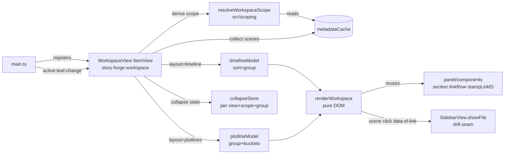
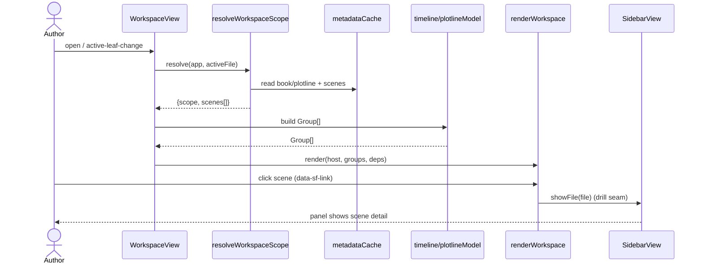

# Solution Design Document

## Validation Checklist

### CRITICAL GATES (Must Pass)

- [x] All required sections are complete
- [x] No [NEEDS CLARIFICATION] markers remain
- [x] Architecture pattern is clearly stated with rationale
- [x] **All architecture decisions confirmed by user**
- [x] Every interface has specification

### QUALITY CHECKS (Should Pass)

- [x] All context sources are listed with relevance ratings
- [x] Project commands are discovered from actual project files
- [x] Constraints → Strategy → Design → Implementation path is logical
- [x] Every component in diagram has directory mapping
- [x] Error handling covers all error types
- [x] Quality requirements are specific and measurable
- [x] Component names consistent across diagrams
- [x] A developer could implement from this design
- [x] Implementation examples use actual schema field names, verified against `schema/scene.json`
- [x] Complex logic includes traced walkthroughs with example data

---

## Constraints

- **CON-1 (platform/language):** TypeScript strict, Obsidian plugin API; ESM/esbuild bundle;
  targets `minAppVersion` 1.12.7. No `any` (use `unknown` + narrowing). No runtime `<style>`
  injection — all styling via the bundled `styles.css` `sf-*` classes.
- **CON-2 (read-only, M5):** the views MUST NOT write frontmatter. All drag/edit is deferred
  to M6. The render host must leave a clean seam (delegated `data-*` handlers) so M6 can add
  interaction without re-architecting.
- **CON-3 (Bases-typing firewall):** all Obsidian **Bases** typings stay confined to
  `src/bases/`. **M5 does not use Bases** as a data source (see ADR-1), so the workspace views
  carry zero Bases typings and live outside `src/bases/` — the firewall is respected by not
  crossing it.
- **CON-4 (lifecycle/teardown):** register DOM listeners, events, and intervals via
  `this.register*`/`registerDomEvent`/`registerEvent` so unload is clean (the mock's
  `_runCleanup()` asserts this). No listener accumulation across re-renders.
- **CON-5 (English + schema-coupled seed):** all committed content and seed-vault additions are
  English; seed changes must keep `npm run schema:check` green.
- **CON-6 (frontmatter is truth):** the views only READ frontmatter; they never own or cache
  authoritative state. Everything derives live from `metadataCache`.

## Implementation Context

**IMPORTANT**: The listed sources were read and analysed to ground this design.

### Required Context Sources

#### Documentation Context
```yaml
- doc: docs/DESIGN.md
  relevance: HIGH
  why: "Two render surfaces (contextual panel vs workspace views); ①–④ view categories"
- doc: docs/build-plan.md
  relevance: HIGH
  why: "M5 scope (Timeline/Plotlines) + the M6 boundary (drag→frontmatter)"
- doc: docs/XDD/specs/006-declarative-views/requirements.md
  relevance: CRITICAL
  why: "The PRD this design must satisfy (F0–F11, ~20 ACs)"
- doc: docs/XDD/specs/005-bases-codex-catalog/mockups.html
  relevance: HIGH
  why: "Existing visual language + highest S-number (S58); the S56 drill seam + S46 degrade"
```

#### Code Context
```yaml
- file: src/panel/components.ts
  relevance: CRITICAL
  why: "section()/collapse, factRow, relationRow, linkRow, stampLinkEl, unresolvedEl, emptyLine — reused verbatim"
- file: src/panel/renderers/scene.ts
  relevance: HIGH
  why: "Precedent for scene field rendering + reading-order/plotlines sections"
- file: src/panel/kindFields.ts
  relevance: HIGH
  why: "Canonical scene fact/relation field order for card fields"
- file: src/engines/NativeScopingEngine.ts
  relevance: HIGH
  why: "The metadataCache-backed, pure-DOM render pattern the workspace host mirrors (incl. its collapse map)"
- file: src/scoping/ScopingService.ts
  relevance: HIGH
  why: "resolve(file)→NoteContext; the workspace scope seam sits alongside this"
- file: src/scoping/NoteContext.ts
  relevance: HIGH
  why: "activeKind (book|plotline|scene|…), frontmatter shape used to derive scope"
- file: src/codex/CodexView.ts
  relevance: HIGH
  why: "Main-area ItemView host pattern (view type, onOpen, activation) to mirror"
- file: src/views/SidebarView.ts
  relevance: HIGH
  why: "showFile()/_drillInto drill seam (target of scene click); active-leaf-change follow pattern; _toggleSection"
- file: src/main.ts
  relevance: HIGH
  why: "View + command registration, activation helpers, active-leaf-change wiring"
- file: schema/scene.json
  relevance: CRITICAL
  why: "Real scene fields: act, order, storyDay, when, plotlines, book, status, chapter, pov"
- file: schema/plotline.json
  relevance: MEDIUM
  why: "Plotline fields (name/title/logline/status) for group headers"
- file: '@styles.css'
  relevance: MEDIUM
  why: "sf-* classes to reuse; new sf-tl-*/sf-pl-* classes added here"
```

#### External APIs
Not applicable — no third-party services. The plugin reads only the local vault via the
Obsidian API (`metadataCache`, `vault`, `workspace`).

### Implementation Boundaries
- **Must Preserve:** the M3 sidebar panel + its `showFile`/`_drillInto` drill seam; the M2
  engine/consent contracts; the M4 Codex view type + catalog; `schema/*` as the canonical
  source (edit JSON + `schema:gen`, never hand-edit generated vault artifacts).
- **Can Modify:** `src/main.ts` (register the new view + commands + follow wiring); `styles.css`
  (add workspace view classes); `src/scoping/` (add the scope seam); the test-vault seed
  (extend per F0); M4 Codex tests whose row counts shift when seed scenes are added (ADR-9).
- **Must Not Touch:** `src/bases/` Bases typings (not needed); generated `00 Meta/` artifacts by
  hand; the frontmatter-write path (read-only in M5).

### External Interfaces
Not applicable in the web sense. The only "external" boundary is the Obsidian workspace/vault
API. No inbound/outbound network, no database, no message queue.

### Project Commands
```bash
Install: npm install
Dev:     npm run dev          # esbuild watch → redeploys into test/StoryForge/
Test:    npm test             # vitest
Lint:    npm run lint         # eslint (obsidianmd) + stylelint
Build:   npm run build        # tsc check + esbuild production build
Types:   npm run typecheck && npm run typecheck:test && npm run typecheck:mock
Schema:  npm run schema:gen   # regenerate vault artifacts   /   npm run schema:check (gate)
```

## Solution Strategy

- **Architecture Pattern:** a thin main-area **`ItemView` host** (one polymorphic workspace
  view, `story-forge-workspace`, discriminated by a `layout: "timeline" | "plotlines"` state)
  that, on open and on active-leaf-change, (1) derives the active **scope** via a new
  `resolveWorkspaceScope` seam, (2) **scans `metadataCache`** for in-scope scenes, (3) sorts
  and groups them **in TypeScript** per the layout strategy, and (4) renders read-only DOM by
  **reusing the M3 panel components** (`section`, `linkRow`, `stampLinkEl`, `emptyLine`).
  Scene clicks reuse the M4 drill seam (`SidebarView.showFile`).
- **Integration Approach:** additive. New module `src/workspace/`; new scope helper in
  `src/scoping/`; registration + follow wiring in `src/main.ts`; new `sf-tl-*`/`sf-pl-*` CSS.
  No changes to the engine registry, consent, or Bases adapter.
- **Justification:** scope-following requires parameterising by the active note, which static
  Bases `.base` filters cannot express (ADR-1). A `metadataCache` scan (the proven
  `NativeScopingEngine` pattern) makes scope-following natural, removes the Bases dependency
  entirely (no degrade path), and gives full DOM ownership so M6 can add drag→frontmatter
  without re-architecting.
- **Key Decisions:** metadataCache (not Bases) as source (ADR-1); main-area follow-the-note
  ItemView (ADR-2); one polymorphic view type (ADR-3); scope seam in `src/scoping/` (ADR-4);
  TS sort/group with coalesced keys + Unassigned/No-act buckets (ADR-5); collapse persisted per
  view+scope+group (ADR-6); unresolved plotline links get their own flagged group (ADR-7);
  reuse M3 components + read-only M6 seam (ADR-8); extend seed + fix M4 Codex counts (ADR-9).

## Building Block View

### Components



### Directory Map

**Component**: workspace views (NEW)
```
.
├── src/
│   ├── workspace/
│   │   ├── WorkspaceView.ts        # NEW: ItemView host; onOpen, follow, layout switch, render orchestration
│   │   ├── workspaceModel.ts       # NEW: SceneRow mapping + timelineModel()/plotlineModel() (pure, testable)
│   │   ├── renderWorkspace.ts      # NEW: pure-DOM render of grouped rows via panel/components
│   │   └── collapseStore.ts        # NEW: transient collapse state keyed by view+scope+group (ADR-6)
│   ├── scoping/
│   │   └── workspaceScope.ts       # NEW: resolveWorkspaceScope(app, activeFile) → Scope + scene TFiles (ADR-4)
│   ├── main.ts                     # MODIFY: register WORKSPACE_VIEW_TYPE, open commands, active-leaf-change follow
│   └── pluginConstants.ts          # MODIFY: WORKSPACE_VIEW_TYPE constant
├── styles.css                      # MODIFY: sf-tl-* / sf-pl-* / shared sf-ws-* classes
├── test/
│   ├── workspace/                  # NEW: unit tests (model sort/group; render; scope; view)
│   └── StoryForge/                 # MODIFY: seed extension (F0) — see ADR-9
└── docs/XDD/specs/006-declarative-views/
    └── mockups.html                # NEW: S59–S70 states
```

### Interface Specifications

#### Data Storage Changes
None. No database, no persisted plugin state beyond Obsidian's own note frontmatter (which the
views only read). Collapse state is in-memory and transient (ADR-6).

#### Internal API Changes (module interfaces, not HTTP)

```typescript
// src/scoping/workspaceScope.ts  (ADR-4)
export type WorkspaceScope =
  | { kind: "book"; ref: TFile }        // scenes whose `book` links ref (or ref IS the book)
  | { kind: "plotline"; ref: TFile }    // scenes whose `plotlines` include ref
  | { kind: "none" };                   // active note yields no scope → whole-vault books + hint

export interface ResolvedScope {
  scope: WorkspaceScope;
  scenes: TFile[];                      // in-scope scene notes (unsorted)
}

// Derives scope from the active note (book note → book; plotline note → plotline;
// scene note → its book; else none), then collects in-scope scenes from metadataCache.
export function resolveWorkspaceScope(app: App, activeFile: TFile | null): ResolvedScope;
```

```typescript
// src/workspace/workspaceModel.ts  (ADR-5)
export interface SceneRow {
  file: TFile;
  title: string;                  // basename / frontmatter title
  act: number | null;
  order: number | null;
  storyDay: number | null;
  when: string;                   // display label ("" when absent)
  status: string;                 // enum value or ""
  pov: string;                    // resolved basename or ""
  plotlines: string[];            // raw link targets (may be unresolved)
}

export interface Group {
  key: string;                    // "Act 1" | "The Dying Light" | "Unassigned" | "No act"
  label: string;                  // display label
  kind: "act" | "plotline" | "unassigned" | "no-act" | "unresolved";
  scenes: SceneRow[];
}

// Timeline: sort by coalesce(storyDay, order) asc, tiebreak order asc, then a stable
// tertiary key; group by act (+ trailing "No act"). Never drops a scene.
export function timelineModel(rows: SceneRow[]): Group[];

// Plotlines: fan each scene into one group per plotline link; empty plotlines → "Unassigned";
// unresolved link target → its own "unresolved"-flagged group (ADR-7).
export function plotlineModel(rows: SceneRow[], app: App, sourcePath: string): Group[];
```

```typescript
// src/workspace/WorkspaceView.ts  (ADR-2, ADR-3)
export const WORKSPACE_VIEW_TYPE = "story-forge-workspace";
export class WorkspaceView extends ItemView {
  // state: layout: "timeline" | "plotlines"; current ResolvedScope
  // getViewType() → WORKSPACE_VIEW_TYPE; getDisplayText() per layout
  // onOpen(): initial scope + render; subscribes to active-leaf-change (re-scope+render)
  // setLayout(layout): switch timeline↔plotlines (toolbar toggle) and re-render
  // render(): resolveWorkspaceScope → model → renderWorkspace(host, groups, deps)
}
```

#### Application Data Models
The only models are the plain, Bases-free `SceneRow` and `Group` above (no Obsidian typings
beyond `TFile`). Rendering consumes `Group[]`; `renderWorkspace` maps each `Group` to a
reused `section()` with `linkRow`/`stampLinkEl` scene rows carrying `data-sf-link`.

#### Integration Points
```yaml
- from: WorkspaceView (main area)
  to: SidebarView (sidebar)
    - protocol: in-process — reveal sidebar leaf + call showFile(file)
    - seam: SidebarView.showFile → _drillInto → navStack (the M4 S56 seam, unchanged)
    - data_flow: "clicked scene path → panel re-subjects to that scene"
- from: WorkspaceView
  to: resolveWorkspaceScope (scoping)
    - protocol: function call on active-leaf-change / open
    - data_flow: "active TFile → {scope, scenes[]}"
- from: WorkspaceView / models
  to: metadataCache (Obsidian)
    - protocol: getFileCache / getFirstLinkpathDest / resolvedLinks
    - data_flow: "read scene + plotline frontmatter/links; resolve wikilinks"
```

### Implementation Examples

#### Example: Timeline sort with coalesced key + tie-break (ADR-5)

**Why this example:** the `storyDay`→`order` fallback plus tie-break is the load-bearing
Timeline rule and the easiest to get subtly wrong. Field names are verified against
`schema/scene.json` (`storyDay`, `order` — both `number`).

```typescript
// Sort key: primary = storyDay ?? order ?? +Infinity (unplaced go last, never dropped);
// tiebreak = order ?? +Infinity; final tiebreak = basename for stability.
function compareTimeline(a: SceneRow, b: SceneRow): number {
  const ak = a.storyDay ?? a.order ?? Number.POSITIVE_INFINITY;
  const bk = b.storyDay ?? b.order ?? Number.POSITIVE_INFINITY;
  if (ak !== bk) return ak - bk;
  const ao = a.order ?? Number.POSITIVE_INFINITY;
  const bo = b.order ?? Number.POSITIVE_INFINITY;
  if (ao !== bo) return ao - bo;
  return a.title.localeCompare(b.title);
}
```

**Traced walkthrough** (seed data — `test/StoryForge/10 Manuscript/Wardens of Moonharbor/`):

| Scene | storyDay | order | primary key | result order |
|-------|----------|-------|-------------|--------------|
| Scene 1 — The Extinguished Fire | 1 | 1 | 1 | 1st |
| Scene 2 — The Salty Gull | 1 | 2 | 1 | 2nd (tie on day 1 → order 1<2) |
| Scene 3 — The Black Cliffs | 2 | 3 | 2 | 3rd |

Extended-seed case: a scene with `storyDay` absent, `order: 5` → primary key = 5, sorts by
`order` among keyed scenes. A scene missing both → primary key +Infinity → appended last,
never dropped.

**Edge cases:** empty group set → `renderWorkspace` shows the empty-state (F5). All-Infinity
(no scene has storyDay/order) → stable basename order, all under their act groups.

#### Example: Plotline fan-out + Unassigned/unresolved buckets (ADR-5/ADR-7)

**Why this example:** `plotlines` is a **list** (`schema/scene.json` `"type":"list"`); a scene
must appear under each plotline it links, empty → Unassigned, unresolved link → its own flagged
group.

```typescript
// For each scene, for each raw plotline link: resolve; bucket by resolved basename,
// or by raw text into an "unresolved"-flagged group; scenes with no links → "Unassigned".
for (const row of rows) {
  if (row.plotlines.length === 0) { pushInto(groups, unassignedKey, row); continue; }
  for (const raw of row.plotlines) {
    const dest = app.metadataCache.getFirstLinkpathDest(strip(raw), sourcePath);
    if (dest) pushInto(groups, dest.basename, row, "plotline");
    else pushInto(groups, strip(raw), row, "unresolved");  // visible, flagged (ADR-7)
  }
}
// Order: plotline groups (by name), then unresolved groups, then "Unassigned" last.
```

#### Test Examples as Interface Documentation
`test/workspace/workspaceModel.test.ts` documents the contracts: `timelineModel` ordering +
act grouping + no-act bucket; `plotlineModel` fan-out + Unassigned + unresolved; both pure and
deterministic (no DOM, no Obsidian runtime — `SceneRow[]` in, `Group[]` out).

## Runtime View

### Primary Flow: open Timeline, scoped to the active book, drill into a scene

1. Author runs "Open Timeline" (or switches an open workspace view's layout to Timeline).
2. `WorkspaceView.onOpen()` reads the active leaf's file and calls `resolveWorkspaceScope`.
3. Scope seam: active note is the book → `{kind:"book", ref}`; collect scenes whose `book`
   links `ref` from `metadataCache`.
4. `timelineModel(rows)` sorts (coalesced key) and groups by act.
5. `renderWorkspace` empties the host and renders one collapsible `section()` per act, each
   scene a `linkRow` with `data-sf-link`.
6. Author clicks a scene → delegated handler reveals the sidebar leaf and calls
   `SidebarView.showFile(file)` → M3 panel shows the scene detail with a `from Timeline ›` trail.
7. On active-leaf-change to another book/plotline/scene, the view re-scopes and re-renders;
   collapse state is restored per (view+scope+group).



### Error Handling
- **No scenes in scope:** render the empty-state (`emptyLine`/empty box), never a blank host (F5).
- **Active note has no derivable scope:** `{kind:"none"}` → whole-vault book scope + a muted
  "not scoped to a book/plotline" hint (F3 AC-4). Never throw.
- **Missing scene fields** (`when`/`storyDay`/`pov`/`status`): render blank/placeholder cells;
  the scene still appears; sort/group tolerate `null` (F5).
- **Unresolved scene link** (a listed scene note that doesn't exist): `unresolvedEl` treatment,
  non-clickable, never throws.
- **Unresolved plotline link:** its own flagged group (ADR-7), not a crash and not hidden.

### Complex Logic
```
ALGORITHM: renderWorkspace(layout, activeFile)
1. RESOLVE scope ← resolveWorkspaceScope(app, activeFile)
2. MAP scenes → SceneRow[] (read frontmatter via metadataCache; resolve pov)
3. BUILD groups ← layout=timeline ? timelineModel(rows) : plotlineModel(rows, app, path)
4. IF groups empty → render empty-state; RETURN
5. FOR each group: section(host, group.label, {count, collapsed: collapseStore.get(view,scope,group)})
     FOR each scene: linkRow(body, scene.title, {path, tag/when}); unresolvedEl if unresolved
6. WIRE (once) delegated click/keydown: data-sf-section-toggle → collapse; data-sf-link → drill
```

## Deployment View
No change. Same single-artifact Obsidian plugin bundle (esbuild) deployed into the vault's
`.obsidian/plugins/story-forge/`. No new dependencies, env vars, or services. The new view type
+ commands register at `onload`; unregister automatically at `onunload` via `this.register*`.

## Cross-Cutting Concepts

### Pattern Documentation
```yaml
- pattern: NativeScopingEngine metadataCache-scan + pure-DOM render
  relevance: CRITICAL
  why: "The workspace host mirrors this (incl. its collapse-state approach)"
- pattern: M3 panel components (section/collapse/linkRow/stampLinkEl/unresolvedEl/emptyLine)
  relevance: CRITICAL
  why: "Reused verbatim for group headers + scene rows + empty/unresolved states"
- pattern: M4 Codex ItemView host + S56 drill seam (SidebarView.showFile)
  relevance: HIGH
  why: "Main-area view registration + scene→panel drill"
- pattern: delegated single-listener body handler (data-sf-section-toggle / data-sf-link)
  relevance: HIGH
  why: "Collapse + drill routing with one listener, no per-row leak (CON-4)"
```

### User Interface & UX

**Information Architecture:** two main-area workspace views (one polymorphic host, layout
toggle) — the "opposite of follow-the-active-note" browsers, complementing the sidebar panel.
Scene click → sidebar panel detail (tandem, S69).

**Design System:** reuse `sf-section`/`sf-sec-head`/`sf-sec-body`, `sf-lrow`/`sf-lrow-lnk`,
`sf-count`, `sf-trail`, `sf-unres`, `sf-empty*`. Add `sf-ws-*` (host), `sf-tl-*` (timeline
row/when-label), `sf-pl-*` (plotline group/unassigned/unresolved cue).

**Interaction Design:** collapse via the existing delegated `data-sf-section-toggle` handler
(click/Enter/Space, `aria-expanded`, chevron); drill via `data-sf-link`. Read-only — no drag,
no edit (M6 seam left in place).

#### UI Visualization Guide — mockup states (author draws ASCII/HTML in mockups.html)
Continue the S-scheme from **S58** → **S59–S70** (from UX research):
- **S59** Timeline — populated (single act) · **S60** Timeline — act boundary (collapsible act
  headers) · **S61** Timeline — storyDay→order fallback · **S62** Timeline — empty · **S63**
  ~~Timeline — Bases-off degrade~~ **superseded by ADR-1** (no Bases dependency → no degrade;
  re-purpose S63 as "Timeline — no-act bucket" or drop).
- **S64** Plotlines — multiple groups · **S65** Plotlines — Unassigned bucket · **S66**
  Plotlines — scene in multiple plotlines · **S67** Plotlines — all groups collapsed · **S68**
  ~~Plotlines — Bases-off degrade~~ **superseded**; re-purpose as "Plotlines — unresolved link
  group" (ADR-7).
- **S69** Workspace scene → sidebar panel drill-in (side-by-side) · **S70** (optional) scope
  hint when active note yields no book/plotline (F3 AC-4).

```
┌───────────────────────────────────────────────┐
│  Story Forge · Timeline        [Timeline|Plot] │  ← layout toggle in view header
├───────────────────────────────────────────────┤
│  ▼ Act 1                                   (3) │  ← collapsible section (reused)
│    Night 1  Scene 1 — The Extinguished Fire pov│  ← when-label · scene link · role
│    Night 1  Scene 2 — The Salty Gull           │
│    Night 2  Scene 3 — The Black Cliffs          │
│  ▶ No act                                   (0) │
└───────────────────────────────────────────────┘
```

### System-Wide Patterns
- **Security:** none beyond vault-local reads; no code execution (no DataviewJS path, so no
  consent gate needed — a simplification vs M4).
- **Error Handling:** local, non-throwing render with empty/placeholder fallbacks (above).
- **Performance:** vault-scale small; scan is O(scenes in scope); re-render on scope change is
  a full host repaint (cheap). Debounce active-leaf-change like `SidebarView` to coalesce.
- **i18n:** English only (CON-5).
- **Logging:** `console.debug` only for diagnostics (obsidian rule: no `console.log`).

## Architecture Decisions

- [x] **ADR-1 Data source = `metadataCache` scan, not a Bases view.** Choice: the workspace
  views read scenes directly from `metadataCache` (the `NativeScopingEngine` pattern).
  - Rationale: scope-following must be parameterised by the active note; static Bases `.base`
    filters cannot reference the active note. A scan makes scope natural, removes the Bases
    dependency, gives full DOM ownership for M6.
  - Trade-offs: we re-implement sort/group in TS (vs free Bases groupBy); we don't get the
    Bases toolbar/sort UI. Accepted — it's the price of scope-following + M6 readiness.
  - Consequence: **PRD F5's "Bases-off degrade" is superseded** — the views need no Bases, so
    there is nothing to degrade from; the empty/missing-field parts of F5 still apply.
  - User confirmed: **Yes**

- [x] **ADR-2 Surface = main-area ItemView that follows the active note.** Choice: a main-area
  `ItemView` (like `CodexView`) subscribing to active-leaf-change to re-scope.
  - Rationale: build-plan classes Timeline/Plotlines as workspace views; wide overviews suit
    the main area; scene click drills the sidebar (S56 tandem).
  - Trade-offs: not a sidebar tab (won't appear alongside Context tabs). Accepted.
  - User confirmed: **Yes (derived from the locked surface decision)**

- [x] **ADR-3 One polymorphic view type `story-forge-workspace` (layout: timeline|plotlines).**
  - Rationale: mirrors the M4 Codex single-type decision; shares scope+scan+render; a layout
    toggle switches strategy. Less registration/boilerplate.
  - Trade-offs: a `layout` discriminant threads through the host. Accepted.
  - User confirmed: **Yes**

- [x] **ADR-4 Scope seam `resolveWorkspaceScope` in `src/scoping/`.** Choice: a pure helper
  deriving `{book|plotline|none}` + in-scope scene `TFile[]` from the active note.
  - Rationale: no "current book/plotline" concept exists; a small, testable seam beside
    `ScopingService` is the least-invasive home.
  - **Alignment note:** book and plotline notes both live in `20 Planning/` — the seam MUST
    distinguish them by `type`/tag (`type: book` vs `type: plotline`), NOT by folder. `activeKind`
    already carries this (`book`/`plotline`/`scene`).
  - Trade-offs: net-new code; multi-book scope selector deferred (F10). Accepted.
  - User confirmed: **Yes (derived from the locked scope decision)**

- [x] **ADR-5 Sort/group in TypeScript.** Coalesce(`storyDay`,`order`) + tiebreak for Timeline;
  act grouping (+ "No act"); plotline fan-out + "Unassigned" for Plotlines.
  - Rationale: follows from ADR-1 (no native Bases groupBy); handles list-valued grouping,
    coalesced keys, and labelled buckets that plain `.base` can't.
  - Trade-offs: our code owns correctness (covered by pure unit tests). Accepted.
  - User confirmed: **Yes (derived from the build/buy decision)**

- [x] **ADR-6 Collapse state per (view + scope + group label), transient in-memory.**
  - Rationale: satisfies F8 — collapsing acts in Book A must not collapse them in Book B.
  - Trade-offs: not persisted across plugin reloads (acceptable; matches M3 transience).
  - User confirmed: **Yes**

- [x] **ADR-7 Unresolved plotline link → its own flagged "unresolved" group.**
  - Rationale: surfaces broken links to the author instead of hiding them; distinct from
    "Unassigned" (no plotline at all).
  - Trade-offs: an extra group kind + cue styling. Accepted.
  - User confirmed: **Yes**

- [x] **ADR-8 Reuse M3 components; new `src/workspace/` module; read-only with an M6 seam.**
  - Rationale: visual + behavioural consistency; the delegated `data-*` handlers are the hook
    M6 will extend for drag→frontmatter without re-architecting.
  - Trade-offs: none material. User confirmed: **Yes (derived)**

- [x] **ADR-9 Extend the test-vault seed (M4 reconciliation is a no-op).** Add an act-2 scene, a
  storyDay-less scene, a multi-plotline scene, a no-plotline scene, and a zero-scene plotline.
  - Rationale: makes AC-T3/T4 + AC-P2/P3/P5 testable (F0).
  - **Post-PLAN alignment finding (correction):** the M4 Codex tests use **in-code fixtures**,
    not live test-vault counts — `test/bases/codexBase.test.ts` reads `.base` YAML structure,
    `CodexBasesView.test.ts` uses `makeEntry`/`makeResult`, and the integration tests use mock
    factories. The only live-vault test (`test/seed-vault-gaps.test.ts`) asserts
    `toBeGreaterThan(0)`. **Therefore adding seed notes does NOT break the M4 suite**; the
    "reconcile counts" step is a no-op safety check (plan T5.2), not a change task.
  - Trade-offs: none. User confirmed: **Yes (derived from the seed decision; scope refined by alignment check)**

## Quality Requirements
- **Correctness:** `timelineModel`/`plotlineModel` are pure and fully unit-tested (sort,
  tiebreak, act grouping, no-act bucket, plotline fan-out, Unassigned, unresolved). 100% of
  F1–F6 ACs pass.
- **Usability/Accessibility:** collapse via keyboard (Enter/Space) with `aria-expanded`; scene
  links are `role="link"` + `tabindex=0`; unresolved links `aria-disabled`.
- **Reliability:** no crash on empty/sparse/no-scope data; never drops a scene; deterministic
  ordering.
- **Maintainability:** zero Bases typings in `src/workspace/`; reuse over reimplementation;
  lint/typecheck (src/test/mock)/schema:check/build all green.

## Acceptance Criteria (EARS)

**Timeline (PRD F1)**
- [ ] THE SYSTEM SHALL order in-scope scenes by ascending coalesce(`storyDay`,`order`), tie-broken
  by `order` then title.
- [ ] WHEN scenes span acts, THE SYSTEM SHALL group them under ascending `act` headers, with a
  trailing "No act" group for scenes lacking `act`.
- [ ] THE SYSTEM SHALL display `when` as each scene's label without it affecting order.
- [ ] IF a scene lacks both `storyDay` and `order`, THEN THE SYSTEM SHALL still render it,
  appended after keyed scenes.

**Plotlines (PRD F2)**
- [ ] THE SYSTEM SHALL render one group per plotline, placing a scene under every plotline it links.
- [ ] IF a scene has no `plotlines`, THEN THE SYSTEM SHALL place it in a trailing "Unassigned" group.
- [ ] IF a plotline link is unresolved, THEN THE SYSTEM SHALL render it in a flagged "unresolved"
  group, not merged into "Unassigned".
- [ ] WHEN a group header is activated (click/Enter/Space), THE SYSTEM SHALL toggle that group's
  collapsed state and update chevron + `aria-expanded`.

**Scope + drill (PRD F3/F4)**
- [ ] WHILE the active note is a book/plotline/scene, THE SYSTEM SHALL scope the view to that
  book (or plotline), re-scoping on active-leaf-change.
- [ ] IF the active note yields no book/plotline, THEN THE SYSTEM SHALL fall back to whole-vault
  book scope and show a non-blocking "not scoped" hint.
- [ ] WHEN a scene row is clicked, THE SYSTEM SHALL re-subject the sidebar panel to that scene
  via `showFile` (modifier-click opens the note, per the setting).

**Robustness (PRD F5/F6)**
- [ ] WHILE no scenes are in scope, THE SYSTEM SHALL render an empty-state, never a blank host.
- [ ] THE SYSTEM SHALL render scenes with missing `when`/`pov`/`status` using placeholders,
  never dropping them.
- [ ] THE SYSTEM SHALL NOT write frontmatter from any M5 interaction.

## Risks and Technical Debt

### Known Technical Issues
- No "current book/plotline" concept exists today; the scope seam is net-new and the single
  biggest correctness surface — mitigated by pure unit tests over `resolveWorkspaceScope`.

### Technical Debt
- `src/workspace/` and the future plugin-owned Codex ItemView will share concerns (main-area
  host, metadataCache scan, grouped render). Debt risk: divergence. Mitigation: factor shared
  render/host helpers so the future Codex can reuse them (noted, not built now).
- The M4 Codex tab-bar/columns/links/sort/grouping remain deferred (separate memory) — M5 does
  not touch them.

### Implementation Gotchas
- `metadataCache` frontmatter links may be stored with or without `[[ ]]`; strip before
  resolving (as the Inspector already does).
- Active-leaf-change fires often; debounce like `SidebarView` to avoid thrash.
- Adding seed scenes shifts M4 Codex counts — update those assertions in the SAME change
  (ADR-9) or the suite goes red.
- The layout toggle must re-render but preserve per-scope collapse state (ADR-6 keying).

## Glossary

### Domain Terms
| Term | Definition | Context |
|------|------------|---------|
| Timeline (view) | Scenes in in-world chronological order, grouped by act | M5 F1 |
| Plotlines (view) | Scenes grouped by the plotlines they advance | M5 F2 |
| Scope | The book or plotline the workspace view is filtered to | F3 |
| Unassigned bucket | Group collecting scenes with no `plotlines` | F2 |
| `storyDay` / `order` | Chronological day (sort key) / reading-order (fallback sort) | schema/scene.json |
| `when` | Free-text story-time label; display only, never sorts | schema/scene.json |

### Technical Terms
| Term | Definition | Context |
|------|------------|---------|
| ItemView | Obsidian main-area view base class | WorkspaceView host |
| metadataCache | Obsidian's parsed frontmatter/link index | Data source (ADR-1) |
| Drill seam | `SidebarView.showFile`→`_drillInto`→`navStack` | Scene→panel (S56) |
| CON-3 firewall | Bases typings confined to `src/bases/` | Not crossed (no Bases in M5) |
| Delegated handler | One body listener routing `data-*` targets | Collapse + drill (CON-4) |

### API/Interface Terms
| Term | Definition | Context |
|------|------------|---------|
| `WORKSPACE_VIEW_TYPE` | `"story-forge-workspace"` view id | Registration |
| `ResolvedScope` | `{scope, scenes[]}` from the scope seam | ADR-4 |
| `SceneRow` / `Group` | Plain, Bases-free render models | ADR-5 |
