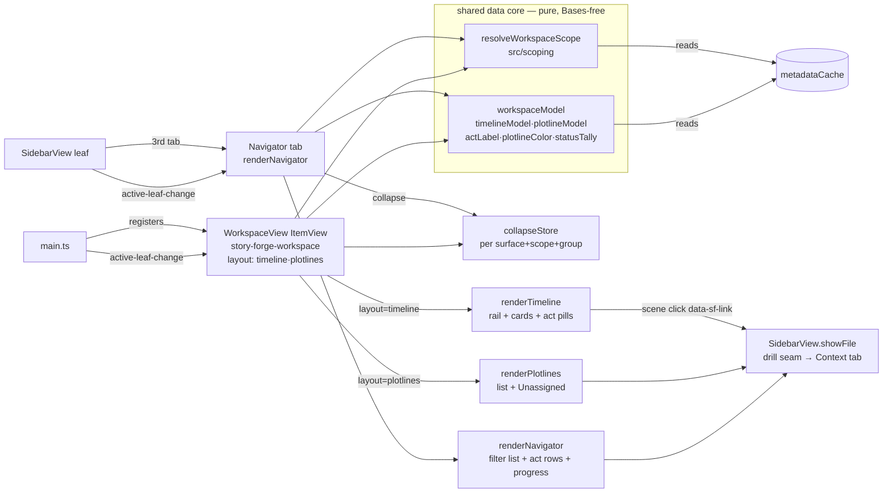
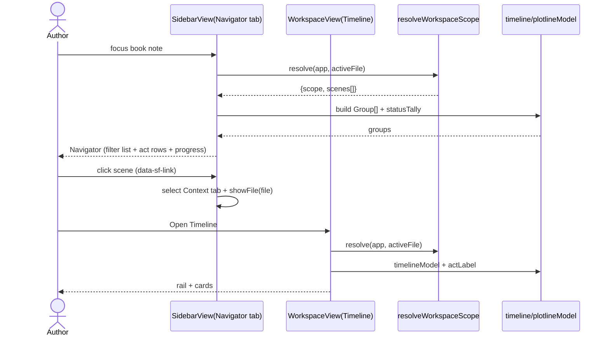

# Solution Design Document

> **v2.0 reground (2026-07-23).** Supersedes the v1.0 "one polymorphic main-area view of M3
> sectioned lists" design. Driven by three user decisions (see README decision log): the views
> take **StoryLine's** visual language (built fresh, no code port); the surface **splits** into a
> sidebar **Navigator** (third tab) + main-area **Timeline/Plotlines**; and **M5 ships Navigator +
> Timeline-rail + Plotlines-list**, with swimlanes / subway map / drag deferred to **M6**. Act
> divider labels come from **beat notes** (`scene.beat` → beat-note alias), not a new schema field.

## Validation Checklist

### CRITICAL GATES (Must Pass)

- [x] All required sections are complete
- [x] No [NEEDS CLARIFICATION] markers remain
- [x] Architecture pattern is clearly stated with rationale
- [x] **All architecture decisions confirmed by user**
- [x] Every interface has specification

### QUALITY CHECKS (Should Pass)

- [x] All context sources are listed with relevance ratings
- [x] Project commands are discovered from actual project files
- [x] Constraints → Strategy → Design → Implementation path is logical
- [x] Every component in diagram has directory mapping
- [x] Error handling covers all error types
- [x] Quality requirements are specific and measurable
- [x] Component names consistent across diagrams
- [x] A developer could implement from this design
- [x] Implementation examples use actual schema field names, verified against `schema/scene.json`
- [x] Complex logic includes traced walkthroughs with example data

---

## Constraints

- **CON-1 (platform/language):** TypeScript strict, Obsidian plugin API; ESM/esbuild bundle;
  targets `minAppVersion` 1.12.7. No `any` (use `unknown` + narrowing). No runtime `<style>`
  injection — all styling via the bundled `styles.css` `sf-*` classes.
- **CON-2 (read-only, M5):** the views MUST NOT write frontmatter. All drag/edit is deferred to
  M6. Render hosts must leave a clean seam (delegated `data-*` handlers) so M6 can add interaction
  without re-architecting.
- **CON-3 (Bases-typing firewall):** all Obsidian **Bases** typings stay confined to `src/bases/`.
  **M5 does not use Bases** as a data source (ADR-1), so the workspace views carry zero Bases
  typings and live outside `src/bases/` — the firewall is respected by not crossing it.
- **CON-4 (lifecycle/teardown):** register DOM listeners, events, intervals via
  `this.register*`/`registerDomEvent`/`registerEvent`; the mock's `_runCleanup()` asserts clean
  unload. No listener accumulation across re-renders.
- **CON-5 (English + schema-coupled seed):** all committed content and seed additions are English;
  seed changes keep `npm run schema:check` green.
- **CON-6 (frontmatter is truth):** the views only READ frontmatter; they never own or cache
  authoritative state. Everything derives live from `metadataCache`. No new schema fields in M5
  (act labels are derived from existing `beat` links, not stored — ADR-11).
- **CON-7 (structure-agnostic):** scenes are INCLUDED by tag/type, never by folder; a folder
  denylist (`DEFAULT_EXCLUDED_FOLDERS`) EXCLUDES template/meta notes. No vault layout is imposed.
- **CON-8 (StoryLine attribution):** the visual language is modelled on the MIT-licensed
  obsidian-storyline; built fresh on our schema (no code copied). Credit StoryLine in `NOTICE`.

## Implementation Context

**IMPORTANT**: The listed sources were read and analysed to ground this design.

### Required Context Sources

#### Documentation Context
```yaml
- doc: docs/DESIGN.md
  relevance: HIGH
  why: "Two render surfaces (contextual panel vs workspace views); view categories"
- doc: docs/build-plan.md
  relevance: HIGH
  why: "M5 scope (Timeline/Plotlines) + the M6 boundary (drag→frontmatter)"
- doc: docs/XDD/specs/006-declarative-views/requirements.md
  relevance: CRITICAL
  why: "The PRD this design must satisfy (F0–F11)"
- doc: docs/XDD/specs/006-declarative-views/mockups.html
  relevance: CRITICAL
  why: "StoryLine-grounded states S59–S72 (Navigator, Timeline-rail, Plotlines-list; M6 swimlane/subway)"
- ref: https://github.com/pixerojan/obsidian-storyline
  relevance: HIGH
  why: "Visual reference (MIT) for Navigator, Timeline, Plotlines; screenshots studied, no code ported"
```

#### Code Context
```yaml
- file: src/views/SidebarView.ts
  relevance: CRITICAL
  why: "Hosts the Navigator as a 3rd tab: tab strip, active-leaf follow, body render, showFile/_drillInto drill seam, _toggleSection, data-sf-* delegation"
- file: src/panel/components.ts
  relevance: HIGH
  why: "section()/collapse, stampLinkEl, unresolvedEl, emptyLine, data-sf-section-toggle/data-sf-link — reused for collapse + drill + empty/unresolved"
- file: src/engines/NativeScopingEngine.ts
  relevance: HIGH
  why: "metadataCache-backed pure-DOM render pattern the main-area host mirrors"
- file: src/scoping/ScopingService.ts
  relevance: HIGH
  why: "resolve(file)→NoteContext; the workspace scope seam sits alongside this"
- file: src/scoping/NoteContext.ts
  relevance: HIGH
  why: "activeKind (book|plotline|scene|…) used to derive scope"
- file: src/codex/CodexView.ts
  relevance: HIGH
  why: "Main-area ItemView host pattern (view type, onOpen, activation) to mirror for Timeline/Plotlines"
- file: src/main.ts
  relevance: HIGH
  why: "View + command registration, activation helpers, active-leaf-change wiring"
- file: schema/scene.json
  relevance: CRITICAL
  why: "Real scene fields: act, order, storyDay, when, plotlines, book, status, chapter, pov, location, characters, beat, wordcount"
- file: schema/plotline.json
  relevance: MEDIUM
  why: "Plotline fields (name/title/status) for group headers; no color field → color is derived (ADR-12)"
- file: '@styles.css'
  relevance: MEDIUM
  why: "sf-* classes to reuse; new sf-nav-*/sf-tl-*/sf-pl-* classes added here"
```

#### External APIs
Not applicable — no third-party services. The plugin reads only the local vault via the Obsidian
API (`metadataCache`, `vault`, `workspace`).

### Implementation Boundaries
- **Must Preserve:** the M3 sidebar panel + its `showFile`/`_drillInto` drill seam and tab strip;
  the M2 engine/consent contracts; the M4 Codex view type; `schema/*` as canonical (edit JSON +
  `schema:gen`, never hand-edit generated vault artifacts).
- **Can Modify:** `src/views/SidebarView.ts` (add the Navigator tab); `src/main.ts` (register the
  main-area view + commands + follow); `styles.css` (add view classes); `src/scoping/` (scope
  seam); the test-vault seed (extend per F0, incl. beat notes).
- **Must Not Touch:** `src/bases/` Bases typings (not needed); generated `00 Meta/` artifacts by
  hand; the frontmatter-write path (read-only in M5); StoryLine's source (visual reference only).

### External Interfaces
The only "external" boundary is the Obsidian workspace/vault API. No network, database, or queue.

### Project Commands
```bash
Install: npm install
Dev:     npm run dev          # esbuild watch → redeploys into test/StoryForge/
Test:    npm test             # vitest
Lint:    npm run lint         # eslint (obsidianmd) + stylelint
Build:   npm run build        # tsc check + esbuild production build
Types:   npm run typecheck && npm run typecheck:test && npm run typecheck:mock
Schema:  npm run schema:gen   # regenerate vault artifacts   /   npm run schema:check (gate)
```

## Solution Strategy

- **Architecture Pattern:** **two read-only surfaces over one shared data core.** A pure core
  (`resolveWorkspaceScope` → `metadataCache` scan → `SceneRow[]` → `timelineModel`/`plotlineModel`)
  feeds:
  1. **Navigator** — a **sidebar tab** rendered inside the existing `SidebarView` leaf (third tab
     alongside Context + the views-library tabs). Compact: a plotline **filter list** (color dot +
     name + count), **act-grouped** collapsible scene rows, and a **status progress** bar. Follows
     the active note exactly like Context.
  2. **Timeline / Plotlines** — a main-area polymorphic `ItemView` (`story-forge-workspace`,
     `layout: "timeline" | "plotlines"`). **M5 renders Timeline in rail mode and Plotlines in list
     mode**; it follows active-leaf-change to re-scope.
  Scene clicks in either surface reuse the M4 drill seam (`SidebarView.showFile`).
- **Visual language:** StoryLine-grounded (cards with status badges, plotline **color dots**, a
  vertical **rail** with act-divider pills, a Navigator list) — built fresh with `sf-nav-*` /
  `sf-tl-*` / `sf-pl-*` classes. Collapse, drill, and empty/unresolved states reuse the M3
  delegated-handler primitives.
- **Integration Approach:** additive. New module `src/workspace/`; new scope helper in
  `src/scoping/`; a Navigator tab in `SidebarView`; main-area registration + follow in `main.ts`.
  No changes to the engine registry, consent, or Bases adapter.
- **Justification:** scope-following must be parameterised by the active note, which static Bases
  `.base` filters cannot express (ADR-1). A `metadataCache` scan makes scope natural, removes the
  Bases dependency (no degrade path), and gives full DOM ownership so M6 can add swimlanes / subway
  / drag→frontmatter on the same core without re-architecting.
- **M5 / M6 boundary:** **M5** = Navigator + Timeline **rail** + Plotlines **list** (read-only).
  **M6** = Timeline **swimlanes** (keys: POV / location / plotline), Plotlines **subway map** (SVG
  or DOM; zoom + pan; clickable stations), and drag→frontmatter. The M5 render hosts and models are
  shaped so M6 adds modes, not rewrites (ADR-8, ADR-13).

- **Key Decisions:** metadataCache not Bases (ADR-1); split surfaces — Navigator sidebar tab +
  main-area Timeline/Plotlines (ADR-2); one polymorphic main-area view (ADR-3); scope seam in
  `src/scoping/` (ADR-4); TS sort/group with coalesced keys + Unassigned/No-act buckets (ADR-5);
  collapse per surface+scope+group (ADR-6); unresolved plotline → flagged group (ADR-7); StoryLine
  visual language + read-only M6 seam (ADR-8); extend seed incl. beat notes (ADR-9); Navigator =
  SidebarView tab (ADR-10); act label derived from `beat` note alias, no schema change (ADR-11);
  plotline color derived deterministically from name (ADR-12); swimlane/subway/drag → M6 (ADR-13).

## Building Block View

### Components



### Directory Map

**Component**: workspace views (NEW) + Navigator tab (MODIFY SidebarView)
```
.
├── src/
│   ├── workspace/
│   │   ├── WorkspaceView.ts        # NEW: main-area ItemView host (Timeline/Plotlines); onOpen, follow, layout toggle
│   │   ├── workspaceModel.ts       # (P1 DONE, EXTEND) SceneRow mapping + timelineModel/plotlineModel; + actLabel, plotlineColor, statusTally
│   │   ├── renderTimeline.ts       # NEW: rail + scene cards + act-divider pills (act label via actLabel)
│   │   ├── renderPlotlines.ts      # NEW: list mode — plotline groups + Unassigned + unresolved
│   │   ├── renderNavigator.ts      # NEW: sidebar Navigator — filter list + act-grouped rows + progress
│   │   └── collapseStore.ts        # NEW: transient collapse state keyed by surface+scope+group (ADR-6)
│   ├── scoping/
│   │   └── workspaceScope.ts       # NEW: resolveWorkspaceScope(app, activeFile) → Scope + scene TFiles (ADR-4)
│   ├── views/
│   │   └── SidebarView.ts          # MODIFY: register the Navigator tab; route its render + follow (ADR-10)
│   ├── main.ts                     # MODIFY: register WORKSPACE_VIEW_TYPE, open commands, follow
│   └── pluginConstants.ts          # MODIFY: WORKSPACE_VIEW_TYPE + NAVIGATOR_TAB_ID constants
├── styles.css                      # MODIFY: sf-nav-* (Navigator) / sf-tl-* (timeline rail/card) / sf-pl-* (plotline list/dots)
├── NOTICE                          # NEW/MODIFY: StoryLine visual-reference attribution (CON-8)
├── test/
│   ├── workspace/                  # NEW/EXTEND: model (P1), scope, actLabel, render, navigator, view
│   └── StoryForge/                 # MODIFY: seed extension (F0) — beat notes + act-2 + edge scenes (ADR-9)
└── docs/XDD/specs/006-declarative-views/
    └── mockups.html                # DONE: S59–S72 (M5 + M6-tagged states)
```

### Interface Specifications

#### Data Storage Changes
None. No database, no persisted plugin state beyond note frontmatter (read-only). Collapse and
Navigator filter state are in-memory and transient (ADR-6).

#### Internal API Changes (module interfaces)

```typescript
// src/scoping/workspaceScope.ts  (ADR-4)
export type WorkspaceScope =
  | { kind: "book"; ref: TFile }        // scenes whose `book` links ref (or ref IS the book)
  | { kind: "plotline"; ref: TFile }    // scenes whose `plotlines` include ref
  | { kind: "none" };                   // active note yields no scope → whole-vault books + hint

export interface ResolvedScope { scope: WorkspaceScope; scenes: TFile[]; }

export const DEFAULT_EXCLUDED_FOLDERS = ["00 Meta"];   // CON-7; future excludedFolders setting

export function resolveWorkspaceScope(app: App, activeFile: TFile | null): ResolvedScope;
```

```typescript
// src/workspace/workspaceModel.ts  (ADR-5, ADR-11, ADR-12)
export interface SceneRow {
  file: TFile;
  title: string;
  act: number | null;
  order: number | null;
  storyDay: number | null;
  when: string;                   // display label ("" when absent)
  status: string;                 // enum value or ""
  pov: string;                    // resolved basename or ""
  location: string;               // resolved basename or ""
  characters: string[];           // resolved basenames (for cards)
  plotlines: string[];            // raw link targets (may be unresolved)
  beat: string;                   // raw `beat` link text ("" when empty)
  beatName: string;               // resolved beat-note alias/title ("" when empty/unresolved)
  wordcount: number | null;
}

export interface Group {
  key: string; label: string;
  kind: "act" | "plotline" | "unassigned" | "no-act" | "unresolved";
  scenes: SceneRow[];
}

// Timeline: sort by coalesce(storyDay, order) asc, tiebreak order asc, then title; group by act
// (+ trailing "No act"). Group label for act groups is produced by actLabel(). Never drops a scene.
export function timelineModel(rows: SceneRow[]): Group[];

// Plotlines: fan each scene into one group per plotline link; empty → "Unassigned";
// unresolved link → its own flagged "unresolved" group (ADR-7).
export function plotlineModel(rows: SceneRow[], resolve: LinkResolver): Group[];

// Act label = the beat name shared by the act's scenes, else "Act N" (ADR-11).
export function actLabel(act: number | null, scenes: SceneRow[]): string;

// Deterministic, stable per-plotline color from its name → a fixed palette (ADR-12).
export function plotlineColor(name: string): string;

// Status → count map, for the Navigator progress bar.
export function statusTally(rows: SceneRow[]): Record<string, number>;
```

```typescript
// src/workspace/WorkspaceView.ts  (ADR-2, ADR-3, ADR-13)
export const WORKSPACE_VIEW_TYPE = "story-forge-workspace";
export class WorkspaceView extends ItemView {
  // layout: "timeline" | "plotlines"; current ResolvedScope
  // onOpen(): initial scope + render; subscribe active-leaf-change (re-scope+render, debounced)
  // setLayout(): timeline↔plotlines toggle → re-render (preserve per-scope collapse)
  // render(): resolveWorkspaceScope → model → renderTimeline | renderPlotlines
  // M6 seam: renderTimeline(mode: "rail"|"swimlane"), renderPlotlines(mode: "list"|"subway")
}
```

```typescript
// src/workspace/renderNavigator.ts  (ADR-10)  — rendered into SidebarView's body for the Nav tab
export interface NavigatorDeps { onScene(file: TFile): void; collapse: CollapseStore; }
export interface NavigatorState { plotlineFilter: string | null; }
export function renderNavigator(
  host: HTMLElement, resolved: ResolvedScope, app: App,
  state: NavigatorState, deps: NavigatorDeps,
): void;   // plotline filter list (dot+count) + act-grouped rows + progress
```

#### Application Data Models
Plain, Bases-free `SceneRow` / `Group` (no Obsidian typings beyond `TFile`). All three renderers
consume `Group[]` (Navigator additionally consumes the plotline groups for its filter list and a
`statusTally`). Scene rows carry `data-sf-link` for the drill seam.

#### Integration Points
```yaml
- from: Navigator tab (SidebarView) / WorkspaceView (main area)
  to: SidebarView Context tab
    - protocol: in-process — select Context tab / reveal leaf + showFile(file)
    - seam: SidebarView.showFile → _drillInto → navStack (M4 S56 seam, unchanged)
- from: both surfaces
  to: resolveWorkspaceScope
    - data_flow: "active TFile → {scope, scenes[]}"
- from: models
  to: metadataCache
    - protocol: getFileCache / getFirstLinkpathDest / resolvedLinks
    - data_flow: "read scene/plotline/beat frontmatter + links; resolve wikilinks + aliases"
```

### Implementation Examples

#### Example: Timeline sort with coalesced key + tie-break (ADR-5)

**Why this example:** the `storyDay`→`order` fallback plus tie-break is the load-bearing Timeline
rule. Field names verified against `schema/scene.json` (`storyDay`, `order` — both `number`).

```typescript
function compareTimeline(a: SceneRow, b: SceneRow): number {
  const ak = a.storyDay ?? a.order ?? Number.POSITIVE_INFINITY;
  const bk = b.storyDay ?? b.order ?? Number.POSITIVE_INFINITY;
  if (ak !== bk) return ak - bk;
  const ao = a.order ?? Number.POSITIVE_INFINITY;
  const bo = b.order ?? Number.POSITIVE_INFINITY;
  if (ao !== bo) return ao - bo;
  return a.title.localeCompare(b.title);
}
```

**Traced walkthrough** (seed — `test/StoryForge/10 Manuscript/Wardens of Moonharbor/`):

| Scene | storyDay | order | primary key | result |
|-------|----------|-------|-------------|--------|
| The Extinguished Fire | 1 | 1 | 1 | 1st |
| The Salty Gull | 1 | 2 | 1 | 2nd (tie on day 1 → order 1<2) |
| The Black Cliffs | 2 | 3 | 2 | 3rd |

Extended-seed: a scene with `storyDay` absent, `order: 5` → key 5, sorts by `order`. Missing both →
key +Infinity → appended last, never dropped.

#### Example: Act label from the beat note (ADR-11)

**Why this example:** acts have no name field; the divider name is derived from the act's scenes'
`beat` link. Verified against the _forge vault: `scene.beat` → `type: beat` note (`aliases`/`title`),
1:1 with `act` in the canon.

```typescript
export function actLabel(act: number | null, scenes: SceneRow[]): string {
  if (act == null) return "No act";
  const names = new Set(scenes.map(s => s.beatName).filter(Boolean));
  return names.size === 1 ? `Act ${act} · ${[...names][0]}` : `Act ${act}`;
}
```

**Walkthrough:** Wardens of Moonharbor Act 1 scenes all set `beat: [[201 🎬 The Failing Light]]`
(alias "The Failing Light") → `"Act 1 · The Failing Light"`. If the act's scenes carried two
different beats → falls back to `"Act 1"` (never guesses). Empty `beat` (as in today's seed) →
`beatName === ""` → `"Act 1"`.

#### Example: Plotline fan-out + Unassigned/unresolved buckets (ADR-5/ADR-7)

**Why:** `plotlines` is a **list** (`schema/scene.json` `"type":"list"`); a scene appears under each
plotline it links, empty → Unassigned, unresolved link → its own flagged group.

```typescript
for (const row of rows) {
  if (row.plotlines.length === 0) { pushInto(groups, unassignedKey, row); continue; }
  for (const raw of row.plotlines) {
    const dest = resolve(strip(raw));                 // metadataCache.getFirstLinkpathDest
    if (dest) pushInto(groups, dest.basename, row, "plotline");
    else pushInto(groups, strip(raw), row, "unresolved");   // visible, flagged (ADR-7)
  }
}
// Order: plotline groups (by name) → unresolved groups → "Unassigned" last.
```

#### Test Examples as Interface Documentation
`test/workspace/workspaceModel.test.ts` (P1, green) documents `timelineModel`/`plotlineModel`
contracts (ordering, act grouping, no-act bucket, fan-out, Unassigned, unresolved) — pure,
deterministic, no DOM. New: `actLabel`/`plotlineColor` tests; `workspaceScope.test.ts`.

## Runtime View

### Primary Flow: Navigator follows a book; drill a scene; open the main-area Timeline

1. Author focuses a book/scene note; `SidebarView`'s active-leaf follow calls the Navigator render
   (if its tab is active) → `resolveWorkspaceScope` → scenes.
2. `renderNavigator` shows the plotline filter list (`plotlineColor` dots + counts from
   `plotlineModel`), act-grouped rows (`timelineModel` + `actLabel`), and a `statusTally` progress.
3. Author clicks a scene → `showFile` re-subjects the **Context** tab to it (drill seam).
4. Author runs "Open Timeline" → `WorkspaceView` (layout=timeline) resolves the same scope, renders
   the **rail**: act-divider pills (via `actLabel`), scene **cards** (title, POV, 📍location, status
   badge + wordcount, character chips), plotline-colored rail nodes.
5. On active-leaf-change, both surfaces re-scope and re-render; collapse restored per
   (surface+scope+group).



### Error Handling
- **No scenes in scope:** empty-state (never a blank host) — F5.
- **No derivable scope:** `{kind:"none"}` → whole-vault books + muted "not scoped" hint — F3 AC-4.
  Never throws.
- **Missing scene fields** (`when`/`storyDay`/`pov`/`status`/`beat`/`wordcount`): blank/placeholder
  cells; the scene still appears; sort/group/actLabel tolerate `null`/`""` — F5.
- **Unresolved scene/beat link:** `unresolvedEl` / `beatName===""` fallback, non-clickable, no throw.
- **Unresolved plotline link:** own flagged group (ADR-7), not hidden, not a crash.

### Complex Logic
```
ALGORITHM: renderSurface(surface, layout, activeFile)
1. RESOLVE scope ← resolveWorkspaceScope(app, activeFile)
2. MAP scenes → SceneRow[] (metadataCache: read frontmatter; resolve pov/location/characters/beatName)
3. BUILD groups ← layout=timeline ? timelineModel(rows) : plotlineModel(rows, resolve)
4. IF groups empty → render empty-state; RETURN
5. surface=navigator: render plotline filter list (plotlineColor+counts) + act rows (actLabel) + statusTally
   surface=timeline : per group → act pill (actLabel) + rail; per scene → card (status badge, plotline node)
   surface=plotlines: per group → section(); per scene → list row
6. WIRE (once) delegated handlers: data-sf-section-toggle → collapse; data-sf-link → drill
```

## Deployment View
No change. Single-artifact esbuild bundle into `.obsidian/plugins/story-forge/`. New main-area view
type + commands register at `onload`; the Navigator tab registers with `SidebarView`. All
unregister automatically at `onunload` via `this.register*`. No new dependencies.

## Cross-Cutting Concepts

### Pattern Documentation
```yaml
- pattern: NativeScopingEngine metadataCache-scan + pure-DOM render
  relevance: CRITICAL
  why: "The shared core mirrors this; no Bases"
- pattern: SidebarView tab strip + active-leaf follow + showFile drill seam
  relevance: CRITICAL
  why: "Hosts the Navigator tab (ADR-10) and receives drills from all three surfaces"
- pattern: M3 delegated single-listener body handler (data-sf-section-toggle / data-sf-link)
  relevance: HIGH
  why: "Collapse + drill routing with one listener, no per-row leak (CON-4)"
- pattern: M4 Codex ItemView host
  relevance: HIGH
  why: "Main-area registration + onOpen/activation for WorkspaceView"
```

### User Interface & UX

**Information Architecture:** the sidebar **Navigator** (compact, follow-the-note) complements the
main-area **Timeline/Plotlines** (wide overviews). Both drill the Context tab (tandem). Visual
language modelled on StoryLine (CON-8).

**Design System:** reuse `sf-section`/`sf-sec-head`/`sf-sec-body`, `sf-count`, `sf-trail`,
`sf-unres`, `sf-empty*`, `sf-lrow`/`sf-lrow-lnk`. Add:
- `sf-nav-*` — Navigator: filter box, plotline filter rows (color dot + count), act group rows,
  scene rows (dot·order·title·when), progress bar.
- `sf-tl-*` — Timeline rail: `-rail`, `-node` (plotline color), `-when` gutter, `-card`, status
  badge (`-st-draft`/`-st-outline`/`-st-written`), chips.
- `sf-pl-*` — Plotlines list: group header + dot, Unassigned/unresolved cues.

**Interaction Design:** collapse via the existing delegated `data-sf-section-toggle` handler
(click/Enter/Space, `aria-expanded`, chevron); drill via `data-sf-link`; Navigator plotline row
toggles the filter. Read-only — no drag/edit (M6 seam left in place).

#### UI Visualization Guide — mockup states (mockups.html, DONE)
S59–S72. **M5:** S59–S61 Navigator (populated / filter-active / empty); S62–S63, S65 Timeline rail
(populated + act pills / `storyDay`→`order` fallback / empty); S69 Plotlines list + Unassigned;
S70 drill; S71 no-scope hint; S72 placement chrome. **M6-tagged:** S64 swimlane, S66–S68 subway.

### System-Wide Patterns
- **Security:** vault-local reads only; no code execution (no DataviewJS → no consent gate; a
  simplification vs M4).
- **Error Handling:** local, non-throwing render with empty/placeholder fallbacks (above).
- **Performance:** O(scenes in scope); re-render is a full host repaint (cheap). Debounce
  active-leaf-change like `SidebarView`.
- **i18n:** English only (CON-5).
- **Logging:** `console.debug` only (obsidian rule: no `console.log`).

## Architecture Decisions

- [x] **ADR-1 Data source = `metadataCache` scan, not a Bases view.** Read scenes directly
  (`NativeScopingEngine` pattern).
  - Rationale: scope-following must be parameterised by the active note; static `.base` filters
    can't. A scan makes scope natural, removes the Bases dependency, gives full DOM ownership for M6.
  - Trade-offs: re-implement sort/group in TS; no Bases toolbar. Accepted.
  - Consequence: **PRD F5 "Bases-off degrade" is superseded** (nothing to degrade from); the
    empty/missing-field parts of F5 still apply.
  - User confirmed: **Yes**

- [x] **ADR-2 Surface split — Navigator (sidebar tab) + Timeline/Plotlines (main area).** *(revised
  v2.0)* Two surfaces over one core, not a single view.
  - Rationale: user's call after reviewing StoryLine — a compact scene Navigator belongs beside
    Context; the graphical Timeline/Plotlines belong in the wide main area. Matches StoryLine's own
    Navigator-vs-graphical split.
  - Trade-offs: two render hosts to build. Accepted — they share the pure core.
  - User confirmed: **Yes**

- [x] **ADR-3 One polymorphic main-area view `story-forge-workspace` (layout: timeline|plotlines).**
  - Rationale: mirrors M4 Codex's single-type decision; shares scope+scan+render; a layout toggle
    switches strategy. (Navigator is separate — it lives in `SidebarView`, ADR-10.)
  - Trade-offs: a `layout` discriminant threads through the host. Accepted.
  - User confirmed: **Yes**

- [x] **ADR-4 Scope seam `resolveWorkspaceScope` in `src/scoping/`.** Pure helper →
  `{book|plotline|none}` + in-scope scene `TFile[]`.
  - **Alignment note:** book & plotline notes co-live in `20 Planning/` → distinguish by
    `type`/tag, NOT folder (`activeKind` carries this).
  - **Folder exclusion (CON-7):** INCLUDE scenes by tag/type; EXCLUDE `DEFAULT_EXCLUDED_FOLDERS =
    ["00 Meta"]` (templates carry the same tags), marked to become the deferred `excludedFolders`
    settings picker. Correct today, no rework later.
  - Trade-offs: net-new; multi-book selector deferred (F10). User confirmed: **Yes**

- [x] **ADR-5 Sort/group in TypeScript.** Coalesce(`storyDay`,`order`)+tiebreak; act grouping (+"No
  act"); plotline fan-out + "Unassigned". Follows ADR-1. User confirmed: **Yes**

- [x] **ADR-6 Collapse state per (surface + scope + group label), transient in-memory.** Satisfies
  F8 (collapsing acts in Book A ≠ Book B); Navigator and main-area keep independent keys.
  User confirmed: **Yes**

- [x] **ADR-7 Unresolved plotline link → own flagged "unresolved" group** (distinct from
  "Unassigned"). Surfaces broken links. User confirmed: **Yes**

- [x] **ADR-8 StoryLine visual language; new `src/workspace/` module; read-only with an M6 seam.**
  *(revised v2.0)* Build fresh (no code port, CON-8); reuse collapse/drill/empty primitives. The
  delegated `data-*` handlers + `render*(mode)` signatures are the hooks M6 extends for
  swimlane/subway/drag.
  - Trade-offs: more custom CSS than v1.0's list reuse. Accepted (it's the point of the reground).
  - User confirmed: **Yes**

- [x] **ADR-9 Extend the seed incl. beat notes.** *(revised v2.0)* Add: a couple `type: beat` notes
  + populate `scene.beat` (for `actLabel`); an act-2 scene; a `storyDay`-less scene; a
  multi-plotline scene; a no-plotline scene (→ Unassigned); a zero-scene plotline; one unresolved
  plotline link.
  - **Alignment finding (kept):** M4 Codex tests use in-code fixtures, not live-vault counts →
    adding seed notes does NOT break the M4 suite (plan safety-check, not a change task).
  - User confirmed: **Yes**

- [x] **ADR-10 Navigator = a third tab inside `SidebarView`, not its own leaf.** *(new v2.0)*
  - Rationale: user's call ("third tab"); reuses SidebarView's tab strip, active-leaf follow, and
    drill seam; sits naturally beside Context.
  - Trade-offs: SidebarView gains a fixed tab + a render branch. Accepted; smaller than a new leaf.
  - User confirmed: **Yes**

- [x] **ADR-11 Act divider label derived from the `beat` note — no schema change.** *(new v2.0)*
  `actLabel(act, scenes)` returns `Act N · <beat alias>` when the act's scenes share one beat, else
  `Act N`.
  - Rationale: verified in the _forge vault — acts have no name; each act's scenes share one named
    `beat` note (1:1 in canon). `beat` already exists on `scene`.
  - Trade-offs: relies on the (non-enforced) 1:1; the fallback keeps it safe. Non-blocking
    follow-up: confirm the invariant with _forge.
  - User confirmed: **Yes**

- [x] **ADR-12 Plotline color derived deterministically from the plotline name.** *(new v2.0)*
  `plotlineColor(name)` hashes to a fixed palette.
  - Rationale: Navigator dots + Timeline nodes need stable colors; `plotline.json` has no `color`
    field and we impose no schema change in M5 (CON-6). Deterministic = stable across renders.
  - Trade-offs: no user-chosen colors yet (StoryLine's palette button is M6/deferred; an optional
    `color` frontmatter override can supersede later). Accepted.
  - User confirmed: **Yes**

- [x] **ADR-13 Swimlanes / subway map / drag → M6.** *(new v2.0)* M5 ships Timeline **rail** +
  Plotlines **list** + Navigator. `renderTimeline(mode)`/`renderPlotlines(mode)` reserve
  `"swimlane"`/`"subway"`; M6 adds them + drag→frontmatter on the same core.
  - Rationale: user's scoping call — graphical swimlane/subway is heavier than read-only lists;
    ship value now, keep the seam.
  - User confirmed: **Yes**

## Quality Requirements
- **Correctness:** `timelineModel`/`plotlineModel`/`actLabel`/`plotlineColor` pure and fully
  unit-tested. 100% of M5 F0–F6 ACs pass.
- **Usability/Accessibility:** collapse via keyboard (Enter/Space) + `aria-expanded`; scene links
  `role="link"` + `tabindex=0`; unresolved links `aria-disabled`; color dots are not the sole
  signal (name + count accompany).
- **Reliability:** no crash on empty/sparse/no-scope data; never drops a scene; deterministic
  ordering + colors + labels.
- **Maintainability:** zero Bases typings in `src/workspace/`; reuse over reimplementation;
  lint/typecheck(src/test/mock)/schema:check/build green.

## Acceptance Criteria (EARS)

**Navigator (PRD F1/F2/F3 — sidebar surface)**
- [ ] WHILE its tab is active, THE SYSTEM SHALL list in-scope scenes grouped by act (collapsible),
  each row showing a plotline-color dot, `order`, title, and `when`.
- [ ] THE SYSTEM SHALL show a plotline filter list (color dot + name + scene count); selecting one
  SHALL filter the scene rows to that plotline's members.
- [ ] THE SYSTEM SHALL show a status progress indicator derived from `statusTally`.

**Timeline — rail (PRD F1)**
- [ ] THE SYSTEM SHALL order in-scope scenes by ascending coalesce(`storyDay`,`order`), tie-broken
  by `order` then title.
- [ ] WHEN scenes span acts, THE SYSTEM SHALL group them under ascending `act` dividers labelled via
  `actLabel` (beat name when shared, else `Act N`), with a trailing "No act" group.
- [ ] THE SYSTEM SHALL render each scene as a card (title, POV, location, status badge, wordcount)
  with a plotline-colored rail node; `when` shown, never affecting order.
- [ ] IF a scene lacks both `storyDay` and `order`, THEN THE SYSTEM SHALL still render it, appended
  after keyed scenes.

**Plotlines — list (PRD F2)**
- [ ] THE SYSTEM SHALL render one collapsible group per plotline (dot + count), placing a scene
  under every plotline it links.
- [ ] IF a scene has no `plotlines`, THEN THE SYSTEM SHALL place it in a trailing "Unassigned" group.
- [ ] IF a plotline link is unresolved, THEN THE SYSTEM SHALL render a flagged "unresolved" group,
  not merged into "Unassigned".
- [ ] WHEN a group header is activated (click/Enter/Space), THE SYSTEM SHALL toggle collapse and
  update chevron + `aria-expanded`.

**Scope + drill (PRD F3/F4)**
- [ ] WHILE the active note is a book/plotline/scene, THE SYSTEM SHALL scope both surfaces to that
  book (or plotline), re-scoping on active-leaf-change.
- [ ] IF the active note yields no book/plotline, THEN THE SYSTEM SHALL fall back to whole-vault
  book scope and show a non-blocking "not scoped" hint.
- [ ] WHEN a scene row/card is clicked, THE SYSTEM SHALL re-subject the Context tab to that scene
  via `showFile` (modifier-click opens the note, per the setting).

**Robustness (PRD F5/F6)**
- [ ] WHILE no scenes are in scope, THE SYSTEM SHALL render an empty-state, never a blank host.
- [ ] THE SYSTEM SHALL render scenes with missing `when`/`pov`/`status`/`beat`/`wordcount` using
  placeholders, never dropping them.
- [ ] THE SYSTEM SHALL NOT write frontmatter from any M5 interaction.

## Risks and Technical Debt

### Known Technical Issues
- No "current book/plotline" concept exists; the scope seam is net-new and the biggest correctness
  surface — mitigated by pure unit tests over `resolveWorkspaceScope`.
- `actLabel` relies on the non-enforced 1:1 act↔beat invariant; the `Act N` fallback contains the
  risk. Confirm with _forge (non-blocking).

### Technical Debt
- `src/workspace/` and the future plugin-owned Codex ItemView will share concerns (main-area host,
  metadataCache scan, grouped render). Factor shared render/host helpers so Codex can reuse (noted).
- Plotline colors are name-derived (ADR-12); a user-chosen `color` override + StoryLine's palette
  button are deferred to M6.
- `excludedFolders` remains a `DEFAULT_EXCLUDED_FOLDERS` constant until the settings picker lands
  (deferred decision).

### Implementation Gotchas
- Frontmatter links may be stored with/without `[[ ]]`; strip before resolving (as the Inspector
  does). Beat resolution should prefer the beat note's `aliases[0]`, else title stripped of emoji.
- Active-leaf-change fires often; debounce like `SidebarView`.
- The layout toggle must re-render but preserve per-scope collapse (ADR-6 keying).
- Navigator lives in `SidebarView` — its render must not fight the Context/Inspector lifecycle
  (guard by active tab).

## Glossary

### Domain Terms
| Term | Definition | Context |
|------|------------|---------|
| Navigator | Compact sidebar scene browser (filter list + act rows + progress) | M5, ADR-10 |
| Timeline (view) | Scenes in chronological order, grouped by act; rail (M5) / swimlane (M6) | F1 |
| Plotlines (view) | Scenes grouped by plotline; list (M5) / subway (M6) | F2 |
| Scope | The book or plotline the surfaces are filtered to | F3 |
| Act label | `Act N · <beat name>` derived from `scene.beat`; fallback `Act N` | ADR-11 |
| Unassigned bucket | Group of scenes with no `plotlines` | F2 |
| `storyDay` / `order` / `when` | Chrono day (sort) / reading order (fallback) / display label | schema/scene.json |
| `beat` | `[[beat note]]` link a scene realises; source of the act name | schema/scene.json |

### Technical Terms
| Term | Definition | Context |
|------|------------|---------|
| ItemView | Obsidian main-area view base class | WorkspaceView host |
| metadataCache | Obsidian's parsed frontmatter/link index | Data source (ADR-1) |
| Drill seam | `SidebarView.showFile`→`_drillInto`→`navStack` | Scene→Context (S56) |
| CON-3 firewall | Bases typings confined to `src/bases/` | Not crossed (no Bases in M5) |
| Delegated handler | One body listener routing `data-*` targets | Collapse + drill (CON-4) |

### API/Interface Terms
| Term | Definition | Context |
|------|------------|---------|
| `WORKSPACE_VIEW_TYPE` | `"story-forge-workspace"` main-area view id | Registration |
| `ResolvedScope` | `{scope, scenes[]}` from the scope seam | ADR-4 |
| `SceneRow` / `Group` | Plain, Bases-free render models | ADR-5 |
| `actLabel` / `plotlineColor` / `statusTally` | Pure derivations (label / color / progress) | ADR-11/12 |
