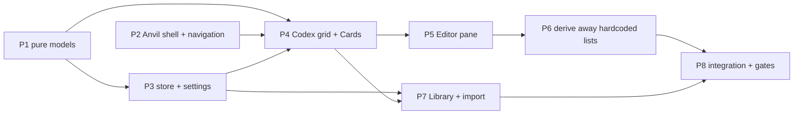

# Implementation Plan

## Validation Checklist

### CRITICAL GATES (Must Pass)

- [x] All `[NEEDS CLARIFICATION: ...]` markers have been addressed
- [x] All specification file paths are correct and exist
- [x] Each phase follows TDD: Prime → Test → Implement → Validate
- [x] Every task has verifiable success criteria
- [x] A developer could follow this plan independently

### QUALITY CHECKS (Should Pass)

- [x] Context priming section is complete
- [x] All implementation phases are defined with linked phase files
- [x] Dependencies between phases are clear (no circular dependencies)
- [x] Parallel work is properly tagged with `[parallel: true]`
- [x] Activity hints provided for specialist selection `[activity: type]`
- [x] Every phase references relevant SDD sections
- [x] Every test references PRD acceptance criteria
- [x] Integration & E2E tests defined in final phase
- [x] Project commands match actual project setup

---

## Context Priming

*GATE: Read all files in this section before starting any implementation.*

**Specification**:
- `docs/XDD/specs/008-codex-surface/requirements.md` — PRD (F1–F8, 70 Gherkin ACs)
- `docs/XDD/specs/008-codex-surface/solution.md` — SDD (CON-1…CON-10, ADR-27…ADR-36, EARS ACs)
- `docs/XDD/specs/008-codex-surface/mockups.html` — **signed off** S91–S103. The visual specification.
  An implementation that diverges from a figure raises it **before** coding; the file is not
  re-synced afterwards.
- `docs/XDD/adr/0001-bases-integration-strategy.md`, `0002-fileclass-driven-editor.md`,
  `0003-generated-bases-two-checksums.md`
- `docs/gap-analysis.md` §1.1–1.4

**Foundations to extend**. Originally verified against `main` on 2026-07-28; the two entries Phases 1
and 2 have since changed were **re-verified against the working tree on 2026-07-31** and are marked
below. The unmarked entries still carry their 2026-07-28 verification and are unaffected by Phases
1–2 — Phase 1 only *added* pure modules, it moved nothing.

- *Line numbers dropped 2026-11-02 from the entries below: they had gone stale, and the symbols are
  the anchors. All named symbols checked at `368da21`.*
- `src/anvil/AnvilView.ts` — the polymorphic main-area host. **Re-verified 2026-07-31**: this is the
  former `src/workspace/WorkspaceView.ts`, **moved by T2.1** — the old path no longer exists, so do
  not go looking for it. The class is now `AnvilView` and the layout type `AnvilLayout`
  (`WorkspaceViewOpts` → `AnvilViewOpts`); only the **id** `WORKSPACE_VIEW_TYPE` is frozen, and it
  now lives in `src/pluginConstants.ts` (ADR-27). Anchors: the `AnvilLayout` union,
  `STATUS_VOCAB`, delegated click handler `_onClick` (now routed through
  `NavigationController` via `walkTargetMarkers`, not the old per-attribute chain), plus
  `CollapseStore` and `_debouncedRender`. **`src/workspace/` itself is retained** — the 11 helper
  modules (`workspaceModel`, `interactionHandler`, the six `render*`, `collapseStore`,
  `sceneMapper`, `timelineZoom`) did **not** move and are what Phase 4 imports.
- `src/views/SidebarView.ts` — the follow-the-note host. Tab strip `_renderTabs`, built-in Context +
  Navigator tabs, drill/back nav stack (`navStack`, `_drillInto`), engine decision tree
  `_renderResolved`. It **already routes clicks through the shared controller**: `_markerKindOf` is
  the per-surface marker vocabulary T4.1/T5.2 extend, plus `_operateControl` and `_onBodyActivate`.
- `src/inspector/frontmatterWriter.ts` — the **sole write seam**. **Exported**: `commit`,
  `commitMany`, `FieldSpec`, `FieldType`, `CommitEntry`, `CommitOk`/`CommitError`/`CommitResult`.
  **Internal, not exported** (corrected 2026-07-31): `validateField` and `isOutOfVocab`
  — validation `commit`/`commitMany` apply on your behalf, readable for behaviour but
  **not importable**. CON-1: no second write path is created, and callers get validation by going
  through `commit`/`commitMany`, never by calling the validators themselves.
- `src/store/types.ts` — `ViewRecord`, fail-closed `applyDefaults`.
- `src/catalog/CatalogService.ts` — VERIFY → MATERIALISE → PERSIST. **Carries the double-copy
  defect** fixed in P3.
- `src/consent/ConsentGate.ts` — `evaluate` decision order; `_evaluateBasesRecord`.
- `src/bases/BasesAdapter.ts` — `registerCodexView` / `isBasesAvailable` (cached in a WeakMap;
  must be called once at load, before the registry is populated).
- `src/panel/components.ts` — `portraitTile`, `imageTile`, `factRow`, `section` — reused by Cards.
- `src/panel/kindFields.ts` — per-kind config **and** the special-field inventory in its header.
  **Revised 2026-11-02:** this is the native fallback now, and that inventory covers only `image`.
- `src/scoping/workspaceScope.ts` — `resolveWorkspaceScope`, `DEFAULT_EXCLUDED_FOLDERS`.
- `test/StoryForge/00 Meta/FileClasses/fc-character-fantasy.md` — the real FileClass shape.

**Key Design Decisions**:
- **ADR-27** — the Anvil is the existing `WorkspaceView`: **view type ids stay frozen**, files and
  **symbols** are renamed (done in T2.1 — headline corrected 2026-07-31: "display only" governs id
  strings and persisted values, never TypeScript symbol names).
- **ADR-28** — one `NavigationController` implements the target-kind matrix for both surfaces.
  **Precedence is proximity, not a kind ranking** (decided 2026-07-31): markers are reported
  nearest-event-target-first and classification is `markers[0]`.
- **ADR-29** — store records gain a `kind` discriminant, and `applyDefaults` defaults legacy records
  to `"view"`. The silent migration was **withdrawn 2026-08-02**: there is nothing to migrate from.
- **ADR-30** — one `CardRenderer` contract, **both** backends for **all three** built-in Cards.
- **ADR-31** — a pure `FieldModel` sits between the FileClass reader and the editor.
- **ADR-32** — column width is derived from field type; `ui` hints live in **our** `schema/*.json`.
  **Revised 2026-11-02:** hints are keyed by FileClass and reach the bundle through the generated
  `src/editor/generatedUiHints.ts`.
- **ADR-35** — two checksums plus the resolved parameters; the store keeps **no** YAML copy.

**Implementation Context**:
```bash
npm test              # vitest — unit tests
npm run test:live     # live-vault checks against test/StoryForge/
npm run lint          # eslint (obsidianmd) + stylelint
npm run typecheck     # plus typecheck:test, typecheck:mock
npm run build         # tsc check + esbuild production
npm run schema:gen    # regenerate vault artifacts
npm run schema:check  # drift gate — MUST stay green (CON-5)
npm run catalog:build # dist/catalog-index.json
```

**Cross-cutting gates — verify on every task**:
1. **CON-1** — every write goes through `frontmatterWriter`; nothing else touches frontmatter.
2. **CON-3** — the task's feature still works with Bases, Dataview and metadata-menu absent.
3. **CON-4** — no view type id string changed.
4. **CON-8** — no `any`; `unknown` plus narrowing at every external boundary.
5. **Cleanup** — every listener/interval registered via `register*` so unload is clean.
6. **Nothing is deleted before its replacement passes its ACs** (PRD risk: partial delivery).

---

## Implementation Phases

Each phase is defined in a separate file. Tasks follow red-green-refactor: **Prime**, **Test**,
**Implement**, **Validate**.

**Shippability**: P2 and P4–P7 each land a user-visible increment that stands on its own. P1 and P3
are foundations with no UI, and are the only phases that ship nothing — they are kept small and are
fully covered by unit tests.



- [x] [Phase 1: Pure models](phase-1.md)
- [x] [Phase 2: Anvil shell and navigation](phase-2.md)
- [x] [Phase 3: Store, settings and the artifact model](phase-3.md)
- [x] [Phase 4: The Codex grid and Cards](phase-4.md)
- [x] [Phase 5: The editor pane](phase-5.md)
- [x] [Phase 6: Deriving away the hardcoded field lists](phase-6.md)
- [x] [Phase 7: The Library, import and capability disclosure](phase-7.md)
- [x] [Phase 8: Integration, degradation and gates](phase-8.md)

---

## Plan Verification

| Criterion | Status |
|-----------|--------|
| A developer can follow this plan without additional clarification | ✅ |
| Every task produces a verifiable deliverable | ✅ |
| All PRD acceptance criteria map to specific tasks | ✅ |
| All SDD components have implementation tasks | ✅ |
| Dependencies are explicit with no circular references | ✅ |
| Parallel opportunities are marked with `[parallel: true]` | ✅ |
| Each task has specification references `[ref: ...]` | ✅ |
| Project commands in Context Priming are accurate | ✅ |
| All phase files exist and are linked from this manifest | ✅ |
