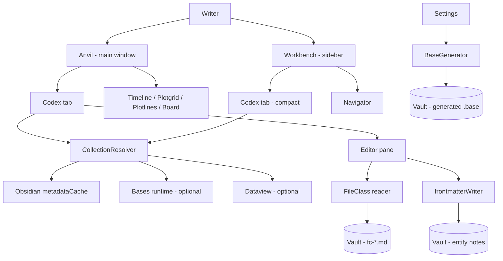
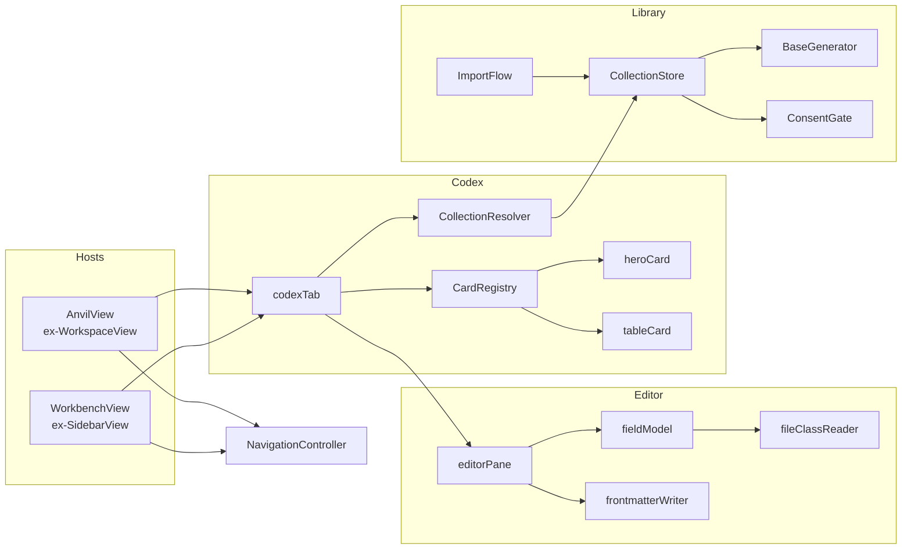
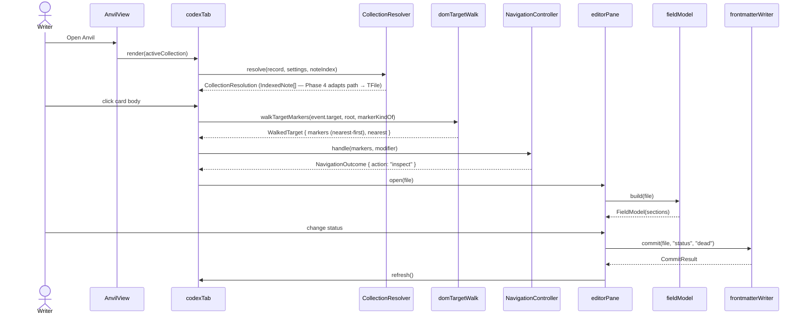
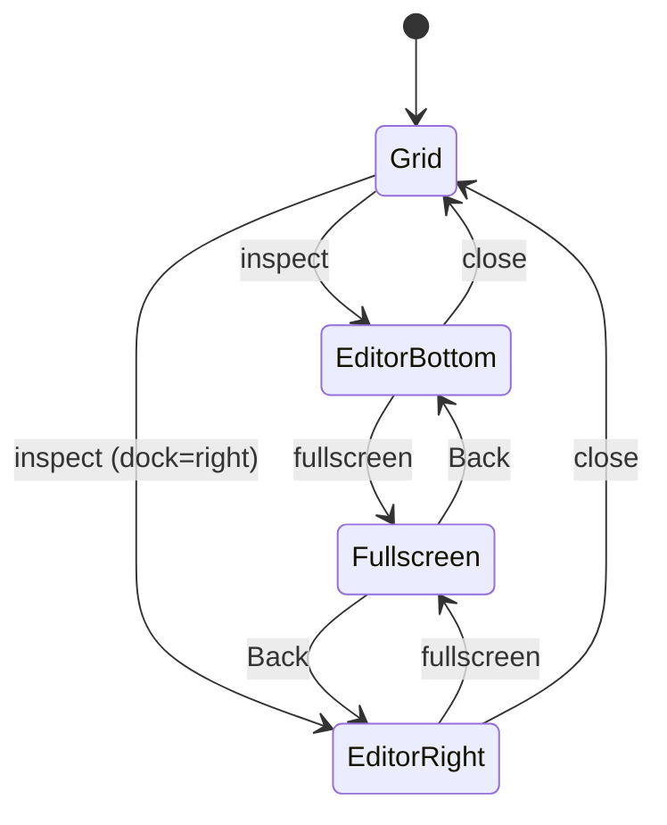

# Solution Design Document

## Validation Checklist

### CRITICAL GATES (Must Pass)

- [x] All required sections are complete
- [x] No [NEEDS CLARIFICATION] markers remain
- [x] Architecture pattern is clearly stated with rationale
- [x] **All architecture decisions confirmed by user** — ADR-27…ADR-36 confirmed 2026-07-28
- [x] Every interface has specification

### QUALITY CHECKS (Should Pass)

- [x] All context sources are listed with relevance ratings
- [x] Project commands are discovered from actual project files
- [x] Constraints → Strategy → Design → Implementation path is logical
- [x] Every component in diagram has directory mapping
- [x] Error handling covers all error types
- [x] Quality requirements are specific and measurable
- [x] Component names consistent across diagrams
- [x] A developer could implement from this design
- [x] Implementation examples use actual names verified against source (no pseudocode identifiers)
- [x] Complex logic includes traced walkthroughs with example data

---

## Constraints

- **CON-1 — Story data is frontmatter only.** Every write is a plain Property through the existing
  single write seam (`src/inspector/frontmatterWriter.ts`). No plugin-owned store for story facts.
- **CON-2 — Operational state belongs in the plugin directory.** Dock position, selected Card per
  collection, dismissed hints. Never in a note.
- **CON-3 — Add-ons are never requirements.** Dataview, metadata-menu, meta-bind, Calendarium are
  detected and used where they help; everything degrades to native rendering. A **core** plugin
  (Bases) may be suggested once, dismissibly; a **community** plugin never is.
- **CON-4 — View type identifiers are frozen.** `SIDEBAR_VIEW_TYPE = "story-forge-panel"` carries
  the comment *"Stable — never change after first release"*; `WORKSPACE_VIEW_TYPE` likewise. Renaming
  a surface changes its **display name**, never its id — changing the id orphans every saved
  workspace layout that contains the leaf.
- **CON-5 — No new story-schema *fields*, but one *type* change (revised 2026-07-29).** No fact is
  added to the story model. Two changes to `schema/*.json` are in scope and both must follow
  `docs/schema-change-runbook.md`: (a) an optional `ui: "wide"` presentation hint, and (b) **the
  image fields `portrait` (character) and `image` (location, object) change type from `text` to the
  media type**, so their value becomes a wikilink instead of a path. That is a real schema change
  with a seed-note ripple — path values must be rewritten as wikilinks — and the schema type
  vocabulary gains `media`, which the generator maps to metadata-menu's `Media`.
  `npm run schema:check` must stay green.
  **Revised 2026-11-02 — a `Media` value stores the wikilink's full vault path**, such as
  `[[95 Assets/Mara Stoneway.svg]]`, not the shortest link form. Meta Bind's image view reads a
  link's target as a path from the vault root, so the shortest form draws a broken image
  (mProjectsCode/obsidian-meta-bind-plugin#677). The picker writes the full path and
  `test/schema/mediaFields.test.ts` requires it of the seed notes. Story Forge reads both forms,
  so a hand-typed short link still works here and stays broken only in Meta Bind.
- **CON-6 — Bases typings stay behind one adapter.** `BasesConfigFile` and friends may only be
  imported by `src/bases/basesConfig.ts` (existing CON-3 firewall from spec 005).
- **CON-7 — Structure-agnostic selection.** Notes are selected **by tag**; folders may only
  *exclude*. No feature may require a particular folder layout.
- **CON-8 — TypeScript strict, no `any`.** Per `src/CLAUDE.md`. Unknown external shapes are `unknown`
  plus narrowing.
- **CON-9 — Mobile.** Bases surfaces are desktop-only (spec 007 ADR-10). The Codex must degrade to
  the native card renderer on mobile rather than fail.
- **CON-10 — The signed-off mockups bind.** `docs/mockups/anvil-workbench-codex.html` S91–S103.
  Divergence is raised before it is coded.

## Implementation Context

**IMPORTANT**: You MUST read and analyze ALL listed context sources.

### Required Context Sources

#### Documentation Context

```yaml
- doc: docs/mockups/anvil-workbench-codex.html
  relevance: CRITICAL
  why: "S91–S103, signed off. The visual specification for every surface in this spec."

- doc: docs/XDD/adr/0001-bases-integration-strategy.md
  relevance: CRITICAL
  why: "Fence vs registerBasesView; no programmatic Bases cell read/write; editing is custom DOM."

- doc: docs/XDD/adr/0002-fileclass-driven-editor.md
  relevance: CRITICAL
  why: "The editor derives fields, order, types, enums, sections and layout from the FileClass chain."

- doc: docs/XDD/adr/0003-generated-bases-two-checksums.md
  relevance: CRITICAL
  why: "Generated artifacts vs consented imports; template resolution; source + instance checksum + params."

- doc: docs/gap-analysis.md
  relevance: HIGH
  why: "§1.1 two invariants, §1.2 extensibility contract, §1.3 surface taxonomy, §1.4 add-ons."

- doc: docs/views-and-integration.md
  relevance: HIGH
  why: "Authoritative view spec — Collection/Card, the Codex tab, division of labour."

- url: https://github.com/PixeroJan/obsidian-storyline
  relevance: MEDIUM
  why: "Reference model for the Codex hub and card presentation (MIT, source-read v1.10.41)."
```

#### Code Context

```yaml
- file: src/anvil/AnvilView.ts
  relevance: CRITICAL
  why: "IS the Anvil — moved from src/workspace/WorkspaceView.ts by T2.1 (anchors re-verified
        against the file 2026-07-31). Holds the AnvilLayout union (l.65), STATUS_VOCAB (l.71),
        the delegated click handler `_onClick` (l.481, now routed through NavigationController
        via walkTargetMarkers), collapse store, debounced render, zoom slot. Note `_drill`
        (l.104/116) defaults to a no-op and main.ts injects no `drill` — see the 2026-07-31
        decision-log row on inert inspect; T5.1 wires it to the editor pane."

- file: src/views/SidebarView.ts
  relevance: CRITICAL
  why: "Becomes the Workbench. 1612 lines: tab strip construction (l.~879), the Context and
        Navigator built-in tabs, drill/back nav stack, engine render decision tree (l.1246)."

- file: src/store/types.ts
  relevance: CRITICAL
  why: "ViewRecord — the record shape Collections and Cards extend. applyDefaults is fail-closed."

- file: src/catalog/CatalogService.ts
  relevance: CRITICAL
  why: "VERIFY → MATERIALISE → PERSIST. The double-copy defect lives here (materialises to the
        vault AND persists the YAML as record.source)."

- file: src/consent/ConsentGate.ts
  relevance: CRITICAL
  why: "evaluate() decision order; _evaluateBasesRecord checksums record.source on every call.
        ADR-0003 changes what is checksummed for generated collections."

- file: src/bases/BasesAdapter.ts
  relevance: HIGH
  why: "registerCodexView / isBasesAvailable — the seam Cards register through."

- file: src/inspector/frontmatterWriter.ts
  relevance: CRITICAL
  why: "The sole write seam. EXPORTED: commit / commitMany / FieldSpec / FieldType / CommitEntry /
        CommitOk / CommitError / CommitResult. INTERNAL, not exported (corrected 2026-07-31):
        validateField (l.61) and isOutOfVocab (l.123) — validation that commit/commitMany apply,
        readable but not importable. CON-1 holds because writes go THROUGH commit/commitMany."

- file: src/inspector/inspectorFields.ts
  relevance: HIGH
  why: "The hardcoded field list this spec derives away (ADR-0002)."

- file: src/panel/kindFields.ts
  relevance: HIGH
  why: "Per-kind facts/relations lists AND the special-field inventory in its header comment."

- file: src/panel/components.ts
  relevance: HIGH
  why: "portraitTile / imageTile / factRow / section — reusable primitives for the Cards."

- file: src/scoping/workspaceScope.ts
  relevance: HIGH
  why: "resolveWorkspaceScope + DEFAULT_EXCLUDED_FOLDERS — the tag-inclusion / folder-exclusion rule."

- file: src/engines/EngineRegistry.ts
  relevance: MEDIUM
  why: "Engine wiring and late-join dataview:api-ready handling."

- file: src/import/ViewDefinition.ts
  relevance: HIGH
  why: "engine: 'dataview-dql' | 'dataviewjs' — the union that must grow to admit .base imports."

- file: scripts/schema-gen.mjs
  relevance: MEDIUM
  why: "Write-only generator (no delete path) — the precedent for generated artifacts."

- file: test/StoryForge/00 Meta/FileClasses/fc-character-fantasy.md
  relevance: CRITICAL
  why: "The real FileClass shape: extends, fieldsOrder, fields[].type, options.valuesList."

- file: @package.json
  relevance: MEDIUM
  why: "Scripts and pinned obsidian typings version."
```

#### External APIs

```yaml
- service: Obsidian Bases (core)
  doc: obsidian.d.ts — registerBasesView (5009), BasesView (1105), BasesEntry (685),
       BasesConfigFile (531), BasesConfigFileFilter (583–600, incl. `not`)
  relevance: CRITICAL
  why: "Card view types register here; `not` makes folder exclusion expressible in a .base."

- service: Obsidian metadata-menu (community) — FileClass file FORMAT only
  doc: the generated files in 00 Meta/FileClasses (v3 shape)
  relevance: CRITICAL
  why: "We READ this format. The plugin itself is never required and is never called."

- service: Obsidian Dataview (community)
  doc: getDataviewApi — execute / executeJs
  relevance: MEDIUM
  why: "Existing engines; a Collection may be a DQL query."
```

### Implementation Boundaries

- **Must Preserve**
  - `SIDEBAR_VIEW_TYPE` and `WORKSPACE_VIEW_TYPE` string values (CON-4).
  - The behaviour of Timeline, Plotgrid, Plotlines and Kanban — they move into the Anvil unchanged.
  - `frontmatterWriter` as the only write path, including its validation and `commitMany` atomicity.
  - The consent gate's behaviour for **imported** and **repo-curated** entries.
  - The existing per-kind panel renderers as the native fallback (CON-3) — they are demoted from
    "only implementation" to "fallback", not deleted.
- **Can Modify**
  - `WorkspaceView` (layout union, header, tab strip) and `SidebarView` (tab strip, labels).
  - `ViewRecord` shape and `applyDefaults`, with migration.
  - `CatalogService` install pipeline (the double-copy defect).
  - `Codex.base` content — the include-by-folder filter is removed.
  - `PluginSettings` — new keys for collections, dock, excluded folders, FileClasses folder.
- **Must Not Touch**
  - `schema/*.json` **story fields** — only presentation hints may be added (CON-5).
  - The FileClass files' content at runtime — the plugin reads them and never writes user ones.
  - Longform, Calendarium and anything in their domain.
  - `src/workspace/interactionHandler.ts` drag semantics (spec 007 territory).

### External Interfaces

#### System Context Diagram



#### Interface Specifications

```yaml
# This is an Obsidian plugin: no HTTP, no network, no server. "Interfaces" are
# Obsidian APIs and vault files.
inbound:
  - name: "Command palette / ribbon"
    type: Obsidian command
    data_flow: "Open Anvil, Open Workbench" # Open Codex dropped 2026-11-02

  - name: "Bases runtime"
    type: registerBasesView factory
    data_flow: "Bases instantiates our Card view type inside a user's .base and supplies BasesEntry[]"

  - name: "Vault events"
    type: metadataCache.changed / active-leaf-change
    data_flow: "External edits and note focus drive re-render"

outbound:
  - name: "Frontmatter writes"
    type: app.fileManager.processFrontMatter
    data_flow: "One plain Property per commit; commitMany for atomic multi-key"
    criticality: HIGH

  - name: "Generated .base files"
    type: vault.adapter write
    data_flow: "Template + settings parameters → a .base in the configured folder"
    criticality: HIGH

data:
  - name: "data.json"
    type: Plugin.loadData / saveData
    data_flow: "Settings + collection/card records + operational state"

  - name: "FileClasses"
    type: metadataCache frontmatter read (READ ONLY)
    data_flow: "Field declarations for the editor"
```

### Cross-Component Boundaries

Not applicable — single plugin, single team, no cross-service contracts.

### Project Commands

```bash
Install:  npm install
Dev:      npm run dev            # esbuild watch, redeploys into test/StoryForge/
Test:     npm test               # vitest
Lint:     npm run lint           # eslint (obsidianmd) + stylelint
Build:    npm run build          # tsc check + esbuild production
Typecheck: npm run typecheck     # plus typecheck:test, typecheck:mock
Schema:   npm run schema:gen     # regenerate vault artifacts
          npm run schema:check   # drift gate (must stay green — CON-5)
Catalog:  npm run catalog:build  # builds dist/catalog-index.json
Live:     npm run test:live      # live-vault checks
```

## Solution Strategy

- **Architecture Pattern:** *layered, with pure models at the core*. The repo's established shape —
  pure model modules (`workspaceModel`, `sceneMapper`) feeding thin DOM renderers, hosted by one
  `ItemView` per surface, with all vault access behind adapters. This spec adds three model layers
  (collection resolution, FileClass field model, base generation) and reuses the host/renderer split
  verbatim.
- **Integration Approach:** *extend, do not replace*. The Anvil is the existing `WorkspaceView` with
  its layout union extended by `codex`; the Workbench is the existing `SidebarView` renamed. The
  editor extends `InspectorController` rather than starting over. The native panel renderers stay as
  the CON-3 fallback.
- **Justification:** the surfaces already exist and carry state (leaf restoration, collapse state,
  follow semantics, consent). Rebuilding them would risk the one thing this spec must not break —
  the M5/M6 views — for no gain. The genuinely new parts are the three model layers, and they are
  pure and testable in isolation.
- **Key Decisions:** see ADR-27…ADR-36. The load-bearing ones: a `kind` discriminant on store
  records (ADR-29), one `CardRenderer` contract with two backends (ADR-30), and a pure
  `FieldModel` between the FileClass reader and the editor (ADR-31).

## Building Block View

### Components



### Directory Map

**Component**: story-forge plugin

```
.
├── src/
│   ├── anvil/                          # NEW — the main-window surface
│   │   ├── AnvilView.ts                # NEW: renamed host (see ADR-27); layout union + `codex`
│   │   └── anvilTabs.ts                # NEW: tab strip construction + tab registry
│   ├── codex/
│   │   ├── CodexView.ts                # WITHDRAWN 2026-11-02: deleted in 30963e6 with `Open Codex`.
│   │   │                               #   Was "MODIFY: today a degrade stub; becomes the shared tab
│   │   │                               #   body". The tab body shipped as codexTab.ts instead.
│   │   ├── codexGrid.ts                # MODIFY: card grid, selection, empty state
│   │   ├── collectionResolver.ts       # NEW: pure — record + settings → resolved note list
│   │   └── cardRegistry.ts             # NEW: Card contract + built-in registration
│   ├── codex/cards/
│   │   ├── heroCard.ts                 # NEW: portrait/facts/pills — reuses panel/components primitives
│   │   ├── tableCard.ts                # NEW
│   │   └── compactCard.ts              # NEW
│   ├── editor/                         # NEW — the editor pane (F5/F6)
│   │   ├── editorPane.ts               # NEW: dock modes, header tools, section rendering
│   │   ├── fieldModel.ts               # NEW: pure — FileClass chain → ordered typed sections
│   │   ├── fieldControls.ts            # NEW: one control per field type incl. relation chips
│   │   └── uiHints.ts                  # NEW: type → width rule + the `wide` override
│   ├── fileclass/                      # NEW — read-only FileClass access
│   │   ├── fileClassReader.ts          # NEW: resolve chain, parse fields, defensive
│   │   └── fileClassTypes.ts           # NEW: the narrow shape we depend on (firewall, cf. CON-6)
│   ├── library/                        # NEW — Collections and Cards management
│   │   ├── collectionStore.ts          # NEW: record CRUD over ViewStore
│   │   ├── baseGenerator.ts            # NEW: params → .base render + classify() (ADR-0003).
│   │   │                               #   Corrected 2026-07-30: NOT "template + params". The
│   │   │                               #   shipped `renderBase(params)` takes no template input, so
│   │   │                               #   nothing in src/ produces a `sourceChecksum` and
│   │   │                               #   classify()'s `reconsent` branch is currently unreachable.
│   │   │                               #   Template resolution + sourceChecksum land in T7.3.
│   │   └── capabilityReport.ts         # NEW: what each optional plugin adds (F8)
│   ├── navigation/                     # NEW
│   │   ├── navigationController.ts     # NEW: target-kind matrix, one rule for both surfaces.
│   │   │                               #   Pure: no DOM, no Obsidian import, so the matrix is
│   │   │                               #   unit-testable without a vault.
│   │   └── domTargetWalk.ts            # NEW (T2.5): the one DOM-touching step — the nearest-first
│   │                                   #   ancestor walk that BUILDS the TargetMarkers array from a
│   │                                   #   real click. Deliberately **beside** the controller, not
│   │                                   #   inside it: it touches `HTMLElement`, and keeping it out
│   │                                   #   is what lets the controller stay DOM-free and vault-free
│   │                                   #   at test time. Both hosts call it; only the marker
│   │                                   #   vocabulary (`markerKindOf`) stays per-surface.
│   ├── store/types.ts                  # MODIFY: `kind` discriminant + CollectionRecord/CardRecord
│   ├── catalog/CatalogService.ts       # MODIFY: drop the store YAML copy; two-checksum flow
│   ├── consent/ConsentGate.ts          # MODIFY: generated collections bypass drift (ADR-0003)
│   ├── import/ViewDefinition.ts        # MODIFY: engine union admits `bases`
│   ├── inspector/inspectorFields.ts    # DELETE — derived away (ADR-0002)
│   ├── panel/kindFields.ts             # MODIFY: keep as native fallback config only
│   ├── pluginConstants.ts              # MODIFY: the single declaration site for **two** frozen
│   │                                   #   ids (CON-4) —
│   │                                   #   · CODEX_VIEW_ID = "story-forge-codex", already imported
│   │                                   #     by BasesAdapter.ts, baseGenerator.ts, CodexBasesView.ts
│   │                                   #   · WORKSPACE_VIEW_TYPE = "story-forge-workspace", moved
│   │                                   #     here from WorkspaceView.ts by T2.1 (2026-07-31)
│   │                                   #   **Import them; never declare another copy** — copies
│   │                                   #   drift out of lockstep, orphaning every `.base` that
│   │                                   #   references the id (CODEX_VIEW_ID) or every saved
│   │                                   #   workspace layout containing the leaf (WORKSPACE_VIEW_TYPE).
│   │                                   #   Applies to **T4.5** in particular, which registers three
│   │                                   #   further Bases view types.
│   │                                   #   **Outstanding (2026-07-31): a fourth id lives outside
│   │                                   #   this file** — `src/codex/CodexView.ts:33` declares
│   │                                   #   `CODEX_VIEW_TYPE = "story-forge-codex-host"`, which is
│   │                                   #   neither here nor in CON-4's inventory. It predates this
│   │                                   #   phase (not Phase 2 drift), but it is exactly the copy
│   │                                   #   proliferation this entry warns about, and its literal is
│   │                                   #   one hyphenated suffix away from CODEX_VIEW_ID.
│   │                                   #   **Consolidate it here before T4.5**, so that task
│   │                                   #   registers against one inventory rather than adding to two.
│   │                                   #   **Withdrawn 2026-11-02:** `CodexView` and
│   │                                   #   `CODEX_VIEW_TYPE` were deleted in 30963e6, so this id
│   │                                   #   exists nowhere now. `CODEX_VIEW_ID` stays (CON-4).
│   ├── settings/SettingsTab.ts         # MODIFY: Library section, scope section, dock, capabilities
│   │                                   #   **Noted 2026-11-02: no dock row.** The pane header's
│   │                                   #   toggle is the dock setting; it persists `editorDock`.
│   ├── views/SidebarView.ts            # MODIFY: display name → Workbench; hosts the Codex tab
│   ├── anvil/AnvilView.ts              # NEW LOCATION (T2.1): the former
│   │                                   #   src/workspace/WorkspaceView.ts, moved and renamed.
│   │                                   #   Hosts the tab strip (anvilTabs.ts) and the delegated
│   │                                   #   click handler now routed through NavigationController.
│   └── workspace/                      # **RETAINED — only the host moved.** Corrected 2026-07-31:
│                                       #   an earlier "WorkspaceView.ts # MODIFY/MOVE" entry made
│                                       #   this read as if the directory dissolved. It did not.
│                                       #   Eleven helper modules stay put and are unchanged by this
│                                       #   spec: workspaceModel, interactionHandler,
│                                       #   renderTimeline/Kanban/Plotgrid/Plotlines/Navigator/Shared,
│                                       #   collapseStore, sceneMapper, timelineZoom. Phase 4 imports
│                                       #   from here; it does not need to recreate any of it.
├── schema/
│   └── *.json                          # MODIFY: optional `ui` hint per field (CON-5: no new facts)
├── catalog/
│   └── *.base                          # MODIFY: become templates with parameters
└── test/
    ├── codex/ editor/ fileclass/ library/ navigation/   # NEW test dirs mirroring src
    └── __mocks__/obsidian.ts           # MODIFY: registerBasesView + adapter read/write fidelity
```

### Interface Specifications

#### Data Storage Changes

```yaml
# data.json — no database. Records keyed by id, as today.
Record: ViewRecord (MODIFIED)
  ADD FIELD: kind: "collection" | "card" | "view"    # discriminant, defaults to "view" (migration)
  ADD FIELD: surfaces: { anvil: boolean, workbench: boolean }   # F7 per-entry binding
  # For kind:"collection" with provenance:"curated" (generated artifacts — ADR-0003)
  ADD FIELD: generated?: {
      sourceChecksum: string        # the template's checksum — "did upstream change"
      params: { tag: string, excludedFolders: string[] }   # what it was rendered with
      instanceChecksum: string      # the written file — "was it edited"
      filePath: string              # the artifact in the vault
      verify: boolean               # false = "this file is yours now" (ADR-0003 §7)
    }
  REMOVE FIELD: source-as-YAML for bases records    # the double-copy defect; source becomes a path

Settings: PluginSettings (MODIFIED)
  REMOVE: exampleSetting                            # sample-plugin residue (gap G17)
  ADD: fileClassesFolder: string                    # default "00 Meta/FileClasses"
  ADD: excludedFolders: string[]                    # default ["00 Meta"] — exclusion only (CON-7)
  ADD: editorDock: "bottom" | "right"               # manual only, never automatic
  ADD: cardTitleOpensNote: boolean                  # default true (2026-11-02): F2's Card title row
  ADD: cardByCollection: Record<string, string>     # operational state (CON-2)
  ADD: dismissedHints: string[]                     # e.g. "bases-disabled"

schema/*.json (MODIFIED — presentation only, CON-5)
  ADD per field (optional): "ui": "wide"      # the only hint; images come from the Media type
```

#### Internal API Changes

Not applicable — no HTTP endpoints. The equivalent contracts are the module interfaces below.

#### Application Data Models

```pseudocode
ENTITY: CollectionRecord (NEW — a ViewRecord with kind:"collection")
  FIELDS:
    id, provenance, enabled, surfaces, engine, source
    label: string                  # pill text
    generated?: GeneratedArtifact  # present only for curated/generated collections
  BEHAVIORS:
    resolve(collections, settings, index): CollectionResolution   # via collectionResolver
      # Corrected 2026-07-30 (Phase 1 close-out): NOT (app, settings) → TFile[]. The resolver is
      # pure over an injected IndexedNote[] and takes no App, so it needs no vault and is testable
      # without one. Phase 4 owns building that index from metadataCache and adapting path → TFile
      # for card rendering, which is where a TFile is actually required.

ENTITY: IndexedNote (NEW — the resolver's injection seam)
  FIELDS:
    path: string                   # vault-relative
    tags: readonly string[]        # normalized, no leading '#'
  BEHAVIORS: (none — a value object)

ENTITY: CollectionResolution (NEW — public contract, src/codex/collectionResolver.ts)
  A discriminated union on `status`:
    { status: "resolved";      notes: IndexedNote[] }
    { status: "misconfigured"; reason: string }
  RULES:
    - An empty or whitespace-only tag ⇒ "misconfigured", carrying a human `reason` naming the
      collection. It NEVER falls through to listing the whole vault (PRD/F3 AC).
    - An UNKNOWN collection id ⇒ "resolved" with an EMPTY note list, not an error and not a
      misconfiguration: nothing was configured wrongly, there is simply nothing to show. Callers
      must not treat empty-vs-misconfigured as the same state.
    - Phase 4 T4.6 consumes `reason` verbatim to render the misconfigured empty state, which is why
      the reason string is part of the contract rather than a log message.

ENTITY: TargetKind (NEW — public contract, src/navigation/navigationController.ts)
  A union of the six PRD F2 matrix rows (four until 2026-11-02, see ADR-28's revised note):
    "name" | "cardTitle" | "paneTitle" | "cardBody" | "structuralControl" | "editableField"
  RULES:
    - A click matching none of them classifies as "unknown", whose only reachable action is "none"
      (no action, no write — PRD/F2 AC). The resolver switches exhaustively so this is structural,
      not merely tested.

ENTITY: TargetMarkers (NEW — public contract, same module)
  readonly TargetKind[]  — every marker kind found along the click's DOM ancestor chain,
                           **ordered nearest-event-target-first**.
  RULES:
    - classifyTarget(markers) = markers[0] ?? "unknown". Precedence is PROXIMITY, not a kind
      ranking (ADR-28, decided 2026-07-31) — a name nested inside a structural control must win.
    - Order is the PRODUCER's contract. A host that reports markers out of order breaks the matrix
      silently, which is why the walk is one shared module rather than one per surface.
    - A plain array of kinds, never a DOM node: this is what keeps the controller DOM-free.

ENTITY: NavigationController (NEW — src/navigation/navigationController.ts)
  BEHAVIORS:
    handle(markers: TargetMarkers, modifier: boolean): NavigationOutcome
      # classify → resolve → invoke deps.inspect() iff the action is "inspect"; return the outcome
      # so the host can enact the actions that need identity it never sees.
  DEPS (supplied by each host):
    getLinkClickAction(): "drill" | "open"   # read per click, so a settings change needs no reload
    getCardTitleOpensNote?(): boolean        # read per click; absent means the shipped default, true
    inspect(): void                          # the one action whose MEANING is per-surface
  OUTCOME:
    NavigationAction = "inspect" | "openNote" | "openNoteInTab" | "operateControl" | "focusField" | "none"

ENTITY: WalkedTarget (NEW — public contract, src/navigation/domTargetWalk.ts)
  FIELDS:
    markers: TargetMarkers         # nearest-first, fed straight to handle()
    nearest: HTMLElement | null    # the element that produced markers[0]; null when markers is empty
  BEHAVIORS: (none — a value object)
  RULES:
    - Produced by walkTargetMarkers(start, root, markerKindOf), which walks start→root inclusive and
      terminates safely if root is never reached (detached node): never throws, never loops.
    - `nearest` is the one piece of surface-specific identity — which link, which control — that the
      controller intentionally never sees, and is what lets the host enact "openNote"/"operateControl".
    - `markerKindOf` is the only per-surface part: the Anvil and the Workbench recognise different
      attributes, but both walk the same way.

ENTITY: CardRecord (NEW — a ViewRecord with kind:"card")
  FIELDS:
    id, provenance, enabled, label
    reads?: string[]               # fields the card renders (Could: Library warning)
  BEHAVIORS:
    render(entry, el, deps): void  # the CardRenderer contract

ENTITY: FieldModel (NEW — pure, produced by fileClassReader + fieldModel)
  FIELDS:
    sections: FieldSection[]
  BEHAVIORS: (none — a value object)

ENTITY: FieldSection (NEW)
  FIELDS:
    label: string                  # the section's human display name — RESOLVED 2026-08-05 (OQ-1):
                                   # `fc.title ?? prettify(stripPrefix(basename))`. The title key is
                                   # optional, so a dropped key degrades the label, never removes it
                                   # of "fc-character-custom1". Phase 1 ships the fc file name.
    source: string                 # fc file NAME (e.g. "fc-character.md"), or "other" for undeclared
                                   # keys. Name, not path: this layer is pure and never sees
                                   # settings.fileClassesFolder, and the mockup shows the bare name.
    origin: "builtin" | "user" | "other"
                                   # DEBT (Phase 1 close-out): the shipped model has two variants,
                                   # "builtin" | "other" — ParsedFileClass carries no provenance, so
                                   # a user's fc is currently indistinguishable from ours. The third
                                   # variant is REQUIRED, not optional: CON-10's mockup defines
                                   # exactly three section styles (.ed-sec / .ed-sec.usr /
                                   # .ed-sec.other, anvil-workbench-codex.html:485-486).
                                   # Due: Phase 5 T5.3. Likely mechanism: pass the set of
                                   # plugin-generated FileClass names (read schema/*.json off
                                   # disk — EIGHT types, not six; corrected 2026-08-06)
                                   # into buildFieldModel, so "not ours" ⇒ "user".
    fields: FieldDef[]

ENTITY: FieldDef (NEW)
  FIELDS:
    name: string
    type: 13 flat metadata-menu types | "Unknown"
          # Input Boolean Number Select Cycle Multi Date Datetime Time File MultiFile Media MultiMedia
          # excluded → "Unknown": Lookup Formula Canvas CanvasGroup CanvasGroupLink (computed)
          #                       JSON YAML Object ObjectList (not flat properties)
    values?: string[]              # from options.valuesList, for Select
    width: "half" | "full"         # derived from type, overridden by ui hint
    ui?: "wide"   # the only remaining hint; images come from the Media type
    readOnly?: true   # added 2026-11-02: a tier-2 or tier-3 value no control can round-trip
  BEHAVIORS: (none)

ENTITY: GeneratedArtifact (NEW — ADR-0003)
  FIELDS: sourceChecksum, params, instanceChecksum, filePath, verify
  BEHAVIORS:
    classify(currentSource, currentParams, fileOnDisk): "clean" | "regenerate" | "ask" | "reconsent"
```

#### Integration Points

```yaml
# All integrations are in-process Obsidian APIs. No network.
Bases:
  - registration: Plugin.registerBasesView("story-forge-hero" | "-table" | "-compact", factory)
  - data_in: BasesEntry[] via BasesView.onDataUpdated
  - constraint: "no programmatic cell read/write exists (ADR-0001); all editing is ours"
  - degrade: "isBasesAvailable() false → native card renderer (CON-3/CON-9)"

metadata-menu:
  - integration: "FILE FORMAT ONLY — we read fc-*.md frontmatter via metadataCache"
  - never: "the plugin is never called, never required, never written to"

Dataview:
  - integration: "existing DQL/JS engines; a Collection may be a DQL query"
  - degrade: "absent → native resolution via metadataCache"
```

### Implementation Examples

#### Example: the width rule (F6 / ADR-32)

**Why this example**: this is the rule that makes a user's fields look as good as ours, and it must
be one function with no per-kind branching. Reviewers should be able to check it against the
signed-off S102/S103 by eye.

```typescript
// src/editor/uiHints.ts
// Verified against the real generated FileClasses: the six types actually emitted are
// Input (42×), Select (17×), Multi (10×), MultiFile (10×), Number (7×), File (5×).
const HALF: ReadonlySet<FieldDef["type"]> = new Set([
  "Input", "Boolean", "Number", "Select", "Cycle", "Date", "Datetime", "Time",
]);

export function widthOf(field: { type: FieldDef["type"]; ui?: "wide" }): "half" | "full" {
  if (field.ui === "wide") return "full";         // the one remaining presentation hint
  return HALF.has(field.type) ? "half" : "full";  // Multi/MultiFile/Media/MultiMedia/File/Unknown
}
```

**Traced walkthrough** — against the fields in S102/S103:

| Field | Declared type | `ui` | Result | Matches mockup |
|---|---|---|---|---|
| `name` | `Input` | — | half | ✔ two-up with `role` |
| `role` | `Select` | — | half | ✔ |
| `status` | `Select` | — | half | ✔ |
| `occupation` | `Input` | — | half | ✔ |
| `level` (user) | `Number` | — | half | ✔ two-up with `affinity` |
| `affinity` (user) | `Select` | — | half | ✔ |
| `awakened` (user) | `Boolean` | — | half | ✔ |
| `skills` (user) | `Multi` | — | full | ✔ chips wrap |
| `allies` | `MultiFile` | — | full | ✔ |
| `tagline` | `Input` | `wide` | full | ✔ the one remaining override |
| `portrait` | `Media` | — | full | ✔ preview + picker, from the **type** |

**Edge cases**: an unrecognised type resolves to `Unknown` → `full` (a text control on its own row —
never a crash). A field with `ui` set but an unknown type still gets `full`.

#### Example: classifying a generated artifact (ADR-0003 / ADR-35)

**Why this example**: the three-way comparison is the heart of ADR-0003, and getting it wrong either
nags the user on every settings change or silently overwrites their edits.

```typescript
// src/library/baseGenerator.ts
export type ArtifactState = "clean" | "regenerate" | "ask" | "reconsent";

export function classify(
  rec: GeneratedArtifact,
  currentSourceChecksum: string,
  currentParams: CollectionParams,
  fileChecksum: string | null,     // null = the file is missing
): ArtifactState {
  if (rec.verify === false) return "clean";                       // "this file is yours now"
  if (currentSourceChecksum !== rec.sourceChecksum) return "reconsent";  // upstream changed
  if (fileChecksum === null) return "regenerate";                 // missing → just rewrite
  if (fileChecksum !== rec.instanceChecksum) return "ask";        // a foreign hand edited it
  if (!sameParams(currentParams, rec.params)) return "regenerate"; // WE caused it — silent
  return "clean";
}
```

**Traced walkthrough**:

| Scenario | source | params | file | → | User sees |
|---|---|---|---|---|---|
| Nothing happened | same | same | same | `clean` | nothing |
| User changes the tag in settings | same | **differs** | same | `regenerate` | the grid updates; **no prompt** |
| User hand-edits `Codex.base` | same | any | **differs** | `ask` | "this file was changed — regenerate or keep?" |
| Catalog update ships a new template | **differs** | — | — | `reconsent` | the existing consent flow |
| User switched verification off | — | — | — | `clean` | we never touch it again |

**Why params must be stored**: a settings change leaves the file untouched, so only the stored
`params` reveal that a regeneration is due. The instance checksum then separates that case from a
hand edit, which wins when both happened (revised 2026-11-02, ADR-0003).

## Runtime View

### Primary Flow: look up an entity and correct a fact

1. Writer runs **Open Anvil**; the Codex tab is selected.
2. `CollectionResolver` resolves the enabled collection → note list.
3. `CardRegistry` renders each note with the Card chosen for that collection.
4. Writer clicks a card body. The host walks up from the event target with `walkTargetMarkers`,
   producing a **nearest-first** `TargetMarkers` array; `NavigationController.handle(markers,
   modifier)` classifies it as *card body* → **inspect**. The controller is handed the marker
   array, **never the DOM node** — that is what keeps it pure (ADR-28).
5. `editorPane` opens in the configured dock; `fieldModel` builds sections from the FileClass chain.
6. Writer edits `status` → `frontmatterWriter.commit` writes one plain Property.
7. `metadataCache.changed` fires → the grid re-renders; the editor keeps focus.



### Error Handling

| Error | Handling |
|---|---|
| **Write fails** (`CommitResult` not ok) | Restore the previous value in the control, surface the reason inline on the field plus a `Notice`. Never leave the UI showing a value the file does not have. |
| **Write-failure message** (added 2026-11-02) | The writer's `reason: "write"` text is neutral ("Couldn't write frontmatter.") and says nothing about the edit, because that differs by surface. Each surface appends its own consequence: the pane "The previous value was restored.", the inspector "Your edits are kept." |
| **Collection query invalid** (bad `.base`, DQL parse error) | The grid shows a diagnosable message naming the collection; other collections keep working. Never a blank tab. |
| **Collection tag empty** | Treated as misconfigured — say so; **never** fall through to "list the whole vault" (F3 AC). |
| **FileClass malformed** | Skip that FileClass, log once, render the rest of the chain. Tier-2 fallback if the whole chain fails. |
| **FileClass chain cycle** | Truncate at the first repeat via a visited set; each section renders once. |
| **Bases absent or disabled** | Native card renderer; a single dismissible hint only if Bases is *present but disabled* (core). |
| **Dataview absent** | Native resolution; **no prompt** (community — CON-3). |
| **Generated artifact edited** | `ask` — regenerate or adopt ("this file is yours now"). Never silent overwrite. |
| **Note deleted while the editor is open** | Close the pane, return to the grid, notify. |
| **Note renamed while the editor is open** (added 2026-11-02) | The pane follows it to the new path from the vault's `rename` event, including a rename of a folder above the note, matched by path prefix. An unresolved write's path moves with it. The pane stays open. |
| **Import invalid** | Refuse with a reason; persist nothing (F7 AC). |

### Complex Logic: building the FieldModel

```
ALGORITHM: buildFieldModel
INPUT: note, fileClassesFolder, schemaUiHints
OUTPUT: FieldModel { sections }

1. RESOLVE CHAIN:
   classes := fileClassesApplyingTo(note)      # by tagNames / filesPaths
   chain   := []; visited := {}
   WHILE class AND class NOT IN visited:
       visited += class; chain += class; class := class.extends
   chain := reverse(chain)                     # base first

2. BUILD SECTIONS:
   seen := {}
   FOR class IN chain:
       fields := []
       # DEVIATION, recorded 2026-07-30 (repo rule: deviating is allowed, deviating silently is not).
       # Specified as a FALLBACK (`class.fieldsOrder ?? declaredOrder(class)`); the shipped reader
       # does a UNION — `fieldsOrder` first, then any field the class declares that `fieldsOrder`
       # omits, appended in declaration order. A partial or stale `fieldsOrder` therefore hides no
       # field, where the fallback would have dropped every unlisted one. Tested; kept.
       FOR name IN union(class.fieldsOrder, declaredOrder(class)):
           IF name IN seen: CONTINUE           # first declaration wins
           seen += name
           def := class.fields[name]
           fields += FieldDef{
               name, type: mapType(def.type), values: def.options?.valuesList,
               ui: schemaUiHints[name], width: widthOf(...)
           }
       # OQ-1 resolved 2026-08-05: the title key is OPTIONAL and the file name is the fallback.
       # Phase 1 ships `class.name` (the fc file name); T5.3 adds the title-key read in front of it.
       sections += FieldSection{ label: class.title ?? prettify(stripPrefix(class.name)),
                                 origin: originOf(class), fields }

3. TIER 2 — no chain at all:
   IF chain is empty:
       RETURN sections := [ inferredSectionFrom(note.frontmatter) ]

4. TIER 3 — undeclared keys:
   extra := keys(note.frontmatter) - seen
   IF extra non-empty:
       # Revised 2026-11-02: typed by value as in tier 2, no longer always text. string → Input,
       # number → Number, boolean → Boolean, list of strings → Multi, null → editable Unknown.
       # Anything else (a nested map, a list holding a non-string, a date object) → read-only
       # Unknown: shown as JSON text and never rewritten. This also applies to tier 2.
       sections += FieldSection{ label: "Other properties", origin: "other", fields: typedByValue(extra) }

5. RETURN FieldModel{ sections }
```

**Traced walkthrough** — Mara Stoneway with a user FileClass (S103):

| Step | State |
|---|---|
| 1 | `fc-character-custom1` applies (tag `canon/character`), `extends: fc-character` → chain `[fc-character, fc-character-custom1]` |
| 2a | Section "Character": `name`(Input,half) `role`(Select,half) `status`(Select,half) `occupation`(Input,half) … `tagline`(Input,**wide**→full) `portrait`(**Media**→full) `allies`(MultiFile,full) |
| 2b | Section "Isekai": `level`(Number,half) `affinity`(Select,half) `awakened`(Boolean,half) `skills`(Multi,full) `guild`(MultiFile,full) |
| 4 | Note also carries `scratch` → Section "Other properties": `scratch`(Input,half; revised 2026-11-02, was text,full) |

Matches S103 exactly, including which fields sit two-up, **except `scratch`**: since 2026-11-02 a
tier-3 string is an `Input`, so it is half width and S103's layout shifts (decision log; mockup not
re-synced). The section *labels* — "Character" and
"Isekai" — come from **OQ-1, resolved 2026-08-05**: `fc.title ?? prettify(stripPrefix(basename))`,
so the mockup's own labels render as signed off.

## Deployment View

**No change.** A single Obsidian plugin loaded from the vault's plugin folder; no environment, no
services, no build-order coordination. `minAppVersion` may need review because Bases surfaces require
≥1.10 for `registerBasesView` — the Codex must degrade below that (CON-9), so a bump is *not*
required by this spec.

## Cross-Cutting Concepts

### Pattern Documentation

```yaml
- pattern: "pure model → thin renderer → ItemView host"
  relevance: CRITICAL
  why: "The established repo shape (workspaceModel/renderTimeline/WorkspaceView). All three new
        model layers follow it so they are unit-testable without Obsidian."

- pattern: "single write seam (frontmatterWriter)"
  relevance: CRITICAL
  why: "CON-1. The editor adds controls, never a second write path."

- pattern: "adapter firewall for volatile typings"
  relevance: HIGH
  why: "Bases typings live only in basesConfig.ts (CON-6). fileClassTypes.ts does the same job for
        metadata-menu's format — the accepted risk in ADR-0002 is contained to one module."

- pattern: "generated artifact vs consented import" (NEW)
  relevance: CRITICAL
  why: "ADR-0003. schema-gen is the precedent; this spec generalises it to .base files."
```

### User Interface & UX

**Information Architecture** — two interfaces, one content concept (`gap-analysis.md` §1.3):

```
┌─ Anvil (main window) ───────────────────────────────────┐
│ [Codex] [Timeline] [Plotgrid] [Plotlines] [Board]       │
├─────────────────────────────────────────────────────────┤
│ (Characters)(Locations)(Objects)(Lore)(+)  Card: Hero ▾ │
│ ┌────────┐ ┌────────┐ ┌────────┐                        │
│ │ card   │ │ card   │ │ card   │                        │
│ └────────┘ └────────┘ └────────┘                        │
├─────────────────────────────────────────────────────────┤
│ editor pane — dock: bottom | right | fullscreen         │
└─────────────────────────────────────────────────────────┘
```

**Design System:** reuse `src/panel/components.ts` primitives (`portraitTile`, `imageTile`,
`factRow`, `section`) so cards and panel share one visual language. No new CSS framework; extend
`styles.css` with `sf-cx-*` and `sf-ed-*` prefixes.

**Interaction Design:**
- *State*: selected collection and Card per collection persist (CON-2); dock persists; selection is
  ephemeral.
- *Feedback*: optimistic field update, rollback on failure, inline reason plus `Notice`.
- *Accessibility*: the grid is keyboard-navigable (Could), every control is labelled, the editor's
  section headings are real headings, and the dismissible hint is not a focus trap.



### System-Wide Patterns

- **Security:** no network, no eval beyond the existing DataviewJS consent gate, no credentials.
  The new surfaces execute no user code — a Card is a declaration, not a script.
- **Error handling:** local and diagnosable. A broken collection or FileClass degrades that item,
  never the surface.
- **Performance:** collection resolution is a `metadataCache` scan (already done elsewhere);
  FileClass chains are read per selection and cached per file until `metadataCache.changed`.
- **i18n:** none — English only, sentence-case UI per the obsidianmd rule.
- **Logging:** `console.debug` only, never `console.log` (community-directory rule).

### Multi-Component Patterns

Not applicable — single component.

## Architecture Decisions

- [x] **ADR-27 — The Anvil is the existing `WorkspaceView`: the ids are frozen, the symbols are
      renamed.** The layout union grows a `codex` member; `WORKSPACE_VIEW_TYPE` and
      `SIDEBAR_VIEW_TYPE` **keep their string values**.
  - **"Display only" governs view-type id strings and persisted values — not TypeScript symbol
    names.** The class, its type aliases and its options interface were renamed with the file
    (`WorkspaceView`→`AnvilView`, `WorkspaceLayout`→`AnvilLayout`, `WorkspaceViewOpts`→
    `AnvilViewOpts`), and `WORKSPACE_VIEW_TYPE` moved to `pluginConstants.ts` — its *value*
    untouched. *(Headline corrected 2026-07-31: it read "renamed in display only", which the
    "Decided" bullet below already contradicted, and `src/anvil/anvilTabs.ts:11` was quoting the
    headline as the operative rule. Symbol renames were always in scope; only ids are frozen.)*
  - Rationale: `pluginConstants.ts` states the ids are stable API ("never change after first
    release"). Changing them orphans saved workspace layouts. Renaming *the id* is what is
    forbidden; renaming the code that carries it is not.
  - **Decided: the files move.** `src/workspace/WorkspaceView.ts` → `src/anvil/AnvilView.ts`, ids
    unchanged. Vocabulary that exists only in the UI decays in the code — which is exactly how
    "Codex" came to mean two things. One large rename diff, taken while the file is open anyway.
  - User confirmed: **Yes** (2026-07-28)

- [x] **ADR-28 — One `NavigationController` implements the target-kind matrix for both surfaces.**
      Click handling is classify-then-act; surfaces contribute target markers, not behaviour.
  - Rationale: PRD F2 requires behaviour to depend on target kind, not on which tab. Today the rule
    is duplicated in `SidebarView` and `WorkspaceView` with different outcomes.
  - Trade-offs: a shared controller must not know about surfaces, so "inspect" is a callback each
    host supplies; the setting's stored values (`drill`/`open`) stay for compatibility while the UI
    says *inspect*.
  - **Decided 2026-07-31: precedence is proximity, not a kind ranking.** `TargetMarkers` is a
    `readonly TargetKind[]` reported **nearest-event-target-first**, and `classifyTarget` is
    literally `markers[0] ?? "unknown"`. There is no priority table anywhere.
    - *Why it cannot be a ranking:* a name is deliberately nested **inside** a structural control in
      shipped markup. `src/workspace/renderTimeline.ts:131-141` stamps `data-sf-link` on a timeline
      act's `.sf-sec-label`, which sits inside the `.sf-sec-head` that
      `src/panel/components.ts:79-92` gives `data-sf-section-toggle`. The **nearer** marker must
      win, so the act label drills to its beat note while the chevron beside it collapses the
      section. Any fixed kind ranking picks the same winner for both clicks and therefore inverts
      one of them; the first implementation of this task did exactly that and was caught in review.
    - *Consequence for the PRD:* the one explicit precedence AC — "the name's behaviour wins over
      the card's" — **falls out of proximity** and is not special-cased. The PRD names only that
      case and the SDD previously named none, which is why this decision existed solely as a source
      docstring until now.
    - *Consequence for structure:* the DOM walk that produces the array is a **separate module**
      (`src/navigation/domTargetWalk.ts`), so `navigationController.ts` keeps no DOM or Obsidian
      import and the matrix stays testable without a vault. Ordering is the walk's contract, not
      the controller's — a host that reports markers out of order silently breaks the matrix, which
      is the reason there is one shared walk rather than one per surface.
  - **Revised 2026-11-02 — two more kinds, and two markers now share one element.** `cardTitle` (a
    Codex Card's title) follows `cardTitleOpensNote`: a plain click opens the note in a new tab, or
    inspects with the setting off, and a modifier inverts the two. `paneTitle` (the name in the
    editor pane's header) always opens a new tab. Both use the new `openNoteInTab` action.
    - *Two markers, one element, deliberately:* each title also carries `data-sf-link`. Only
      `ANVIL_MARKERS` lists the title markers, so the Workbench and a standalone `.base` still see a
      plain `name`.
    - *Proximity cannot decide this,* since both markers are the same distance from the click. The
      order of `ANVIL_MARKERS` does: the first listed attribute wins, and both title markers are
      listed before `data-sf-link`. This is not a kind ranking, because it decides only within one
      element. `classifyTarget` is still `markers[0]`.
    - *Pinned by* `test/navigation/markerVocabulary.test.ts` ("two markers on ONE element"),
      whichever attribute the DOM set first. This closes the 2026-08-04 log row's obligation.
  - User confirmed: **Yes** (2026-07-28)

- [x] **ADR-29 — Store records gain a `kind` discriminant** (`"view" | "collection" | "card"`), with
      `applyDefaults` defaulting legacy records to `"view"`.
  - Rationale: Collections and Cards need different fields; a single flat `ViewRecord` would collect
    optional members that are meaningless for two of the three kinds.
  - **Decided: migrate silently on load.** Legacy `bases` records become `kind:"collection"` with
    `source` as a path, and the instance checksum is computed from the vault file that exists.
    Nuance accepted deliberately: if that file was edited before the upgrade, its current content
    becomes the baseline — which is correct here, because that file is the one actually rendered.
    `applyDefaults` stays fail-closed.
  - **Revised 2026-08-02 — the migration half is withdrawn; the `kind` discriminant is not.**
    T3.2 built the silent migration, it survived two review rounds, and it was then **reverted**
    (`1759be7`) once the premise was checked: **no legacy `bases` record exists in any vault.** The
    only install is the test vault, whose `data.json` holds two Dataview imports and no `bases`
    record. The migration was load-bearing only by accident — `CatalogService` still wrote the old
    shape, so it fired on records it had itself just written, which is what broke the duplicate-install
    check. **T3.3 makes the install persist the ADR-35 shape directly, so there is nothing to migrate
    from.** What stands from this ADR: the `kind` discriminant, `applyDefaults` defaulting legacy
    records to `"view"`, and fail-closed parsing — all shipped in T3.1. What does not: any conversion
    of `source` from YAML to a path on load. See the decision log, 2026-08-02.
  - User confirmed: **Yes** (2026-07-28); descope confirmed **Yes** (2026-08-02)

- [x] **ADR-30 — One `CardRenderer` contract, two backends.** A Card is registered both as a Bases
      view type and as a native renderer; the Codex picks the backend by availability.
  - Rationale: CON-3 and CON-9 require the Codex to work without Bases and on mobile, while
    ADR-0001 makes `registerBasesView` the way to appear inside a user's `.base`.
  - **Decided: all three built-in Cards (Hero, Table, Compact) get both backends.** Each is written
    once against a normalised entry shape with a thin adapter per side. The alternative — Hero only,
    the rest Bases-only — would give the Card selector a different number of options depending on
    whether a plugin is enabled, and would recreate the divergence the panel renderers already
    suffer from.
  - User confirmed: **Yes** (2026-07-28)

- [x] **ADR-31 — A pure `FieldModel` sits between the FileClass reader and the editor.** The reader
      produces data; the editor renders it and never reads FileClasses itself.
  - Rationale: makes the whole of ADR-0002 unit-testable with fixtures and contains the metadata-menu
    format risk to one module.
  - Trade-offs: one more layer; worth it because the format is the accepted external risk.
  - User confirmed: **Yes** (2026-07-28)

- [x] **ADR-32 — Column width is derived from field type**, with a `ui: "wide"` override
      stored in `schema/*.json`, never in the FileClass file. **Revised 2026-07-29: only `wide`
      remains.** metadata-menu has a native **`Media`** type, so an image control follows from the
      *type* like every other control — for our fields and the user's alike. `ui: "image"` is
      withdrawn before it was ever built.
  - Rationale: reproduces the signed-off layout for our fields and the user's alike with no
    configuration; metadata-menu rewrites FileClass files through its own UI and could drop unknown
    keys.
  - Trade-offs: a *user's* field cannot carry a `wide` hint, so a long text field of theirs renders
    half-width. That is cosmetic and acceptable; the case that mattered — images — is solved by the
    `Media` type rather than by a hint, so no asymmetry remains where it would have been visible.
  - User confirmed: **Yes** (2026-07-28)

- [x] **ADR-33 — The editor pane is one component with three dock modes**, dock persisted in
      settings and **never switched automatically**.
  - Rationale: PRD F5; a layout that moves during a resize is worse than one set once.
  - Trade-offs: no responsive adaptation; accepted deliberately.
  - User confirmed: **Yes** (2026-07-28)

- [x] **ADR-34 — Curated `.base` files become templates rendered whole**, never patched.
  - Rationale: ADR-0003. Regex over YAML breaks on comments, quoting and nesting; whole-file render
    is deterministic and diffable.
  - Trade-offs: a template syntax must be specified and tested (empty parameters, folder names with
    spaces).
  - User confirmed: **Yes** (2026-07-28)

- [x] **ADR-35 — Generated collections carry `{sourceChecksum, params, instanceChecksum, verify}`
      and the store keeps no YAML copy.**
  - Rationale: ADR-0003; also removes the existing double-copy defect where drift is computed over
    the store copy while `_openCodex` opens the vault file.
  - Trade-offs: one file read per evaluate (compare `mtime` first if it ever matters); a migration
    for existing bases records.
  - User confirmed: **Yes** (2026-07-28)

- [x] **ADR-36 — Capability disclosure distinguishes core from community.** Core plugins may be
      suggested once, dismissibly; community plugins appear only in a settings list.
  - Rationale: PRD F4/F8. Bases is enabled, not installed — a different act from installing a
    third-party plugin, and the community-directory norms differ accordingly.
  - Trade-offs: users who never open settings may not discover what Dataview would add; accepted, as
    nagging is worse.
  - User confirmed: **Yes** (2026-07-28)

## Quality Requirements

- **Performance:** opening the Codex on the seed vault renders within one animation frame of the
  collection resolving; a field commit reflects in the grid within the existing 200 ms debounce.
  FileClass chains are re-read only on `metadataCache.changed` for the FileClasses folder.
- **Usability:** every surface reachable by command; no dead ends (the Anvil tab strip is always
  visible, including in fullscreen); every empty state names its cause and offers an action.
- **Security:** no new code-execution path. Cards are declarative; the DataviewJS gate is unchanged.
- **Reliability:** no write outside `frontmatterWriter`; no user file overwritten without an explicit
  decision; a malformed FileClass or `.base` degrades one item, never the surface.
- **Compatibility:** with Bases, Dataview and metadata-menu all absent, every Must feature works
  except the Bases-specific Card backend. Verified by test, not by assertion.

## Acceptance Criteria

**Main Flow: PRD F1 — the Anvil**
- [ ] WHEN the user runs `Open Anvil`, THE SYSTEM SHALL open one view whose tab strip contains Codex, Timeline, Plotgrid, Plotlines and Board
- [ ] WHEN a legacy command (`open-timeline`, `open-plotlines`, `open-kanban`, `open-plotgrid`) is invoked, THE SYSTEM SHALL open the Anvil with the corresponding tab selected
- [ ] THE SYSTEM SHALL preserve `WORKSPACE_VIEW_TYPE` and `SIDEBAR_VIEW_TYPE` string values unchanged
- [ ] WHILE a management tab is selected, THE SYSTEM SHALL render it with the behaviour shipped in M5/M6, unmodified

**Main Flow: PRD F2 — navigation**
- [ ] WHEN a click occurs, THE SYSTEM SHALL determine behaviour from the target kind alone, independent of the hosting surface
- [ ] WHEN the user inspects an entry in the Anvil, THE SYSTEM SHALL show it within the Anvil and SHALL NOT open, reveal or re-target another leaf
- [ ] WHEN the user opens a note, THE SYSTEM SHALL NOT change any panel's selected tab
- [ ] IF a click resolves to no known target kind, THEN THE SYSTEM SHALL take no action

**Main Flow: PRD F3 — collections**
- [ ] WHEN a collection resolves, THE SYSTEM SHALL include notes by tag and SHALL exclude notes under the configured excluded folders
- [ ] WHEN the tag or excluded folders change in settings, THE SYSTEM SHALL reflect the change without requesting consent or approval
- [ ] IF a collection's tag is empty, THEN THE SYSTEM SHALL report it as misconfigured and SHALL NOT list unfiltered notes

**Main Flow: PRD F4 — cards**
- [ ] WHERE Bases is available, THE SYSTEM SHALL render Cards through registered Bases view types
- [ ] WHERE Bases is unavailable, THE SYSTEM SHALL render the same Cards natively
- [ ] WHEN the user selects a Card, THE SYSTEM SHALL persist that choice per collection and SHALL NOT write frontmatter
- [ ] WHERE Bases is present but disabled, THE SYSTEM SHALL show at most one dismissible hint
- [ ] WHERE a community plugin is absent, THE SYSTEM SHALL NOT prompt for its installation

**Main Flow: PRD F5 — the editor pane**
- [ ] WHEN an entry is inspected, THE SYSTEM SHALL open the editor in the configured dock showing the complete field set
- [ ] WHEN a field is committed, THE SYSTEM SHALL write exactly one plain Property through `frontmatterWriter`
- [ ] THE SYSTEM SHALL NOT change the dock automatically in response to a resize
- [ ] WHEN a note changes externally, THE SYSTEM SHALL update the displayed values

**Main Flow: PRD F6 — FileClass-driven fields**
- [ ] WHEN the editor opens, THE SYSTEM SHALL derive fields, order, types, enum values and sections from the FileClass chain
- [ ] THE SYSTEM SHALL render one section per FileClass in the chain, base first
- [ ] THE SYSTEM SHALL assign half width to Select, Number, Boolean, Date and Input, and full width to Multi and MultiFile, unless a `ui` hint overrides it
- [ ] IF no FileClass applies, THEN THE SYSTEM SHALL render the note's own frontmatter keys typed by value
- [ ] IF a key is declared by no FileClass, THEN THE SYSTEM SHALL render it under "Other properties"
- [ ] THE SYSTEM SHALL NOT write to any FileClass file

**Main Flow: PRD F7 — the Library**
- [ ] WHEN the user imports a `.base`, THE SYSTEM SHALL accept it as a Collection
- [ ] WHEN the user installs a curated Dataview view, THE SYSTEM SHALL accept it
- [ ] THE SYSTEM SHALL allow built-in entries to be disabled and SHALL NOT offer to remove them
- [ ] WHERE an entry is imported or from-repo, THE SYSTEM SHALL allow disable and remove
- [ ] WHEN an entry's surface toggles change, THE SYSTEM SHALL show it in exactly the toggled surfaces

**Error Handling**
- [ ] WHEN a commit fails, THE SYSTEM SHALL restore the previous value and surface the reason
- [ ] IF a FileClass is malformed, THEN THE SYSTEM SHALL skip it and render the remaining chain
- [ ] IF a FileClass chain contains a cycle, THEN THE SYSTEM SHALL truncate at the first repeat
- [ ] IF an import's query cannot be resolved, THEN THE SYSTEM SHALL refuse it and persist nothing

**Edge Cases**
- [ ] IF a generated artifact's file differs from its stored instance checksum, THEN THE SYSTEM SHALL ask before overwriting
- [ ] IF a generated artifact's parameters changed AND its file was not hand-edited, THEN THE SYSTEM SHALL regenerate without prompting
- [ ] WHILE verification is switched off for a collection, THE SYSTEM SHALL neither verify nor regenerate its file
- [ ] IF two FileClasses in a chain declare the same field, THEN THE SYSTEM SHALL render it once, in the earliest section
- [ ] IF a `Select` field's current value is not among its declared values, THEN THE SYSTEM SHALL preserve and display the current value

## Open Questions

### OQ-1 — Where does a section's display **label** come from? (**RESOLVED 2026-08-05**, before T5.3)

> **Resolution — the hybrid, neither option as written.**
>
> ```
> label = fc.title ?? prettify(stripPrefix(basename))
> ```
>
> Read the `title` key from the FileClass frontmatter; when it is absent, derive the label from the
> file name by stripping the user's `fc-` convention and prettifying. Both options below were
> rejected **alone** because they fail in opposite directions and the fallback composes them:
> Option 1 renders the mockup correctly but makes a droppable key the *only* label source; Option 2
> survives any metadata-menu save but **cannot produce "Isekai"**, which would force the signed-off
> mockup to be re-read to fit an implementation constraint — CON-10 forbids exactly that.
>
> Under the hybrid the mockup renders **as signed off**, and if metadata-menu drops the key the
> label degrades to `"Character custom1"` instead of vanishing: a visible cosmetic regression rather
> than a silent data loss. Renaming remains *a* way to relabel but is no longer the *only* way, so
> the "`extends:` strings do not follow a rename" hazard leaves the common path.
>
> **T5.3 is unblocked.** The two options are retained below as the record of what was weighed.

**The gap.** The signed-off mockup labels the editor's sections **"Character"** and **"Isekai"**
(`docs/mockups/anvil-workbench-codex.html:808, 827, 894, 919`) while showing the fc file name as the
secondary line (`fc-character.md`). `FieldSection.label` currently resolves to `fc-character` /
`fc-character-custom1`, because that is the only string the reader has. Real generated FileClass
frontmatter carries **no title key**, and **"Isekai" is derivable from "fc-character-custom1" by no
transform at all** — the user chose a name for the *concept* that is not the name of the *file*. So
the mockup shows a human label for which there is no data source. CON-10 makes the mockup binding,
so this must be answered, not quietly dropped.

**Option 1 — a title property in the fc file.** The user tested this and **it works today**:
metadata-menu tolerates the extra key and our reader could read it. Risk: it would have to be a
property **unique to us**, and metadata-menu rewrites FileClass files through its own UI — it may
drop keys it does not recognise. That is precisely the format-coupling risk **ADR-31 exists to
contain**, and here it would sit in the one place the containment cannot help: the data itself,
silently deleted by another plugin's save.

**Option 2 — derive the label from the file name**, stripping the user's own `fc-` convention
(`fc-character` → "Character", `fc-character-custom1` → "Character custom1"). Immune to metadata-menu
rewriting, because a file name is not frontmatter and no other plugin's save can touch it. Cost:
**renaming a file becomes the way to rename a label**, and `extends:` references are plain strings
that do **not** follow a rename automatically — so any rename must be accompanied by updating every
referring `extends:` value, or the chain silently breaks. It also cannot produce "Isekai" from
"fc-character-custom1"; under this option the mockup's label is the file name, and the mockup's own
example would have to be read as `fc-character-isekai.md`.

**Due:** before **Phase 5 T5.3**, which renders sections and therefore has to print something.

## Risks and Technical Debt

### Known Technical Issues

- **Double-copy divergence (active defect).** `CatalogService` materialises `.base` YAML into the
  vault *and* persists a copy as `record.source`; `ConsentGate._evaluateBasesRecord` checksums the
  store copy, so editing the vault file raises no drift even though `_openCodex` opens that file.
  Fixed by ADR-35.
- **`Codex.base` include-by-folder** (`file.inFolder("30 Canon")`) contradicts the structure-agnostic
  rule (CON-7) and is removed here.
- **`exampleSetting`** — sample-plugin residue in `PluginSettings` and the settings UI; removed while
  that file is open (gap G17).

### Technical Debt

- **The hardcoded field surface is larger than one field.** `src/panel/kindFields.ts` documents it:
  character uses `portrait`, location and object use `image`, each triggering a tile instead of a
  fact row; `src/panel/components.ts` remaps `locationType` → "type" for display;
  `src/panel/renderers/character.ts` special-cases `portrait` (l.108) and `tagline` (l.119).
  **This answered the PRD's open question**, and the resolution improved once metadata-menu's type
  list was actually read: the image field has *two different names by kind*, and the fix is not a
  `ui: image` declaration but **changing both fields to the `Media` type**. The control then follows
  from the type, the stored value becomes a wikilink that survives a rename, and the special case
  disappears rather than being redeclared. **Revised 2026-11-02:** that wikilink stores the full
  vault path (CON-5), and the rename check is open again on that form (T5.6).
- **`inspectorFields.ts` duplicates the FileClasses** and is deleted rather than extended.
- **Two view-tab mechanisms** exist (`SidebarView` tab strip, `WorkspaceView` layout switch); this
  spec adds a third host but should converge them, not fork again.

### Implementation Gotchas

- **Renaming ≠ re-identifying.** Changing a view type id silently orphans leaves in saved layouts.
  Display names only (CON-4).
- **`registerBasesView` must be called once at load**, before the registry is populated — the
  existing code caches availability in a `WeakMap` for exactly this reason (spec 005 ADR-8).
- **`metadataCache` is not immediately populated at layout-ready**; the existing late-join
  `dataview:api-ready` pattern applies to Bases availability too.
- **FileClass `tagNames`/`filesPaths` may be empty** (as in `fc-character-fantasy`), so "which
  FileClass applies" cannot rely on them alone — the `extends` chain and the note's own tags both
  matter.
- **`fieldsOrder` uses prefixed ids** (`f-name`, `g-species`), not field names; the mapping to
  `fields[].name` goes through each entry's `id`.
- **Obsidian's own undo does not cover `processFrontMatter` writes** made from a plugin view — with
  the undo journal out of scope (#17), the editor must not make writes easy to trigger accidentally.

## Glossary

### Domain Terms

| Term | Definition | Context |
|------|------------|---------|
| Anvil | The main-window interface; one view with a tab switcher | Hosts Codex + the management tabs |
| Workbench | The sidebar interface; follows the active note | Hosts the compact Codex, Navigator, user views |
| Codex | The story objects — content, not an interface | Appears in both surfaces |
| Collection | *What* is shown — a query yielding notes | One pill in the Codex |
| Card | *How* an entry is drawn | Chosen per collection, remembered |
| Inspect | Show an entity where you already are | Anvil → editor pane; Workbench → panel body |

### Technical Terms

| Term | Definition | Context |
|------|------------|---------|
| FileClass | A vault note whose frontmatter declares fields, types, values, order and `extends` | Read-only source of the editor's field model |
| Generated artifact | A file we produce deterministically from our schema + the user's settings | Not checksum-gated as a consented import (ADR-0003) |
| Consented import | Content we did not author, guarded by checksum and consent | Imported and repo-curated entries |
| Instance checksum | Hash of the written artifact — "was this file altered" | Distinguished from the source checksum |
| Plain Property | A frontmatter value a human could have typed | The only thing this plugin ever writes |

### API/Interface Terms

| Term | Definition | Context |
|------|------------|---------|
| `registerBasesView` | Obsidian API registering a custom Bases view *type* | How Cards appear inside a user's `.base` |
| `BasesEntry` | One row of a Bases query result | The normalised input a Card renders |
| `processFrontMatter` | Obsidian's atomic frontmatter mutation API | Behind `frontmatterWriter`, the single write seam |
| `BasesConfigFileFilter` | `string | {and} | {or} | {not}` | `not` makes folder exclusion expressible |
