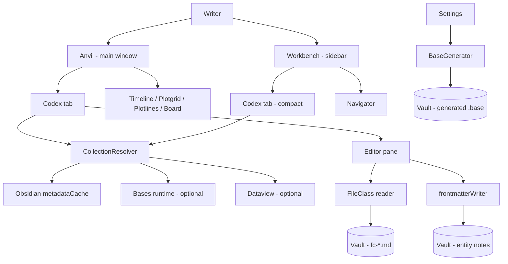
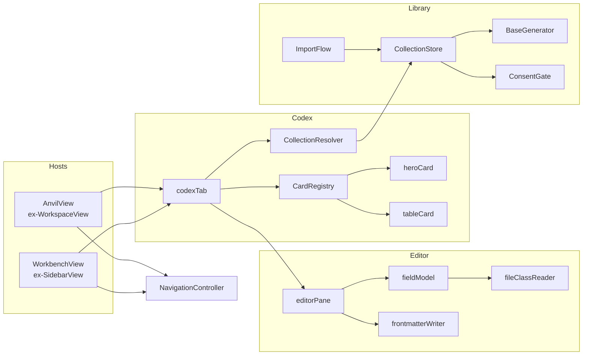
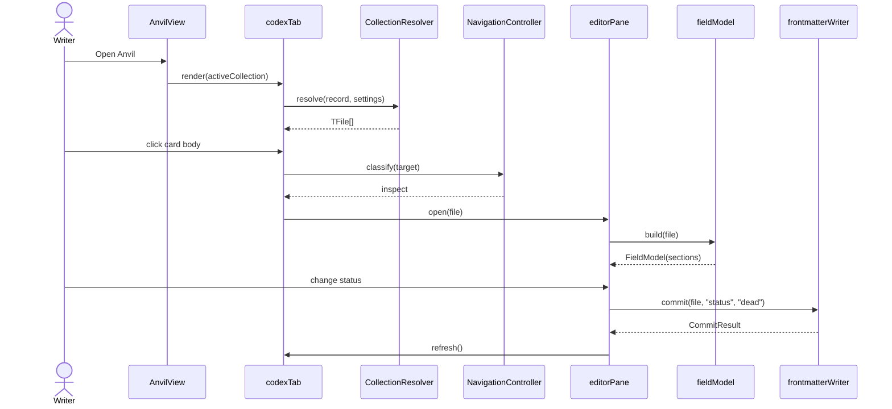
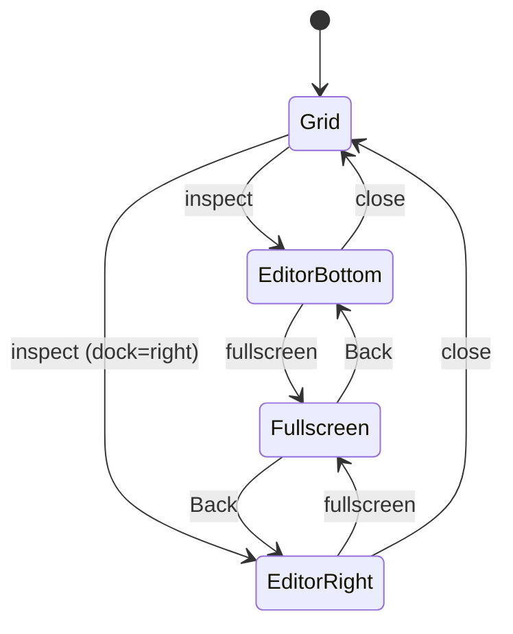

# Solution Design Document

## Validation Checklist

### CRITICAL GATES (Must Pass)

- [x] All required sections are complete
- [x] No [NEEDS CLARIFICATION] markers remain
- [x] Architecture pattern is clearly stated with rationale
- [ ] **All architecture decisions confirmed by user** — ADR-27…ADR-36 are **Pending**
- [x] Every interface has specification

### QUALITY CHECKS (Should Pass)

- [x] All context sources are listed with relevance ratings
- [x] Project commands are discovered from actual project files
- [x] Constraints → Strategy → Design → Implementation path is logical
- [x] Every component in diagram has directory mapping
- [x] Error handling covers all error types
- [x] Quality requirements are specific and measurable
- [x] Component names consistent across diagrams
- [x] A developer could implement from this design
- [x] Implementation examples use actual names verified against source (no pseudocode identifiers)
- [x] Complex logic includes traced walkthroughs with example data

---

## Constraints

- **CON-1 — Story data is frontmatter only.** Every write is a plain Property through the existing
  single write seam (`src/inspector/frontmatterWriter.ts`). No plugin-owned store for story facts.
- **CON-2 — Operational state belongs in the plugin directory.** Dock position, selected Card per
  collection, dismissed hints. Never in a note.
- **CON-3 — Add-ons are never requirements.** Dataview, metadata-menu, meta-bind, Calendarium are
  detected and used where they help; everything degrades to native rendering. A **core** plugin
  (Bases) may be suggested once, dismissibly; a **community** plugin never is.
- **CON-4 — View type identifiers are frozen.** `SIDEBAR_VIEW_TYPE = "story-forge-panel"` carries
  the comment *"Stable — never change after first release"*; `WORKSPACE_VIEW_TYPE` likewise. Renaming
  a surface changes its **display name**, never its id — changing the id orphans every saved
  workspace layout that contains the leaf.
- **CON-5 — No new story-schema fields.** This spec adds presentation hints to the plugin's own
  `schema/*.json`, not facts to the story model. `npm run schema:check` must stay green.
- **CON-6 — Bases typings stay behind one adapter.** `BasesConfigFile` and friends may only be
  imported by `src/bases/basesConfig.ts` (existing CON-3 firewall from spec 005).
- **CON-7 — Structure-agnostic selection.** Notes are selected **by tag**; folders may only
  *exclude*. No feature may require a particular folder layout.
- **CON-8 — TypeScript strict, no `any`.** Per `src/CLAUDE.md`. Unknown external shapes are `unknown`
  plus narrowing.
- **CON-9 — Mobile.** Bases surfaces are desktop-only (spec 007 ADR-10). The Codex must degrade to
  the native card renderer on mobile rather than fail.
- **CON-10 — The signed-off mockups bind.** `docs/mockups/anvil-workbench-codex.html` S91–S103.
  Divergence is raised before it is coded.

## Implementation Context

**IMPORTANT**: You MUST read and analyze ALL listed context sources.

### Required Context Sources

#### Documentation Context

```yaml
- doc: docs/mockups/anvil-workbench-codex.html
  relevance: CRITICAL
  why: "S91–S103, signed off. The visual specification for every surface in this spec."

- doc: docs/XDD/adr/0001-bases-integration-strategy.md
  relevance: CRITICAL
  why: "Fence vs registerBasesView; no programmatic Bases cell read/write; editing is custom DOM."

- doc: docs/XDD/adr/0002-fileclass-driven-editor.md
  relevance: CRITICAL
  why: "The editor derives fields, order, types, enums, sections and layout from the FileClass chain."

- doc: docs/XDD/adr/0003-generated-bases-two-checksums.md
  relevance: CRITICAL
  why: "Generated artifacts vs consented imports; template resolution; source + instance checksum + params."

- doc: docs/gap-analysis.md
  relevance: HIGH
  why: "§1.1 two invariants, §1.2 extensibility contract, §1.3 surface taxonomy, §1.4 add-ons."

- doc: docs/views-and-integration.md
  relevance: HIGH
  why: "Authoritative view spec — Collection/Card, the Codex tab, division of labour."

- url: https://github.com/PixeroJan/obsidian-storyline
  relevance: MEDIUM
  why: "Reference model for the Codex hub and card presentation (MIT, source-read v1.10.41)."
```

#### Code Context

```yaml
- file: src/workspace/WorkspaceView.ts
  relevance: CRITICAL
  why: "Becomes the Anvil. Holds the layout union (l.54), STATUS_VOCAB (l.60), the delegated
        click handler (l.~435), collapse store, debounced render, zoom slot."

- file: src/views/SidebarView.ts
  relevance: CRITICAL
  why: "Becomes the Workbench. 1612 lines: tab strip construction (l.~879), the Context and
        Navigator built-in tabs, drill/back nav stack, engine render decision tree (l.1246)."

- file: src/store/types.ts
  relevance: CRITICAL
  why: "ViewRecord — the record shape Collections and Cards extend. applyDefaults is fail-closed."

- file: src/catalog/CatalogService.ts
  relevance: CRITICAL
  why: "VERIFY → MATERIALISE → PERSIST. The double-copy defect lives here (materialises to the
        vault AND persists the YAML as record.source)."

- file: src/consent/ConsentGate.ts
  relevance: CRITICAL
  why: "evaluate() decision order; _evaluateBasesRecord checksums record.source on every call.
        ADR-0003 changes what is checksummed for generated collections."

- file: src/bases/BasesAdapter.ts
  relevance: HIGH
  why: "registerCodexView / isBasesAvailable — the seam Cards register through."

- file: src/inspector/frontmatterWriter.ts
  relevance: CRITICAL
  why: "The sole write seam: commit / commitMany / validateField / FieldSpec / CommitResult."

- file: src/inspector/inspectorFields.ts
  relevance: HIGH
  why: "The hardcoded field list this spec derives away (ADR-0002)."

- file: src/panel/kindFields.ts
  relevance: HIGH
  why: "Per-kind facts/relations lists AND the special-field inventory in its header comment."

- file: src/panel/components.ts
  relevance: HIGH
  why: "portraitTile / imageTile / factRow / section — reusable primitives for the Cards."

- file: src/scoping/workspaceScope.ts
  relevance: HIGH
  why: "resolveWorkspaceScope + DEFAULT_EXCLUDED_FOLDERS — the tag-inclusion / folder-exclusion rule."

- file: src/engines/EngineRegistry.ts
  relevance: MEDIUM
  why: "Engine wiring and late-join dataview:api-ready handling."

- file: src/import/ViewDefinition.ts
  relevance: HIGH
  why: "engine: 'dataview-dql' | 'dataviewjs' — the union that must grow to admit .base imports."

- file: scripts/schema-gen.mjs
  relevance: MEDIUM
  why: "Write-only generator (no delete path) — the precedent for generated artifacts."

- file: test/StoryForge/00 Meta/FileClasses/fc-character-fantasy.md
  relevance: CRITICAL
  why: "The real FileClass shape: extends, fieldsOrder, fields[].type, options.valuesList."

- file: @package.json
  relevance: MEDIUM
  why: "Scripts and pinned obsidian typings version."
```

#### External APIs

```yaml
- service: Obsidian Bases (core)
  doc: obsidian.d.ts — registerBasesView (5009), BasesView (1105), BasesEntry (685),
       BasesConfigFile (531), BasesConfigFileFilter (583–600, incl. `not`)
  relevance: CRITICAL
  why: "Card view types register here; `not` makes folder exclusion expressible in a .base."

- service: Obsidian metadata-menu (community) — FileClass file FORMAT only
  doc: the generated files in 00 Meta/FileClasses (v3 shape)
  relevance: CRITICAL
  why: "We READ this format. The plugin itself is never required and is never called."

- service: Obsidian Dataview (community)
  doc: getDataviewApi — execute / executeJs
  relevance: MEDIUM
  why: "Existing engines; a Collection may be a DQL query."
```

### Implementation Boundaries

- **Must Preserve**
  - `SIDEBAR_VIEW_TYPE` and `WORKSPACE_VIEW_TYPE` string values (CON-4).
  - The behaviour of Timeline, Plotgrid, Plotlines and Kanban — they move into the Anvil unchanged.
  - `frontmatterWriter` as the only write path, including its validation and `commitMany` atomicity.
  - The consent gate's behaviour for **imported** and **repo-curated** entries.
  - The existing per-kind panel renderers as the native fallback (CON-3) — they are demoted from
    "only implementation" to "fallback", not deleted.
- **Can Modify**
  - `WorkspaceView` (layout union, header, tab strip) and `SidebarView` (tab strip, labels).
  - `ViewRecord` shape and `applyDefaults`, with migration.
  - `CatalogService` install pipeline (the double-copy defect).
  - `Codex.base` content — the include-by-folder filter is removed.
  - `PluginSettings` — new keys for collections, dock, excluded folders, FileClasses folder.
- **Must Not Touch**
  - `schema/*.json` **story fields** — only presentation hints may be added (CON-5).
  - The FileClass files' content at runtime — the plugin reads them and never writes user ones.
  - Longform, Calendarium and anything in their domain.
  - `src/workspace/interactionHandler.ts` drag semantics (spec 007 territory).

### External Interfaces

#### System Context Diagram



#### Interface Specifications

```yaml
# This is an Obsidian plugin: no HTTP, no network, no server. "Interfaces" are
# Obsidian APIs and vault files.
inbound:
  - name: "Command palette / ribbon"
    type: Obsidian command
    data_flow: "Open Anvil, Open Workbench, Open Codex"

  - name: "Bases runtime"
    type: registerBasesView factory
    data_flow: "Bases instantiates our Card view type inside a user's .base and supplies BasesEntry[]"

  - name: "Vault events"
    type: metadataCache.changed / active-leaf-change
    data_flow: "External edits and note focus drive re-render"

outbound:
  - name: "Frontmatter writes"
    type: app.fileManager.processFrontMatter
    data_flow: "One plain Property per commit; commitMany for atomic multi-key"
    criticality: HIGH

  - name: "Generated .base files"
    type: vault.adapter write
    data_flow: "Template + settings parameters → a .base in the configured folder"
    criticality: HIGH

data:
  - name: "data.json"
    type: Plugin.loadData / saveData
    data_flow: "Settings + collection/card records + operational state"

  - name: "FileClasses"
    type: metadataCache frontmatter read (READ ONLY)
    data_flow: "Field declarations for the editor"
```

### Cross-Component Boundaries

Not applicable — single plugin, single team, no cross-service contracts.

### Project Commands

```bash
Install:  npm install
Dev:      npm run dev            # esbuild watch, redeploys into test/StoryForge/
Test:     npm test               # vitest
Lint:     npm run lint           # eslint (obsidianmd) + stylelint
Build:    npm run build          # tsc check + esbuild production
Typecheck: npm run typecheck     # plus typecheck:test, typecheck:mock
Schema:   npm run schema:gen     # regenerate vault artifacts
          npm run schema:check   # drift gate (must stay green — CON-5)
Catalog:  npm run catalog:build  # builds dist/catalog-index.json
Live:     npm run test:live      # live-vault checks
```

## Solution Strategy

- **Architecture Pattern:** *layered, with pure models at the core*. The repo's established shape —
  pure model modules (`workspaceModel`, `sceneMapper`) feeding thin DOM renderers, hosted by one
  `ItemView` per surface, with all vault access behind adapters. This spec adds three model layers
  (collection resolution, FileClass field model, base generation) and reuses the host/renderer split
  verbatim.
- **Integration Approach:** *extend, do not replace*. The Anvil is the existing `WorkspaceView` with
  its layout union extended by `codex`; the Workbench is the existing `SidebarView` renamed. The
  editor extends `InspectorController` rather than starting over. The native panel renderers stay as
  the CON-3 fallback.
- **Justification:** the surfaces already exist and carry state (leaf restoration, collapse state,
  follow semantics, consent). Rebuilding them would risk the one thing this spec must not break —
  the M5/M6 views — for no gain. The genuinely new parts are the three model layers, and they are
  pure and testable in isolation.
- **Key Decisions:** see ADR-27…ADR-36. The load-bearing ones: a `kind` discriminant on store
  records (ADR-29), one `CardRenderer` contract with two backends (ADR-30), and a pure
  `FieldModel` between the FileClass reader and the editor (ADR-31).

## Building Block View

### Components



### Directory Map

**Component**: story-forge plugin

```
.
├── src/
│   ├── anvil/                          # NEW — the main-window surface
│   │   ├── AnvilView.ts                # NEW: renamed host (see ADR-27); layout union + `codex`
│   │   └── anvilTabs.ts                # NEW: tab strip construction + tab registry
│   ├── codex/
│   │   ├── CodexView.ts                # MODIFY: today a degrade stub; becomes the shared tab body
│   │   ├── codexGrid.ts                # MODIFY: card grid, selection, empty state
│   │   ├── collectionResolver.ts       # NEW: pure — record + settings → resolved note list
│   │   └── cardRegistry.ts             # NEW: Card contract + built-in registration
│   ├── codex/cards/
│   │   ├── heroCard.ts                 # NEW: portrait/facts/pills — reuses panel/components primitives
│   │   ├── tableCard.ts                # NEW
│   │   └── compactCard.ts              # NEW
│   ├── editor/                         # NEW — the editor pane (F5/F6)
│   │   ├── editorPane.ts               # NEW: dock modes, header tools, section rendering
│   │   ├── fieldModel.ts               # NEW: pure — FileClass chain → ordered typed sections
│   │   ├── fieldControls.ts            # NEW: one control per field type incl. relation chips
│   │   └── uiHints.ts                  # NEW: type → width rule + `wide`/`image` overrides
│   ├── fileclass/                      # NEW — read-only FileClass access
│   │   ├── fileClassReader.ts          # NEW: resolve chain, parse fields, defensive
│   │   └── fileClassTypes.ts           # NEW: the narrow shape we depend on (firewall, cf. CON-6)
│   ├── library/                        # NEW — Collections and Cards management
│   │   ├── collectionStore.ts          # NEW: record CRUD over ViewStore
│   │   ├── baseGenerator.ts            # NEW: template + params → .base (ADR-0003)
│   │   └── capabilityReport.ts         # NEW: what each optional plugin adds (F8)
│   ├── navigation/                     # NEW
│   │   └── navigationController.ts     # NEW: target-kind matrix, one rule for both surfaces
│   ├── store/types.ts                  # MODIFY: `kind` discriminant + CollectionRecord/CardRecord
│   ├── catalog/CatalogService.ts       # MODIFY: drop the store YAML copy; two-checksum flow
│   ├── consent/ConsentGate.ts          # MODIFY: generated collections bypass drift (ADR-0003)
│   ├── import/ViewDefinition.ts        # MODIFY: engine union admits `bases`
│   ├── inspector/inspectorFields.ts    # DELETE — derived away (ADR-0002)
│   ├── panel/kindFields.ts             # MODIFY: keep as native fallback config only
│   ├── settings/SettingsTab.ts         # MODIFY: Library section, scope section, dock, capabilities
│   ├── views/SidebarView.ts            # MODIFY: display name → Workbench; hosts the Codex tab
│   └── workspace/WorkspaceView.ts      # MODIFY/MOVE: becomes src/anvil/AnvilView.ts
├── schema/
│   └── *.json                          # MODIFY: optional `ui` hint per field (CON-5: no new facts)
├── catalog/
│   └── *.base                          # MODIFY: become templates with parameters
└── test/
    ├── codex/ editor/ fileclass/ library/ navigation/   # NEW test dirs mirroring src
    └── __mocks__/obsidian.ts           # MODIFY: registerBasesView + adapter read/write fidelity
```

### Interface Specifications

#### Data Storage Changes

```yaml
# data.json — no database. Records keyed by id, as today.
Record: ViewRecord (MODIFIED)
  ADD FIELD: kind: "collection" | "card" | "view"    # discriminant, defaults to "view" (migration)
  ADD FIELD: surfaces: { anvil: boolean, workbench: boolean }   # F7 per-entry binding
  # For kind:"collection" with provenance:"curated" (generated artifacts — ADR-0003)
  ADD FIELD: generated?: {
      sourceChecksum: string        # the template's checksum — "did upstream change"
      params: { tag: string, excludedFolders: string[] }   # what it was rendered with
      instanceChecksum: string      # the written file — "was it edited"
      filePath: string              # the artifact in the vault
      verify: boolean               # false = "this file is yours now" (ADR-0003 §7)
    }
  REMOVE FIELD: source-as-YAML for bases records    # the double-copy defect; source becomes a path

Settings: PluginSettings (MODIFIED)
  REMOVE: exampleSetting                            # sample-plugin residue (gap G17)
  ADD: fileClassesFolder: string                    # default "00 Meta/FileClasses"
  ADD: excludedFolders: string[]                    # default ["00 Meta"] — exclusion only (CON-7)
  ADD: editorDock: "bottom" | "right"               # manual only, never automatic
  ADD: cardByCollection: Record<string, string>     # operational state (CON-2)
  ADD: dismissedHints: string[]                     # e.g. "bases-disabled"

schema/*.json (MODIFIED — presentation only, CON-5)
  ADD per field (optional): "ui": "wide" | "image"
```

#### Internal API Changes

Not applicable — no HTTP endpoints. The equivalent contracts are the module interfaces below.

#### Application Data Models

```pseudocode
ENTITY: CollectionRecord (NEW — a ViewRecord with kind:"collection")
  FIELDS:
    id, provenance, enabled, surfaces, engine, source
    label: string                  # pill text
    generated?: GeneratedArtifact  # present only for curated/generated collections
  BEHAVIORS:
    resolve(app, settings): TFile[]    # via CollectionResolver

ENTITY: CardRecord (NEW — a ViewRecord with kind:"card")
  FIELDS:
    id, provenance, enabled, label
    reads?: string[]               # fields the card renders (Could: Library warning)
  BEHAVIORS:
    render(entry, el, deps): void  # the CardRenderer contract

ENTITY: FieldModel (NEW — pure, produced by fileClassReader + fieldModel)
  FIELDS:
    sections: FieldSection[]
  BEHAVIORS: (none — a value object)

ENTITY: FieldSection (NEW)
  FIELDS:
    label: string                  # the FileClass's display name
    source: string                 # fc file path, or "other" for undeclared keys
    origin: "builtin" | "user" | "other"
    fields: FieldDef[]

ENTITY: FieldDef (NEW)
  FIELDS:
    name: string
    type: "Input"|"Select"|"Multi"|"MultiFile"|"Number"|"File"|"Boolean"|"Date"|"Unknown"
    values?: string[]              # from options.valuesList, for Select
    width: "half" | "full"         # derived from type, overridden by ui hint
    ui?: "wide" | "image"
  BEHAVIORS: (none)

ENTITY: GeneratedArtifact (NEW — ADR-0003)
  FIELDS: sourceChecksum, params, instanceChecksum, filePath, verify
  BEHAVIORS:
    classify(currentSource, currentParams, fileOnDisk): "clean" | "regenerate" | "ask" | "reconsent"
```

#### Integration Points

```yaml
# All integrations are in-process Obsidian APIs. No network.
Bases:
  - registration: Plugin.registerBasesView("story-forge-hero" | "-table" | "-compact", factory)
  - data_in: BasesEntry[] via BasesView.onDataUpdated
  - constraint: "no programmatic cell read/write exists (ADR-0001); all editing is ours"
  - degrade: "isBasesAvailable() false → native card renderer (CON-3/CON-9)"

metadata-menu:
  - integration: "FILE FORMAT ONLY — we read fc-*.md frontmatter via metadataCache"
  - never: "the plugin is never called, never required, never written to"

Dataview:
  - integration: "existing DQL/JS engines; a Collection may be a DQL query"
  - degrade: "absent → native resolution via metadataCache"
```

### Implementation Examples

#### Example: the width rule (F6 / ADR-32)

**Why this example**: this is the rule that makes a user's fields look as good as ours, and it must
be one function with no per-kind branching. Reviewers should be able to check it against the
signed-off S102/S103 by eye.

```typescript
// src/editor/uiHints.ts
// Verified against the real generated FileClasses: the six types actually emitted are
// Input (42×), Select (17×), Multi (10×), MultiFile (10×), Number (7×), File (5×).
const HALF: ReadonlySet<FieldDef["type"]> = new Set([
  "Input", "Select", "Number", "Boolean", "Date",
]);

export function widthOf(field: { type: FieldDef["type"]; ui?: "wide" | "image" }): "half" | "full" {
  if (field.ui !== undefined) return "full";      // wide and image both take the row
  return HALF.has(field.type) ? "half" : "full";  // Multi / MultiFile / File / Unknown → full
}
```

**Traced walkthrough** — against the fields in S102/S103:

| Field | Declared type | `ui` | Result | Matches mockup |
|---|---|---|---|---|
| `name` | `Input` | — | half | ✔ two-up with `role` |
| `role` | `Select` | — | half | ✔ |
| `status` | `Select` | — | half | ✔ |
| `occupation` | `Input` | — | half | ✔ |
| `level` (user) | `Number` | — | half | ✔ two-up with `affinity` |
| `affinity` (user) | `Select` | — | half | ✔ |
| `awakened` (user) | `Boolean` | — | half | ✔ |
| `skills` (user) | `Multi` | — | full | ✔ chips wrap |
| `allies` | `MultiFile` | — | full | ✔ |
| `tagline` | `Input` | `wide` | full | ✔ override |
| `portrait` | `Input` | `image` | full | ✔ preview + picker |

**Edge cases**: an unrecognised type resolves to `Unknown` → `full` (a text control on its own row —
never a crash). A field with `ui` set but an unknown type still gets `full`.

#### Example: classifying a generated artifact (ADR-0003 / ADR-35)

**Why this example**: the three-way comparison is the heart of ADR-0003, and getting it wrong either
nags the user on every settings change or silently overwrites their edits.

```typescript
// src/library/baseGenerator.ts
export type ArtifactState = "clean" | "regenerate" | "ask" | "reconsent";

export function classify(
  rec: GeneratedArtifact,
  currentSourceChecksum: string,
  currentParams: CollectionParams,
  fileChecksum: string | null,     // null = the file is missing
): ArtifactState {
  if (rec.verify === false) return "clean";                       // "this file is yours now"
  if (currentSourceChecksum !== rec.sourceChecksum) return "reconsent";  // upstream changed
  if (fileChecksum === null) return "regenerate";                 // missing → just rewrite
  if (!sameParams(currentParams, rec.params)) return "regenerate"; // WE caused it — silent
  if (fileChecksum !== rec.instanceChecksum) return "ask";        // a foreign hand edited it
  return "clean";
}
```

**Traced walkthrough**:

| Scenario | source | params | file | → | User sees |
|---|---|---|---|---|---|
| Nothing happened | same | same | same | `clean` | nothing |
| User changes the tag in settings | same | **differs** | differs | `regenerate` | the grid updates; **no prompt** |
| User hand-edits `Codex.base` | same | same | **differs** | `ask` | "this file was changed — regenerate or keep?" |
| Catalog update ships a new template | **differs** | — | — | `reconsent` | the existing consent flow |
| User switched verification off | — | — | — | `clean` | we never touch it again |

**Why params must be stored**: rows 2 and 3 are otherwise indistinguishable — both present only as
an instance-checksum mismatch. Without `params` the plugin either prompts on every settings change
or silently overwrites hand edits.

## Runtime View

### Primary Flow: look up an entity and correct a fact

1. Writer runs **Open Anvil**; the Codex tab is selected.
2. `CollectionResolver` resolves the enabled collection → note list.
3. `CardRegistry` renders each note with the Card chosen for that collection.
4. Writer clicks a card body → `NavigationController` classifies the target as *card body* → **inspect**.
5. `editorPane` opens in the configured dock; `fieldModel` builds sections from the FileClass chain.
6. Writer edits `status` → `frontmatterWriter.commit` writes one plain Property.
7. `metadataCache.changed` fires → the grid re-renders; the editor keeps focus.



### Error Handling

| Error | Handling |
|---|---|
| **Write fails** (`CommitResult` not ok) | Restore the previous value in the control, surface the reason inline on the field plus a `Notice`. Never leave the UI showing a value the file does not have. |
| **Collection query invalid** (bad `.base`, DQL parse error) | The grid shows a diagnosable message naming the collection; other collections keep working. Never a blank tab. |
| **Collection tag empty** | Treated as misconfigured — say so; **never** fall through to "list the whole vault" (F3 AC). |
| **FileClass malformed** | Skip that FileClass, log once, render the rest of the chain. Tier-2 fallback if the whole chain fails. |
| **FileClass chain cycle** | Truncate at the first repeat via a visited set; each section renders once. |
| **Bases absent or disabled** | Native card renderer; a single dismissible hint only if Bases is *present but disabled* (core). |
| **Dataview absent** | Native resolution; **no prompt** (community — CON-3). |
| **Generated artifact edited** | `ask` — regenerate or adopt ("this file is yours now"). Never silent overwrite. |
| **Note deleted while the editor is open** | Close the pane, return to the grid, notify. |
| **Import invalid** | Refuse with a reason; persist nothing (F7 AC). |

### Complex Logic: building the FieldModel

```
ALGORITHM: buildFieldModel
INPUT: note, fileClassesFolder, schemaUiHints
OUTPUT: FieldModel { sections }

1. RESOLVE CHAIN:
   classes := fileClassesApplyingTo(note)      # by tagNames / filesPaths
   chain   := []; visited := {}
   WHILE class AND class NOT IN visited:
       visited += class; chain += class; class := class.extends
   chain := reverse(chain)                     # base first

2. BUILD SECTIONS:
   seen := {}
   FOR class IN chain:
       fields := []
       FOR name IN class.fieldsOrder ?? declaredOrder(class):
           IF name IN seen: CONTINUE           # first declaration wins
           seen += name
           def := class.fields[name]
           fields += FieldDef{
               name, type: mapType(def.type), values: def.options?.valuesList,
               ui: schemaUiHints[name], width: widthOf(...)
           }
       sections += FieldSection{ label: class.title, origin: originOf(class), fields }

3. TIER 2 — no chain at all:
   IF chain is empty:
       RETURN sections := [ inferredSectionFrom(note.frontmatter) ]

4. TIER 3 — undeclared keys:
   extra := keys(note.frontmatter) - seen
   IF extra non-empty:
       sections += FieldSection{ label: "Other properties", origin: "other", fields: textFields(extra) }

5. RETURN FieldModel{ sections }
```

**Traced walkthrough** — Mara Stoneway with a user FileClass (S103):

| Step | State |
|---|---|
| 1 | `fc-character-custom1` applies (tag `canon/character`), `extends: fc-character` → chain `[fc-character, fc-character-custom1]` |
| 2a | Section "Character": `name`(Input,half) `role`(Select,half) `status`(Select,half) `occupation`(Input,half) … `tagline`(Input,**wide**→full) `portrait`(Input,**image**→full) `allies`(MultiFile,full) |
| 2b | Section "Isekai": `level`(Number,half) `affinity`(Select,half) `awakened`(Boolean,half) `skills`(Multi,full) `guild`(MultiFile,full) |
| 4 | Note also carries `scratch` → Section "Other properties": `scratch`(text,full) |

Matches S103 exactly, including which fields sit two-up.

## Deployment View

**No change.** A single Obsidian plugin loaded from the vault's plugin folder; no environment, no
services, no build-order coordination. `minAppVersion` may need review because Bases surfaces require
≥1.10 for `registerBasesView` — the Codex must degrade below that (CON-9), so a bump is *not*
required by this spec.

## Cross-Cutting Concepts

### Pattern Documentation

```yaml
- pattern: "pure model → thin renderer → ItemView host"
  relevance: CRITICAL
  why: "The established repo shape (workspaceModel/renderTimeline/WorkspaceView). All three new
        model layers follow it so they are unit-testable without Obsidian."

- pattern: "single write seam (frontmatterWriter)"
  relevance: CRITICAL
  why: "CON-1. The editor adds controls, never a second write path."

- pattern: "adapter firewall for volatile typings"
  relevance: HIGH
  why: "Bases typings live only in basesConfig.ts (CON-6). fileClassTypes.ts does the same job for
        metadata-menu's format — the accepted risk in ADR-0002 is contained to one module."

- pattern: "generated artifact vs consented import" (NEW)
  relevance: CRITICAL
  why: "ADR-0003. schema-gen is the precedent; this spec generalises it to .base files."
```

### User Interface & UX

**Information Architecture** — two interfaces, one content concept (`gap-analysis.md` §1.3):

```
┌─ Anvil (main window) ───────────────────────────────────┐
│ [Codex] [Timeline] [Plotgrid] [Plotlines] [Board]       │
├─────────────────────────────────────────────────────────┤
│ (Characters)(Locations)(Objects)(Lore)(+)  Card: Hero ▾ │
│ ┌────────┐ ┌────────┐ ┌────────┐                        │
│ │ card   │ │ card   │ │ card   │                        │
│ └────────┘ └────────┘ └────────┘                        │
├─────────────────────────────────────────────────────────┤
│ editor pane — dock: bottom | right | fullscreen         │
└─────────────────────────────────────────────────────────┘
```

**Design System:** reuse `src/panel/components.ts` primitives (`portraitTile`, `imageTile`,
`factRow`, `section`) so cards and panel share one visual language. No new CSS framework; extend
`styles.css` with `sf-cx-*` and `sf-ed-*` prefixes.

**Interaction Design:**
- *State*: selected collection and Card per collection persist (CON-2); dock persists; selection is
  ephemeral.
- *Feedback*: optimistic field update, rollback on failure, inline reason plus `Notice`.
- *Accessibility*: the grid is keyboard-navigable (Could), every control is labelled, the editor's
  section headings are real headings, and the dismissible hint is not a focus trap.



### System-Wide Patterns

- **Security:** no network, no eval beyond the existing DataviewJS consent gate, no credentials.
  The new surfaces execute no user code — a Card is a declaration, not a script.
- **Error handling:** local and diagnosable. A broken collection or FileClass degrades that item,
  never the surface.
- **Performance:** collection resolution is a `metadataCache` scan (already done elsewhere);
  FileClass chains are read per selection and cached per file until `metadataCache.changed`.
- **i18n:** none — English only, sentence-case UI per the obsidianmd rule.
- **Logging:** `console.debug` only, never `console.log` (community-directory rule).

### Multi-Component Patterns

Not applicable — single component.

## Architecture Decisions

- [ ] **ADR-27 — The Anvil is the existing `WorkspaceView`, renamed in display only.** The layout
      union grows a `codex` member; `WORKSPACE_VIEW_TYPE` and `SIDEBAR_VIEW_TYPE` **keep their string
      values**.
  - Rationale: `pluginConstants.ts` states the ids are stable API ("never change after first
    release"). Changing them orphans saved workspace layouts. Renaming is a *display* concern.
  - Trade-offs: internal names (`WorkspaceView`, `workspace/`) stay out of step with the UI vocabulary
    unless we move the files; we accept a one-off file move with the id unchanged.
  - User confirmed: _Pending_

- [ ] **ADR-28 — One `NavigationController` implements the target-kind matrix for both surfaces.**
      Click handling is classify-then-act; surfaces contribute target markers, not behaviour.
  - Rationale: PRD F2 requires behaviour to depend on target kind, not on which tab. Today the rule
    is duplicated in `SidebarView` and `WorkspaceView` with different outcomes.
  - Trade-offs: a shared controller must not know about surfaces, so "inspect" is a callback each
    host supplies; the setting's stored values (`drill`/`open`) stay for compatibility while the UI
    says *inspect*.
  - User confirmed: _Pending_

- [ ] **ADR-29 — Store records gain a `kind` discriminant** (`"view" | "collection" | "card"`), with
      `applyDefaults` defaulting legacy records to `"view"`.
  - Rationale: Collections and Cards need different fields; a single flat `ViewRecord` would collect
    optional members that are meaningless for two of the three kinds.
  - Trade-offs: a migration path is required; `applyDefaults` stays fail-closed.
  - User confirmed: _Pending_

- [ ] **ADR-30 — One `CardRenderer` contract, two backends.** A Card is registered both as a Bases
      view type and as a native renderer; the Codex picks the backend by availability.
  - Rationale: CON-3 and CON-9 require the Codex to work without Bases and on mobile, while
    ADR-0001 makes `registerBasesView` the way to appear inside a user's `.base`.
  - Trade-offs: each built-in Card is implemented once against a normalised entry shape, with a thin
    adapter on each side — a small mapping cost to avoid two divergent card families.
  - User confirmed: _Pending_

- [ ] **ADR-31 — A pure `FieldModel` sits between the FileClass reader and the editor.** The reader
      produces data; the editor renders it and never reads FileClasses itself.
  - Rationale: makes the whole of ADR-0002 unit-testable with fixtures and contains the metadata-menu
    format risk to one module.
  - Trade-offs: one more layer; worth it because the format is the accepted external risk.
  - User confirmed: _Pending_

- [ ] **ADR-32 — Column width is derived from field type**, with `ui: "wide" | "image"` overrides
      stored in `schema/*.json`, never in the FileClass file.
  - Rationale: reproduces the signed-off layout for our fields and the user's alike with no
    configuration; metadata-menu rewrites FileClass files through its own UI and could drop unknown
    keys.
  - Trade-offs: a *user's* field cannot carry a hint; the value-inspection image fallback is a Could.
  - User confirmed: _Pending_

- [ ] **ADR-33 — The editor pane is one component with three dock modes**, dock persisted in
      settings and **never switched automatically**.
  - Rationale: PRD F5; a layout that moves during a resize is worse than one set once.
  - Trade-offs: no responsive adaptation; accepted deliberately.
  - User confirmed: _Pending_

- [ ] **ADR-34 — Curated `.base` files become templates rendered whole**, never patched.
  - Rationale: ADR-0003. Regex over YAML breaks on comments, quoting and nesting; whole-file render
    is deterministic and diffable.
  - Trade-offs: a template syntax must be specified and tested (empty parameters, folder names with
    spaces).
  - User confirmed: _Pending_

- [ ] **ADR-35 — Generated collections carry `{sourceChecksum, params, instanceChecksum, verify}`
      and the store keeps no YAML copy.**
  - Rationale: ADR-0003; also removes the existing double-copy defect where drift is computed over
    the store copy while `_openCodex` opens the vault file.
  - Trade-offs: one file read per evaluate (compare `mtime` first if it ever matters); a migration
    for existing bases records.
  - User confirmed: _Pending_

- [ ] **ADR-36 — Capability disclosure distinguishes core from community.** Core plugins may be
      suggested once, dismissibly; community plugins appear only in a settings list.
  - Rationale: PRD F4/F8. Bases is enabled, not installed — a different act from installing a
    third-party plugin, and the community-directory norms differ accordingly.
  - Trade-offs: users who never open settings may not discover what Dataview would add; accepted, as
    nagging is worse.
  - User confirmed: _Pending_

## Quality Requirements

- **Performance:** opening the Codex on the seed vault renders within one animation frame of the
  collection resolving; a field commit reflects in the grid within the existing 200 ms debounce.
  FileClass chains are re-read only on `metadataCache.changed` for the FileClasses folder.
- **Usability:** every surface reachable by command; no dead ends (the Anvil tab strip is always
  visible, including in fullscreen); every empty state names its cause and offers an action.
- **Security:** no new code-execution path. Cards are declarative; the DataviewJS gate is unchanged.
- **Reliability:** no write outside `frontmatterWriter`; no user file overwritten without an explicit
  decision; a malformed FileClass or `.base` degrades one item, never the surface.
- **Compatibility:** with Bases, Dataview and metadata-menu all absent, every Must feature works
  except the Bases-specific Card backend. Verified by test, not by assertion.

## Acceptance Criteria

**Main Flow: PRD F1 — the Anvil**
- [ ] WHEN the user runs `Open Anvil`, THE SYSTEM SHALL open one view whose tab strip contains Codex, Timeline, Plotgrid, Plotlines and Board
- [ ] WHEN a legacy command (`open-timeline`, `open-plotlines`, `open-kanban`, `open-plotgrid`) is invoked, THE SYSTEM SHALL open the Anvil with the corresponding tab selected
- [ ] THE SYSTEM SHALL preserve `WORKSPACE_VIEW_TYPE` and `SIDEBAR_VIEW_TYPE` string values unchanged
- [ ] WHILE a management tab is selected, THE SYSTEM SHALL render it with the behaviour shipped in M5/M6, unmodified

**Main Flow: PRD F2 — navigation**
- [ ] WHEN a click occurs, THE SYSTEM SHALL determine behaviour from the target kind alone, independent of the hosting surface
- [ ] WHEN the user inspects an entry in the Anvil, THE SYSTEM SHALL show it within the Anvil and SHALL NOT open, reveal or re-target another leaf
- [ ] WHEN the user opens a note, THE SYSTEM SHALL NOT change any panel's selected tab
- [ ] IF a click resolves to no known target kind, THEN THE SYSTEM SHALL take no action

**Main Flow: PRD F3 — collections**
- [ ] WHEN a collection resolves, THE SYSTEM SHALL include notes by tag and SHALL exclude notes under the configured excluded folders
- [ ] WHEN the tag or excluded folders change in settings, THE SYSTEM SHALL reflect the change without requesting consent or approval
- [ ] IF a collection's tag is empty, THEN THE SYSTEM SHALL report it as misconfigured and SHALL NOT list unfiltered notes

**Main Flow: PRD F4 — cards**
- [ ] WHERE Bases is available, THE SYSTEM SHALL render Cards through registered Bases view types
- [ ] WHERE Bases is unavailable, THE SYSTEM SHALL render the same Cards natively
- [ ] WHEN the user selects a Card, THE SYSTEM SHALL persist that choice per collection and SHALL NOT write frontmatter
- [ ] WHERE Bases is present but disabled, THE SYSTEM SHALL show at most one dismissible hint
- [ ] WHERE a community plugin is absent, THE SYSTEM SHALL NOT prompt for its installation

**Main Flow: PRD F5 — the editor pane**
- [ ] WHEN an entry is inspected, THE SYSTEM SHALL open the editor in the configured dock showing the complete field set
- [ ] WHEN a field is committed, THE SYSTEM SHALL write exactly one plain Property through `frontmatterWriter`
- [ ] THE SYSTEM SHALL NOT change the dock automatically in response to a resize
- [ ] WHEN a note changes externally, THE SYSTEM SHALL update the displayed values

**Main Flow: PRD F6 — FileClass-driven fields**
- [ ] WHEN the editor opens, THE SYSTEM SHALL derive fields, order, types, enum values and sections from the FileClass chain
- [ ] THE SYSTEM SHALL render one section per FileClass in the chain, base first
- [ ] THE SYSTEM SHALL assign half width to Select, Number, Boolean, Date and Input, and full width to Multi and MultiFile, unless a `ui` hint overrides it
- [ ] IF no FileClass applies, THEN THE SYSTEM SHALL render the note's own frontmatter keys typed by value
- [ ] IF a key is declared by no FileClass, THEN THE SYSTEM SHALL render it under "Other properties"
- [ ] THE SYSTEM SHALL NOT write to any FileClass file

**Main Flow: PRD F7 — the Library**
- [ ] WHEN the user imports a `.base`, THE SYSTEM SHALL accept it as a Collection
- [ ] WHEN the user installs a curated Dataview view, THE SYSTEM SHALL accept it
- [ ] THE SYSTEM SHALL allow built-in entries to be disabled and SHALL NOT offer to remove them
- [ ] WHERE an entry is imported or from-repo, THE SYSTEM SHALL allow disable and remove
- [ ] WHEN an entry's surface toggles change, THE SYSTEM SHALL show it in exactly the toggled surfaces

**Error Handling**
- [ ] WHEN a commit fails, THE SYSTEM SHALL restore the previous value and surface the reason
- [ ] IF a FileClass is malformed, THEN THE SYSTEM SHALL skip it and render the remaining chain
- [ ] IF a FileClass chain contains a cycle, THEN THE SYSTEM SHALL truncate at the first repeat
- [ ] IF an import's query cannot be resolved, THEN THE SYSTEM SHALL refuse it and persist nothing

**Edge Cases**
- [ ] IF a generated artifact's file differs while its parameters are unchanged, THEN THE SYSTEM SHALL ask before overwriting
- [ ] IF a generated artifact's parameters changed, THEN THE SYSTEM SHALL regenerate without prompting
- [ ] WHILE verification is switched off for a collection, THE SYSTEM SHALL neither verify nor regenerate its file
- [ ] IF two FileClasses in a chain declare the same field, THEN THE SYSTEM SHALL render it once, in the earliest section
- [ ] IF a `Select` field's current value is not among its declared values, THEN THE SYSTEM SHALL preserve and display the current value

## Risks and Technical Debt

### Known Technical Issues

- **Double-copy divergence (active defect).** `CatalogService` materialises `.base` YAML into the
  vault *and* persists a copy as `record.source`; `ConsentGate._evaluateBasesRecord` checksums the
  store copy, so editing the vault file raises no drift even though `_openCodex` opens that file.
  Fixed by ADR-35.
- **`Codex.base` include-by-folder** (`file.inFolder("30 Canon")`) contradicts the structure-agnostic
  rule (CON-7) and is removed here.
- **`exampleSetting`** — sample-plugin residue in `PluginSettings` and the settings UI; removed while
  that file is open (gap G17).

### Technical Debt

- **The hardcoded field surface is larger than one field.** `src/panel/kindFields.ts` documents it:
  character uses `portrait`, location and object use `image`, each triggering a tile instead of a
  fact row; `src/panel/components.ts` remaps `locationType` → "type" for display;
  `src/panel/renderers/character.ts` special-cases `portrait` (l.108) and `tagline` (l.119).
  **This answers the PRD's open question:** the image field has *two different names by kind*, so a
  `ui: image` declaration replaces a per-kind convention, not a single exception.
- **`inspectorFields.ts` duplicates the FileClasses** and is deleted rather than extended.
- **Two view-tab mechanisms** exist (`SidebarView` tab strip, `WorkspaceView` layout switch); this
  spec adds a third host but should converge them, not fork again.

### Implementation Gotchas

- **Renaming ≠ re-identifying.** Changing a view type id silently orphans leaves in saved layouts.
  Display names only (CON-4).
- **`registerBasesView` must be called once at load**, before the registry is populated — the
  existing code caches availability in a `WeakMap` for exactly this reason (spec 005 ADR-8).
- **`metadataCache` is not immediately populated at layout-ready**; the existing late-join
  `dataview:api-ready` pattern applies to Bases availability too.
- **FileClass `tagNames`/`filesPaths` may be empty** (as in `fc-character-fantasy`), so "which
  FileClass applies" cannot rely on them alone — the `extends` chain and the note's own tags both
  matter.
- **`fieldsOrder` uses prefixed ids** (`f-name`, `g-species`), not field names; the mapping to
  `fields[].name` goes through each entry's `id`.
- **Obsidian's own undo does not cover `processFrontMatter` writes** made from a plugin view — with
  the undo journal out of scope (#17), the editor must not make writes easy to trigger accidentally.

## Glossary

### Domain Terms

| Term | Definition | Context |
|------|------------|---------|
| Anvil | The main-window interface; one view with a tab switcher | Hosts Codex + the management tabs |
| Workbench | The sidebar interface; follows the active note | Hosts the compact Codex, Navigator, user views |
| Codex | The story objects — content, not an interface | Appears in both surfaces |
| Collection | *What* is shown — a query yielding notes | One pill in the Codex |
| Card | *How* an entry is drawn | Chosen per collection, remembered |
| Inspect | Show an entity where you already are | Anvil → editor pane; Workbench → panel body |

### Technical Terms

| Term | Definition | Context |
|------|------------|---------|
| FileClass | A vault note whose frontmatter declares fields, types, values, order and `extends` | Read-only source of the editor's field model |
| Generated artifact | A file we produce deterministically from our schema + the user's settings | Not checksum-gated as a consented import (ADR-0003) |
| Consented import | Content we did not author, guarded by checksum and consent | Imported and repo-curated entries |
| Instance checksum | Hash of the written artifact — "was this file altered" | Distinguished from the source checksum |
| Plain Property | A frontmatter value a human could have typed | The only thing this plugin ever writes |

### API/Interface Terms

| Term | Definition | Context |
|------|------------|---------|
| `registerBasesView` | Obsidian API registering a custom Bases view *type* | How Cards appear inside a user's `.base` |
| `BasesEntry` | One row of a Bases query result | The normalised input a Card renders |
| `processFrontMatter` | Obsidian's atomic frontmatter mutation API | Behind `frontmatterWriter`, the single write seam |
| `BasesConfigFileFilter` | `string | {and} | {or} | {not}` | `not` makes folder exclusion expressible |
