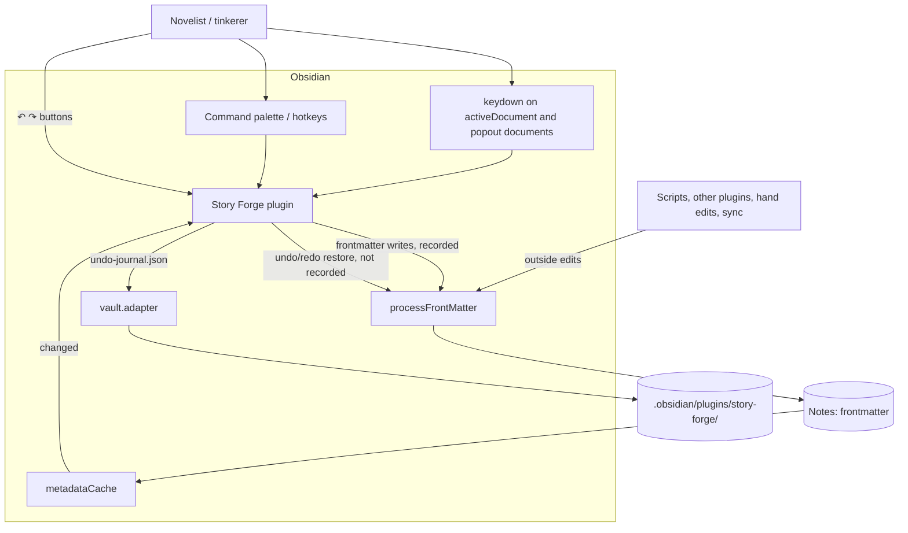
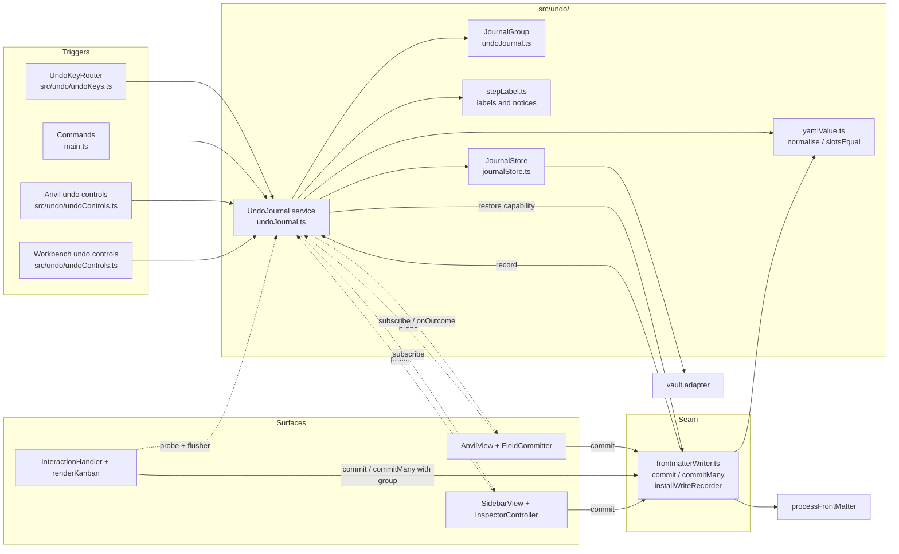
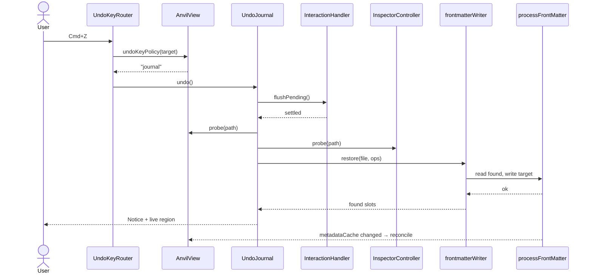
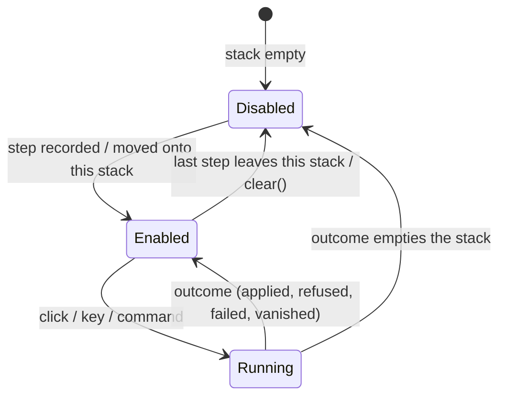

# Solution Design Document

## Validation Checklist

### CRITICAL GATES (Must Pass)

- [x] All required sections are complete
- [x] No [NEEDS CLARIFICATION] markers remain
- [x] Architecture pattern is clearly stated with rationale
- [x] **All architecture decisions confirmed by user** — ADR-37…ADR-53 confirmed 2026-11-04
- [x] Every interface has specification

### QUALITY CHECKS (Should Pass)

- [x] All context sources are listed with relevance ratings
- [x] Project commands are discovered from actual project files
- [x] Constraints → Strategy → Design → Implementation path is logical
- [x] Every component in diagram has directory mapping
- [x] Error handling covers all error types
- [x] Quality requirements are specific and measurable
- [x] Component names consistent across diagrams
- [x] A developer could implement from this design
- [x] Implementation examples use actual names verified against source (no pseudocode identifiers)
- [x] Complex logic includes traced walkthroughs with example data

---

## Constraints

- **CON-1 — Story data is frontmatter only.** The journal is operational state (CLAUDE.md invariant 2,
  `docs/gap-analysis.md` §1.1, G22). No note, view or feature reads story data from it. Deleting
  `undo-journal.json` must leave every fact readable and every view correct.
- **CON-2 — One write seam.** `app.fileManager.processFrontMatter` is called only from
  `src/inspector/frontmatterWriter.ts` (verified 2026-11-04: lines 241 and 295 are the only call
  sites in `src/`). Undo and redo write through the same module; no second exported write function
  is added.
- **CON-3 — Plain Properties only.** Undo writes back values that were read from the file (or that
  Story Forge validated when it first wrote them). It never writes a value Story Forge could not
  have written, and never creates, renames or deletes a note.
- **CON-4 — A bare click must not mutate.** Undo and redo are triggered by a key, a command, or a
  button that names the change in its tooltip. No click elsewhere writes.
- **CON-5 — One fact, one place.** The journal stores only the values Story Forge changed, per
  field, never a copy of a note's frontmatter.
- **CON-6 — Obsidian API discipline.** Every listener through `register*`; popout-safe globals
  (`activeDocument`, `activeWindow`); persistence through `app.vault.adapter`; no `any` (strict
  TypeScript, `src/CLAUDE.md`); `main.ts` stays lifecycle wiring only.
- **CON-7 — The mock matches `obsidian.d.ts`.** Every mock addition this spec needs is named after
  and shaped like the real declaration (memory: "Obsidian mock must match real API"). The existing
  `debounce` mock exposes `flush()` where the d.ts declares `Debouncer.run()` (d.ts l.2235–2248);
  production code calls `run()` and the mock is corrected.
- **CON-8 — Mockups are a gate.** No UI code (buttons, tooltips, notices, settings rows) before the
  user signs off the HTML states in `docs/XDD/specs/009-undo-journal/mockups.html` (CLAUDE.md, G23).
- **CON-9 — Storyline is the reference model.** Every deviation from Storyline's `UndoManager` is a
  recorded decision (PRD Competitive Analysis; ADRs below).
- **CON-10 — English, sentence case.** All UI text follows the obsidianmd sentence-case rule;
  "Story Forge", "Anvil" and "Workbench" are proper nouns.

## Implementation Context

**IMPORTANT**: You MUST read and analyze ALL listed context sources.

### Required Context Sources

#### Documentation Context

```yaml
- doc: docs/XDD/specs/009-undo-journal/requirements.md
  relevance: CRITICAL
  why: "F1–F10 must-haves, Should/Could/Won't, the conflict and pending-work business rules."

- doc: docs/XDD/ideas/2026-11-04-undo-journal.md
  relevance: CRITICAL
  why: "Brainstormed design: entry shape, writer-level journal, conflict rule, tests. Superseded
        where ADR-37 (keyboard) and ADR-40 (no device id) say otherwise."

- doc: docs/XDD/specs/009-undo-journal/README.md
  relevance: HIGH
  why: "Decision log — notice after every undo/redo, no Ctrl+Y, Clear button kept, #30 closes here."

- doc: docs/gap-analysis.md
  relevance: HIGH
  why: "§1.1 the two invariants; G22 (undo history is operational state)."

- doc: docs/storyline-analysis.md
  relevance: MEDIUM
  why: "Storyline is the reference model; its UndoManager is the baseline we adopt or deviate from."

- doc: docs/live-testing.md
  relevance: MEDIUM
  why: "Format for the manual live-vault walk (Should Have)."

- url: https://github.com/pixerojan/obsidian-storyline (services/UndoManager.ts, main.ts)
  relevance: MEDIUM
  why: "Global keydown routing when a Storyline view is active; 50-entry stacks; labels."
```

#### Code Context

```yaml
- file: src/inspector/frontmatterWriter.ts
  relevance: CRITICAL
  why: "The single write seam. commit (l.270) and commitMany (l.209) each call processFrontMatter
        once. The recorder hook and the restore capability live here (ADR-44)."

- file: src/editor/fieldCommit.ts
  relevance: HIGH
  why: "The Anvil editor's write path: FieldCommitter._commit calls commit() and reports
        onWriteIssued / onWriteSettled to the host. Unchanged by this spec except via the writer."

- file: src/inspector/InspectorController.ts
  relevance: CRITICAL
  why: "Workbench inspector. fieldStates (l.150), gen (l.157), render (l.190) refreshes only
        status 'clean' (l.218) — the #30 stale-saved-value cause; notifyFileChanged (l.255) skips
        the whole redraw if any field is dirty/saving/error. _commitField (l.643)."

- file: src/anvil/AnvilView.ts
  relevance: CRITICAL
  why: "Anvil. onWrite wiring of the InteractionHandler (l.425), Kanban renumber closure (l.1101)
        that awaits commits sequentially, _inFlight/_inFlightPath (l.267), _draftEl (l.284),
        _paneIsDirty (l.637), _reconcile (l.614), tab-strip head (l.375–381), _liveEl and
        _announce (l.413, l.1143), metadataCache 'changed' (l.491), vault 'rename' (l.509)."

- file: src/anvil/anvilTabs.ts
  relevance: MEDIUM
  why: "buildAnvilTabStrip — the strip the ↶/↷ controls sit beside."

- file: src/editor/editorPane.ts
  relevance: HIGH
  why: "toolEl (l.~261): span + role=button + tabindex=0 + aria-label + title. The undo controls
        follow this pattern."

- file: src/workspace/interactionHandler.ts
  relevance: CRITICAL
  why: "Drag pointerup (l.301–324) calls strategy.computeDrop then _apply; _apply merges per file
        and schedules a per-file debounced _flush; destroy() cancels pending flushes. Grouping and
        the public flush land here (ADR-38, ADR-39)."

- file: src/workspace/renderKanban.ts
  relevance: CRITICAL
  why: "computeDrop / computeKey; the RENUMBER path fires `void deps.renumber(otherWrites)` (l.434)
        unawaited. ADR-38 makes the group track it."

- file: src/views/SidebarView.ts
  relevance: CRITICAL
  why: "Workbench. _buildShell header .sf-icons (l.598–628) with native pin/edit buttons; the
        metadataCache 'changed' handler (l.331–347) consults notifyFileChanged and ignores a pinned
        subject (l.334)."

- file: src/main.ts
  relevance: CRITICAL
  why: "onload wiring; createFileClassCache + this.register(dispose) (l.55–61) is the model for a
        plugin-owned service; loadData/saveData port; no onunload override; addCommand pattern."

- file: src/types/index.ts
  relevance: HIGH
  why: "PluginSettings, DEFAULT_SETTINGS, normalizeSettings — gains keepUndoHistory."

- file: src/settings/SettingsTab.ts
  relevance: MEDIUM
  why: "Setting rows; the persistence toggle and Clear undo history button go here."

- file: src/navigation/keyboardRouting.ts
  relevance: MEDIUM
  why: "isFormControl — reused for the 'is this an editable text element' half of the key rule."

- file: test/__mocks__/obsidian.ts
  relevance: CRITICAL
  why: "processFrontMatter store (l.524), vault.adapter (l.574), Platform (l.1615), debounce with
        flush instead of run (l.1734). Lacks parseYaml/stringifyYaml, Keymap, Scope."

- file: node_modules/obsidian/obsidian.d.ts
  relevance: HIGH
  why: "Debouncer.run (l.2248), parseYaml (l.4817), stringifyYaml (l.6815), DataAdapter
        (l.2006), PluginManifest.dir (l.5099), Vault 'rename'/'delete' (l.7570, 7576),
        Workspace 'window-open' (l.8090), 'quit' with Tasks (l.8160, l.6991),
        registerDomEvent overloads for Window/Document (l.1892–1904)."

- file: package.json
  relevance: MEDIUM
  why: "Scripts; `yaml` ^2.9 is a devDependency the mock can use for parseYaml/stringifyYaml."
```

#### External APIs

```yaml
- service: Obsidian Plugin API (in-process)
  doc: node_modules/obsidian/obsidian.d.ts
  relevance: CRITICAL
  why: "processFrontMatter, parseYaml/stringifyYaml, DataAdapter read/write/exists/remove,
        Vault events, Workspace events, Keymap.isModifier, Platform.isMacOS, Debouncer.run."

- service: Obsidian Sync
  doc: https://help.obsidian.md/sync/settings (Installed community plugins option)
  relevance: MEDIUM
  why: "ADR-40 assumes Sync transfers only a plugin's known files (main.js, manifest.json,
        styles.css, data.json), so undo-journal.json stays on the device. Checked in the live walk."
```

### Implementation Boundaries

- **Must Preserve**:
  - `commit` / `commitMany` signatures and results for every existing caller (an optional trailing
    `options` argument is added; no caller has to change unless it groups).
  - Validation-before-write, out-of-vocab advisory, `keepDirty` semantics (spec 008 ADR-7, ADR-14).
  - The Anvil editor's draft/in-flight/reconcile behaviour (T5.4) and the ruled divergence in
    `fieldCommit.ts` (restore on failure, no retry).
  - Kanban drag/keyboard semantics, the per-file merge rule and announce flag (spec 007 ADR-23).
  - `WORKSPACE_VIEW_TYPE`, `SIDEBAR_VIEW_TYPE`, command ids already shipped.
- **Can Modify**:
  - `frontmatterWriter.ts` (recorder hook, restore capability, options argument).
  - `InteractionHandler` (group per pending batch, public flush, busy probe), `renderKanban`
    (await renumber inside the group).
  - `InspectorController` refresh rules (#30) and `SidebarView`'s change handler (pinned subject,
    owed redraw).
  - Anvil and Workbench headers (new controls), settings, the obsidian mock.
- **Must Not Touch**:
  - `schema/*.json` and generated vault artifacts — no schema change.
  - Any note body; any note other than through `processFrontMatter`.
  - `data.json` layout beyond one new setting key (the journal does not live in `data.json`).

### External Interfaces

#### System Context Diagram



#### Interface Specifications

```yaml
# An Obsidian plugin: no HTTP, no network, no server. Interfaces are Obsidian APIs and files.
inbound:
  - name: "Keyboard"
    type: DOM keydown (capture phase) on activeDocument and every popout window's document
    format: "Mod+Z undo, Mod+Shift+Z redo; only while the Anvil or the Workbench is the active view"
    data_flow: "Key → UndoKeyHost.undoKeyPolicy(target) → journal.undo()/redo() or pass through"

  - name: "Commands"
    type: Obsidian command palette
    format: "story-forge:undo-last-change 'Undo last change',
             story-forge:redo-last-change 'Redo last change'; no default hotkeys"

  - name: "Buttons"
    type: DOM click / Enter / Space
    format: "Anvil: span[data-sf-undo=undo|redo] beside the tab strip; Workbench: button.sf-undo-btn"

  - name: "Vault events"
    type: Obsidian events
    format: "vault 'rename' (file, oldPath), vault 'delete' (file)"
    data_flow: "Rewrite or drop paths in both stacks"

outbound:
  - name: "processFrontMatter"
    type: Obsidian API
    criticality: HIGH
    data_flow: "Recorded writes (commit/commitMany) and unrecorded restores (undo/redo)"

  - name: "Notice"
    type: Obsidian UI
    data_flow: "One notice after every undo/redo outcome (F4)"

data:
  - name: "undo-journal.json"
    type: JSON file in the plugin directory, via app.vault.adapter
    data_flow: "Both stacks, debounced save, flushed on unload and quit; deleted when the setting is off"

  - name: "data.json"
    type: Plugin data (loadData/saveData)
    data_flow: "One new setting: keepUndoHistory (boolean, default true)"
```

### Cross-Component Boundaries

- **API contracts**: `commit`/`commitMany` stay source-compatible. The journal's public surface is
  the `UndoJournal` interface (below); views depend on it, never on the owned implementation.
- **Ownership**: the plugin owns the journal (created in `onload`, disposed through `register`),
  exactly like the FileClass cache. Views receive it by injection and never construct one.
- **Shared resources**: `undo-journal.json` is written only by `JournalStore`. Notes are written
  only by `frontmatterWriter`.
- **Breaking change policy**: the file carries `"version": 1`. An unknown version is treated as
  corrupt (empty stacks, warning), never migrated silently.

### Project Commands

```bash
# Discovered from package.json and CLAUDE.md
Install:   npm install
Dev:       npm run dev          # esbuild watch, redeploys into test/StoryForge/
Test:      npm test             # vitest run
Live:      npm run test:live    # vitest.live.config.ts
Lint:      npm run lint         # eslint (obsidianmd) + stylelint
Typecheck: npm run typecheck    # tsc --noEmit
Build:     npm run build        # tsc check + esbuild production build
Schema:    npm run schema:check # unaffected by this spec; must stay green
```

## Solution Strategy

- **Architecture pattern: a plugin-owned in-process service behind a write seam (modular monolith,
  observer at the seam).** The plugin is one bundle; the journal is one module family
  (`src/undo/`) that observes the single write seam and is driven by three triggers (keys,
  commands, buttons). No event bus, no background worker: the scale is 100 steps on one device.
- **Integration approach.** The writer gains a recorder hook that the plugin installs at load. Every
  successful write reports `{path, key, before, after}` from inside its own `processFrontMatter`
  callback, so every current and future write path is journaled with no per-surface work (PRD F1,
  coverage metric). Surfaces that make several writes for one gesture pass an explicit group.
  Undo/redo use a restore capability that the writer hands only to the journal at install time.
  Surfaces register "busy" probes and flushers so undo never collides with unsaved text or a
  pending write.
- **Justification.** Approach A of the design (journal in the writer) was chosen over per-surface
  recording (forgettable — exactly the #8 failure mode) and over observing frontmatter changes
  (needs a mirror of the vault — the ownership layer CON-1 refuses). A service created in
  `main.ts` and injected matches the existing FileClass cache, which is the project's precedent
  for shared, disposable, plugin-owned state.
- **Key decisions.** ADR-37 (keyboard), ADR-38 (gesture groups), ADR-39 (pending-work registry),
  ADR-40 (one file, no device id), ADR-41 (YAML-normalised comparison), ADR-42 (Workbench #30) —
  confirmed. ADR-43…ADR-53 — service location, writer hook, capture, algorithm,
  rename/delete, limits and persistence, labels, UI controls, pinned Workbench refresh, plus finishing pending writes on close and ignoring a duplicate command.

### PRD traceability

| PRD item | Design elements | ACs (below) |
|---|---|---|
| F1 every write is a step | ADR-44 hook in `commit`/`commitMany`, ADR-45 capture, ADR-41 normalisation, ADR-38 groups | AC-F1.* |
| F2 undo/redo, bounded stacks | ADR-46 algorithm, ADR-48 limit 50, serialized queue | AC-F2.* |
| F3 conflicts recoverable | ADR-46 symmetric step orientation, ADR-45 compare-and-write in one callback | AC-F3.* |
| F4 notice after every outcome | ADR-49 labels, `onOutcome` → Notice + Anvil `_announce` | AC-F4.* |
| F5 keyboard + commands | ADR-37 global keydown + `undoKeyPolicy`, two commands without hotkeys | AC-F5.* |
| F6 buttons | ADR-50 controls, `subscribe` for live state, mockup gate | AC-F6.* |
| F7 restart persistence | ADR-40 file, ADR-48 limits/save/flush, `keepUndoHistory` | AC-F7.* |
| F8 waits for unsaved work | ADR-39 probes + flushers | AC-F8.* |
| F9 every surface shows it | ADR-42 inspector fix, ADR-51 pinned refresh, existing metadataCache reconcile in the Anvil | AC-F9.* |
| F10 rename/move/delete | ADR-47 vault events + startup prune + resolve-at-undo | AC-F10.* |
| Should: user docs | README "Undo" section (Deployment View) | AC-S.1 |
| Should: wikilink staleness documented | README "Undo" section | AC-S.2 |
| Should: live walk | Live walk list (Quality Requirements) → `docs/live-testing.md` | AC-S.3 |
| Could: Clear undo history | `journal.clear()` + settings button (ADR-48) | AC-C.1 |

## Building Block View

### Components



| Component | Responsibility |
|---|---|
| **UndoJournal** (`undoJournal.ts`) | The two stacks, recording, groups, probes/flushers registry, the serialized undo/redo queue, rename/delete maintenance, outcomes, subscribers. |
| **JournalGroup** (`undoJournal.ts`) | One gesture's accumulating step: ref-counted open/close, tracked promises, timeout. |
| **yamlValue** (`yamlValue.ts`) | `normalise`, `slotOf`, `slotsEqual`, value byte size. Pure. Used by writer and journal alike. |
| **stepLabel** (`stepLabel.ts`) | Tooltip labels and every notice text, from a step or an outcome. Pure. |
| **JournalStore** (`journalStore.ts`) | Read/parse/validate, size-capped serialise, debounced write, flush, delete. |
| **UndoKeyRouter** (`undoKeys.ts`) | The global keydown handler: modifier check, active-host lookup, containment, key policy, dispatch. |
| **Undo controls** (`undoControls.ts`) | Builds and syncs ↶/↷ for both surfaces from `journal.peek()`. |
| **frontmatterWriter** | Recorder hook; before/after capture; restore capability (the no-journal path). |
| **InteractionHandler / renderKanban** | Gesture groups, awaited renumber, public `flushPending`, busy probe. |
| **AnvilView / SidebarView / InspectorController** | Probes, key policy, controls, live region, #30 fix, pinned refresh. |

### Directory Map

**Component**: undo journal (new)
```
.
├── src/
│   ├── undo/
│   │   ├── journalTypes.ts     # NEW: Slot, FieldChange, FileChanges, Step, StepSummary, UndoOutcome, persisted schema v1
│   │   ├── yamlValue.ts        # NEW: normalise (parseYaml∘stringifyYaml), slotOf, slotsEqual, deepEqual, valueSize
│   │   ├── undoJournal.ts      # NEW: createUndoJournal → OwnedUndoJournal; JournalGroup; stacks; queue; probes; flushers
│   │   ├── journalStore.ts     # NEW: JournalStore — load/validate, capped serialise, debounced save, flushNow, remove
│   │   ├── stepLabel.ts        # NEW: stepLabel, outcomeNotice, formatValue, modKeyName
│   │   ├── undoKeys.ts         # NEW: createUndoKeyHandler, UndoKeyHost, isEditableText
│   │   └── undoControls.ts     # NEW: buildAnvilUndoControls, buildWorkbenchUndoControls, syncUndoControls
│   ├── inspector/
│   │   ├── frontmatterWriter.ts    # MODIFY: CommitOptions {group?}; capture before/after; installWriteRecorder → {uninstall, restore}
│   │   └── InspectorController.ts  # MODIFY: ADR-42 refresh rules; isBusy(path); undoKeyPolicy(target); onGuardCleared
│   ├── workspace/
│   │   ├── interactionHandler.ts   # MODIFY: group per pending batch; GestureContext to strategies; flushPending(); isBusy(path); destroy closes groups
│   │   └── renderKanban.ts         # MODIFY: computeDrop/computeKey take GestureContext; group.track(deps.renumber(writes, group))
│   ├── anvil/
│   │   └── AnvilView.ts            # MODIFY: opts.undo; controls beside tab strip; _onClick routes data-sf-undo; probe; undoKeyPolicy; onOutcome → _announce; onWrite/renumber pass group
│   ├── views/
│   │   └── SidebarView.ts          # MODIFY: journal param; header buttons; probe; undoKeyPolicy; pinned subject refresh; owed redraw
│   ├── types/index.ts              # MODIFY: PluginSettings.keepUndoHistory (default true) + normalizeSettings
│   ├── settings/SettingsTab.ts     # MODIFY: "Keep undo history across restarts" toggle + "Clear undo history" button
│   └── main.ts                     # MODIFY: create/install/dispose journal; vault + workspace events; keydown on documents; commands; quit task
├── styles.css                      # MODIFY: .sf-undo-group, .sf-undo-tool, .sf-undo-btn, [aria-disabled="true"] look
├── README.md                       # MODIFY: "Undo" section (Should Have docs)
└── docs/
    ├── XDD/specs/009-undo-journal/mockups.html  # NEW (gate, before any UI code)
    └── live-testing.md             # MODIFY: the 009 live walk record
```

**Component**: tests
```
test/
├── undo/
│   ├── yamlValue.test.ts           # NEW
│   ├── undoJournal.record.test.ts  # NEW: steps, groups, limits, redo clearing
│   ├── undoJournal.apply.test.ts   # NEW: undo/redo, conflicts, partial failure, vanished, queue
│   ├── undoJournal.pending.test.ts # NEW: probes, flushers, refusal
│   ├── undoJournal.paths.test.ts   # NEW: rename (file + folder, both stacks), delete, startup prune
│   ├── journalStore.test.ts        # NEW: round trip, corrupt, missing, caps, setting off, clear
│   ├── stepLabel.test.ts           # NEW
│   ├── undoKeys.test.ts            # NEW: modifier, host, containment, key policy
│   ├── undoControls.test.ts        # NEW: enabled/disabled/aria/tooltip/live update
│   └── writeCoverage.test.ts       # NEW: every write path produces exactly one step
├── inspector/frontmatterWriter.journal.test.ts   # NEW: capture, no-op, failure, restore
├── inspector/InspectorController.refresh.test.ts # NEW: ADR-42
├── workspace/interactionHandler.group.test.ts    # NEW
├── anvil/AnvilView.undo.test.ts                  # NEW
├── views/SidebarView.undo.test.ts                # NEW (incl. pinned refresh)
├── main.undo.test.ts                             # NEW: wiring, commands, quit, unload flush
└── __mocks__/obsidian.ts                         # MODIFY: parseYaml, stringifyYaml, Keymap.isModifier, Platform.isMacOS, Debouncer.run (rename of the mock-only `flush`), a `Tasks` class for the `quit` payload (Workspace.on already accepts any event)
```

### Interface Specifications

#### Interface Documentation References

```yaml
interfaces:
  - name: "frontmatterWriter (spec 007 ADR-14, spec 008 ADR-7)"
    doc: src/inspector/frontmatterWriter.ts (module docstring)
    relevance: CRITICAL
    why: "The seam the journal observes; its contract is extended, not replaced."

  - name: "UndoJournal (NEW)"
    doc: this document, Application Data Models
    relevance: CRITICAL
    why: "The only interface views and triggers depend on."
```

#### Data Storage Changes

```yaml
# 1. data.json — one new setting (PluginSettings)
PluginSettings:
  ADD: keepUndoHistory (boolean, default true; normalizeSettings falls back to true when not boolean)

# 2. NEW file: <manifest.dir>/undo-journal.json  (operational state, CON-1)
# Path: normalizePath(`${manifest.dir ?? `${app.vault.configDir}/plugins/${manifest.id}`}/undo-journal.json`)
UndoJournalFileV1:
  version: 1                       # number, required; any other value = corrupt
  savedAt: number                  # epoch ms, informational
  undo: PersistedStep[]            # oldest first, top of stack last
  redo: PersistedStep[]            # oldest first, top of stack last

PersistedStep:
  id: string                       # "u-<epoch ms>-<counter>"
  at: number                       # epoch ms when recorded
  files: PersistedFileChanges[]    # ordered: the order in which they were written

PersistedFileChanges:
  path: string                     # vault path, rewritten on rename
  changes: PersistedChange[]

PersistedChange:
  key: string                      # frontmatter key
  before: PersistedSlot            # what undo writes back
  after: PersistedSlot             # what undo expects to find; what redo writes

PersistedSlot:                     # absent key ≠ empty value (PRD F1 AC3/AC4)
  {}                               # key absent
  { "v": <YAML-normalised value> } # key present, value may be null, "", [] …
```

Example file (one plain field step, one Kanban gesture on redo):

```json
{
  "version": 1,
  "savedAt": 1793800000000,
  "undo": [
    { "id": "u-1793799990000-1", "at": 1793799990000,
      "files": [ { "path": "20 Characters/Mara Stoneway.md",
                   "changes": [ { "key": "status", "before": { "v": "alive" }, "after": { "v": "dead" } } ] } ] }
  ],
  "redo": [
    { "id": "u-1793799900000-0", "at": 1793799900000,
      "files": [
        { "path": "30 Scenes/Scene 5.md", "changes": [ { "key": "order", "before": { "v": 11 }, "after": { "v": 30 } } ] },
        { "path": "30 Scenes/Scene 7.md", "changes": [ { "key": "status", "before": { "v": "draft" }, "after": { "v": "revised" } },
                                                      { "key": "order",  "before": { "v": 30 },      "after": { "v": 20 } } ] } ] }
  ]
}
```

#### Internal API Changes

No HTTP endpoints. The in-process API changes are:

```typescript
// src/inspector/frontmatterWriter.ts — MODIFIED (source-compatible)
export interface CommitOptions {
	/** Join this gesture's step instead of recording one step for this call (ADR-38). */
	readonly group?: JournalGroup;
}
export function commit(app: App, file: TFile, key: string, value: unknown, field: FieldSpec,
	options?: CommitOptions): Promise<CommitResult>;
export function commitMany(app: App, file: TFile, entries: CommitEntry[],
	options?: CommitOptions): Promise<CommitResult>;

/** Receives one report per successful write that changed at least one value. */
export interface WriteRecorder {
	record(path: string, changes: readonly FieldChange[], group: JournalGroup | undefined): void;
}
/** A target for one key: write this slot (absent = delete the key). */
export interface RestoreOp { readonly key: string; readonly target: Slot; }
/** One processFrontMatter: per op, read what is there, then write the target. Not recorded. */
export type RestoreFn = (file: TFile, ops: readonly RestoreOp[]) => Promise<readonly Slot[]>;

/**
 * Install the plugin's recorder. Returns the ONLY handle to the unrecorded write path.
 * A second install while one is active throws (one plugin, one journal).
 */
export function installWriteRecorder(app: App, recorder: WriteRecorder):
	{ readonly restore: RestoreFn; uninstall(): void };
```

#### Application Data Models

```typescript
// src/undo/journalTypes.ts — NEW
export type Slot = { readonly present: false } | { readonly present: true; readonly value: unknown };
export interface FieldChange { readonly key: string; readonly before: Slot; readonly after: Slot; }
export interface FileChanges { readonly path: string; readonly changes: readonly FieldChange[]; }
export interface Step {
	readonly id: string;
	readonly at: number;
	readonly files: readonly FileChanges[];
	/** false when any value exceeds MAX_VALUE_CHARS: kept this session, never persisted (ADR-48). */
	readonly persist: boolean;
}
export interface StepSummary { readonly label: string; readonly fieldCount: number; readonly noteCount: number; }

export type UndoOutcome =
	| { kind: "applied"; direction: "undo" | "redo"; step: Step; conflicts: readonly ConflictReport[];
	    failedPaths: readonly string[]; vanishedPaths: readonly string[] }
	| { kind: "empty"; direction: "undo" | "redo" }
	| { kind: "refused"; direction: "undo" | "redo"; path: string; reason: "draft" | "write" }
	| { kind: "failed"; direction: "undo" | "redo"; step: Step }
	| { kind: "vanished"; direction: "undo" | "redo"; paths: readonly string[] };
export interface ConflictReport { readonly path: string; readonly key: string;
	readonly expected: Slot; readonly found: Slot; readonly written: Slot; }

// src/undo/undoJournal.ts — NEW
export type PendingReason = "draft" | "write";
/** Does this vault path have unsaved text, or a write in flight or pending? */
export type PendingProbe = (path: string) => PendingReason | null;

export interface JournalGroup {
	readonly id: string;
	/** Another holder joins (nesting = join). Each join needs one close. */
	join(): JournalGroup;
	/** The group commits only after `p` settles (resolved or rejected). Returns `p`. */
	track<T>(p: Promise<T>): Promise<T>;
	/** Release one hold. At zero holds and zero unsettled tracked promises, the step commits. */
	close(): void;
	/** Resolves once the group has committed (or was empty). */
	readonly settled: Promise<void>;
}

export interface UndoJournal {
	openGroup(): JournalGroup;
	group<T>(fn: (g: JournalGroup) => Promise<T>): Promise<T>;   // open, await fn, close in finally
	registerProbe(probe: PendingProbe): () => void;
	registerFlusher(flush: () => Promise<void>): () => void;
	undo(): Promise<UndoOutcome>;
	redo(): Promise<UndoOutcome>;
	peek(): { readonly undo: StepSummary | null; readonly redo: StepSummary | null };
	subscribe(listener: () => void): () => void;                 // any stack change
	onOutcome(listener: (o: UndoOutcome, message: string) => void): () => void;
	clear(): Promise<void>;                                      // both stacks + stored file
}

/** The plugin's handle — only main.ts holds it (like OwnedFileClassCache). */
export interface OwnedUndoJournal extends UndoJournal, WriteRecorder {
	load(): Promise<void>;                     // from JournalStore when persistence is on
	setPersistence(on: boolean): Promise<void>; // off → delete the file, stop saving
	pruneUnresolvable(): Promise<void>;        // at layout-ready: drop paths that no longer exist
	onRename(file: TAbstractFile, oldPath: string): Promise<void>; // queued behind any apply (T2.5)
	onDelete(file: TAbstractFile): Promise<void>;
	settle(): Promise<void>;                   // T3.4: run flushers, wait for open groups (queued); shutdown runs it before flushNow
	flushNow(): Promise<void>;                 // write pending state immediately
	dispose(): void;                           // cancel timers, close groups, drop listeners
}

export function createUndoJournal(deps: {
	app: App;
	restore: () => RestoreFn;                  // late-bound: installWriteRecorder runs after creation
	store: JournalStore;
	persist: () => boolean;                    // reads settings.keepUndoHistory
	notify: (message: string) => void;         // new Notice(message)
	now?: () => number;
}): OwnedUndoJournal;

// src/undo/undoKeys.ts — NEW
export interface UndoKeyHost {
	readonly containerEl: HTMLElement;
	/** "text": let the element's own text undo run; "journal": Story Forge undo. */
	undoKeyPolicy(target: EventTarget | null): "text" | "journal";
}
export function createUndoKeyHandler(deps: {
	activeHost: () => UndoKeyHost | null;      // Anvil or Workbench when it is the active view
	undo: () => void;
	redo: () => void;
}): (e: KeyboardEvent) => void;

// src/workspace/interactionHandler.ts — MODIFIED
export interface GestureContext { readonly group: JournalGroup | null; }
export interface Draggable {
	computeDrop(card: HTMLElement, dropTarget: Element | null, ctx: GestureContext): CommitEntry[];
	computeKey(card: HTMLElement, key: string, ctx: GestureContext): CommitEntry[];
}
export interface InteractionHandlerOpts {
	onWrite: (file: TFile, entries: CommitEntry[], group: JournalGroup | null) => Promise<CommitResult>;
	openGroup?: () => JournalGroup;            // absent in old tests → no grouping
	// ...existing members unchanged
}
// new public members
flushPending(): Promise<void>;               // Debouncer.run() every pending file, await the flushes
isBusy(path: string): boolean;               // pending entries or a flush in flight for path

// src/workspace/renderKanban.ts — MODIFIED
export interface KanbanDeps {
	app: App;
	renumber?: (writes: RenumberWrite[], group: JournalGroup | null) => Promise<void>;
}

// src/inspector/InspectorController.ts — MODIFIED (additions)
isBusy(path: string): PendingReason | null;  // subject === path and a field is dirty | saving | error
undoKeyPolicy(target: EventTarget | null): "text" | "journal";
onGuardCleared?: () => void;                 // set by SidebarView; runs the owed redraw
```

#### Integration Points

```yaml
# Inter-component (all in-process)
- from: main.ts
  to: UndoJournal
  data_flow: "create → installWriteRecorder(app, journal) → load() → events → keydown → commands"

- from: frontmatterWriter
  to: UndoJournal
  protocol: WriteRecorder.record (synchronous, after processFrontMatter resolves)

- from: UndoJournal
  to: frontmatterWriter
  protocol: RestoreFn (the capability returned by installWriteRecorder)

- from: InteractionHandler / AnvilView / InspectorController
  to: UndoJournal
  protocol: registerProbe / registerFlusher (unregister through Component.register)

- from: UndoJournal
  to: AnvilView, SidebarView, SettingsTab
  protocol: subscribe (buttons), onOutcome (Anvil live region)

# External
Obsidian:
  - integration: "processFrontMatter, parseYaml/stringifyYaml, vault.adapter, Vault/Workspace events"
  - critical_data: [frontmatter values Story Forge wrote, vault paths]
```

### Implementation Examples

#### Example: capturing a step inside the writer (ADR-44, ADR-45, ADR-41)

**Why this example**: `before` must be read in the same callback that writes, and `after` must be
the stored form, or formatting alone would look like a conflict (PRD F1 AC7).

```typescript
// frontmatterWriter.ts — inside commitMany (commit is the one-entry case)
let recorder: WriteRecorder | null = null;

const captured: FieldChange[] = [];
await app.fileManager.processFrontMatter(file, (fm: Record<string, unknown>) => {
	for (const entry of entries) {
		const before = slotOf(fm, entry.key);       // normalised copy, absent when missing/undefined
		fm[entry.key] = entry.value;
		const after = slotOf(fm, entry.key);        // normalised: what Obsidian will serialise
		if (!slotsEqual(before, after)) captured.push({ key: entry.key, before, after });
	}
});
// Only reached when processFrontMatter resolved: a failed write records nothing (F1 AC6).
if (captured.length > 0) recorder?.record(file.path, captured, options?.group);
return { ok: true };

// yamlValue.ts
export function normalise(v: unknown): unknown {
	// Wrapped in an object so a bare scalar round-trips through the same YAML path as a key.
	return (parseYaml(stringifyYaml({ v })) as { v?: unknown } | null)?.v ?? null;
}
export function slotOf(fm: Record<string, unknown>, key: string): Slot {
	if (!Object.prototype.hasOwnProperty.call(fm, key) || fm[key] === undefined) return { present: false };
	return { present: true, value: normalise(fm[key]) };
}
```

#### Example: the restore capability with the conflict read (ADR-45, ADR-46)

**Why this example**: reading the current value and writing the target in one callback means no
outside edit can land between the conflict check and the write.

```typescript
const restore: RestoreFn = async (file, ops) => {
	const found: Slot[] = [];
	await app.fileManager.processFrontMatter(file, (fm: Record<string, unknown>) => {
		for (const op of ops) {
			found.push(slotOf(fm, op.key));
			if (op.target.present) fm[op.key] = op.target.value;
			else delete fm[op.key];                  // a key that did not exist is removed, not nulled
		}
	});
	return found;                                // no recorder call: undo/redo record nothing (Rule 7)
};
```

#### Example: one direction of apply (ADR-46)

```typescript
// direction "undo": write c.before, expect c.after.  direction "redo": write c.after, expect c.before.
for (const f of step.files) {
	const file = app.vault.getFileByPath(f.path);
	if (file === null) { vanished.push(f.path); continue; }
	const ops = f.changes.map((c) => ({ key: c.key, target: dir === "undo" ? c.before : c.after }));
	let found: readonly Slot[];
	try { found = await restore()(file, ops); }
	catch { failed.push(f); continue; }
	moved.push({ path: f.path, changes: f.changes.map((c, i) => {
		const expected = dir === "undo" ? c.after : c.before;
		if (!slotsEqual(found[i]!, expected)) conflicts.push({ path: f.path, key: c.key, expected, found: found[i]!, written: ops[i]!.target });
		// The moved step restores what THIS write overwrote (F3 AC2): nothing is ever lost.
		return dir === "undo" ? { key: c.key, before: c.before, after: found[i]! }
		                      : { key: c.key, before: found[i]!, after: c.after };
	}) });
}
```

#### Example: the key policy (ADR-37)

```typescript
// undoKeys.ts
return (e: KeyboardEvent): void => {
	if (e.defaultPrevented || e.altKey || e.key.toLowerCase() !== "z") return;
	if (!Keymap.isModifier(e, "Mod")) return;            // Cmd on macOS, Ctrl elsewhere
	const host = deps.activeHost();                       // null unless Anvil/Workbench is active
	if (host === null) return;                            // Markdown note: Obsidian's own undo
	const t = e.target;
	const inHost = isNode(t) && host.containerEl.contains(t);  // isNode: Obsidian's cross-window instanceOf
	const doc = host.containerEl.doc;                     // the host's own window (main or popout)
	const onBody = t === doc.body || t === doc.documentElement; // nothing focused, e.g. after a card click
	if (!inHost && !onBody) return;                       // a modal, the palette, another leaf
	if (host.undoKeyPolicy(t) === "text") return;         // a draft: the field's own text undo
	e.preventDefault();
	if (e.shiftKey) deps.redo(); else deps.undo();
};

// AnvilView.undoKeyPolicy
undoKeyPolicy(target: EventTarget | null): "text" | "journal" {
	if (!isEditableText(target)) return "journal";        // card, button, checkbox, select
	const cell = (target as HTMLElement).closest(`[${FIELD_CONTROL_ATTR}]`);
	if (cell === null) return "text";                     // not ours (e.g. a Bases search box)
	return target === this._draftEl ? "text" : "journal"; // saved field with caret → journal
}
```

**Popouts (Phase 1 spike):** never use `instanceof Node`/`HTMLElement` on an event target. In a
popout, the element comes from that window's realm, so the main window's constructors return false.
Use Obsidian's `instanceOf` helper (`el.instanceOf(HTMLElement)`). The same applies inside
`isEditableText`.

`isEditableText(t)` is true for `textarea`, contenteditable, and `input` whose type is a text
type (`text`, `search`, `url`, `email`, `tel`, `number`, `password`, `date`, `datetime-local`,
`time`); checkbox, radio, range, button and `select` are not text.

#### Test Examples as Interface Documentation

```typescript
describe("UndoJournal — conflicts", () => {
	it("restores the earlier value and puts the overwritten one on redo", async () => {
		const { app, journal, file } = setup({ "20 Characters/Mara Stoneway.md": { status: "dead" } });
		await commit(app, file, "status", "alive", STATUS_SPEC);           // step A
		app.fileManager._setFrontmatter(file.path, { status: "missing" });  // a script
		const o = await journal.undo();
		expect(app.fileManager._getFrontmatter(file.path).status).toBe("dead");
		expect(o).toMatchObject({ kind: "applied", conflicts: [{ key: "status",
			expected: { present: true, value: "alive" }, found: { present: true, value: "missing" } }] });
		await journal.redo();
		expect(app.fileManager._getFrontmatter(file.path).status).toBe("missing"); // not "alive"
	});
});
```

## Runtime View

### Primary Flow

#### Primary Flow: change a field, regret it, undo it

1. The writer sets Mara Stoneway's `status` to `dead` in the Anvil editor (was `alive`).
2. `FieldCommitter._commit` → `commit()` → `processFrontMatter` captures
   `{status: before alive, after dead}` → `journal.record` → one step on undo, redo cleared,
   subscribers update ↶ tooltips ("Undo: status in Mara Stoneway"), save debounced.
3. The writer presses Cmd+Z with the caret still in the saved field.
4. `UndoKeyRouter`: Mod+Z, active host is the Anvil, target inside it, `_draftEl` is null →
   `"journal"` → `preventDefault`, `journal.undo()`.
5. The queue runs: flushers (Kanban: nothing pending), open groups (none), probes for
   `20 Characters/Mara Stoneway.md` (no draft, no write) → restore `status: alive`; found `dead` =
   expected → no conflict. Step moves to redo.
6. Outcome → `Notice("Undo: status in Mara Stoneway")`, Anvil `_announce` the same text; buttons
   update; no navigation or focus change.
7. `metadataCache` 'changed' → Anvil `_paneStale` → `_reconcile` → re-render keeping focus; the
   field shows `alive`. Workbench (if on Mara) refreshes the clean/saved field (ADR-42).



### Error Handling

| Situation | Behaviour | Notice (exact text is settled in the mockup sign-off) |
|---|---|---|
| Undo/redo stack empty | No write; `empty` outcome | "Nothing to undo" / "Nothing to redo" |
| Draft on a target note (Anvil `_draftEl` on that path; Workbench field dirty/saving/error) | `refused`; stacks unchanged; draft untouched | "Save or discard your edit first" + note name |
| Write in flight on a target note (Anvil `_inFlight`, Kanban flush running) | Same refusal (PRD F8 AC2) | Same text |
| Kanban writes pending (debounce not fired) | Not a refusal: flushed first, then the gesture's step is the one undone | (normal undo notice) |
| Conflict on one or more fields | Restore anyway; overwritten values onto the moved step | "Undo: status in Mara Stoneway is 'dead' again. It had changed to 'missing'; Cmd+Shift+Z restores it." (multi-field variant names up to three, then "and N more") |
| `processFrontMatter` rejects for every file | `failed`; step stays on top | "Couldn't undo the change in Mara Stoneway. It stays on the undo stack; try again." |
| Some files fail in a multi-note step | Others applied and moved; a reduced step of the failed files stays on top | "Undo: 2 changes in Scene 5. Couldn't write Scene 4; its change stays on the undo stack." |
| A target note no longer exists | That file's changes dropped; the rest applied; if nothing remains, the step is dropped | "Scene 4 no longer exists; its change was removed from the undo history." |
| Journal file missing | Empty stacks, silent (first run) | — |
| Journal file unreadable / invalid JSON / wrong version / bad shape | Empty stacks, `console.warn("[StoryForge] Undo history could not be read; starting empty.", err)`; plugin starts | — |
| Journal save fails (adapter write rejects) | `console.warn`; stacks stay in memory; next change retries | — |
| A group is never closed | Force-commit after `GROUP_TIMEOUT_MS` (10 s) + `console.warn`; later writes with that group record as their own steps + warn | — |
| A tracked promise rejects | Counts as settled; whatever was recorded commits | — |
| Recorder throws | Caught in the writer, `console.warn`; the write result is still `{ok:true}` (the file was written; losing undo must not look like a failed save) | — |

### Complex Logic

```
ALGORITHM: apply(direction)                       — runs inside the serialized queue (ADR-46)
INPUT:  direction ∈ {undo, redo}
OUTPUT: UndoOutcome

1. FLUSH:   await all flushers (Kanban: Debouncer.run() per pending file; await in-flight flushes)
2. SETTLE:  await every open group's `settled` (bounded by GROUP_TIMEOUT_MS)
3. TOP:     src = direction==undo ? undoStack : redoStack; dst = the other
            IF src empty → return {empty}
            step = src.top
4. PROBE:   FOR path IN step.files.path, FOR probe IN probes:
              IF probe(path) ≠ null → return {refused, path, reason}   (stacks untouched)
5. APPLY:   FOR f IN step.files IN ORDER:                (one processFrontMatter per file)
              file = vault.getFileByPath(f.path)
              IF null → vanished += f.path; CONTINUE
              found = restore(file, targets(f, direction))   — catch → failed += f; CONTINUE
              moved += reoriented(f, found, direction); conflicts += mismatches(found, expected)
6. STACKS:  src.pop()
            IF failed ≠ ∅ → src.push(step with files = failed, same id)     (reduced step, F2 AC10)
            IF moved ≠ ∅ → dst.push(step with files = moved); trim dst to 50 (drop oldest)
7. EMIT:    notify subscribers; schedule save; build message (stepLabel.outcomeNotice)
            return applied | failed (moved = ∅ and failed ≠ ∅) | vanished (moved = failed = ∅)

ALGORITHM: record(path, changes, group)          — called by the writer
1. IF group given and still open → merge into group.pending:
     same (path,key) already present → keep its first `before`, take the new `after`;
     drop the change if before == after now.
   ELSE (no group, or group already committed → warn) → commit as a one-file step.
2. COMMIT(step): IF step has no changes → nothing.
     undo.push(step); trim undo to 50 (drop oldest); redo.clear(); gen++; notify; schedule save.
```

## Deployment View

### Single Application Deployment

- **Environment**: Obsidian desktop and mobile, in-process. No network. Popout windows covered by
  registering the keydown handler on each window's document (ADR-37).
- **Configuration**: one setting, `keepUndoHistory` (default `true`). No hotkeys shipped.
- **Dependencies**: none new at runtime. `parseYaml`/`stringifyYaml` are Obsidian exports. Tests
  use the existing `yaml` devDependency inside the mock.
- **Performance**: recording is O(fields written) plus one YAML round trip per value; the keydown
  handler returns in O(1) when the active view is not the Anvil or Workbench; saving is debounced
  (1 s) and capped (1 MiB).
- **Documentation (Should Have)**: README "Undo" section: values are restored, not formatting;
  the history copies field values and should be excluded from version control
  (`.obsidian/plugins/story-forge/undo-journal.json`); it is per device — Obsidian Sync leaves it
  alone, other sync tools may copy it and that is the user's choice; binding either command to
  Cmd/Ctrl+Z globally shadows Obsidian's editor undo/redo, so no default is shipped; a link value
  stored in the history goes stale when its target is renamed.
- **Dev deployment gotcha**: `npm run dev` copies build output into
  `test/StoryForge/.obsidian/plugins/story-forge/`. The deploy step must not delete unknown files
  there, or every rebuild wipes the journal (verify in Phase 1; see Risks).

### Multi-Component Coordination

Not applicable: one plugin bundle, one release. No data migration: a missing file is the empty
state, and the new setting defaults through `normalizeSettings`.

## Cross-Cutting Concepts

### Pattern Documentation

```yaml
# Existing patterns used
- pattern: "Plugin-owned service, created in onload, disposed via this.register (FileClass cache, spec 008 T6.4)"
  relevance: CRITICAL
  why: "The journal follows it exactly (ADR-43)."

- pattern: "Single write seam (frontmatterWriter, spec 007 ADR-14 / spec 008 CON-1)"
  relevance: CRITICAL
  why: "The journal observes the seam instead of the surfaces."

- pattern: "toolEl span controls (editorPane.ts) and native header buttons (SidebarView._buildShell)"
  relevance: HIGH
  why: "The ↶/↷ controls reuse each surface's own control idiom."

- pattern: "Owed redraw (Anvil _reconcileOwed)"
  relevance: HIGH
  why: "The Workbench adopts the same idea for ADR-42."

# New patterns
- pattern: "Capability handed at install (installWriteRecorder → restore)"
  relevance: HIGH
  why: "The unrecorded write path exists, but only the journal can reach it."

- pattern: "Busy probe registry + flusher registry"
  relevance: HIGH
  why: "Undo asks every surface about pending work without knowing the surfaces."
```

### User Interface & UX

**Information Architecture:**
- Navigation: undo never navigates, opens, reveals or focuses (F4 AC6).
- Content organisation: ↶ ↷ sit at the right of the Anvil tab strip on every tab; in the
  Workbench they sit at the start of the `.sf-icons` group, before pin and edit.
- User flows: key, command and button all call the same `journal.undo()` / `redo()`.

**Design System:**
- Components: Anvil — `span.sf-undo-tool[role=button][tabindex=0][data-sf-undo=undo|redo]` inside
  `div.sf-undo-group`, with `aria-label` and `title`, mirroring `toolEl`. Workbench —
  `button.sf-undo-btn[data-sf-undo=undo|redo]`, mirroring `sf-pin-btn`.
- Tokens: Obsidian CSS variables only (`--text-muted`, `--text-faint` for disabled,
  `--interactive-hover`). No new colours.
- Patterns: disabled = `aria-disabled="true"` + muted look, not the `disabled` attribute, so the
  tooltip stays reachable by pointer and keyboard (ADR-50).

**Interaction Design:**
- State: the controls hold no state; `syncUndoControls(els, journal.peek())` runs on every
  `subscribe` notification.
- Feedback: one `Notice` per outcome; the Anvil live region (`role=status`, `aria-live=polite`)
  repeats the text whenever the Anvil is open.
- Accessibility: accessible names "Undo: status in Mara Stoneway" / "Nothing to undo"; Enter and
  Space activate (the Anvil's existing activation router reaches `_onClick`, which routes
  `[data-sf-undo]` first).

#### UI Visualization Guide

**Entry points** (ASCII sketch only — the binding states are the HTML mockups):

```
Anvil header
┌───────────────────────────────────────────────────────────────────────────┐
│ Story Forge  [Codex][Timeline][Plotgrid][Plotlines][Board]        ↶  ↷   │
└───────────────────────────────────────────────────────────────────────────┘
                                         tooltip on ↶: "Undo: status in Mara Stoneway"

Workbench header
┌──────────────────────────────────────┐
│ Workbench                ↶  ↷  📌  ✎ │
└──────────────────────────────────────┘
```

**Mockup gate (CON-8).** `docs/XDD/specs/009-undo-journal/mockups.html` must hold, and the user
must sign off, before any task that writes UI code:

| State | Content |
|---|---|
| U1 | Anvil header, both enabled, on the Codex tab and the Board tab |
| U2 | Anvil header, ↶ enabled / ↷ disabled; and both disabled (fresh start) |
| U3 | Anvil header at narrow width (wrapping of the tab strip vs the controls) |
| U4 | Workbench header, enabled and disabled |
| U5 | Tooltips: single field ("Undo: status in Mara Stoneway"), extent ("Undo: 4 changes in 3 notes"), disabled ("Nothing to undo") |
| U6 | Notice: plain undo, plain redo |
| U7 | Notice: conflict, single field and several fields |
| U8 | Notice: "Save or discard your edit first" |
| U9 | Notices: partial failure, total failure, vanished note, nothing to undo; and decide whether an unexpected error (a rejected undo) gets a notice (today: console only, T2.7) |
| U10 | Workbench field after an outside change: a saved field showing the new value; a dirty field keeping its text beside an updated neighbour |
| U11 | Settings: "Keep undo history across restarts" with its description, and "Clear undo history" |

**Component states:**



### System-Wide Patterns

- **Security / privacy**: the file holds copies of frontmatter values. The setting description
  says so (F7 AC9); turning it off deletes the file; Clear removes it. Nothing leaves the device.
- **Error handling**: no throw crosses the writer boundary because of the journal; every journal
  failure is a `console.warn` plus, where the user acted, a Notice.
- **Performance**: see Quality Requirements.
- **i18n**: English only (CON-10); all strings in `stepLabel.ts`.
- **Logging/observability**: `console.warn` with the `[StoryForge]` prefix for corrupt file, save
  failure, group timeout, late group write, recorder exception; `console.debug` (not `log`) for
  group open/close in development. No telemetry (PRD).

### Multi-Component Patterns

- **Communication**: synchronous in-process calls; listeners via `subscribe`/`onOutcome`.
- **Consistency**: per-file atomic (one `processFrontMatter` per file); multi-file steps are
  deliberately non-atomic with a reduced step for failures (ADR-46).
- **Concurrency**: one serialized queue for undo/redo; recording is synchronous after each write.

## Architecture Decisions

Decisions ADR-37…ADR-53 were confirmed by the user on 2026-11-04.

- [x] **ADR-37 — Keyboard: a global `keydown` handler, not a view `scope`.**
  Registered with `registerDomEvent(activeDocument, "keydown", handler, { capture: true })` at load,
  and for every popout through `workspace.on("window-open", (_w, win) => registerDomEvent(win.document, …))`.
  It acts only when `getActiveViewOfType(AnvilView)` or `getActiveViewOfType(SidebarView)` is the
  active view and the event target is inside that view (or on the body). Mod+Z undoes,
  Mod+Shift+Z redoes, there is no built-in Ctrl+Y. The field rule is a per-surface predicate,
  `undoKeyPolicy(target)`:
  - Anvil: a text control inside `[data-sf-ed-field]` that is `_draftEl` → `"text"`; the same
    control without a draft (saved, caret still in it) → `"journal"`; buttons, checkboxes,
    selects, cards → `"journal"`; a text input that is not ours → `"text"`.
  - Workbench: a `[data-sf-inspector-input]` text control whose field status is `dirty`, `saving`
    or `error` → `"text"`; `clean` or `saved` → `"journal"`; non-text → `"journal"`; foreign text
    inputs → `"text"`.
  - Rationale: Storyline does exactly this and it works in production; a view `scope` only sees
    keys when the leaf is focused through Obsidian's keymap, which the PRD flagged as unproven. The
    saved-field rule avoids text undo making a field look edited while the file keeps its value.
  - Trade-offs: a document-level handler runs on every keydown (cheap early returns); capture
    phase must be checked live against Obsidian's own handling (Open Questions); popout listeners
    on closed windows linger until unload (harmless).
  - User confirmed: **Yes** (2026-11-04)

- [x] **ADR-38 — Gestures are explicit groups.** A surface opens a group, writes with
  `{ group }`, and closes it; the step commits when the group has no holds and every tracked
  promise has settled.
  - API: `journal.openGroup()` → `JournalGroup { join, track, close, settled }`, plus the
    `journal.group(fn)` convenience. A write with no group is one step per call. Nesting is a
    `join()` on the same group (ref-counted); there are no child groups. An unclosed group
    force-commits after `GROUP_TIMEOUT_MS = 10 000` with a warning; a write that names an already
    committed group becomes its own step with a warning.
  - Kanban: on pointerup / key move the handler takes the file's pending group or opens one,
    passes it in `GestureContext`; `renderKanban` calls `ctx.group.track(deps.renumber(writes, group))`
    instead of `void deps.renumber(...)`, and `AnvilView`'s renumber passes `{ group }` to each
    `commit`. `_flush` passes the group to `onWrite` and closes it in `finally`. ArrowLeft/Right
    presses that coalesce in the per-file debounce reuse the pending group, so they stay one step.
    `destroy()` closes every pending group (writes already landed still form a step).
  - Rationale: a drag writes 1 + N files at two different times (immediately and after the
    debounce); only an explicit owner knows when the gesture ends.
  - Trade-offs: surfaces that group must remember to close (the timeout bounds the damage);
    a 10 s window in which a forgotten group delays undo.
  - User confirmed: **Yes** (2026-11-04)

- [x] **ADR-39 — Pending work: a central probe and flusher registry.** Anvil, Workbench and
  Kanban register `PendingProbe(path) → "draft" | "write" | null`; Kanban also registers
  `flushPending()`. Undo/redo first awaits every flusher (Kanban calls `Debouncer.run()` on each
  pending file — the d.ts name, l.2248 — and awaits its in-flight flush promises), then awaits
  open groups, then asks every probe for every path of the step. Any busy answer → no write,
  stacks unchanged, notice.
  - Probes: Anvil → `"draft"` when `_draftEl` is connected and `_editor.path === path`; `"write"`
    when `_inFlightPath === path && _inFlight.size > 0`. Workbench → `"draft"` when the subject is
    `path` and a field is `dirty` or `error`, `"write"` when one is `saving`. Kanban →
    `"write"` when `_pending` or an in-flight flush exists for `path` (after the flush this is only
    a flush that is still running).
  - Mock: `test/__mocks__/obsidian.ts` debounce exposes `flush()`; it is renamed to `run()` to
    match `Debouncer` (no production or test code calls `.flush()` today — verified by grep).
  - Rationale: undo must know about drafts without knowing which views exist; new surfaces
    (#7, #8) register a probe instead of editing the journal.
  - Trade-offs: a probe that forgets a state silently allows a collision — each probe gets a
    mutation-checked test.
  - User confirmed: **Yes** (2026-11-04)

- [x] **ADR-40 — Storage: one `undo-journal.json` in the plugin directory, no device id.**
  Path `normalizePath(`${manifest.dir}/undo-journal.json`)` (fallback
  `${configDir}/plugins/${manifest.id}` when `dir` is undefined), read and written through
  `app.vault.adapter`.
  - Assumption: Obsidian Sync syncs only a plugin's known files (`main.js`, `manifest.json`,
    `styles.css`, `data.json`), so this file stays on the device. Another sync mechanism that
    copies the folder is the user's business; the docs say so. The live walk checks it: record a
    step on device A, let Sync settle, confirm on device B that `undo-journal.json` is absent or
    unchanged and B's ↶ tooltip does not name A's step.
  - Rationale: simpler than the design's device-keyed file; `app.saveLocalStorage` and a device id
    add a moving part for a case Sync already handles.
  - Trade-offs: with a folder-level sync tool, B can load A's history; the conflict rule keeps
    that safe (nothing lost), but the history may be surprising.
  - User confirmed: **Yes** (2026-11-04)

- [x] **ADR-41 — Value comparison through Obsidian's YAML round trip.** Both sides are
  normalised with `parseYaml(stringifyYaml({ v }))`, then compared with a deep structural equality
  (ordered arrays, plain objects by own keys, primitives by `Object.is` except `-0`/`0`).
  `undefined` is absent.
  - Rationale: the comparison sees the form Obsidian will store, so quoting or spacing never
    counts as a conflict (F1 AC7), and both sides use the same parser whatever it does with dates.
  - Trade-offs: one YAML round trip per value written (small values; see Quality Requirements).
  - User confirmed: **Yes** (2026-11-04)

- [x] **ADR-42 — Workbench takes outside changes into fields without unsaved text (#30).**
  - `saved` and `clean` fields adopt the file's value on every refresh: `committedValue` and
    `draftValue` become the file's value; a `saved` field whose value changed returns to `clean`
    and drops its out-of-vocab advisory, so its status never claims stale text is saved.
  - `dirty` and `saving` are protected: the draft stays; `committedValue` is updated to the
    file's value for `dirty` (so discarding shows the current file value, F9 AC6), left alone for
    `saving` (the write's result settles it).
  - `error` holds unsaved text (`keepDirty`) and is protected exactly like `dirty`.
  - Refresh is in place: `notifyFileChanged` updates unprotected fields' inputs immediately (other
    fields update while one holds a draft, F9 AC5). A structural redraw (fields added or removed,
    FileClass change) that a protected field blocks is **owed**; it runs through `onGuardCleared`
    when the last protected field becomes `clean`/`saved` or the subject changes.
  - User confirmed: **Yes** (2026-11-04)

- [x] **ADR-43 — The journal is a plugin-owned service created in `main.ts` and injected.**
  `createUndoJournal(...)` in `onload` before views are registered;
  `this.register(() => { void journal.flushNow(); journal.dispose(); })` (T3.4: the shutdown is
  `settle()` → uninstall the recorder → `flushNow()` → `dispose()`, shared by unload and `quit`); passed to `AnvilView`
  through `AnvilViewOpts.undo` and to `SidebarView` as a new trailing constructor argument; to
  `SettingsTab` through its existing plugin reference.
  - Rationale: the FileClass cache precedent; one instance, explicit lifetime, testable with a
    fake.
  - Trade-offs: one more constructor parameter on `SidebarView` (already eight).
  - User confirmed: **Yes** (2026-11-04)

- [x] **ADR-44 — The writer reaches the journal through a writer-level recorder hook; the
  unrecorded path is a capability returned by the install.**
  `installWriteRecorder(app, journal)` sets a module-level `recorder` and returns
  `{ restore, uninstall }`; the plugin's shutdown calls `uninstall` after `settle()` (T3.4), so a
  pending write flushed during shutdown is still recorded. Callers of `commit`/`commitMany` pass
  nothing. Undo/redo write through `restore`, which only the journal holds, so there is no second
  exported write function and no way for a surface to write unrecorded. Deleting a key that did not
  exist is part of `restore` (`delete fm[key]`); `commit` keeps its existing semantics (writing
  `undefined` is not offered as a delete).
  - Rationale: every current and future write path is journaled with no per-surface work (F1 AC8);
    an injected writer would require each surface (and #7/#8) to receive and use it.
  - Trade-offs: module state — tests must uninstall in `afterEach`; a second install throws to
    catch leaks.
  - User confirmed: **Yes** (2026-11-04)

- [x] **ADR-45 — Capture before/after inside the write's own `processFrontMatter` callback.**
  `before = slotOf(fm, key)` before assignment, `after = slotOf(fm, key)` after it,
  both normalised (ADR-41); a change whose slots are equal is dropped; a call whose changes are
  all dropped records nothing; recording happens only after the promise resolves. Restore reads
  `found` and writes `target` in one callback too.
  - Rationale: `before` cannot be stale and the conflict check cannot race an outside edit.
  - Trade-offs: the callback does a little more work while Obsidian holds the file.
  - User confirmed: **Yes** (2026-11-04)

- [x] **ADR-46 — Undo/redo algorithm.** One serialized queue (a promise chain), so
  a second press runs after the first finishes. Steps on both stacks share the orientation
  `{before, after}`; undo writes `before` expecting `after`, redo writes `after` expecting
  `before`; the moved step records what the write actually found, so a conflict is restored anyway
  and redo restores what undo overwrote (F3). Multi-file steps apply file by file, non-atomically;
  failed files stay on top as a reduced step with the same id; vanished files are dropped. A field
  whose current value already equals the target is still included (the write is a no-op).
  A step recorded by the user while an apply is running still pushes the applied step to the
  other stack afterwards (the conflict rule keeps any later redo safe).
  - Rationale: matches PRD Rules 1, 2, 6, 7 and F2 AC9/AC10 with the least state.
  - Trade-offs: no all-or-nothing across notes (the PRD accepts it).
  - User confirmed: **Yes** (2026-11-04)

- [x] **ADR-47 — Renames and deletes through vault events, both stacks.**
  `vault.on("rename", (file, oldPath))`: a file path equal to `oldPath` becomes `file.path`; for a
  folder, every path under `oldPath + "/"` gets the new prefix. `vault.on("delete", file)`: file
  records with that path (or under that folder) are removed; a step left with no files is dropped.
  At layout-ready, `pruneUnresolvable()` drops paths renamed or deleted while the plugin was not
  running. At apply time a path that does not resolve is "vanished". All three mutate both stacks
  and schedule a save.
  - Rationale: F10; eager maintenance keeps tooltips honest.
  - Trade-offs: a note restored from trash does not regain its history; a rename while the plugin
    was off loses that note's steps (documented).
  - User confirmed: **Yes** (2026-11-04)

- [x] **ADR-48 — Limits, persistence and the setting.**
  - `MAX_STEPS = 50` per stack (oldest dropped).
  - `MAX_VALUE_CHARS = 16 384` (length of `JSON.stringify(value)`): a step with any larger value
    gets `persist: false` — kept this session, never written.
  - `MAX_FILE_CHARS = 1 048 576`: serialise undo newest-first, then redo newest-first, and stop
    adding steps once the next would exceed the cap; older steps are omitted from the file only.
  - `SAVE_DEBOUNCE_MS = 1000` (reset on each change); saves serialised; a save writes the whole
    file.
  - Flush: one memoized shutdown runs `settle()` → `uninstall` → `flushNow()` → `dispose()` (T3.4).
    Unload starts it through `this.register` (fire-and-forget; unload is synchronous), and
    `workspace.on("quit", tasks => tasks.addPromise(shutdown()))` lets the desktop quit wait.
  - Load: missing → empty; invalid JSON, wrong `version` or bad shape → empty + warning.
  - Setting `keepUndoHistory` off: `adapter.remove(path)` if it exists, no further saves, stacks
    stay in memory for the session. On again: the next change saves.
  - **Clear undo history** (PRD Could): `journal.clear()` empties both stacks and removes the file;
    the button is a deliberate action (CON-4) and shows "Undo history cleared".
  - Rationale: a typical step is ~150–300 characters, so 100 steps fit in ~30 KB; 1 MiB leaves
    room for large renumbers without letting one huge value bloat every save.
  - Trade-offs: a crash loses at most the last second of steps (accepted, F7 AC8).
  - User confirmed: **Yes** (2026-11-04)

- [x] **ADR-49 — Labels and notices are built from the step.**
  `stepLabel(step)`: one field in one note → `"status in Mara Stoneway"`; several fields in one
  note → `"3 changes in Mara Stoneway"`; several notes → `"4 changes in 3 notes"`. Note name =
  basename without `.md`. Tooltip/notice prefixes "Undo: " / "Redo: ". Values in notices:
  strings in single quotes, lists joined with ", ", absent as "not set", truncated at 40
  characters with "…". The shortcut name is "Cmd+Shift+Z" when `Platform.isMacOS`, otherwise
  "Ctrl+Shift+Z". No per-surface labels (PRD Won't).
  - User confirmed: **Yes** (2026-11-04)

- [x] **ADR-50 — Controls: Anvil spans, Workbench native buttons, `aria-disabled`.**
  Anvil: `div.sf-undo-group` appended to the header after the tab strip, two
  `span.sf-undo-tool` built like `toolEl` (role, tabindex, aria-label, title), routed by
  `_onClick` checking `target.closest("[data-sf-undo]")` before the marker walk, so Enter/Space
  reach it through the existing activation router. Workbench: two `button.sf-undo-btn` prepended
  to `.sf-icons`, each with its own `registerDomEvent(click)`. Both use `aria-disabled="true"` and
  a muted style when the stack is empty (no `disabled` attribute, so the tooltip "Nothing to undo"
  stays reachable); a click on a disabled control does nothing. While work is pending they stay
  enabled and the click produces the refusal notice (F6 AC6). Updated from `journal.subscribe`.
  - User confirmed: **Yes** (2026-11-04)

- [x] **ADR-51 — A pinned Workbench also refreshes on its subject's changes.**
  `SidebarView`'s `metadataCache` 'changed' handler currently returns early for
  `subject.source === "pinned"` (l.334). Pinning means "do not follow the active note", not "do
  not refresh"; the guard becomes "only the subject's own file", whatever the source.
  - Rationale: F9 AC2 — a Workbench pinned on Mara must show an undone value.
  - Trade-offs: changes behaviour shipped in spec 004/006; covered by a new test and the walk.
  - User confirmed: **Yes** (2026-11-04)

- [x] **ADR-52 — Closing a view finishes its pending writes.** `InteractionHandler.destroy()` runs
  each pending debounced flush (`Debouncer.run()`) instead of cancelling it, and the open gesture
  group closes once they settle, so the step and the files agree.
  - Rationale: a pre-existing data loss found while designing this spec: closing the Anvil within
    200 ms of a drop dropped the dragged card's write while its renumbered siblings landed.
  - Trade-offs: a write can land just after the view closed; that is the user's own gesture.
  - User confirmed: **Yes** (2026-11-04)

- [x] **ADR-53 — A command right after the key trigger is ignored.** If the user binds Mod+Z to
  "Undo last change", the key handler and the hotkey could both fire. A
  command-triggered undo or redo within 100 ms of a key-triggered one is ignored.
  - Rationale: one keystroke must never take two steps.
  - Trade-offs: a deliberate command within 100 ms of a key press is dropped; not a real case.
  - User confirmed: **Yes** (2026-11-04)

## Quality Requirements

- **Performance**
  - Recording adds ≤ 2 ms per written field on the test vault (one YAML round trip per value).
  - The keydown handler returns in ≤ 0.1 ms when the active view is neither the Anvil nor the
    Workbench (no DOM queries before the active-view check).
  - Undo of a 10-file step completes in ≤ 500 ms on `test/StoryForge/` (sequential
    `processFrontMatter`), measured in the live walk.
  - The journal file never exceeds 1 MiB; no save happens without a stack change.
- **Usability**
  - Every outcome produces exactly one Notice; the Anvil live region carries the same text.
  - Controls have accessible names and `aria-disabled`; tooltips name the change.
  - Undo never moves focus or the caret, never opens or reveals a leaf.
- **Security / privacy**
  - The file contains only `{path, key, before, after}` for values Story Forge changed.
  - Setting off → file deleted within the same settings change; Clear → file deleted.
- **Reliability**
  - A corrupt journal never prevents the plugin from loading.
  - A journal failure never turns a successful write into a reported failure.
  - Undo never touches the note body or keys outside the step (asserted by snapshotting the full
    mock frontmatter and body around every apply test).
- **Verification**: every AC below has an automated test, each new test mutation-checked
  (memory: "Mutation-check every new test"); the live walk below is recorded in
  `docs/live-testing.md`.

**Live walk list** (mock cannot show these; run on `test/StoryForge/`):
1. Spike first (before building F5): Cmd+Z in the Anvil and the Workbench reaches the capture
   handler; Obsidian's Markdown editor undo is unaffected; a popout Anvil works.
2. Anvil editor: change `status`, Cmd+Z with the caret in the field; Cmd+Shift+Z.
3. Anvil editor: type without committing, Cmd+Z → text undo only.
4. Workbench: Save a field, Cmd+Z; a dirty draft in the Workbench refuses an Anvil undo of the
   same note.
5. Kanban: a drag that triggers RENUMBER; one Cmd+Z restores all notes; undo within 200 ms of the
   drop.
6. Outside edit between write and undo (edit the YAML by hand): conflict notice, redo restores it.
7. Rename a note, then undo its step; delete a note, then undo.
8. Restart Obsidian: tooltips and undo still work; hot-reload rebuild does not delete the file.
9. Setting off → file gone; restart → empty; Clear undo history.
10. Obsidian Sync on two devices: the file does not travel (ADR-40).
11. #30: Workbench saved field updates after a hand edit.
12. A user hotkey bound to the undo command does not double-undo in the Anvil (see Gotchas).

## Acceptance Criteria

**PRD F1 — every write is a step**
- [ ] AC-F1.1 WHEN `commit` or `commitMany` resolves and at least one value changed, THE SYSTEM SHALL record exactly one step (or merge into the given group)
- [ ] AC-F1.2 THE SYSTEM SHALL store for each change the note path, key, `before` slot and `after` slot, where a slot distinguishes an absent key from a present one
- [ ] AC-F1.3 IF the key was absent before the write, THEN undo SHALL delete the key
- [ ] AC-F1.4 IF the key was present with an empty value, THEN undo SHALL write that empty value back and keep the key
- [ ] AC-F1.5 WHEN a Kanban drag (including RENUMBER) or a coalesced keyboard move completes, THE SYSTEM SHALL record one step spanning every file it wrote
- [ ] AC-F1.6 IF a write is rejected by validation, rejects, has no entries, or changes no value, THEN THE SYSTEM SHALL record nothing
- [ ] AC-F1.7 THE SYSTEM SHALL compare and store values in their YAML-normalised form
- [ ] AC-F1.8 THE SYSTEM SHALL journal every call to `commit`/`commitMany` without caller changes, AND `processFrontMatter` SHALL appear only in `frontmatterWriter.ts` (coverage test)

**PRD F2 — undo and redo, bounded stacks**
- [ ] AC-F2.1 WHEN the user undoes, THE SYSTEM SHALL write every `before` of the top step, move the step to redo, and record no new step
- [ ] AC-F2.2 WHEN the user redoes, THE SYSTEM SHALL write every `after` of the top redo step, move it to undo, and record no new step
- [ ] AC-F2.3 WHEN a step spans several notes, THE SYSTEM SHALL restore them one note at a time, in recorded order
- [ ] AC-F2.4 WHEN a new step is recorded, THE SYSTEM SHALL clear the redo stack
- [ ] AC-F2.5 IF a stack would exceed 50 steps, THEN THE SYSTEM SHALL drop its oldest step
- [ ] AC-F2.6 WHILE a stack is empty, an undo/redo request SHALL write nothing and produce "Nothing to undo" / "Nothing to redo"
- [ ] AC-F2.7 THE SYSTEM SHALL leave the note body and every key outside the step unchanged
- [ ] AC-F2.8 IF every file of the step fails to write, THEN THE SYSTEM SHALL keep the step on top and notify
- [ ] AC-F2.9 IF some files fail, THEN THE SYSTEM SHALL apply the rest and keep a reduced step of the failed files on top
- [ ] AC-F2.10 WHEN undo is requested twice quickly, THE SYSTEM SHALL run the second after the first completes

**PRD F3 — conflicts**
- [ ] AC-F3.1 IF a field's current value differs from the expected value, THEN THE SYSTEM SHALL still write the target value
- [ ] AC-F3.2 WHEN a conflicting undo completes, THE SYSTEM SHALL make redo restore the value it found, not the value originally written
- [ ] AC-F3.3 WHEN a conflict occurs, THE SYSTEM SHALL show a notice naming the note, field, restored value, overwritten value and the redo shortcut
- [ ] AC-F3.4 IF the field was removed outside Story Forge, THEN undo SHALL restore it and redo SHALL remove it again
- [ ] AC-F3.5 THE SYSTEM SHALL apply the same rule on redo and on any undo/redo/undo sequence with outside edits between
- [ ] AC-F3.6 IF no field conflicts, THEN THE SYSTEM SHALL show the plain notice

**PRD F4 — notices**
- [ ] AC-F4.1 WHEN an undo/redo applies, THE SYSTEM SHALL show "Undo: <label>" / "Redo: <label>"
- [ ] AC-F4.2 WHERE a step has several fields or notes, the label SHALL state the extent
- [ ] AC-F4.3 WHILE the Anvil is open, THE SYSTEM SHALL write the same text to its live region
- [ ] AC-F4.4 WHEN the outcome is conflict, refusal, failure, empty or vanished, the notice SHALL name the case and the next action
- [ ] AC-F4.5 THE SYSTEM SHALL NOT open, reveal, navigate or focus anything on undo/redo

**PRD F5 — keyboard and commands**
- [ ] AC-F5.1 WHILE the Anvil or Workbench is the active view, WHEN Mod+Z is pressed on a non-draft target inside it, THE SYSTEM SHALL undo and prevent the default
- [ ] AC-F5.2 WHILE the same holds, WHEN Mod+Shift+Z is pressed, THE SYSTEM SHALL redo
- [ ] AC-F5.3 IF the target field holds a draft, THEN THE SYSTEM SHALL NOT handle the key
- [ ] AC-F5.4 IF the target field is saved and focused, THEN THE SYSTEM SHALL handle the key as journal undo
- [ ] AC-F5.5 WHILE any other view is active, THE SYSTEM SHALL NOT handle the key
- [ ] AC-F5.6 THE SYSTEM SHALL register "Undo last change" and "Redo last change" with no default hotkey and no Ctrl+Y binding
- [ ] AC-F5.7 WHEN a command runs from any view, THE SYSTEM SHALL undo/redo, or show the empty notice
- [ ] AC-F5.8 WHERE a popout window shows the Anvil or Workbench, THE SYSTEM SHALL handle the keys there too

**PRD F6 — buttons**
- [ ] AC-F6.1 THE SYSTEM SHALL show ↶ ↷ at the right of the Anvil tab strip on every tab, and in the Workbench header
- [ ] AC-F6.2 WHILE a stack is empty, its control SHALL carry `aria-disabled="true"` and the tooltip "Nothing to undo"/"Nothing to redo"
- [ ] AC-F6.3 WHILE a stack is not empty, its control's tooltip and accessible name SHALL be "Undo: <label>"/"Redo: <label>"
- [ ] AC-F6.4 WHILE work is pending on a target note, the controls SHALL stay enabled
- [ ] AC-F6.5 WHEN either stack changes, THE SYSTEM SHALL update every open control without a reload
- [ ] AC-F6.6 WHEN a control is activated by click, Enter or Space, THE SYSTEM SHALL call the same undo/redo as the key and command

**PRD F7 — restart**
- [ ] AC-F7.1 THE SYSTEM SHALL default `keepUndoHistory` to true
- [ ] AC-F7.2 WHERE persistence is on, WHEN the plugin loads, THE SYSTEM SHALL restore both stacks in order
- [ ] AC-F7.3 WHERE persistence is off, THE SYSTEM SHALL write no file and start empty
- [ ] AC-F7.4 WHEN persistence is turned off, THE SYSTEM SHALL delete the file
- [ ] AC-F7.5 IF the file is missing, THEN THE SYSTEM SHALL start empty; IF it is unreadable or invalid, THEN THE SYSTEM SHALL start empty and warn; in both cases it SHALL load normally
- [ ] AC-F7.6 THE SYSTEM SHALL keep the file in the plugin directory, outside `data.json`
- [ ] AC-F7.7 IF a value exceeds 16 384 characters, THEN its step SHALL not be persisted; IF the file would exceed 1 MiB, THEN the oldest steps SHALL be omitted
- [ ] AC-F7.8 WHEN the plugin unloads or the app quits, THE SYSTEM SHALL flush pending state
- [ ] AC-F7.9 THE setting's description SHALL state that the history contains copies of field values

**PRD F8 — pending work**
- [ ] AC-F8.1 IF any probe reports a draft on a step's note, THEN THE SYSTEM SHALL write nothing, leave the draft and stacks untouched, and notify "Save or discard your edit first"
- [ ] AC-F8.2 IF any probe reports a write in flight on a step's note, THEN THE SYSTEM SHALL refuse the same way
- [ ] AC-F8.3 IF the busy note is not in the step, THEN THE SYSTEM SHALL proceed
- [ ] AC-F8.4 WHEN Kanban writes are pending, THE SYSTEM SHALL flush them and settle their group before choosing the step
- [ ] AC-F8.5 WHEN the draft is saved or discarded, THE SYSTEM SHALL accept the next request

**PRD F9 — surfaces show the result**
- [ ] AC-F9.1 WHEN an undone note is open in the Anvil editor, THE SYSTEM SHALL show the restored value after the cache update
- [ ] AC-F9.2 WHEN an undone note is the Workbench subject (followed or pinned), THE SYSTEM SHALL show the restored value
- [ ] AC-F9.3 WHEN an undone note is listed in Kanban/Codex/other Story Forge views, they SHALL reflect it
- [ ] AC-F9.4 WHILE a Workbench field is `clean` or `saved`, WHEN the file changes, THE SYSTEM SHALL show the file's value and status SHALL NOT be `saved` for a value it no longer holds
- [ ] AC-F9.5 WHILE a Workbench field is `dirty`, `saving` or `error`, WHEN the file changes, THE SYSTEM SHALL keep its text and update the other fields
- [ ] AC-F9.6 WHEN a dirty field is discarded, THE SYSTEM SHALL show the file's current value

**PRD F10 — renames and deletes**
- [ ] AC-F10.1 WHEN a note or folder is renamed, THE SYSTEM SHALL rewrite matching paths in both stacks
- [ ] AC-F10.2 WHEN a note is deleted, THE SYSTEM SHALL drop its file records and any step left empty
- [ ] AC-F10.3 IF a step's note cannot be found at apply time, THEN THE SYSTEM SHALL drop it, notify, and apply the rest
- [ ] AC-F10.4 THE SYSTEM SHALL only write frontmatter of existing notes and never create, rename or delete a note

**Should / Could**
- [ ] AC-S.1 The README SHALL document value-not-format restore, the history's contents and git exclusion, per-device history, and the global-binding shadow risk
- [ ] AC-S.2 The README SHALL document wikilink staleness in stored values
- [ ] AC-S.3 The live walk SHALL be recorded in `docs/live-testing.md`
- [ ] AC-C.1 WHEN the user activates "Clear undo history", THE SYSTEM SHALL empty both stacks and delete the file

## Open Questions

- **OQ-1 — RESOLVED 2026-11-05 (Phase 1 spike): yes.** A capture-phase `keydown` on the document
  receives Mod+Z before Obsidian's own handling. With the caret in an Anvil text field,
  `preventDefault` stopped the field's text undo, so our handler ran first. In a Markdown note,
  Obsidian's editor undo is unaffected. The popout window receives the key through the
  `window-open` registration. When no field has focus (after a click on a card), the target is the
  document body, not the view. The `onBody` branch above covers this. ADR-37 stands. Record:
  `docs/live-testing.md`, "Spec 009 Phase 1".
- **OQ-2 — Does Obsidian Sync really leave `undo-journal.json` alone?** ADR-40's assumption;
  checked in walk item 10.
- **OQ-3 — Exact notice and tooltip wording.** The texts in Error Handling and ADR-49 are the
  proposal; the signed-off mockup (U5–U9) is binding.

## Risks and Technical Debt

### Known Technical Issues

- **Workbench stale saved value (#30).** `InspectorController.render` refreshes only `clean`
  fields (l.218), so a `saved` field is never refreshed; `notifyFileChanged` skips the whole redraw while any field is
  `dirty`/`saving`/`error` (l.259). Fixed by ADR-42.
- **Pinned Workbench ignores changes** to its subject (SidebarView l.334). Fixed by ADR-51.
- **Kanban renumber is fire-and-forget** (`void deps.renumber`, renderKanban l.434) and
  `AnvilView`'s renumber writes sequentially (l.1101–1105). Fixed by ADR-38.
- **`InteractionHandler.destroy()` cancels pending flushes** — closing the Anvil within 200 ms of
  a drop lost the dragged card's write while its siblings were renumbered. **Fixed here (ADR-52):**
  `destroy()` runs pending flushes instead of cancelling them.

### Technical Debt

- **The obsidian mock** lacks `parseYaml`, `stringifyYaml`, `Keymap.isModifier`,
  `Platform.isMacOS`, and names the debouncer's method `flush` instead of `run`. Each addition
  follows the d.ts shape (CON-7); `parseYaml`/`stringifyYaml` delegate to the `yaml` package,
  which may differ from Obsidian's parser in edge cases (dates, large numbers) — the live walk
  covers real values.
- **Module-level recorder state** in `frontmatterWriter.ts` (ADR-44) — tests must uninstall; a
  second install throws. `resetWriteRecorderForTests()` (test-only, called by the global
  `test/setup/resetWriteRecorder.ts`) clears it between tests, so a recorder one test leaves behind
  is cleaned up silently and no longer shows up in the next test.
- **`SidebarView` constructor grows** to nine positional parameters; an options object is the
  natural refactor but out of scope.

### Implementation Gotchas

- **Double undo with a user hotkey.** If the user binds Mod+Z to "Undo last change",
  both the capture handler and Obsidian's hotkey may fire in the Anvil. Mitigation: the key handler
  records `lastKeyTriggerAt`; a command-triggered request within 100 ms of a key-triggered one is
  ignored. Verify live (walk item 12).
- **Focus moves on a button click.** Clicking an Anvil ↶ while typing blurs the field, which
  fires `change` and commits the draft first; the following click then meets an in-flight write
  (refusal) or, once it lands, undoes that commit. Correct, but shown in the mockup notes so it is
  not a surprise.
- **Saving a refused draft creates a newer step.** After "Save or discard your edit first", saving
  records a new top step, so the next undo undoes the save, not the earlier step. Discarding does
  not. This follows the PRD's stack model.
- **`processFrontMatter` on an emptied block.** Undoing the only key Story Forge ever added leaves
  an empty frontmatter block (or removes it, depending on Obsidian); the body is unchanged either
  way. Assert body equality, not byte equality.
- **`after` must come from `slotOf(fm, key)` after assignment**, not from the input value: the
  writer may be handed `undefined` (absent) or a value YAML reshapes.
- **Group merge on the same key** keeps the first `before` and the last `after`, and drops the
  change if they become equal — otherwise an ArrowRight then ArrowLeft would leave a no-op step.
- **Renumber includes unchanged siblings** (`order` 10 → 10). The writer's no-op rule drops them,
  so the step lists only notes that changed.
- **Popout listeners**: register per `window-open`; `activeDocument` at load time is the main
  window only.
- **Hot reload / dev deploy** may clear the plugin folder; verify, and exclude
  `undo-journal.json` from the deploy clean if needed.
- **`getFileByPath`** (not `getAbstractFileByPath` + cast) at apply time, so a folder at that path
  never counts as the note.

#### Traced walkthrough 1 — a Kanban RENUMBER drag, then undo inside the debounce window

Board column **revised** holds Scene 2 (`order` 10), Scene 5 (`order` 11), Scene 9 (`order` 20).
Scene 7 is in **draft** with `order` 30. The user drags Scene 7 between Scene 2 and Scene 5.
`insertOrder(10, 11)` has no integer between → `RENUMBER`.

| t | Event | State |
|---|---|---|
| 0 ms | pointerup → handler: no pending group for `Scene 7.md` → `G = journal.openGroup()` (holds 1) | G open |
| 0 ms | `computeDrop(card, target, {group: G})`: new column Scene 2, Scene 7, Scene 5, Scene 9 → orders 10, 20, 30, 40; `G.track(deps.renumber([S2→10, S5→30, S9→40], G))` | renumber running |
| 0 ms | `_apply(Scene 7, [status→revised, order→20], false, G)`; per-file debounce scheduled (200 ms, `DEBOUNCE_MS`) | pending: Scene 7 |
| ~5 ms | `commit(S2, order, 10, {group:G})`: before 10, after 10 → equal → no change recorded | — |
| ~10 ms | `commit(S5, order, 30, {group:G})` → G += `S5 order 11→30` | |
| ~15 ms | `commit(S9, order, 40, {group:G})` → G += `S9 order 20→40`; renumber promise settles | tracked: 0 open |
| 150 ms | User presses Cmd+Z on the board (target: a card → `"journal"`) → `journal.undo()` | |
| 150 ms | Flusher: `handler.flushPending()` → `Debouncer.run()` for Scene 7 → `_flush` → `commitMany(S7, …, {group:G})` → G += `S7 status draft→revised`, `S7 order 30→20` → `finally G.close()` (holds 0, tracked 0) → **step S committed**: 4 changes, 3 notes | undo top = S |
| 151 ms | Settle: no open groups. Probes for S5, S9, S7: Anvil editor shows nothing on these; Workbench subject Scene 7 all fields `clean`; Kanban nothing pending → proceed | |
| 152 ms | S5: target 11, found 30 = expected → ok. S9: target 20, found 40 → ok. S7: status → draft, order → 30; found revised, 20 → ok | |
| 160 ms | S moved to redo with found values (identical to S here). Notice "Undo: 4 changes in 3 notes"; Anvil live region; Kanban re-renders from the cache with Scene 7 back in **draft** | |

Scene 2 never appears in the step, and the undo never waited for the 200 ms debounce.

#### Traced walkthrough 2 — undo with a conflict, then redo

Mara Stoneway: `status: dead`. The user sets `alive` in the Anvil → step A
`{status: before {v:"dead"}, after {v:"alive"}}`. A script then writes `status: missing`.

| Step | Read | Write | Stacks after |
|---|---|---|---|
| Undo A | found `missing`, expected `alive` → **conflict** | `dead` | undo: —; redo: A′ `{before dead, after missing}` |
| Notice | "Undo: status in Mara Stoneway is 'dead' again. It had changed to 'missing'; Cmd+Shift+Z restores it." | | |
| Redo A′ | found `dead`, expected `dead` → no conflict | `missing` | undo: A″ `{before dead, after missing}`; redo: — |
| Notice | "Redo: status in Mara Stoneway" | | |
| (hand edit to `lost`) then Undo A″ | found `lost`, expected `missing` → conflict | `dead` | redo: `{before dead, after lost}` — `lost` is recoverable |

Variant — the script **deleted** `status`: undo finds `{present:false}` (conflict), writes `dead`;
the redo step's `after` is absent, so redo deletes the key again (F3 AC4).

#### Traced walkthrough 3 — undo refused because of a draft

Top of undo: step B, `status in Mara Stoneway`. The Workbench's subject is Mara; its `aliases`
field holds unsaved text (status `dirty`). The user is on a Codex card in the Anvil.

1. Cmd+Z → active host Anvil, target a card → `"journal"` → `journal.undo()`.
2. Flushers: none pending. Groups: none.
3. Probes for `20 Characters/Mara Stoneway.md`: Anvil → `_editor.path` is another note → null;
   Kanban → null; Workbench → subject is Mara and `aliases` is `dirty` → `"draft"`.
4. Outcome `refused`: nothing written; stacks unchanged; the `aliases` draft untouched;
   Notice "Save or discard your edit first" (with the note name); Anvil live region repeats it.
5. a) The user restores `aliases` to its old text → status `clean` → next Cmd+Z undoes B.
   b) The user saves `aliases` → step C recorded on top (redo cleared) → next Cmd+Z undoes C;
   B is next after it.
6. Had the draft been on a different note than B's, step 3 would return null for every probe and
   the undo would proceed (F8 AC3).

## Glossary

### Domain Terms

| Term | Definition | Context |
|------|------------|---------|
| Change | One key of one note going from one value to another because Story Forge wrote it | `FieldChange` |
| Step | Everything one gesture or one call changed, in one or several notes | `Step`; the unit of undo |
| Conflict | The value found at apply time differs from the value expected | ADR-46; notice |
| Draft | Text typed into an Anvil or Workbench field and not yet saved | Probes, key policy |
| Reduced step | What remains on the stack after a partial failure: only the failed files | ADR-46 |
| Vanished | A step's note no longer exists at apply time | ADR-47 |

### Technical Terms

| Term | Definition | Context |
|------|------------|---------|
| Slot | `{present:false}` or `{present:true, value}` — tells an absent key from an empty one | journalTypes |
| Normalise | `parseYaml(stringifyYaml({v})).v` — the stored form of a value | ADR-41 |
| Group | A ref-counted accumulator for one gesture's changes, committed when released and settled | ADR-38 |
| Probe | A function telling whether a path has unsaved text or a pending write | ADR-39 |
| Flusher | A function that makes a surface's pending writes happen now | ADR-39 |
| Owed redraw | A redraw skipped because a field had unsaved text, run when that clears | ADR-42 |

### API/Interface Terms

| Term | Definition | Context |
|------|------------|---------|
| `installWriteRecorder` | Installs the journal into the writer; returns the unrecorded `restore` capability | ADR-44 |
| `RestoreFn` | One `processFrontMatter` per file: read found slots, write targets, record nothing | ADR-44/45 |
| `Debouncer.run()` | Obsidian's "run the pending call now" (d.ts l.2248); the mock's `flush` is renamed to it | ADR-39 |
| `undoKeyPolicy` | A host's answer for a key target: `"text"` or `"journal"` | ADR-37 |
| `undo-journal.json` | The persisted stacks, schema version 1 | ADR-40, ADR-48 |
