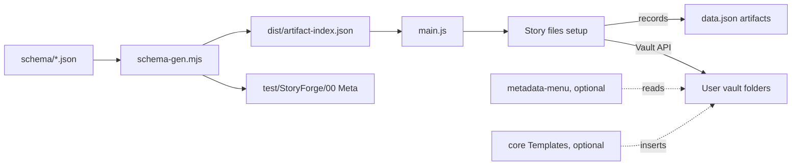
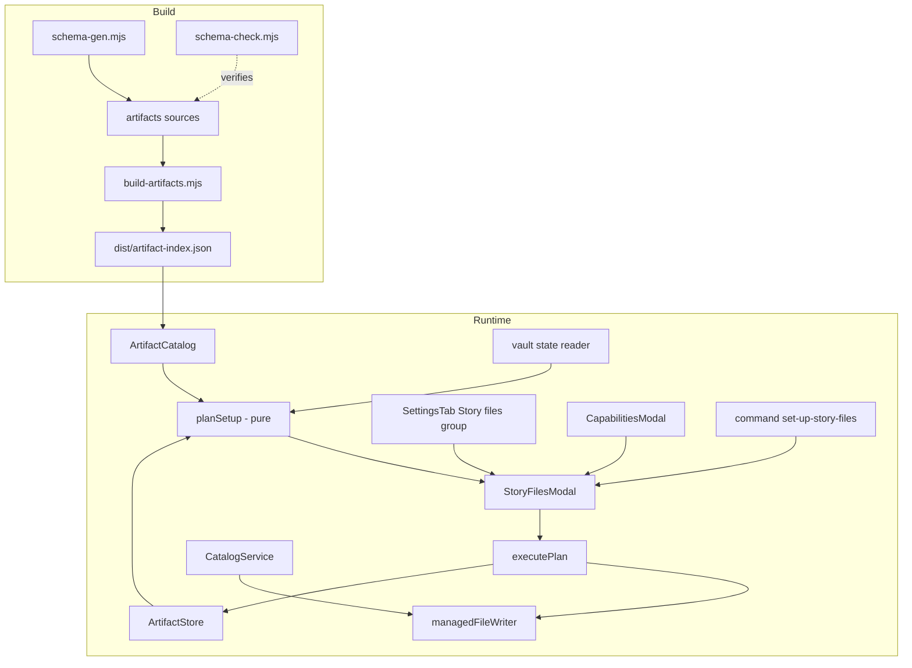
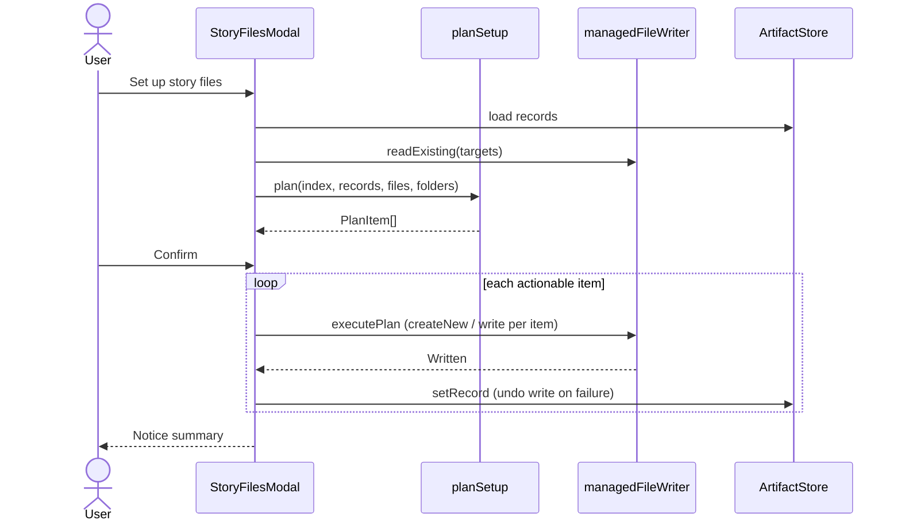

# Solution Design Document

## Validation Checklist

### CRITICAL GATES (Must Pass)

- [x] All required sections are complete
- [x] No [NEEDS CLARIFICATION] markers remain
- [x] All context sources are listed with relevance ratings
- [x] Project commands are discovered from actual project files
- [x] Constraints → Strategy → Design → Implementation path is logical
- [x] Every component in diagram has directory mapping
- [x] Error handling covers all error types
- [x] Quality requirements are specific and measurable
- [x] Every quality requirement has test coverage
- [x] **All architecture decisions confirmed by user**
- [x] Component names consistent across diagrams
- [x] A developer could implement this design

### QUALITY CHECKS (Should Pass)

- [x] Architecture pattern is clearly stated with rationale
- [x] Integration points with external systems are documented
- [x] Data storage changes are specified
- [x] Cross-cutting concerns are addressed
- [x] Risks are identified with mitigations
- [x] Implementation gotchas are documented

---

## Constraints

- **CON-1 Three files only.** A Community Plugins install delivers `main.js`, `manifest.json`,
  `styles.css`. Every shipped artifact is bundled into `main.js`; nothing is fetched at runtime.
- **CON-2 Public API only.** No `app.internalPlugins`, no private settings of the core Templates
  plugin (standing rule).
- **CON-3 Vault API for vault files.** Files in the vault are written with `Vault.create`,
  `Vault.process`/`modify` and `Vault.createFolder`, not `vault.adapter` (review expectation).
  `adapter` stays allowed for files in the plugin directory (`undo-journal.json`).
- **CON-4 Nothing writes unasked.** Load, enable and update write no vault file (PRD Rule 1).
- **CON-5 Two invariants.** Story data → frontmatter only. Setup bookkeeping → `data.json`
  (operational state), never a note.
- **CON-6 Mockup gate.** The settings group, the setup dialog and the capability-screen pointer
  are drawn in `mockups.html` and signed off before UI code.
- **CON-7 Scanner-clean.** The release passes `eslint-plugin-obsidianmd`'s community scanner
  configuration with zero errors.
- **CON-8 Schema is canonical.** `schema/*.json` stays the only source; all vault artifacts and
  the shipped index are generated from it (`docs/schema-change-runbook.md`). `_forge` is told
  about the schema text changes (folder-free descriptions, neutral `gender`).

## Implementation Context

### Required Context Sources

#### Documentation Context

```yaml
- doc: docs/XDD/specs/010-ship-vault-artifacts/requirements.md
  relevance: CRITICAL
  why: The PRD this design implements (7 Must features)
- doc: docs/XDD/adr/0003-generated-bases-two-checksums.md
  relevance: CRITICAL
  why: Source checksum + instance checksum + stored params — the record model reused here
- doc: docs/schema-change-runbook.md
  relevance: HIGH
  why: How schema edits ripple into generated artifacts
- doc: docs/XDD/specs/008-codex-surface/solution.md
  relevance: MEDIUM
  why: ADR-35 (single artifact copy), catalog install/update and refusal wording
- doc: docs/gap-analysis.md (G25, G14, G4)
  relevance: MEDIUM
  why: The gaps this closes; G4 text is stale and is updated
- url: https://github.com/obsidianmd/eslint-plugin (Community plugin scanner configuration)
  relevance: HIGH
  why: The rules the directory's automated review runs
- url: https://docs.obsidian.md/Plugins/Releasing/Plugin+guidelines
  relevance: HIGH
  why: Vault API, normalizePath, disclosure rules
```

#### Code Context

```yaml
- file: scripts/schema-gen.mjs
  relevance: CRITICAL
  why: Generators for FileClasses, templates, schema notes; gains index emission
- file: scripts/schema-check.mjs
  relevance: CRITICAL
  why: Drift gate; becomes a content comparison and joins CI
- file: scripts/build-catalog.mjs
  relevance: HIGH
  why: Model for build-artifacts (exported core, CLI, checksum via jiti, dist output)
- file: src/catalog/CatalogService.ts
  relevance: CRITICAL
  why: Install/update/refusal logic to extract into the shared writer
- file: src/consent/checksum.ts
  relevance: HIGH
  why: computeChecksum (Web Crypto, all platforms)
- file: src/store/ViewStore.ts, src/store/types.ts
  relevance: HIGH
  why: data.json read-modify-write pattern and StoryForgeData shape
- file: src/types/index.ts
  relevance: HIGH
  why: PluginSettings + normalizeSettings; two new folder settings
- file: src/settings/SettingsTab.ts
  relevance: HIGH
  why: Scope tab "Vault folders" group; new "Story files" group
- file: src/library/CapabilitiesModal.ts, src/library/capabilityReport.ts, src/library/capabilitiesWiring.ts
  relevance: MEDIUM
  why: Capability screen ("What Story Forge can use") gains a story files row; the wiring takes getStoryFilesStatus and openStoryFiles
- file: src/fileclass/fileClassVault.ts
  relevance: MEDIUM
  why: Reacts to vault events; newly set-up FileClasses must take effect without reload
- file: src/scoping/workspaceScope.ts, src/codex/collectionResolver.ts
  relevance: MEDIUM
  why: excludedFolders semantics, used for the "not excluded" warning
- file: src/main.ts
  relevance: HIGH
  why: Static index import, command registration, wiring
- file: eslint.config.mts, package.json, .github/workflows/*.yml, .releaserc.json, version-bump.mjs
  relevance: HIGH
  why: Lint/scanner alignment, CI gate, release
```

### Implementation Boundaries

- **Must Preserve:** Catalog install/update behaviour and its refusal wording (tests in
  `test/catalog/`); command ids; view type ids; the dev vault's role as the live-test vault;
  `schema/*.json` as the single source.
- **Can Modify:** schema-gen/schema-check scripts; CatalogService internals (delegating to the
  shared writer); Scope tab layout; template bodies; `schema/*.json` text and defaults covered by
  the PRD; lint configuration; README, PRIVACY, docs.
- **Must Not Touch:** Story data ownership (frontmatter only); `undo-journal.json` mechanics;
  the release workflow's trigger (stays manual).

### External Interfaces

#### System Context Diagram



#### Interface Specifications

```yaml
inbound:
  - name: Command "Set up story files" (id set-up-story-files)
    type: Obsidian command
  - name: Settings → Scope → Story files → "Set up story files…"
    type: Settings UI
  - name: Capability screen pointer
    type: Button/link in CapabilitiesModal

outbound:
  - name: Obsidian Vault API
    calls: getAbstractFileByPath, create, process, createFolder, read
  - name: Plugin data
    calls: loadData/saveData (data.json, key "artifacts")

data:
  - name: dist/artifact-index.json (build-time, bundled)
  - name: data.json → artifacts (runtime records)
```

### Project Commands

```bash
npm run build         # catalog:build + artifacts:build + tsc + esbuild
npm test              # vitest
npm run lint          # eslint (obsidianmd, scanner-aligned) + stylelint
npm run typecheck
npm run schema:gen    # regenerates dev vault artifacts AND the artifact sources
npm run schema:check  # content drift gate (now in CI)
```

## Solution Strategy

- **Architecture pattern:** build-time generation into a bundled, checksummed index; pure
  planning core (`planSetup`) deciding per file; thin vault writer executing a plan; thin UI.
  Same shape as the catalog (build index → service → modal), extended with ADR-0003's
  placeholder resolution.
- **Integration approach:** the generator that already writes the dev vault also emits the
  unresolved sources. The dev vault is "the index resolved with the default folders", so the
  live-test vault and the shipped files cannot drift without the gate failing.
- **Justification:** reuses three proven pieces — schema-gen, the catalog build/import pattern,
  and the catalog's edited/occupied refusals — instead of a parallel system. Placeholders keep
  folder rewriting explicit (no blind search/replace), and the two-checksum record answers
  "did the user edit it?" without markers inside files (EngramQuest lesson).
- **Key decisions:** ADR-38 … ADR-44 below.

## Building Block View

### Components



### Directory Map

```
schema/                                  MODIFY  folder-free descriptions, neutral gender, value-list paths as placeholders
scripts/
├── schema-gen.mjs                       MODIFY  placeholder-aware generators; emits artifact sources; generates Schema/README.md
├── schema-artifacts.mjs                 NEW     pure: render each artifact unresolved (`renderArtifacts`); resolution is src/artifacts/resolvePlaceholders.ts via jiti
├── build-artifacts.mjs                  NEW     artifact sources → dist/artifact-index.json (+ checksums)
└── schema-check.mjs                     MODIFY  content comparison, banned-text scan
src/
├── artifacts/                           NEW
│   ├── artifactTypes.ts                 NEW     ArtifactIndex, ArtifactEntry, ArtifactSet, ArtifactRecord, PlanItem
│   ├── resolvePlaceholders.ts           NEW     {{sf:…}} resolution (shared contract with the script)
│   ├── ArtifactStore.ts                 NEW     data.json "artifacts" read/modify/write + normalisation
│   ├── planSetup.ts                     NEW     pure: index × records × vault state × folders → PlanItem[]
│   ├── executePlan.ts                   NEW     runs a plan via managedFileWriter, records results
│   ├── StoryFilesModal.ts               NEW     setup/update dialog (per-file preview)
│   ├── storyFilesStatus.ts              NEW     summarizeStoryFiles (pure), readStoryFilesStatus (read-only)
│   ├── storyFilesNotice.ts              NEW     pure composeNotice (result notice text and role; PlannedWrite, per-set setLines, unbudgeted, R2)
│   └── storyFilesWiring.ts              NEW     command, getStatus, Library hints (isHintDismissed(kind)/dismissHint(kind); kinds setup (S7a) and updates (R3), id via storyFilesUpdatesHintId(version)), the one settings→folders mapping
├── vault/managedFileWriter.ts           NEW     Vault-API writer: read/occupied/edited checks, write, undo
├── catalog/CatalogService.ts            MODIFY  delegates file IO to managedFileWriter
├── settings/SettingsTab.ts              MODIFY  Scope tab "Story files" group
├── library/CapabilitiesModal.ts         MODIFY  pointer to setup
├── library/capabilitiesWiring.ts        MODIFY  takes getStoryFilesStatus and openStoryFiles
├── scoping/workspaceScope.ts            MODIFY  exports isExcluded
├── types/index.ts                       MODIFY  templatesFolder, schemaFolder
├── store/types.ts                       MODIFY  StoryForgeData.artifacts
└── main.ts                              MODIFY  import index, register command, wire
test/StoryForge/00 Meta/                 REGENERATED  folder-free, {{title}}, neutral defaults, value lists, README
eslint.config.mts, package.json          MODIFY  eslint-plugin-obsidianmd 0.5.1, scanner rules locally
.github/workflows/lint.yml               MODIFY  adds schema:check
README.md, PRIVACY.md, docs/*.md         MODIFY  disclosures, setup docs, #19 docs
```

### Interface Specifications

#### Data Storage Changes

```yaml
data.json:
  settings:                       # PluginSettings, two new keys
    templatesFolder: string       # default "00 Meta/Templates"
    schemaFolder: string          # default "00 Meta/Schema"
    # fileClassesFolder already exists (default "00 Meta/FileClasses")
  artifacts:                      # NEW top-level key, operational state
    "<artifactId>":               # e.g. "fileclass/fc-scene", "template/scene", "schema/scene"
      path: string                # vault path written (normalised)
      sourceChecksum: string      # "sha256:…" of the unresolved source that was installed
      instanceChecksum: string    # "sha256:…" of the bytes actually written
      params: { fileClassesFolder: string, templatesFolder: string, schemaFolder: string }
      pluginVersion: string       # manifest version at write time (diagnostics only)
```

Malformed entries are dropped on load (guard per field, like `normalizeSettings`). A missing
`artifacts` key equals `{}`.

#### Application Data Models

```pseudocode
ArtifactIndex  { version: "1", entries: ArtifactEntry[] }        # no timestamp (deterministic)
ArtifactEntry  { id, set: "fileclasses"|"templates"|"schema", relPath, source, checksum,
                 placeholders: ("fileClassesFolder"|"templatesFolder"|"schemaFolder")[] }

PlanItem {
  entry: ArtifactEntry
  path: string                     # target vault path
  action: "create" | "up-to-date" | "update" | "skip-exists" | "skip-edited"
        | "missing" | "unreadable" | "refused"   # refused: index entry checksum mismatch
  note?: string                    # e.g. "setting now points to <folder>"
  sameContent?: boolean            # skip-exists only: bytes equal the shipped copy; drives the
                                   # dialog's reason line, never claims the file (R1)
}
```

`planSetup` decision table (per entry, folders = current settings):

| Record? | File at record path / target path | Shipped checksum vs record.source | File checksum vs record.instance | Action |
|---|---|---|---|---|
| none | target free | – | – | create |
| none | target occupied | – | – | skip-exists (dialog: "Already there", dimmed, never written or recorded, not in the result notice, R1; executePlan still skips a file that appears between plan and write with "Not installed: … already exists") |
| yes | record path missing | – | – | missing (offered as set up again) |
| yes | present | equal | – | up-to-date |
| yes | present | differs | equal | update |
| yes | present | differs | differs | skip-edited ("Not updated: … was edited") |
| any | read fails | – | – | unreadable (reported, not written) |

A record's path wins over the current folder setting (PRD edge case); when they differ the item
carries the note "setting now points to …".

#### Internal API Changes

```pseudocode
managedFileWriter (src/vault/managedFileWriter.ts):
  # every function takes `app` (trashFile needs app.fileManager)
  readExisting(app, path, prefix) -> { content } | { absent: true } | { refusal }
  ensureFolder(app, folder)                         # creates every missing level
  parentFolderOf(path)
  createNew(app, path, content) -> Written {path, previous: null}   # vault.create; rejects if it exists
  write(app, path, content) -> Written {path, previous}             # process, or createNew if absent
  undo(app, written)                                # restore previous / trash new file; throws on vault error
  checkOccupied(app, path, content, prefix, { adoptIdentical })
  editedRefusal(path, prefix) / occupiedRefusal(path, prefix)
  # CatalogService passes adoptIdentical=true to keep its current behaviour; artifacts never do.

createDataFile(port) -> DataFile { read(), update(syncMutator) }   # one queue for data.json
ArtifactStore(dataFile): load(), get(id), all(), setRecord(id, rec), deleteRecord(id),
  onChange(listener) -> unsubscribe                 # fires after a successful save; listeners isolated

planSetup(index, records, readFile, folders, selectedSets) -> Promise<PlanItem[]>
  # readFile(path) -> ArtifactFileRead { kind: "content", text } | { kind: "absent" } | { kind: "unreadable", reason }
executePlan(plan, folders, { app, store, pluginVersion })
  -> { written[], skipped[{path, reason}], failed[{path, reason}] }   # never throws
# create/missing: managedFileWriter.createNew (vault.create, rejects if the file exists);
# update: managedFileWriter.write (process, previous captured, undone on mismatch)
```

```pseudocode
StoryFilesDeps (src/artifacts/StoryFilesModal.ts):
  app, settings() -> StoryFilesSettings, saveFolders(folders)   # confirm only, and only if one changed
  addExcludedFolder(folder)     # D9 button; wiring calls the collection store's setScope([...current, folder])
  store: ArtifactStore, index: ArtifactIndex, pluginVersion
```

#### Integration Points

- **CatalogService → managedFileWriter:** same call order and reason strings, so the catalog
  test suite passes unchanged except for the mocked IO surface (adapter → vault).
- **fileClassVault:** Vault-API writes emit `create`/`modify` immediately, so the FileClass
  cache invalidates without reload.
- **Capability screen:** a row with a button calling the injected `openStoryFiles` callback; the
  capability wiring takes `getStoryFilesStatus` and `openStoryFiles` (both required). It writes
  nothing.
- **fileClassVault count:** `count()` counts notes with frontmatter, so the empty value-list
  notes are left out (8 FileClasses, not 11).
- **Mock `Notice`:** accepts a `DocumentFragment`, as `obsidian.d.ts` does. The result notice
  is built into `messageEl` (`new Notice("")`, then fill `messageEl`): a fragment built in one
  window's realm rendered as an object name after a popout (found live, 2026-11-20).

### Implementation Examples

#### Example: placeholder resolution

```text
source (index):   valuesListNotePath: {{sf:fileClassesFolder}}/fc-armor.md
folders:          { fileClassesFolder: "Story/Classes", … }
resolved (vault): valuesListNotePath: Story/Classes/fc-armor.md
dev vault:        resolved with defaults → 00 Meta/FileClasses/fc-armor.md
```

Rules: placeholders are `{{sf:<name>}}` with `<name>` from a closed list; an unknown name fails
the build; resolution never touches `{{title}}` (core Templates' own placeholder); folder
values are normalised and have no trailing slash; a folder that normalises to empty is an
error (it would turn `{{sf:x}}/a.md` into `/a.md`).

#### Test Examples as Interface Documentation

```pseudocode
planSetup: record present, shipped changed, file unchanged      -> "update"
planSetup: record present, shipped changed, file edited          -> "skip-edited"
planSetup: no record, same bytes already at target               -> "skip-exists", sameContent true (never adopted)
executePlan: second write fails                                  -> first written + recorded,
                                                                    second reported failed, no record
schema-check: dev vault file differs from resolve(index, defaults) -> exit 1
```

## Runtime View

### Primary Flow

#### Primary Flow: set up story files

1. User runs **Set up story files** (command, settings button or capability pointer).
2. `StoryFilesModal` reads settings folders, loads `ArtifactStore`, reads each target with
   `managedFileWriter.readExisting`, calls `planSetup`.
3. Modal shows three set sections (FileClasses, Templates, Schema reference) with folder,
   checkbox, exclusion warning and one row per file with its action.
4. User may change a folder (a preview: the plan is recomputed, nothing is saved) or deselect a
   set; folders are saved only on confirm (O1). A failed recompute restores the previous folder.
5. `executePlan` writes `create`/`update`/`missing` items in order, each followed by a record
   update; skips the rest. The dialog passes a `missing` item only when the user ticked it
   ("set up again"); it is never recreated by default (PRD F4.5). `create` items resolve
   placeholders with the current folders; `update` and `missing` items keep the folders in
   their record (`record.params`), because the file stays at its record path.
6. One Notice: "Set up N story files.", one line per written set and folder (R2), then failed and
   skipped lines (refusal prefixes). "Already there" files (R1) are not listed; only a file
   that appears between plan and write is skipped. Debug log per refusal with `[StoryForge]`.



**Updates available:** the status is one read through `storyFilesStatus` (`readStoryFilesStatus`,
read-only) when the Scope tab is drawn, and again after the dialog closes
(`Modal.setCloseCallback`). It shows "N updates available" when any item is `update` or
`missing`. A folder edit in the Scope tab does not re-read. The button always reads "Set up story
files…" and opens the same modal.

**Library hint slot:** one hint at a time. S7a ("Story files are not set up", while nothing is
set up) wins over R3 ("N story file updates available.", when the status has at least one
update). "Don't show again" (S7a) and "Not now" (R3) store an id in `dismissedHints`; the R3 id
carries the plugin version (`storyFilesUpdatesHintId`), so a later version shows it again.

### Error Handling

| Error | Handling |
|---|---|
| Target read fails | `unreadable`, reported with path, nothing written |
| Folder creation fails | The parent folder of each create/missing item is ensured once; every item under a parent that cannot be created fails; update items never need it; other items proceed |
| Write fails | Item failed, no record, other items proceed (PRD Rule 5) |
| File changed since planning | Re-checked right before writing: occupied (create/missing) or edited (update) → skipped with the refusal; an update whose file vanished → failed |
| File appears between check and write | create/missing: `vault.create` rejects, nothing overwritten, item failed; update: write undone, item failed; an undo failure is appended to the reason |
| Record save fails after a write | Write undone (new file trashed, replaced file restored), item failed |
| Index checksum mismatch at runtime | Entry refused ("checksum mismatch"), fail closed — as the catalog |
| Unknown placeholder | Build fails (`build-artifacts`); never reaches runtime |
| Folder check fails in the dialog | "Could not check <folder>: <reason>. The folder stays <previous>." in the card; previous folder restored |
| Story files cannot be read | "Could not read the story files: <reason>" |
| Folder settings cannot be saved | "Could not save the folder settings: <reason> Nothing was written." |
| Excluded-folder add fails | "Could not add <folder> to excluded folders: <reason>" |
| Status check fails (capability row) | Row reads "Could not check story files" |

The result notice (pure `composeNotice`) has role `status` when it hides itself and `alert` when
it stays (sticky). While confirming, every dialog control is locked; closing with Escape
mid-write does not stop the write, and the result notice still reports it.

### Complex Logic

The decision table above is the whole logic; it lives in the pure `planSetup` and is
table-tested row by row, each row mutation-checked.

## Deployment View

### Single Application Deployment

- `npm run build` runs `catalog:build`, then `artifacts:build`, then tsc and esbuild; the index is
  inlined into `main.js` like `catalog-index.json`. Size budget: index ≤ 200 KB.
- Release: manual `release.yml` workflow (semantic-release, tag `0.2.0`, no `v`, assets
  `build/main.js`, `manifest.json`, `styles.css`, attestations). Preceded by
  `npx semantic-release --dry-run`. The repository is made public by the maintainer first.
- No runtime network access; works on desktop and mobile.

## Cross-Cutting Concepts

### Pattern Documentation

```yaml
- pattern: Build-time index bundled via static JSON import (catalog-index.json)
  relevance: CRITICAL
- pattern: ADR-0003 two checksums + stored params
  relevance: CRITICAL
- pattern: Pure model → thin renderer → host (spec 008)
  relevance: HIGH
- pattern: Refusal prefixes "Not installed:" / "Not updated:" (spec 008 L10f); in setup they come
  from executePlan only, since a file already there is not a refusal but an "Already there" row (R1)
  relevance: HIGH
- pattern (new): managedFileWriter — the one place that writes vault files on the user's behalf
  relevance: HIGH
```

### User Interface & UX

Drawn in `docs/XDD/specs/010-ship-vault-artifacts/mockups.html` and signed off before UI code
(CON-6). States to draw:

- **S1** Scope tab "Story files" group: Templates folder, Schema folder (FileClasses folder stays
  in "Vault folders"), "Set up story files…" button, status line (not set up / up to date /
  N updates available / N missing).
- **S2** Setup dialog, fresh vault: three sets, all "create".
- **S3** Setup dialog, mixed: up to date, update, skip-exists ("Already there"), skip-edited, missing.
- **S4** Folder not excluded warning.
- **S5** Result notice (written + skipped + failed).
- **S6** Capability screen row; the screen is named "What Story Forge can use" (O7).
- **S7a** Library hint "Story files are not set up" with "Don't show again" (id
  `story-files-not-set-up` in `dismissedHints`, data.json), re-read after the dialog closes.
- **R1** "Already there" rows: dimmed, reason line (same content / your own file), disabled set
  checkbox when all files are there; not in the result notice.
- **R2** Result notice with one line per written set and folder.
- **R3** Library hint "N story file updates available." with "Review updates…" and "Not now"
  (id per plugin version).
- **O9** The metadata-menu row has a Properties-panel bullet (checked live in T3.5).

### System-Wide Patterns

- **Security:** no code is written into the vault (FileClasses, templates, notes are inert
  Markdown); no network.
- **Error handling:** results, never throws to the UI (as `CatalogService.install`).
- **Logging:** `console.debug` with `[StoryForge]` per refusal; no `console.log`.
- **Sentence case:** UI text sentence case; "FileClasses" handled as a brand in the lint
  configuration, not by disable comments.

## Architecture Decisions

- [x] **ADR-38 Artifact index built from schema-gen with placeholders.**
  - Choice: schema-gen renders every artifact unresolved with `{{sf:<folder>}}` placeholders;
    `build-artifacts.mjs` writes `dist/artifact-index.json` (entries with set, relPath, source,
    sha256 checksum, placeholders; no timestamp); `src/artifacts/artifactIndex.ts` imports it statically and `main.ts` uses that module (wired in T2.7). The dev vault
    receives the same sources resolved with default folders. `Schema/README.md` becomes
    generated.
  - Rationale: one source; explicit, testable folder rewriting; same build pattern as the
    catalog.
  - Trade-offs: schema-gen grows a second output; template bodies, hand-kept today, move into the
    generator's inputs (a `schema/templates/` body per template) so they ship too.
  - User confirmed: Yes (2026-11-18)

- [x] **ADR-39 Content drift gate in CI.**
  - Choice: `schema:check` compares dev vault files byte-for-byte with `resolve(index, defaults)`,
    compares the index with a fresh build, scans shipped sources for banned text (`00 Meta/`,
    `30 Canon`, `10 Manuscript`, `20 Planning`, `95 Assets`, `%title%`, `%name%`, `"Forge"`), and
    runs in `lint.yml` after `npm run build`. The index-vs-fresh-build comparison needs
    `dist/artifact-index.json` and is skipped when it is absent; the dev-vault comparison, which
    enforces PRD F1.4, never needs `dist/`.
  - Rationale: today the gate compares property sets only and is not in CI.
  - Trade-offs: stricter gate makes schema edits require `schema:gen` every time (intended).
  - User confirmed: Yes (2026-11-18)

- [x] **ADR-40 Install records in `data.json` under `artifacts`.**
  - Choice: new top-level key with `{path, sourceChecksum, instanceChecksum, params,
    pluginVersion}` per artifact id, behind `ArtifactStore` (read-modify-write, field guards,
    malformed entries dropped).
  - Rationale: operational state (CON-5); not a ViewRecord (the Library/ConsentGate must not see
    it); not a setting.
  - Trade-offs: data.json read-modify-write by three writers (settings, views, artifacts) can lose
    an update when two run at once; mitigated by serialising saves (see Gotchas).
  - User confirmed: Yes (2026-11-18)

- [x] **ADR-41 Shared `managedFileWriter` on the Vault API; catalog migrates to it.**
  - Choice: extract read/occupied/edited checks, folder creation, write and undo from
    CatalogService into `src/vault/managedFileWriter.ts`, using `getAbstractFileByPath`,
    `create`, `process`, `createFolder`, `trashFile`. CatalogService delegates; it keeps its
    "adopt an identical file" rule as an option, artifacts never adopt (PRD Rule 2).
  - Rationale: reviewer expectation (CON-3); one writer for every user-requested vault write;
    immediate vault events for fileClassVault.
  - Trade-offs: catalog tests switch their IO mocks from adapter to vault.
  - User confirmed: Yes (2026-11-18)

- [x] **ADR-42 UI: Scope tab group, setup dialog, command, capability pointer.**
  - Choice: "Story files" group in the Scope tab (two folder settings, button, status line);
    command `set-up-story-files` / "Set up story files"; `StoryFilesModal` with per-file preview
    and a warning for folders not covered by `excludedFolders`; pointer on the capability screen
    (named "What Story Forge can use", O7); a Library hint with "Don't show again" (S7). Mockups
    signed off first; S7 and the rename signed off 2026-11-20.
  - Rationale: folders already live in Scope; one dialog for setup and update.
  - Trade-offs: the update status is computed when the Scope tab is drawn (cheap: ~25 reads).
  - User confirmed: Yes (2026-11-18; S7 and the O7 rename 2026-11-20)

- [x] **ADR-43 Neutral, folder-free artifact content.**
  - Choice: FileClasses match by `tagNames` only (`filesPaths` emitted empty), `fc-lore` queries by tag;
    templates use `{{title}}`, `series` empty (no `"Forge"` preset), no `gender` preset, `status` first list value;
    schema descriptions drop folder prescriptions and `95 Assets` examples; the three value
    lists ship empty with the FileClass set; the dev vault follows the same content.
  - Media fields are generated with metadata-menu's full default options (`embed` false,
    `folders` [], `display` card, `thumbnailSize` "100"), because metadata-menu 0.8.12's
    FileClass form fails on a missing `folders` (96b553f, handed to _forge).
  - Rationale: works in any layout; dev vault = shipped content (ADR-38).
  - Trade-offs: the dev vault loses folder-based FileClass matching (unused: classification is
    by `fileClass` key, then tag); `_forge` must be told about the schema text changes.
  - User confirmed: Yes (2026-11-18)

- [x] **ADR-44 Scanner-aligned lint and release 0.2.0.**
  - Choice: upgrade `eslint-plugin-obsidianmd` to 0.5.1, run its scanner rule set in
    `npm run lint`; remove sentence-case disables (Timeline, Plotlines, Plotgrid, FileClasses as
    brands from a local list, "Open board" in sentence case), add reasons to remaining disables,
    remove `no-explicit-any` disables; README and PRIVACY disclose vault writes, frontmatter
    writes, DataviewJS execution and no network; first release 0.2.0 via the manual workflow
    after a dry run; repository made public and release triggered by the maintainer.
  - Rationale: PRD Feature 6, CON-7; 0.2.0 is what semantic-release computes and what the
    manifest carries.
  - Trade-offs: touches many files outside the feature (lint cleanup); kept in its own phase.
  - User confirmed: Yes (2026-11-18)

## Quality Requirements

- **Safety:** zero overwritten user files — every row of the decision table has a test;
  each new test mutation-checked.
- **Determinism:** two builds from the same sources produce byte-identical indexes.
- **Size:** artifact index ≤ 200 KB; `main.js` growth reported in the PR.
- **Performance:** planning ~25 files completes in < 200 ms on desktop.
- **Compliance:** scanner configuration reports 0 errors; `npm run lint` clean.
- **Portability:** shipped sources contain no banned text (ADR-39).

## Acceptance Criteria

- Given the index, When resolved with default folders, Then each file equals the dev vault file
  byte for byte (PRD F1, F5).
- Given each row of the planSetup table, When planned, Then the action is that row's action
  (PRD F4).
- Given a non-owned identical file, When setup runs, Then the dialog shows it as
  "Already there" (`sameContent` true), it is never written or recorded, and it is not in the
  result notice (PRD F4 Rule 2, R1).
- Given a record save failure, When executing, Then the write is undone (PRD Rule 5).
- Given the plugin loads, When no user action happens, Then no vault write occurs (PRD F2).
- Given the scanner configuration, When run on the release source, Then 0 errors (PRD F6).
- Given CatalogService on the shared writer, When the catalog suite runs, Then it passes with
  unchanged expectations (Must Preserve).

## Risks and Technical Debt

### Known Technical Issues

- `data.json` is written by read-modify-write from several places (`saveSettings`, ViewStore);
  concurrent saves can drop a change today.
- `fileClassVault.ts:180` scans `getMarkdownFiles()` by basename as a fallback.
- `gap-analysis.md` G4 lists settings that no longer exist.

### Technical Debt

- 116 `prefer-create-el` and 11 `prefer-instanceof` scanner warnings remain (warnings, not
  errors); tracked separately.
- The dialog's folder suggester is not closed when the dialog closes: `attachFolderSuggest`
  (`src/settings/suggesters.ts`) returns no handle. Its input is removed with the dialog content.
- `obsidian` typings (1.13.1) are newer than `minAppVersion` (1.12.7).

### Implementation Gotchas

- **Serialise data.json saves.** ArtifactStore must not interleave with ViewStore/settings
  saves; route all three through one save queue (or the store re-reads inside a single critical
  section). Add a test that two concurrent saves keep both changes.
- **`{{title}}` is not ours.** The resolver must ignore every `{{…}}` that is not `{{sf:…}}`.
- **Template bodies** are hand-kept today (schema-gen preserves existing bodies); moving them
  into generator inputs must keep the meta-bind `VIEW[...]` lines exactly.
- **Vault API and folders:** `createFolder` fails if the folder exists — check first; create
  every missing level.
- **Records outlive settings:** a record's path wins over the current folder setting.
- **Excluded folders** use path-segment prefix match; the warning must use the same function
  (`isExcluded`) as the scopes, and per-collection overrides (`builtInCollections[id]
  .excludedFolders`) mean the warning is "not excluded by default".
- **Catalog adoption rule** (identical bytes adopted) must stay for the catalog only.
- **semantic-release** jumps to 1.0.0 on any `BREAKING CHANGE` footer — dry run first.

## Glossary

### Domain Terms

| Term | Definition | Context |
|------|------------|---------|
| Story files | The shipped FileClasses, templates and schema reference notes | User-facing name of the artifacts |
| Artifact set | One of FileClasses, Templates, Schema reference | Unit of selection in the dialog |
| Set up | Write story files into the vault on request | Command and button wording |

### Technical Terms

| Term | Definition | Context |
|------|------------|---------|
| Artifact index | `dist/artifact-index.json`, bundled into main.js through `src/artifacts/artifactIndex.ts` | ADR-38 |
| Placeholder | `{{sf:<folder>}}` in a shipped source, resolved at setup | ADR-38 |
| Source checksum | sha256 of the unresolved source | ADR-0003, ADR-40 |
| Instance checksum | sha256 of the bytes written to the vault | ADR-0003, ADR-40 |
| managedFileWriter | Shared Vault-API writer for user-requested files | ADR-41 |
| Scanner configuration | eslint-plugin-obsidianmd rule set the directory review runs | ADR-44 |
